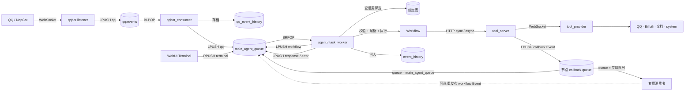

# AAgent 功能全景

> 类型:审计报告。
> 性质:现行文档。
> 归属:跨服务。
> 适用版本:平台 `4.0.0+`。

> 本文档由**代码级审计**产出：逐文件通读 `agent/`、`webui_py/`、`manager_webui/`、`workflow_editor/`、`tool_server/`、`tool_provider/`、`qqbot/`、`qqbot_consumer/` 与部署配置，把每一个功能、每一个 API、每一个按钮与交互、每一个配置项、每一处可插拔边界逐条登记。
>
> 原则：**以源码为准**。凡与 `docs/` 下的设计文档冲突，本文档记录代码事实，并在第 07 章登记漂移。引用一律给出 `文件路径:行号`。
>
> 生成方式：分七个领域并行审计后合并；每个领域独立成章，可单独阅读。

## 文档说明与局限（请先读这一节）

**怎么读。** 9 个 `#` 级章节（第 0 章为总览，第 01–08 章为分领域清点）。每章自带"扩展槽"与"已知缺陷"小节；第 08 章专门收录**跨越两个以上子系统**、且经父代理逐行复核的问题——**只关心"哪些坑是真会炸的"，直接看第 08 章**。

**确定性的三个层次。** 本文档内容并非同一置信度，请按下列标记区分：

| 层次 | 含义 |
| --- | --- |
| 第 01–07 章 | 各领域审计员逐文件通读产出，结论带 `文件:行号`，但**多数未由第二方复算** |
| 第 08 章 | 父代理**亲自打开源码逐行复核**过的跨子系统结论；§8.14 列出了复核清单与未复核项 |
| 标注"既有报告" | 已被 `docs/审查日志/`（含其 `归档/`）登记过的**已知**问题，不是本轮新发现；第 08 章 §8.11 给了新旧对照表。**这些历史报告均已归档，行号引用规则见上文「引用约定」** |

**最重要的两条阅读警告**：

1. **本文档全程是静态阅读，没有运行过任何测试或容器。** 本次审计期间 PowerShell 被 Windows 文件权限挡住（工作区授权写入 `D:\AAgent` 失败），因此所有"后果"都由代码路径推导而来，不是实测结果。项目自己的 `docs/审查日志/归档/2026-10-11-全项目-审查报告.md`（**已归档**）是在容器内跑过测试的快照（agent 90 用例中 3 例红、tool_server 7 例全绿、manager_webui 17 例全绿），两者的独立一致性是本文档最大的可信度来源。
2. **`docs/` 下的部分文档已经过期，不要照它们排查。** 最严重的一例：整套 System Prompt / 设置功能（`GET/POST /api/settings`、`aagent:settings`、`agent/settings.json`）**已从代码中整体移除**，但 `docs/webUI/前端API格式.md` 仍在详细描述它（另有 `docs/审查日志/归档/架构问题汇总.md` 的 A-09 等**已归档**条目同样只剩历史意义）。详见第 08 章 §8.8。

**关于中间稿。** `docs/功能全景/_sections/` 下是各章的独立草稿（含编号为 `09-` 的跨章草稿，成稿中为第 08 章）。成稿即本文件，草稿目录仅为追溯来源保留。

---

## 引用约定（本文引用审查日志时怎么读）

本文多处引用 `docs/审查日志/` 下的**历史**审查/审计报告。该目录在本轮审计前后做过一次重整：全部历史快照与旧问题汇总**已移入 `docs/审查日志/归档/`**，根目录副本已删除；根目录现在只保留两份现行文档。

| 本文出现的写法 | 实际指向 | 注意 |
| --- | --- | --- |
| `归档/2026-10-11-全项目-审查报告.md:27-33` 等 | `docs/审查日志/归档/…` | **行号是归档件自身的行号**。归档说明声明"归档里的 `file:line` 全部作废"，指的是**重构前的旧行号**；下文引用的行号已逐条按归档件正文复核 |
| `汇总报告` | `docs/审查日志/汇总报告.md` | **当前唯一的问题清单**（52 条）。查"现在要修什么"只看它 |
| `核验报告` | `docs/审查日志/核验报告.md` | 历史 221 条问题的逐条判定（STILL / FIXED / GONE / MOVED）与当前 `file:line` |
| `架构问题汇总` | `docs/审查日志/归档/架构问题汇总.md` | **已归档**。其 A-01～A-11 中有 2 条（A-03、A-09）已随重构消失、不再需要决策；其余 9 条仍成立，见 `汇总报告` §5 |

> 换句话说：**本文引用的历史报告都在 `归档/` 下、只用于追溯来源；"当前还有哪些问题"以 `汇总报告` 为准，"某个历史条目现在还算不算问题"以 `核验报告` 为准。**

## 阅读指南

| 你想知道 | 直接看 |
| --- | --- |
| 这个系统到底有哪些进程、怎么连起来 | 第 0.2 节 服务拓扑 · 第 06 章 事件源适配器与基础设施 |
| 一条消息从进入到出结果走了什么路 | 第 0.3 节 端到端数据流 |
| Workflow 能编排哪些节点、端口怎么连 | 第 0.4 节 节点与端口能力矩阵 · 第 04 章 Workflow 编辑器 |
| 每个页面有哪些按钮、点了会发生什么 | 第 02 章（:8081）· 第 03 章（:8084）· 第 04 章（:8082）· 第 05 章 控制台控件表 |
| 怎么接一个新的聊天平台 / 新事件源 | 第 06 章 扩展槽 · 第 0.4 节事件信封 · 第 08 章 §8.4 |
| 怎么加一个新工具 | 第 05 章 扩展槽（E2）· `tool_provider/README.md` |
| 长任务续跑 / 异步回调怎么接 | **第 08 章 §8.15** · 第 06 章扩展槽 4 |
| 怎么加一种新节点类型 | 第 01 章 扩展槽 · 第 04 章 扩展槽（**前后端各要注册一次**） |
| 跨子系统的坑（"前端能造、后端必崩"那一类） | **第 08 章 跨章交叉发现** |
| 本文引用的"审查日志/某份报告"到底指哪个文件、行号可不可信 | **引用约定**（本节上方）· `汇总报告` · `核验报告` |
| 项目还有哪些没做完、有哪些已知坑 | 第 07 章 未实现与路线图全表（82 项） |
| 哪些文档已经过期、不能信 | 第 07 章 文档与实现漂移 · 第 08 章 §8.8 |

### 文档结构

| 章 | 覆盖范围 | 源码根 |
| --- | --- | --- |
| 0 | 概述、服务拓扑、端到端数据流、节点与端口能力矩阵、术语表 | 全局 |
| 1 | Agent 运行时：Workflow 校验/解析/执行、节点实现、契约、仓库、LLM | `agent/` |
| 2 | Agent WebUI：事件流、终端、事件绑定 | `webui_py/` |
| 3 | 管理 WebUI：Workflow、文档、模型、Session、事件目录 | `manager_webui/` |
| 4 | Workflow 可视化编辑器：画布、连线、Inspector、序列化 | `workflow_editor/` |
| 5 | 工具平台：Tool Server 注册/调用/任务/回调 + Provider 与内置工具 | `tool_server/`、`tool_provider/` |
| 6 | 事件源适配器（QQ / OneBot）与部署配置、环境变量、存储键 | `qqbot/`、`qqbot_consumer/`、compose |
| 7 | 设计目标态、未实现项（82）、显式扩展槽清单（67）、文档漂移 | `docs/` |
| 8 | **跨章交叉发现**：经父代理逐行复核的跨子系统缺陷 | 全局 |

---

## 0.1 系统定位

以 **事件驱动 + Workflow 画布** 为中心的个人 Agent 平台。三类横向扩展轴：

| 轴 | 扩展对象 | 对接契约 | 是否需要改执行器 |
| --- | --- | --- | --- |
| 输入 | 事件源适配器 | 产出标准 Event 写入主队列 | 否 |
| 编排 | Workflow 节点 | `agent/workflow_contract.py` 的节点/端口/类型表 | 是（新增节点类型） |
| 能力 | Tool Provider / 工具 | Tool Server 注册协议 | 否 |

QQ 与 WebUI Terminal 只是当前已实现的两个事件源；`README.md:10` 明确它们不是系统入口的固定边界。

## 0.2 服务拓扑

| 服务 | 端口 | 入口文件 | 角色 | 有状态 |
| --- | --- | --- | --- | --- |
| `webui_py` | 8081 | `webui_py/main.py` | Agent WebUI：事件流 / 终端 / 事件绑定 | 否（读写 Redis+Mongo） |
| `workflow_editor` | 8082 | `workflow_editor/main.py` | Workflow 可视化编辑器，只导出 JSON | 否（无持久化） |
| `tool_server` | 8083 | `tool_server/main.py` | 工具注册、调用、任务状态、回调投递 | 是（Redis + Mongo） |
| `manager_webui` | 8084 | `manager_webui/main.py` | 管理面：Workflow / 文档 / 模型 / Session / 事件目录 | 否（读写 Mongo） |
| `agent` | — | `agent/task_worker.py` | 主队列消费者，Workflow 执行器 | 是（Mongo 历史） |
| `qqbot` | — | `qqbot/listener.py` | OneBot WebSocket 接入 → QQ 队列 | 否 |
| `qqbot_consumer` | — | `qqbot_consumer/queue_consumer.py` | QQ 事件存档 → 筛选转发主队列 | 是（Mongo） |
| `tool_provider` | — | `tool_provider/main.py` | 工具实际执行方，WebSocket 注册到 Tool Server | 否 |
| `redis` / `mongodb` | dev 下暴露 | — | 队列与存储 | 是 |

## 0.3 端到端数据流



### 队列方向与顺序（`docs/20-Event协议与流转.md:29-53`）

| 队列 | 默认键名 | 入队 | 出队 | 实际顺序 |
| --- | --- | --- | --- | --- |
| QQ 输入队列 | `qq:events` | `LPUSH` | `BLPOP` | **LIFO**，后到先处理 |
| 主队列 · 普通 | `main_agent_queue` | `LPUSH` | `BRPOP` | **FIFO** |
| 主队列 · 终端入队 | `main_agent_queue` | `RPUSH` | `BRPOP` | **插队**，当前任务结束后优先取出 |
| 回调队列 | 由节点 `callback.queue` 指定，**可以就是 `main_agent_queue`** | `LPUSH` | 主 worker `BRPOP`（配绑定）或专用消费者 `BLPOP` | 视队列而定 |

四个容易踩的点：

1. `qq:events` 是 LIFO 不是 FIFO（`README.md:94`、`docs/20-Event协议与流转.md:39`）。
2. Terminal 的 `terminal` Event 有插队优先级，但它派生出的 `workflow` Event 走普通 `LPUSH`，**不继承**该优先级（`docs/20-Event协议与流转.md:284`）。
3. 异步工具回调**可以**写 `main_agent_queue`，而且这是最省事的做法：给 `async_result` 建**一条启用绑定**，主 worker 的通用绑定路由就会把它变成 `workflow` 事件（`agent/task_worker.py:46-53`），**不需要新容器**。节点侧只要把 `callback.queue` 设成 `main_agent_queue`（投递代码按该字段走，`tool_server/main.py:57,141`）。
   > `README.md:98`、`docs/20-Event协议与流转.md:247` 说"主 worker 没有 `async_result` handler，所以不能写主队列"——这是**旧架构残留**，见 §8.15。
4. 只有当你**确实要另起一个消费者**时，才必须换队列：`agent` 用 `BRPOP` 占着 `main_agent_queue`（`agent/queue_client.py:65`），对**同一** List 再加 `BLPOP/BRPOP` 会与它抢事件。第 3 点的路线本来就不需要额外消费者，所以不受此限。

### Event 类型表（`docs/20-Event协议与流转.md:68-80`）

| `event_type` | 生产者 | 消费者 | 作用 | 参与绑定路由 |
| --- | --- | --- | --- | --- |
| `qq` | QQ listener（经 consumer 筛选） | 主 worker | 命中绑定时透传 payload 并发布 `workflow` | 是 |
| `terminal` | WebUI `POST /api/terminal` | 主 worker | 同上 | 是 |
| `workflow` | 主 worker 绑定路由 | 主 worker | 按 `payload.workflow_id` 执行 Workflow | 否（内部） |
| `response` | `workflow` handler | 主 worker | 最终输出写历史 + 终端历史接口 | **是**（与文档声明相反，见 §8.7） |
| `error` | `workflow` handler | 主 worker | 目标 Workflow 不存在时记错误 | **是**（同上，见 §8.7） |
| `async_result` | Tool Server callback | 主 worker（需一条启用绑定，见 §8.15）或专用消费者 | 异步工具终态通知 | **是** |
| `raw` | WebUI 展示层 | — | **仅展示用**，无法解析为 JSON 对象时的包装类型，不是 worker 协议 | 否 |

Event 信封（`docs/20-Event协议与流转.md:13-27`）：

```json
{"event_type": "workflow", "payload": {"workflow_id": "..."}}
```

- `event_type` 决定主 worker 调用哪个 handler；`payload` 承载数据。
- 出队后主 worker **复制** Event、追加 UTC `created_at`，再写 MongoDB（Mongo 自动生成 `_id`）。
- `terminal` 生产者额外写顶层 `time`，主 worker 不读它。
- **未绑定的 Event 只写历史，不发布后续 Event**；绑定查询出错算处理错误，不算未绑定。

## 0.4 节点与端口能力矩阵

> 唯一权威来源：`agent/workflow_contract.py`。前端 `workflow_editor/static/workflow/domain/node-contract.js:9-26` 维护同一份清单。

### 数据类型（`agent/workflow_contract.py:8-16`）

`content` · `message` · `event` · `list-content` · `list-message` · `list-event` · `map-content`

`list-*` 由 `list_type_for_item()`（`workflow_contract.py:88-89`）按 `item_type` 动态拼出；列表节点的 `item_type` 决定它实际能连哪条 `list-*` 边。

### 24 种节点

| # | 节点 type | 控制入 | 控制出 | 数据入 | 数据出 | 私有参数 |
| --- | --- | --- | --- | --- | --- | --- |
| 1 | `input` | — | `control-out` | — | `workflow:<边界端口>` | — |
| 2 | `output` | `control-in` | — | `workflow:<边界端口>` | — | — |
| 3 | `router` | `control-in` | 每个 `branches[].id` | `content-in` | — | `branches` |
| 4 | `llm` | `control-in` | `control-out` | `messages-in` | `output` (+`reasoning`、`tool_calls`) | `model` `think` `tool_calls` `tools` |
| 5 | `construct_message` | `control-in` | `control-out` | `content-in` (+`role-in`) | `message-out` | `role` `role_source` |
| 6 | `construct_content` | `control-in` | `control-out` | 声明的 `dataInputPorts` | `content-out` | `append_items` |
| 7 | `construct_map_content` | `control-in` | `control-out` | 声明的 `dataInputPorts` | `map-out` | `mappings` |
| 8 | `map_content_get` | `control-in` | `control-out` | `map-in` `key-in` | `content-out` | — |
| 9 | `split_event` | `control-in` | `control-out` | `event-in` | `type-out` `payload-out` | — |
| 10 | `deserialize_json` | `control-in` | `control-out` | `content-in` | 每个 `outputs[].key` | `outputs` |
| 11 | `construct_list` | `control-in` | `control-out` | 声明的 `dataInputPorts` | `list-out` | `item_type` `initial_value_count` |
| 12 | `list_append` | `control-in` | `control-out` | `list-in` `item-in` | `list-out` | `item_type` `position` |
| 13 | `foreach` | `control-in` `loop-in` | `control-out` `loop-out` | `list-in` | `item-out` | `item_type` |
| 14 | `history` | `control-in` | `control-out` | 声明的 `dataInputPorts` | `events` | `event_types` `limit` |
| 15 | `local_tool` | `control-in` | `control-out` | 参数名同名端口 | `output` | `tool` `parameters` |
| 16 | `remote_sync_tool` | `control-in` | `control-out` | 参数名同名端口 | 每个 `outputs[].name` | `tool` `parameters` `outputs` `timeout_ms` |
| 17 | `remote_async_tool` | `control-in` | `control-out` | 参数名同名端口 | `task_id` | `tool` `parameters` `timeout_ms` `callback` |
| 18 | `context_create` | `control-in` | `control-out` | `initial-value` | `context-id` | `value_type` |
| 19 | `context_read` | `control-in` | `control-out` | `context-id` | `value-out` | `value_type` |
| 20 | `context_write` | `control-in` | `control-out` | `context-id` `value-in` | `context-id` `value-out` | `value_type` |
| 21 | `session_create` | `control-in` | `control-out` | `initial-value` | `session-id` | `value_type` |
| 22 | `session_read` | `control-in` | `control-out` | `session-id` | `value-out` | `value_type` |
| 23 | `session_write` | `control-in` | `control-out` | `session-id` `value-in` | `session-id` `value-out` | `value_type` |
| 24 | `workflow` | `control-in` | `control-out` | `workflow:<input_ports>` | `workflow:<output_ports>` | `workflow_name` |

`foreach` 是唯一有**两个控制入 / 两个控制出**的节点：`control-*` 走顺序，`loop-*` 走迭代回边（`workflow_contract.py:226-227`），这是画布上唯一合法的成环写法。

### 节点通用字段（`workflow_contract.py:44-50`）

- 基础字段：`id` `type` `name` `x` `y` `arguments`
- 共享字段：`workflowPorts` `dataInputPorts` `input_ports` `output_ports`

### 连接合法性

后端在 `is_valid_connection()`（`workflow_contract.py:231-354`）逐条判定，前端在 `connection-rules.js` 维护等价规则。语义要点：

1. 控制边与数据边是两套端口集合，`connection_type == "control"` 时只查控制端口（`:251-254`）。
2. 数据边类型必须落在 7 种 `DATA_CONNECTION_TYPES`（`:255-256`）。
3. **边界端口强类型**：`input` 节点出、`output` 节点入、`workflow` 子节点两端的边类型必须等于该边界端口声明的 `type`（`:261-276`）。
4. **工具节点参数化类型**：工具入参端口名 = 参数名，边类型必须等于 `parameters[].type`；出参同理查 `outputs[].type`（`:277-280`）。
5. **Context/Session 值类型**：`value_type` 决定 `value-in` / `initial-value` / `value-out` 的边类型；`context-id` 与 `session-id` 恒为 `content`（`:281-293`）。
6. **列表族**：`construct_list` / `list_append` / `foreach` 的边类型由 `item_type` 动态推导（`:334-351`）。
7. **LLM 特例**：`tool_calls` 出边必须是 `list-content`（`:352`）。

> 任一步抛 `KeyError` / `StopIteration` / `TypeError` 都直接判非法连接（`:353-354`）——即"模型里缺字段"表现为"连不上线"，而不是崩溃。

---

## 0.5 术语表

| 术语 | 含义 |
| --- | --- |
| Event | 队列里的标准消息单元，含 `event_type` 与 `payload` |
| 主队列 | `main_agent_queue`，agent 的唯一输入 |
| Handler | agent 内按 `event_type` 分发的处理函数 |
| Workflow | 画布导出的 JSON 图，绑定到事件后执行 |
| 绑定 | 事件类型 → Workflow 的映射，由 WebUI 维护 |
| Context | Workflow 内可变状态，Redis 承载，随执行生命周期 |
| Session | 跨 Workflow 持久状态，可被多个 Workflow 读写 |
| Tool Server | 工具注册与调用中心，负责等待、状态与回调 |
| Provider | 工具的实际执行方，WebSocket 注册到 Tool Server |
| 回调 / callback | 异步工具终态后由 Tool Server 投递的事件 |
| 扩展槽 | 代码中预留或天然存在的可插拔接缝（本文档第 8 章） |
---
# 01 Agent 运行时（agent/）

> 范围：`agent/` 目录下的运行时进程、Workflow 执行引擎、节点契约与校验、LLM/远程工具接入、持久化与调试入口。
> 依据：只读源码与测试交叉印证，所有结论附 `文件:行号`。测试通过即视为该行为已被契约固化，测试失败/矛盾处单独标注。

## 1.1 文件清单与角色

| 文件 | 行数 | 角色 | 是否被运行进程加载 |
| --- | --- | --- | --- |
| `agent/task_worker.py` | 126 | 进程入口、队列主循环、事件分流、Workflow 启动 | 是（`command: ["python","task_worker.py"]`，`docker-compose.yml:5`） |
| `agent/workflow_parser.py` | 160 | 画布文档 → 索引链表结构的编译 | 是（`task_worker.py:8`） |
| `agent/workflow_nodes.py` | 602 | 节点处理器实现 + `nodes_map` 分发表 + 执行主循环 | 是（`task_worker.py:10`） |
| `agent/workflow_contract.py` | 368 | 节点类型/参数/端口/连线类型表（唯一权威来源） | 是（`workflow_parser.py:13`） |
| `agent/workflow_validator.py` | 711 | 保存/执行期不变量校验 | 是（`task_worker.py:9`） |
| `agent/llm.py` | 78 | 模型配置读取 + OpenAI 兼容 chat completion | 是（懒加载，`workflow_nodes.py:121`） |
| `agent/tool_server_client.py` | 60 | 远程工具 HTTP 客户端（wait / async） | 是（懒加载，`workflow_nodes.py:393`） |
| `agent/queue_client.py` | 69 | Redis 队列、worker 状态键、工具注册表 | 是 |
| `agent/history_repository.py` | 75 | 事件历史 MongoDB 仓库（含两处索引） | 是 |
| `agent/workflow_context_repository.py` | 193 | Workflow Context（Redis，运行期可变单元） | 是（懒加载，`workflow_nodes.py:60`） |
| `agent/workflow_session_repository.py` | 186 | Workflow Session（MongoDB，跨运行全局值） | 是（懒加载，`workflow_nodes.py:495`） |
| `agent/utils.py` | 3 | `env(name, fallback)` 一行封装 | **否**（仅被 `tools/documents.py:1` 引用） |
| `agent/debug_workflow.py` | 56 | 拉取并打印解析后的 workflow map（离线 CLI） | 否（人工执行） |
| `agent/tools/tool.py` | 180 | 本地工具注册表 + `execute_tool` 分发 | 是（`llm.py:8`、`workflow_nodes.py:122`） |
| `agent/tools/documents.py` | 212 | 文档 CRUD 工具（第二套实现） | **否**（agent 内零 import） |
| `agent/tools/qqapi.py` | 82 | QQ HTTP API 封装 | 否（仅被 `tool_provider/tools/qq.py:4` import） |
| `agent/tools/1.py` | 269 | B 站搜索页 `window.__pinia` 解析实验脚本 | 否（有 `__main__`，会联网并写 `1.txt`） |
| `agent/test_*.py`（**6 个**） | 2047 | 契约测试（事件路由/节点/工具/两个仓储） | 否 |
| `agent/downloaded/` | 226 个文件 | `.m4s`/`.mp3` 音视频产物（含一批 `.m4s` 与对应 mp3）。**注**：另一次统计（`汇总报告` 条目 48 / `_核验/D`）glob 得 174 个，两次数值不一致、未定案；字节总量旧报告称 628.9 MB，本轮未复算 | 否 |

依赖仅 5 项且未锁版本：`pymongo / requests / redis / ffmpeg-python / pydub`（`agent/requirements.txt:1-5`）；基镜像 `python:3.11-slim-bookworm`（`agent/Dockerfile:1`）。

## 1.2 进程入口与主循环

| 维度 | 事实 | 位置 |
| --- | --- | --- |
| 启动方式 | 容器 `command: ["python","task_worker.py"]`，容器名 `agent_aagent`，`restart: unless-stopped` | `docker-compose.yml:2-6` |
| 启动参数 | `main()` 无参数、无 argparse；仅 `if __name__ == "__main__"` | `task_worker.py:96-126` |
| 消费方式 | `BRPOP main_agent_queue timeout=5`（阻塞 5s，超时返回 `None` 后 `continue`） | `queue_client.py:63-69`、`task_worker.py:104-106` |
| 生产方式 | 一律 `LPUSH`（同一队列），与 `BRPOP` 组成 FIFO | `queue_client.py:31-39` |
| 并发模型 | 单进程单线程串行：一次只处理一个事件，无线程池/无 prefetch/无并行 | `task_worker.py:98-118` |
| 心跳/状态 | 每轮循环先写 `state=idle`；取到任务写 `state=processing` + `event` 原文 + `started_at`；`finally` 再写 `idle` | `task_worker.py:100-118` |
| 状态键 | `AGENT_WORKER_STATUS_KEY`，默认 `aagent:worker:status`，值为 JSON 字符串，**无 TTL** | `queue_client.py:12-15`、`:41-47` |
| 错误处理 | 最外层 `except Exception`：`print("agent处理失败:", e)` + `traceback.print_exc()` + `time.sleep(2)`，**不重试、不发事件** | `task_worker.py:119-122` |
| 优雅退出 | **无**：无信号处理、无 drain、无 in-flight 记录；进程被杀时已 `BRPOP` 出队的事件永久丢失 | 全文无 `signal`/`atexit` |
| 重试 | 无任何队列级重试/死信；唯一"重试"是 Mongo 读绑定失败时抛 `RuntimeError` 后由主循环 sleep 2s 重来（事件已丢） | `task_worker.py:39-40`、`:119-122` |
| 退出条件 | 无（`while True`） | `task_worker.py:98` |

环境变量（agent 实际读取）：

| 变量 | 默认 | 位置 |
| --- | --- | --- |
| `MONGO_HOST` / `MONGO_PORT` / `MONGO_USER` / `MONGO_PASS` / `MONGO_DATABASE` | `mongodb` / `27017` / 空 / `""` / `agent` | `task_worker.py:22-35` 等 5 处同构 |
| `MONGO_HISTORY_COLLECTION` | `event_history` | `history_repository.py:11-14` |
| `MONGO_EVENT_BINDING_COLLECTION` | `event_bindings` | `task_worker.py:36`（`.env.example` 未列） |
| `MONGO_WORKFLOW_COLLECTION` | `workflows` | `workflow_parser.py:138` |
| `MONGO_MODEL_COLLECTION` | `models` | `llm.py:32` |
| `MONGO_SESSION_COLLECTION` | `sessions` | `workflow_session_repository.py:120` |
| `REDIS_HOST` / `REDIS_PORT` / `REDIS_SOCKET_TIMEOUT` | `redis` / `6379` / `30` | `queue_client.py:7-9` |
| `MAIN_AGENT_QUEUE_NAME` | `main_agent_queue` | `queue_client.py:11` |
| `AGENT_WORKER_STATUS_KEY` / `AGENT_TOOLS_KEY` | `aagent:worker:status` / `aagent:tools` | `queue_client.py:12-19` |
| `TOOL_SERVER_URL` | `http://tool_server:8083` | `tool_server_client.py:26` |
| `TOOL_CLIENT_DEFAULT_WAIT_MS` / `TOOL_CLIENT_DEFAULT_ASYNC_TIMEOUT_MS` | `10000` / `600000` | `workflow_nodes.py:412`、`:437` |
| `TOOL_CLIENT_MAX_WAIT_MS` / `TOOL_CLIENT_MAX_ASYNC_TIMEOUT_MS` | `10000` / `3600000` | `workflow_validator.py:364-370` |
| `WORKFLOW_CONTEXT_TTL_SECONDS` / `WORKFLOW_CONTEXT_MAX_VALUE_BYTES` | `86400` / `1048576` | `workflow_context_repository.py:70-75` |
| `WORKFLOW_SESSION_MAX_VALUE_BYTES` | `1048576` | `workflow_session_repository.py:75-76` |
| `DEEPSEEK_*` / `KIMI_*` / `ZAI_API_KEY` / `TAVILY_API_KEYS` / `BOCHA_*` | 无默认，`os.environ[...]` 强读 | `tools/tool.py:10-27` |

**未被 agent 读取但存在于 `.env.example` 的 Redis 项**：`REDIS_PASSWORD`、`REDIS_DB`（`queue_client.py:22-28` 只传 host/port/decode_responses/socket_timeout）。`.env.example` 亦缺 `MONGO_EVENT_BINDING_COLLECTION`、`TOOL_CLIENT_DEFAULT_ASYNC_TIMEOUT_MS`、`WORKFLOW_CONTEXT_*`、`WORKFLOW_SESSION_*`（`.env.example` 全文 56 行）。

## 1.3 Event 协议与分发

`handle_task(e)` 是**唯一**事件入口，没有 dict 注册表，只有两个分支（`task_worker.py:43-93`）：

| 事件类型 | 判定 | 副作用（按执行顺序） | 位置 |
| --- | --- | --- | --- |
| 任意 | 无条件 | `record_history(e)`：整条事件 + `created_at` 落 `event_history` | `task_worker.py:44`、`history_repository.py:50-55` |
| `workflow`（等于） | `if event_type != "workflow"` 取反分支 | 见下"Workflow 启动链" | `task_worker.py:46`、`:55-93` |
| 其它任意类型 | 兜底分支 | `read_bound_workflow_id(event_type)` 查 `event_bindings{event_type, enabled:true}`；命中则 `LPUSH` 一条 `{event_type:"workflow", payload:{**e["payload"], workflow_id}}`，否则**静默丢弃** | `task_worker.py:46-53`、`:21-41` |

关键事实：

* **没有事件类型白名单**：未绑定的事件（含拼写错误、`raw`、未知类型）只写历史，不报错、不告警、无返回值。
* **payload 是唯一数据通道**：`payload` 键名必须与目标 workflow 的 `input_ports[].name` 一致才会被注入（`task_worker.py:83-87`）；缺少 `payload` 键本身则在绑定命中时抛 `KeyError`（`task_worker.py:51`）。
* **`workflow` 事件必须带 `payload.workflow_id`**，缺失即 `KeyError` → 冒泡到主循环 → 静默失败（`task_worker.py:55`）。
* **自产事件回流**：`response`/`error`/`workflow` 都被 `LPUSH` 回同一队列（`task_worker.py:49-52`、`:61-64`、`:90-93`），会在后续循环中再次被 `handle_task` 记录历史。若 `event_bindings` 里为 `response` 或 `error` 建了绑定，就会形成"workflow→response→workflow"的**无界事件回环**；测试明确固化了这一可实现性（`test_task_worker.py:63-73`）。
* 已知生产者（跨模块，仅作协议上下文）：`qqbot/listener.py:25,34`（`qq`）、`webui_py/events.py:388`（`terminal`）、`agent/tools/tool.py:130`（`response`，工具 `output_to_terminal` 直接往队列推）。
* 绑定文档结构（保存侧）：`{event_type, workflow_id(ObjectId), workflow_name, enabled}`，`event_type` 有唯一索引（`webui_py/event_bindings.py:17-23`、`webui_py/main.py:80`）；agent 侧只读 `event_type/enabled/workflow_id` 三个字段，完全不校验 `workflow_name`（`task_worker.py:36-38`）。

### Workflow 启动链（`event_type == "workflow"`）

| 步 | 动作 | 失败表现 | 位置 |
| --- | --- | --- | --- |
| 1 | `_read_workflow(workflow_id, by_id=True)`，`ObjectId` 非法 → `WorkflowParseError("workflow id invalid")`；查询无果 → `"workflow not found:"` | 仅 `not found` 前缀被识别为"已删除"，回推 `{event_type:"error", payload:{workflow_id, message:"workflow not found"}}`；**其它异常继续上抛** | `task_worker.py:56-65`、`workflow_parser.py:140-152` |
| 2 | `validate_workflow(workflow_document)` | `WorkflowValidationError`/`KeyError`/`TypeError` 全部上抛 → 静默失败 | `task_worker.py:66` |
| 3 | `parse_workflow(...)` 编译为索引链表 | 上抛 | `task_worker.py:67` |
| 4 | 给每个节点写 `_workflow_call_stack = [workflow_document['name']]` | 文档无 `name` 字段 → `KeyError`（校验器不校验 `name`） | `task_worker.py:68-69` |
| 5 | 取第一个 `type=="input"` 节点为起点；无 → `ValueError("workflow has no input node")` | 上抛 | `task_worker.py:71-80` |
| 6 | 对 input 节点每个 `workflowPorts` 用 `payload[port['name']]` 注入下游槽位 | 缺值即注入 `None`，下游视作"未连接" | `task_worker.py:82-87` |
| 7 | `run_workflow_map(map, start)` | 上抛 | `task_worker.py:89` |
| 8 | 结果回推 `{event_type:"response", payload:{content: output.get("content", output)}}` | 无 output 内容时 `content` 直接是端口名→值的 dict（**非字符串**） | `task_worker.py:90-93` |

## 1.4 Workflow 执行引擎

### 图解析（`workflow_parser.py`）

* 输入是 MongoDB `workflows` 文档，必须有 `nodes`、`connections`、`input_ports`、`output_ports`（`workflow_parser.py:33-41`）。
* `filter_connections(...)` 先丢掉全部不满足连接契约的边（**静默过滤，无日志**，`workflow_contract.py:357-368`）。
* 输出为等长 `list[dict]`，索引即节点位置；每个节点携带：
  * `predecessors: {key: [index,...]}`、`successors: {key: index}`（`workflow_parser.py:55-65`）；
  * `data_inputs: {port_id: [源节点索引, 源端口, 值槽]}`（三元可变槽）；
  * `data_outputs: {port_id: [[目标节点索引, 目标端口], ...]}`（可多目标）；
  * `x`/`y` 被 `pop`（`workflow_parser.py:46-47`）。
* 控制流键的推导（`workflow_parser.py:97-113`）：

| 源节点/端口 | successor 键 | 目标节点/端口 | predecessor 键 |
| --- | --- | --- | --- |
| 一般节点 `control-out` | `next` | 一般节点 `control-in` | `last` |
| `router` 的分支端口 | `branch-{branch.name}`（按 **name** 而非 id） | — | — |
| `foreach` 的 `loop-out` | `item` | `foreach` 的 `loop-in` | `continue` |

### 调度主循环（`workflow_nodes.py:56-88`）

```text
current = start
while current != -1:
    node = map[current]; handler = nodes_map[node.type]   # 未知类型 → ValueError
    current = handler(current, map)                        # 由 handler 决定下一步
    if node.pop("_workflow_result") is dict: result = 它    # 仅 output 节点写入
return result or {}
```

| 维度 | 事实 | 位置 |
| --- | --- | --- |
| 控制流决定方式 | 每个 handler 返回下一个节点索引；`next_successor(node, key)` 未连接即 `ValueError("workflow successor is not connected: node X, key K")` | `workflow_nodes.py:47-53` |
| 终止 | `WORKFLOW_END = -1`，只有 `workflow_output` 返回它 | `workflow_nodes.py:16`、`:102` |
| 迭代上限 | **无**。无步数计数、无墙钟超时、无环检测 → 任意控制流环 = 永久挂死（单线程 worker 停止消费） | `workflow_nodes.py:70-79` |
| 深度 | 单层 `while`，无递归调度；子 workflow 通过嵌套调用 `run_workflow_map` 递归 | `workflow_nodes.py:569` |
| Context 生命周期 | 每次 `run_workflow_map` 生成 `invocation_id = uuid4().hex`，写入每个节点的 `_workflow_invocation_id` / `_workflow_context_ids`；`finally` 中 `delete_contexts(context_ids)`，并 `pop` 掉两个内部键 | `workflow_nodes.py:60-88` |
| 清理失败 | 只 `logger.exception(...)`，不覆盖原有返回值或异常（测试固化） | `workflow_nodes.py:80-84`、`test_workflow_node.py:890-918` |
| 子 workflow 作用域 | 子调用是独立 `run_workflow_map` → 独立 `invocation_id` 与独立 context 集合；测试断言父/子 invocation 不同、清理顺序 `[{子}, {父}]` | `test_workflow_node.py:920-1000` |
| 递归防护 | 仅按 **workflow 名**白名单：`_workflow_call_stack` 命中即 `ValueError("recursive workflow call detected: A -> B -> A")` | `workflow_nodes.py:530-535` |

### 失败处理矩阵

| 失败点 | 传播路径 | 用户可见结果 | 位置 |
| --- | --- | --- | --- |
| 节点处理器 `ValueError`（输入缺失/类型不符/键未映射/未知节点类型/后继未连接） | handler → `run_workflow_map` → `handle_task` → `main` 兜底 | **无任何事件**；仅容器 stdout `agent处理失败:` + traceback | `workflow_nodes.py:109` 等、`task_worker.py:119-122` |
| 工具超时（远程 sync） | `ToolServerError` → 转 `ValueError(json{node_id,tool,execution,message[,task_id]})` + `logger.error` | 同上（错误详情只进 stderr 日志与异常消息） | `workflow_nodes.py:399-407` |
| LLM 失败 | `requests` 异常/非 200（`raise_for_status`）/模型缺失 → 上抛 | 同上；402 特判返回字符串 `"[-]余额不足"` | `llm.py:55-57`、`:75-76` |
| Mongo/Redis 故障 | `WorkflowContextError`/`WorkflowSessionError`/`PyMongoError` → 上抛 | 同上 | `workflow_context_repository.py:103` 等 |
| 未知本地工具 | **不抛错**：`execute_tool` 返回 `"未知工具: {tool}"` 并被当作正常 content 下传 | workflow 继续跑，结果里出现中文提示字符串 | `tools/tool.py:169-171` |
| 事件落库时机 | 只有 `handle_task` 入队时写历史；引擎自身产生的 `response`/`error` 不直接落库，而是回队列后被**同一 worker 下一轮**记录 | 历史条数 = 被消费次数 | `task_worker.py:44`、`:90-93` |

## 1.5 全部节点类型

`nodes_map` 共 24 个键，与 `SUPPORTED_NODE_TYPES`、`NODE_ARGUMENT_FIELDS_BY_TYPE` 三处集合现已完全一致（`map_content_get` 的缺项**已修复**，见缺陷 ~~D1~~）共同构成契约。

### 端口总表（权威来源：`workflow_contract.py:144-228`）

| 节点类型 | handler（`workflow_nodes.py`） | 数据输入端口 | 数据输出端口 | 控制输入 | 控制输出 | 运行期语义 / 失败模式 |
| --- | --- | --- | --- | --- | --- | --- |
| `input` | `workflow_input:90` | 无（由 payload 注入） | `workflow:<name>`×N（来自 `input_ports`，`boundary_ports` 强制 `id=workflow:<name>`） | 无 | `control-out` | 仅 `next_successor`；`workflowPorts` 被 parser 覆盖为 boundary 集合 |
| `output` | `workflow_output:94` | `workflow:<name>`×N | 无 | `control-in` | 无 | 收集所有"有值"端口为 dict 写入 `_workflow_result`，返回 `-1`；无值端口不进结果 |
| `router` | `workflow_router:354` | `content-in`（强制） | 无 | `control-in` | `branches[].id`（每个必须连） | 读 `content-in` 值 `k`，跳 `branch-{k}`——**必须精确等于某个 branch 的 `name`**；否则 `successor is not connected` 抛错。无 default/兜底分支（`workflow_validator.py:195-223` 不要求兜底） |
| `construct_message` | `workflow_construct_message:146` | `content-in` + `role-in`（仅 `role_source=="port"` 时） | `message-out` | `control-in` | `control-out` | 组 `{role, content}`；`role_source` 缺省 `"fixed"`；端口 role 缺失或 role 非 4 种标准角色 → 抛错 |
| `construct_content` | `workflow_construct_content:163` | `dataInputPorts`（须与 `append_items` 中 port 项完全一致，`workflow_validator.py:509-539`） | `content-out` | `control-in` | `control-out` | 按 `append_items` 顺序拼接，`fixed` 用字面值、`port` 取槽位值（非 str 走 `str()`）；缺值端口直接跳过（**静默丢段**） |
| `construct_map_content` | `workflow_construct_map_content:177` | 无 | `map-out` | `control-in` | `control-out` | 由 `mappings[{key,value}]` 组 dict，键值均强制 str 且键唯一（`workflow_validator.py:240-255`） |
| `map_content_get` | `workflow_map_content_get:184` | `map-in`（map-content）、`key-in`（content） | `content-out` | `control-in` | `control-out` | 校验 map 形状与 key 命中，未命中 → `key is not mapped` 抛错。（该类型曾因契约漏注册而在校验期必崩，**已修复**，见缺陷 ~~D1~~） |
| `split_event` | `workflow_split_event:205` | `event-in` | `type-out`（content）、`payload-out`（content） | `control-in` | `control-out` | `payload` 用 `json.dumps(separators=(",",":"))` 压缩；str 原样返回（`_json_content:220-223`） |
| `deserialize_json` | `workflow_deserialize_json:262` | `content-in` | `outputs[].key` 动态端口 | `control-in` | `control-out` | 根必须是 object；逐 key 按声明类型转换（`content/list-content/message/event/list-message/list-event/map-content`）；任一 key 缺失或类型不符 → **整体抛错且不传播任何已转换值**（测试固化 `test_workflow_node.py:1160-1180`） |
| `construct_list` | `workflow_construct_list:293` | `{item_type}-in-{0..n-1}`（与 `initial_value_count` 一致） | `list-out` | `control-in` | `control-out` | 按索引顺序读槽位，只收"有值"的；`initial_value_count` 0..20 |
| `list_append` | `workflow_list_append:307` | `list-in`、`item-in` | `list-out` | `control-in` | `control-out` | 返回新列表（不改输入）；`position` 缺省非 `"start"` 即追加尾部 |
| `foreach` | `workflow_foreach:322` | `list-in` | `item-out` | `control-in`、`loop-in` | `control-out`（`next`）、`loop-out`（`item`） | 首轮 `list(input)` 存入节点私有键 `_foreach_items`；每次 `pop(0)` 发 `item-out` 并走 `item`；列表耗尽后清键走 `next`。迭代状态挂在**图节点 dict 上**，非并发安全 |
| `history` | `workflow_history:342` | 无 | `events`（仅允许 `list-event`） | `control-in` | `control-out` | 调 `get_recent_history(limit, event_types)`；`event_types` 只允许 `terminal`/`response`，`limit` 1..1000；返回文档含 `created_at`、不含 `_id` |
| `llm` | `workflow_llm:105` | `messages-in`（仅 `list-message`，`workflow_validator.py:704-707` 强制；运行时二次校验角色与 content 为 str） | `output`；`reasoning`（`think=true` 时）；`tool_calls`（`tool_calls=true` 时，元素为 JSON 字符串 → `list-content`） | `control-in` | `control-out` | 见 §1.7；`tools` 由 `registered_tools` 按名称交集过滤 |
| `local_tool` | `workflow_local_tool:377` | `parameters`（字符串名列表，`content` 类型） | `output`（content） | `control-in` | `control-out` | `execute_tool(node_id, tool, args)`；dict/list 结果 `json.dumps`，`None` → `"执行失败，未获取到数据"`；**未知工具不报错** |
| `remote_sync_tool` | `workflow_remote_sync_tool:410` | `parameters[{name,type}]` | `outputs[{name,type}]` | `control-in` | `control-out` | `mode="wait"`；单 `result` 输出直传；多输出要求返回 dict 且字段齐备，缺字段抛错；`map-content` 输出会二次校验形状 |
| `remote_async_tool` | `workflow_remote_async_tool:432` | `parameters[{name,type}]` | `task_id`（content） | `control-in` | `control-out` | `mode="async"`，返回服务端 `task_id`；可选 `callback{type:"redis",queue,event_type,on[]}` 原样透传 |
| `context_create` | `workflow_context_create:452` | `initial-value` | `context-id`（content） | `control-in` | `control-out` | 生成 `ctx_<uuid4hex>`，写 Redis Hash + TTL，把 id 记入本次调用的清理集合 |
| `context_read` | `workflow_context_read:465` | `context-id` | `value-out`（`arguments.value_type` 声明类型） | `control-in` | `control-out` | 校验 invocation 归属与 `value_type`，命中即刷新 TTL |
| `context_write` | `workflow_context_write:477` | `context-id`、`value-in` | `context-id`、`value-out` | `control-in` | `control-out` | 同 read 的归属/类型校验后覆盖 `value` 与 `updated_at` |
| `session_create` | `workflow_session_create:494` | `initial-value` | `session-id`（content） | `control-in` | `control-out` | 写 MongoDB `sessions`，`_id = ses_<uuid4hex>`，**无 TTL、不参与清理** |
| `session_read` | `workflow_session_read:504` | `session-id` | `value-out` | `control-in` | `control-out` | 按 `_id + value_type` 查询；ID 需匹配 `^ses_[0-9a-f]{32}$` |
| `session_write` | `workflow_session_write:514` | `session-id`、`value-in` | `session-id`、`value-out` | `control-in` | `control-out` | CAS 循环：`find_one(updated_at)` → `update_one` 带旧 `updated_at` 条件 → `matched_count==0` 重试（无次数上限） |
| `workflow` | `workflow_workflow:526` | `workflow:<name>`×N（来自节点 `input_ports`） | `workflow:<name>`×N（来自节点 `output_ports`） | `control-in` | `control-out` | 见下 |

### 子 Workflow 调用（`workflow_nodes.py:526-574`）

1. `workflow_name` 必须在 `_workflow_call_stack` 中不存在，否则报递归（`:533-535`）。
2. `_read_workflow(name)`（**按 name 查询**，非 id）→ `validate_workflow` → 再逐字比对父节点保存的 `input_ports`/`output_ports` 与子文档是否完全相等，不等即 `callable workflow contract changed; refresh the workflow node metadata`（`:537-548`）。
3. `parse_workflow` → 找子图 `input` 节点（无则抛错）→ 给子图所有节点写 `next_call_stack`（`:550-560`）。
4. 逐端口把父节点 `workflow:<name>` 槽位值注入子 input（只注入"有值"的，`:561-567`）。
5. `run_workflow_map(child_map, child_input_id)` 递归执行；结果逐端口回填父节点 `workflow:<name>` 输出槽（`:569-573`）。
6. 子调用失败 = 父调用失败，无 try/except、无降级。

### 数据传播细节

* 写槽：`target_slot[2] = value.copy() if isinstance(value, dict) else value` —— **只有 dict 做浅拷贝**，list/对象按引用传递；`list_append` 等节点自建新列表来避免别名问题（`workflow_nodes.py:34-44`，测试 `test_workflow_node.py:769-801`）。
* 读槽：`read_workflow_input` 以 `slot[2] is not None` 作为"有值"判据 → **显式写入 `None` 等价于未连接**（`workflow_nodes.py:27-31`）。
* 目标槽位不是三元 list 时抛 `workflow target input is not connected`（`workflow_nodes.py:39-43`）。

## 1.6 契约（`workflow_contract.py`）

| 注册项 | 内容 | 位置 |
| --- | --- | --- |
| `DATA_CONNECTION_TYPES` | `content, message, event, list-content, list-message, list-event, map-content`（7 种，既是数据边类型也是"值类型"枚举） | `:8-16` |
| `SUPPORTED_NODE_TYPES` | 24 种（§1.5 表） | `:17-42` |
| `NODE_BASE_FIELDS` | `id, type, name, x, y, arguments` | `:44` |
| `NODE_SHARED_FIELDS` | `workflowPorts, dataInputPorts, input_ports, output_ports`（必须顶层） | `:45-50` |
| `NODE_ARGUMENT_FIELDS_BY_TYPE` | 每类节点允许的 `arguments` 键集合（24 项齐全；`map_content_get` 的缺项**已修复**，见缺陷 ~~D1~~） | `:51-76` |
| `NODE_ARGUMENT_FIELDS` | 上述并集，用于识别"参数被平铺到节点顶层" | `:76` |
| `normalize_node_arguments` | 只保留 base+shared 字段（`arguments` 字典整体保留） | `:123-128` |
| `boundary_ports` | 把 `{name,type}` 映射成 `{id:"workflow:<name>", name, type}` | `:131-141` |
| `data_ports_for_node` | 每种节点的数据入/出端口集合（动态项：`llm` 三输出、`construct_list` 的 `{item_type}-in-i`、tool 参数/输出、`workflow` 的 `workflow:*`） | `:144-213` |
| `control_ports_for_node` | `input` 只有 `control-out`；`output` 只有 `control-in`；`router` 输出=分支 id；`foreach` 有 `control-in/loop-in` 与 `control-out/loop-out`；其余默认 `control-in/control-out` | `:216-228` |
| `is_valid_connection` | 单边合法性判定（端口存在 + 逐类型语义 + 工具参数/输出类型 + 边界/子 workflow 端口类型 + context/session 的 `value_type`） | `:231-354` |
| `filter_connections` | 用上者过滤，**丢弃而非报错** | `:357-368` |

注意：`data_ports_for_node` 对 `input`/`output` 用 boundary 端口；对 `llm`/`deserialize_json`/`context_*`/`session_*` **忽略用户声明的 `dataInputPorts`**（硬编码返回），因此多余声明端口上的连线会在过滤阶段被静默删除。

## 1.7 校验（`workflow_validator.py`）与保存期/执行期差异

`validate_workflow(workflow)` 的不变量（`workflow_validator.py:28-151`）：

| # | 不变量 | 位置 |
| --- | --- | --- |
| 1 | `nodes`/`connections` 必须是 list | `:29-34` |
| 2 | `input_ports`/`output_ports`/`remote_tools` 必须是 list，端口名去空格小写后唯一、类型在 7 种枚举内 | `:35-37`、`:401-457` |
| 3 | 每个节点：id 非空 str、type 受支持、`arguments` 为 dict、可配置字段不得平铺在顶层、shared 字段不得塞进 `arguments`、`arguments` 无未知键、节点无未知顶层字段、`dataInputPorts` 为非空字符串且不重复 | `:154-190`、`:460-471` |
| 4 | `input`/`output` 必须有 `workflowPorts` 且与文档 boundary 元数据**逐字相等**（含顺序），id 必须 `workflow:<name>` 且与 name 一致 | `:59-66`、`:474-506` |
| 5 | 恰好 1 个 `input` 节点；至少 1 个 `output` 节点 | `:72-78` |
| 6 | 节点 id 唯一 | `:67-70` |
| 7 | 控制输出**单后继**、数据输入**单来源** | `:112-134` |
| 8 | 每类节点的 `control_ports_for_node` 端口必须全部连上（`foreach` 因此强制 `loop-in`/`loop-out` 成环） | `:140-151` |
| 9 | 逐类型参数形状：`router.branches` 非空且 id/name 各自唯一；`construct_message.role_source/role`；`construct_content.append_items` 与 `dataInputPorts` 集合一致；`construct_map_content.mappings` 键唯一；`deserialize_json.outputs` 非空/键唯一/类型合法/不得叫 `control-out`；`construct_list` 的 `item_type` 与 `initial_value_count(0..20)` 与 `dataInputPorts` 一致；`list_append`/`foreach` 的 `item_type∈{content,message,event}` 与 `position∈{start,end}`；context/session 的 `value_type` 合法；`history` 的 `event_types` 与 `limit`；`local_tool`/远程工具的 tool 名与参数表 | `:195-325` |
| 10 | 远程工具必须先在 `workflow.remote_tools` 声明，且 `parameters`/`outputs` 与声明**完全相等**；`timeout_ms` 为正整数且不超过 `TOOL_CLIENT_MAX_(ASYNC_)…`；`callback` 严格 4 字段（`type=redis`、queue≤256、event_type≤128、`on` 非空无重复且∈`{working,completed,failed}`） | `:42-58`、`:326-392`、`:411-440` |
| 11 | `workflow` 节点的 `workflow_name` 非空 + `input_ports`/`output_ports` 端口形状合法 | `:393-398` |

**保存在哪一侧校验**：agent 只在**执行期**校验（`task_worker.py:66`、子 workflow `workflow_nodes.py:538`、离线 `debug_workflow.py:45`）；保存侧由 `webui_py`/`manager_webui`/`workflow_editor` 各写一套规则，agent 不复用（全仓 grep 确认 `validate_workflow` 仅被 agent 自身与测试引用）。因此"画布能保存"不等于"执行期能过"。

**两套实现的分叉（同文件内部）**：

* `validate_workflow` 先 `filter_connections` 再遍历，因此 §7 的"未知节点/端口"分支只对**已通过** `is_valid_connection` 的边走；所有不合法的边在 `filter_connections` 阶段被静默丢弃（测试明确断言丢弃语义：`test_workflow_node.py:543-582`）。
* `_validate_control_connection`（`:576-593`）与 `_validate_data_connection`（`:595-711`）与 `is_valid_connection` 高度重复；唯一**只在 validator 中存在**的规则是 `target_type == "llm" → connection_type 必须为 list-message`（`:704-707`），`is_valid_connection` 里没有对应判据，因此单独用 `parse_workflow`（如 `debug_workflow.py --no-validate`）时该非法边会被接受。
* 校验器**不校验**：文档 `name` 字段存在性、控制流环存在性、`router` 是否存在兜底分支、`workflowPorts` 与节点 `arguments` 之外的一致性。

## 1.8 LLM 接入（`llm.py`）

| 维度 | 事实 | 位置 |
| --- | --- | --- |
| Provider 抽象 | **无 provider 枚举**。模型配置以文档形式存 MongoDB `models`，按 `_id`（ObjectId 字符串）查询且要求 `enabled: true` | `llm.py:11-36` |
| 配置字段（消费方） | `model`、`base_url`、`api_key`（可选，`config.get("api_key","")`） | `llm.py:67-73` |
| 协议 | 单一 OpenAI 兼容 `POST {base_url}/chat/completions`，Bearer 鉴权 | `llm.py:46-54` |
| 请求体 | `{model, messages, tools, **extra}`；`extra` 默认 `{}`（可变默认参数，未被调用方使用） | `llm.py:40-45` |
| 流式 | **不支持**：一次性 JSON 响应，无 `stream` 参数 | `llm.py:59` |
| 重试 | **无** | 全文 |
| 超时 | `timeout=(5, 90)` 秒（连接, 读取），硬编码 | `llm.py:53` |
| 特殊返回 | HTTP 402 → 返回 `(402, None, None)`，由 `chat_with_model` 转成 `("[-]余额不足","",[])`（用 `content == 402` 比较，字面量 402 的模型输出不会被误判为 int） | `llm.py:55-56`、`:75-77` |
| 日志副作用 | `print(resp.json())` 打印**完整响应体**（含推理与 tool_calls），生产环境会污染 stdout | `llm.py:58` |
| 消息组装 | 只来自 `messages-in` 端口；运行时校验每条 `{role∈4, content:str}` | `workflow_nodes.py:105-119` |
| 工具挂载 | `registered_tools`（本地注册表快照）按 `node.arguments.tools` 名称交集过滤；**空列表也会照发** `"tools": []` | `workflow_nodes.py:124-132`、`llm.py:43` |
| tool_calls | 仅作为 `list-content`（JSON 字符串数组）输出到端口，**引擎不执行、不回灌**；无 ReAct/多轮工具循环 | `workflow_nodes.py:136-142` |
| `think` 参数 | 只用于 `data_ports_for_node` 决定是否暴露 `reasoning` 端口，**不参与请求体**；`reasoning_content` 仅在端口存在时传播 | `workflow_contract.py:161-167`、`workflow_nodes.py:134-135` |
| history 召回 | **无自动召回**。历史只能经 `history` 节点显式取回，再用 `construct_list`/`list_append`/`construct_message` 拼成 `list-message` 喂给 `messages-in` | `workflow_nodes.py:342-351` |
| 上下文裁剪 | **无**。无 system prompt 注入、无 token 计数、无截断；`tools/documents.py:166` 的 `system_documents_prompt()` 是 agent 内唯一"文档索引进上下文"的实现，但该模块 agent 不 import（死链） | `tools/documents.py:159-173` |

## 1.9 远程工具客户端（`tool_server_client.py`）

| 维度 | 事实 | 位置 |
| --- | --- | --- |
| 端点 | `POST {TOOL_SERVER_URL}/api/tools/{tool}/calls` | `tool_server_client.py:26-34` |
| 请求体 | `{arguments, mode, timeout_ms}`，可选 `callback` | `:27-29` |
| HTTP 超时 | `(3, timeout_ms/1000 + 5)` 秒（读取超时随业务预算放大） | `:34` |
| `mode="wait"` | 期望 `200 + {status:"completed"}`，返回 `payload["result"]`；**202 视为失败**（`remote tool did not complete; task continues on server: {task_id}`），不轮询、不等待 | `:45-59` |
| `mode="async"` | `202 + task_id` → 返回 `task_id`（字符串）；非 202/200 一律异常 | `:45-56` |
| task_id 获取 | 仅从响应体 `payload["task_id"]` 取；不落库、不做关联表 | `:43` |
| 重试/轮询 | **均无**。所谓"task_id 轮询"在本实现中不存在 | 全文 |
| 失败路径 | 网络异常 → `ToolServerError("remote tool request failed: …")`；HTTP≠200 → 带状态码与 `detail`；`status != "completed"` → `remote tool failed: {error}` | `:36-59` |
| 回调语义 | 客户端只做透传；`callback` 的消费方是 tool_server（向指定 Redis 队列发 `event_type` 事件）。agent 侧无 task_id 关联逻辑；回调事件回到 `main_agent_queue` 后靠 `event_bindings` 决定是否起新 workflow | `workflow_nodes.py:432-442`、`workflow_validator.py:375-392` |
| 双层错误包装 | `ToolServerError` 在节点层被转成 `ValueError(json{node_id,tool,execution,message,task_id})` 并 `logger.error`，因此错误信息以结构化 JSON 出现在异常里，但**不会产生任何事件** | `workflow_nodes.py:399-407` |
| 默认/上限 | sync 默认 10s、上限 10s（compose 同值）；async 默认 600s、上限 3600s | `workflow_nodes.py:412,437`、`workflow_validator.py:364-370` |

## 1.10 持久化

### MongoDB（库名默认 `agent`）

| 集合（env） | 读者/写者 | 文档结构 | 索引 | 位置 |
| --- | --- | --- | --- | --- |
| `event_history`（`MONGO_HISTORY_COLLECTION`） | agent 读+写 | 事件原文全量 + `created_at`（UTC aware）。`{event_type, payload, ...任意透传字段, created_at}`；tool 回调事件惯例带 `payload.id` | `(event_type ASC, _id DESC)`= `event_type_id`；`(payload.id ASC)` sparse = `tool_call_id_payload` | `history_repository.py:20-55` |
| `workflows`（`MONGO_WORKFLOW_COLLECTION`） | 只读 | 消费字段：`name`、`input_ports`、`output_ports`、`remote_tools`、`nodes[]`（`{id,type,name,arguments,x,y,dataInputPorts,workflowPorts,input_ports,output_ports}`）、`connections[]`（`{fromId,fromPortId,toId,toPortId,type}`）；查询用 `{"_id":ObjectId}` 或 `{"name":...}`，投影去掉 `_id` | agent 不建索引 | `workflow_parser.py:124-153`、`workflow_contract.py:231-236` |
| `models`（`MONGO_MODEL_COLLECTION`） | 只读 | 消费字段：`model`、`base_url`、`api_key`；过滤 `enabled:true` | 无 | `llm.py:30-36` |
| `sessions`（`MONGO_SESSION_COLLECTION`） | 读+写 | `{_id:"ses_<32hex>", value_type, value(原生 BSON), created_at, updated_at}`（毫秒截断） | `(updated_at)` = `session_updated_at` | `workflow_session_repository.py:97-122`、`:139-153` |
| `event_bindings`（`MONGO_EVENT_BINDING_COLLECTION`） | 只读 | 只取 `{event_type, enabled:true}` 的第一条 `workflow_id` | 写侧（webui_py）建 `event_type` 唯一索引 | `task_worker.py:34-41`、`webui_py/main.py:80` |
| `documents`（`MONGO_DOCUMENT_COLLECTION`） | **agent 不读写** | 仅存在于未被 import 的 `tools/documents.py` | 无 | `tools/documents.py:14-33` |

生命周期：`event_history` 无 TTL、无归档；`sessions` 无 TTL（仅 `updated_at` 单调递增，用于 CAS）。

### Redis

| 键 | 类型 | 结构/命令 | TTL | 位置 |
| --- | --- | --- | --- | --- |
| `main_agent_queue`（`MAIN_AGENT_QUEUE_NAME`） | List | `LPUSH` 生产 + `BRPOP timeout=5` 消费（FIFO）；元素为 `json.dumps(event, ensure_ascii=False)` | 无 | `queue_client.py:31-34`、`:63-69` |
| `aagent:worker:status`（`AGENT_WORKER_STATUS_KEY`） | String | `{state:"idle"/"processing", updated_at?, event?, started_at?}` | **无** | `task_worker.py:100-118`、`queue_client.py:41-47` |
| `aagent:tools`（`AGENT_TOOLS_KEY`） | Hash | field=工具名，value=OpenAI function schema JSON；`redis_reset_tools()` 是 `DEL`，`redis_register_tool()` 是 `HSET` | 无 | `queue_client.py:49-61` |
| `workflow-context:<ctx_id>` | Hash | `{version:"1", value_type, value(JSON 字符串), invocation_id, created_at, updated_at}`；`WATCH/MULTI` 事务，读/写都会刷新 TTL | `WORKFLOW_CONTEXT_TTL_SECONDS`（默认 86400s），并在 `run_workflow_map` 结束时由 `delete_contexts` 删除 | `workflow_context_repository.py:78-128`、`:131-193`、`workflow_nodes.py:80-84` |
| `aagent:settings` 等 | — | agent 不读写（属 webui/qqbot 侧） | — | — |

写入方约定：`get_connection()` 每次调用**新建** `redis.Redis`（无连接池复用、无 password/db 参数），业务代码在循环里反复调用（如每次 `publish_to_queue`）——`queue_client.py:22-28`。

## 1.11 可观测性与调试

| 手段 | 用法 | 位置 |
| --- | --- | --- |
| `debug_workflow.py` | `python debug_workflow.py [name] [--by-id] [--no-validate]`；无 name 时交互输入；从 Mongo 拉取 → 可选校验 → 打印缩进 JSON（`default=str` 处理非 JSON 类型）；失败打印 stderr 并返回 1/2 | `debug_workflow.py:13-56` |
| `workflow_parser.py` 的 `__main__` | `python workflow_parser.py <workflow_name>`，按 **name** 取图并逐行打印（无校验、无 argparse，尽管第 5 行 import 了 argparse） | `workflow_parser.py:5`、`:156-160` |
| 日志 | 仅 `logging.getLogger("aagent.workflow")`：`logger.error("remote tool failed: …")`、`logger.exception("failed to clean up Workflow Contexts")`。全仓**无 logging 配置**（无 basicConfig/DictConfig），默认 WARNING 级走 root handler；节点级信息全部靠 `print` | `workflow_nodes.py:17`、`:84`、`:406` |
| stdout 噪声 | `print("Agent worker started...")`、`print("agent处理失败:", e)` + traceback、`llm.py:58` 打印完整响应 JSON、`tools/tool.py:114` Tavily 换 key 提示、`tools/tool.py:166` Bocha 打印 | 各处 |
| 外部观测面 | `aagent:worker:status`（`webui_py/main.py:39` 消费）用于展示 worker 是否 idle/processing 与当前事件 | `queue_client.py:41-47` |
| 无 | 无指标、无 trace、无请求 ID 贯穿、无节点级耗时统计 | — |

## 1.12 测试固化的契约（交叉印证）

| 测试文件 | 被固化的行为（即"改代码时必须同步改测试"的红线） | 代表用例 |
| --- | --- | --- |
| `test_task_worker.py` | 绑定查询只认 `{event_type, enabled:true}` 并投影 `workflow_id`；未绑定事件**只写历史、不回落默认 workflow**；绑定命中时用 `{**payload, workflow_id}` 覆盖 payload 中的不可信 id 且不修改原事件；`response`/`error` 也可被绑定触发 workflow；Mongo 读失败必须抛 `RuntimeError` 而非"视作未绑定"；workflow 事件按 `_id` 查询；input 端口名恰好为 `workflow_id` 时才注入该值（不是隐式注入）；`workflow not found` 只发一条 `error` 事件；`workflow id invalid` 不得被当作"不存在" | `:13-30`、`:45-51`、`:63-73`、`:75-80`、`:89-116`、`:118-133` |
| `test_workflow_node.py` | 控制流键名（`next`/`branch-{name}`/`item`/`continue`/`last`）；`branches` 必须留在 `arguments` 内；子 workflow 端口 `workflow:*` 双向映射与 `input_ports/output_ports` 顶层存放；`deserialize_json` 失败**不得**传播部分输出；`list_append` 不得原地修改入参；Context 在成功/失败两条路径都要清理且清理失败不得覆盖结果；子 workflow 使用**独立** `invocation_id` 与清理顺序；`foreach` 单次调用内跑完整轮循环并清理 `_foreach_items` | `:417-464`、`:511-541`、`:1160-1180`、`:769-801`、`:834-888`、`:920-1000`、`:1002-1043` |
| `test_tool_nodes.py` | `SUPPORTED_NODE_TYPES == set(NODE_ARGUMENT_FIELDS_BY_TYPE) == set(nodes_map)`；已删除的 `tool`/`remote_tool`/`tool_call` 必须被拒；远程 `timeout_ms` 不得超上限且 async 不受 sync 上限约束；`callback.on` 必须拒绝空数组与非字符串元素；客户端的 URL、请求体、`timeout=(3, timeout_ms/1000+5)`、202/200 语义逐字节固化 | `:239-241`、`:229-236`、`:243-253`、`:355-393`、`:158-225` |
| `test_history_repository.py` | `event_types` 过滤不得跨调用泄漏（每次新建 query dict，`history_repository.py:65`） | `:9-23` |
| `test_workflow_context_repository.py` | `invocation_id` 归属校验、`value_type` 不匹配拒绝、读时刷新 TTL、`delete_contexts(set())` 不得触达 Redis | `:46-75`、`:77-94`、`:125-129` |
| `test_workflow_session_repository.py` | 7 种值类型 CRUD、**无 TTL**、文档字段集合恰为 `{_id,value_type,value,created_at,updated_at}`、`updated_at` 单调递增的 CAS 重试、非法值与超限值拒绝 | `:26-39`、`:42-53`、`:56-67` |

**上次实测结果（容器内，来源：`归档/2026-10-11-全项目-审查报告.md:9-23`，本轮未复跑）**：

| 服务 | 结果 | 说明 |
| --- | --- | --- |
| agent | **90 例：1 失败 + 2 错误** | 3 例红全部指向当时的两条缺陷 —— `test_validator_and_parser_accept_map_content_nodes`（`KeyError: 'map_content_get'`）与 `test_runtime_and_argument_contract_support_the_same_node_types`（集合对账差 1 项）**已随 ~~D1~~ 修复而应转绿**；`test_remote_async_tool_rejects_non_string_callback_status`（`TypeError: unhashable type: 'dict'`，= 本文档 D6）**仍会失败** |
| tool_server | 7 例全通过 | 仅覆盖 `TaskStore` 与 `TaskLogRepository`；`main.py` 的路由/WS/callback worker 零覆盖 |
| manager_webui | 17 例全通过 | — |

> 即：**上表这 6 个文件中，红测钉住了 D1 与 D6 两条缺陷。** 现已修复 D1 → 该次 3 例红应只剩 1 例（D6 那条）；**本轮未复跑，故仍按原快照记录**。

## 扩展槽

| # | 扩展点 | 契约/接入方式 | 必须改动的文件/位置 |
| --- | --- | --- | --- |
| 1 | **新增节点类型** | 一个节点 = 一组端口 + 一个 handler。运行时按 `node["type"]` 在 `nodes_map` 取 handler，签名固定 `(current_id: int, workflow_map: list) -> int`（返回下一个索引，`-1` 结束） | ① `workflow_nodes.py:577-602` 加 handler 与表项；② `workflow_contract.py:17-42` `SUPPORTED_NODE_TYPES`；③ 同文件 `:51-76` `NODE_ARGUMENT_FIELDS_BY_TYPE`（**漏加即 `KeyError`**——`map_content_get` 就漏过一次，见 §1 缺陷 ~~D1~~ 与 §8.1）；④ 同文件 `:144-213` `data_ports_for_node`；⑤ 同文件 `:216-228` `control_ports_for_node`（若控制端口非默认）；⑥ 同文件 `:231-354` `is_valid_connection` 的逐类型分支；⑦ `workflow_validator.py:154-398` `_validate_node` 加 `elif`；⑧ 前端两处副本（`manager_webui`、`workflow_editor/static/workflow/domain/*`）。测试会强制断言 `SUPPORTED_NODE_TYPES == set(NODE_ARGUMENT_FIELDS_BY_TYPE) == set(nodes_map)`（`agent/test_tool_nodes.py:239-241`） |
| 2 | **新增本地工具** | `@tool(description, json_schema, name=...)` 装饰器（`tools/tool.py:36-55`）：同时写入 `registered_tools`（LLM 可见 schema 列表）、`tool_handlers`（`execute_tool` 按名分发）、`aagent:tools` Redis Hash（manager_webui / workflow_editor 的 `/api/tools` 读它）。重名直接 `ValueError` | 只需在**被 agent import 的模块**里写函数 + 装饰器。注意 agent 只 import `tools.tool`（`llm.py:8`、`workflow_nodes.py:122,378`），`tools.documents`/`tools.qqapi` 不在导入链上 → 写在那里不会被注册 |
| 3 | **新增事件源** | 生产者向 `MAIN_AGENT_QUEUE_NAME` `LPUSH` 一条 `{"event_type": "<type>", "payload": {...}}`；要触发 workflow 则在 `event_bindings` 插一条 `{event_type, workflow_id(ObjectId), workflow_name, enabled:true}`（`event_type` 唯一索引）。`payload` 的键必须与目标 workflow 的 `input_ports[].name` 同名才会被注入 | 生产侧代码 + 绑定文档；agent 侧**零改动**。约束：`event_type` 是普通字符串、无白名单（`task_worker.py:46-53`）；不要给 `response`/`error` 建绑定以免自环（D2） |
| 4 | **新增数据类型/值类型** | 五处并行枚举：数据边与值类型共用 `DATA_CONNECTION_TYPES`（`workflow_contract.py:8-16`）、JSON 反序列化分派 `_deserialize_json_value`（`workflow_nodes.py:244-259`）、Context 值校验 `CONTEXT_VALUE_TYPES`+`_valid_value`（`workflow_context_repository.py:16-58`）、Session 值校验 `SESSION_VALUE_TYPES`+`valid_value`（`workflow_session_repository.py:16-72`）、边界端口类型校验（`workflow_validator.py:443-457`） | 上述 5 处 + 工具参数/输出的 `type` 声明（`workflow_validator.py:326-392`） |
| 5 | **远程工具契约** | 端点固定 `POST /api/tools/{tool}/calls`，语义由 `mode` 决定（`wait` 走 200+completed，`async` 走 202+task_id）；workflow 文档必须在顶层 `remote_tools` 里声明 `{name, input_ports, output_ports}`，节点 `arguments.parameters/outputs` 必须与之**逐字相等**；`callback` 必须严格 `{type:"redis", queue, event_type, on[]}` 且 `on ⊆ {working,completed,failed}` | workflow 文档 + tool_server 实现；时间预算由 `TOOL_CLIENT_*`（节点层默认）与 `TOOL_CLIENT_MAX_*`（校验上限）两个命名族控制（`workflow_nodes.py:396-398`、`workflow_validator.py:359-374`） |
| 6 | **新增持久化集合/队列/键** | 全部走环境变量；Mongo 侧模式统一为 `os.getenv("MONGO_*_COLLECTION", <默认>)`，Redis 侧 key 在 `queue_client.py` 顶部常量 | `task_worker.py:36`、`workflow_parser.py:138`、`llm.py:32`、`history_repository.py:11-14`、`workflow_session_repository.py:120`、`queue_client.py:11-19` |
| 7 | **替换/扩展执行器行为** | 唯一注入点是 `nodes_map`（可被 monkeypatch 覆盖单点行为，`test_tool_nodes.py:72-77` 即用 `sys.modules` 替换 `tools.tool`）；`run_workflow_map` 无参数化钩子（无 before/after 节点回调、无中间件） | `workflow_nodes.py:56-88`、`:577-602` |

## 已知缺陷与占位代码

> 全目录 grep `TODO|FIXME|XXX|NotImplemented|raise NotImplementedError|pass  #` **零命中**：本模块没有显式标记的未完成代码，但存在以下等效占位/死代码与实现矛盾。其中 **D6 与同仓测试的期望直接冲突（按现有代码必然失败）**，D2/D3 为运行期硬缺陷。
>
> **修复状态**：**D1 已修复**（`NODE_ARGUMENT_FIELDS_BY_TYPE` 已补 `"map_content_get": set(),`，见 `workflow_contract.py:58`），其余（D2–D15）仍成立。

| # | 级别 | 缺陷 | 证据 | 影响 |
| --- | --- | --- | --- | --- |
| ~~D1~~ | ~~P0~~ | ~~`NODE_ARGUMENT_FIELDS_BY_TYPE` **漏了 `map_content_get`**~~ **【已修复】** | 原证据：`workflow_contract.py:17-42` 含该类型，`:51-75` 不含；`workflow_validator.py:178` 用 `NODE_ARGUMENT_FIELDS_BY_TYPE[node_type]` 直接取键 | **已修复**：`:58` 现为 `"map_content_get": set(),`，三处集合（`SUPPORTED_NODE_TYPES` / `NODE_ARGUMENT_FIELDS_BY_TYPE` / `nodes_map`）恢复一致，含该节点的 Workflow 不再抛 `KeyError`。原先必然失败的两例（`test_tool_nodes.py:240` 集合对账、`test_workflow_node.py:263-303` 节点验收）应随之转绿（本轮未复跑） |
| D2 | P1 | **运行期失败全静默**：节点抛错、校验失败、工具超时、Mongo 抖动都只 `print` + `sleep(2)`，不产出任何事件、不留节点信息 | `task_worker.py:119-122`；`task_worker.py:55`（缺 `payload.workflow_id`→`KeyError`）、`task_worker.py:69`（文档缺 `name`→`KeyError`）同样落入该兜底 | 用户侧表现为"发了没反应"；事件已 `BRPOP` 出队且无重试/死信 → 消息永久丢失；唯一的 `error` 事件只覆盖"workflow not found"一种情形（`task_worker.py:61-64`） |
| D3 | P1 | **执行器无环检测、无迭代上限、无超时** | `workflow_nodes.py:70-79` 为裸 `while`，无步数/墙钟保护；`workflow_validator.py` 只校验控制端口连通性与单后继，不禁止环 | 画布上任一非 `foreach` 回边即造成无限循环，单线程 worker 停止消费整条队列；每轮可能伴随 LLM/远程工具调用（成本放大）。`foreach` 的 `loop-in/loop-out` 是唯一"正当环"，但无机制区分 |
| D4 | P1 | **工具注册表被 import 副作用清空**：`tools/tool.py:33` 模块级 `redis_reset_tools()` 直接 `DEL aagent:tools` | `tools/tool.py:26-33`；且 `tools/tool.py:10-24` 用 `os.environ[...]` 强读 `DEEPSEEK_*`/`KIMI_*`/`ZAI_API_KEY`/`TAVILY_API_KEYS`/`BOCHA_*` | 任何 import `tools.tool` 的进程（agent、测试、一次性脚本）都会清掉共享工具目录；agent 只注册 5 个工具（余额×2、Tavily、`output_to_terminal`、`get_recent_records`），而 `aagent:tools` 的读者是 manager_webui/`workflow_editor`；`ZAI_API_KEY`/`BOCHA_*` 被读出但**完全未使用**，缺任一 Key 即启动失败 |
| D5 | P1 | **`tools/documents.py`、`tools/qqapi.py` 在 agent 进程内是死代码**：全仓 grep 确认 agent 无任何 import（`documents.py:1-2` 反向 import `utils` 与 `tools.tool`，即依赖方向是"死文件依赖活模块"）；`qqapi.py` 仅被 `tool_provider/tools/qq.py:4` 引用；且 `execute_tool` 对未知工具**返回成功字符串**而非报错 | `tools/documents.py:1`、`tools/qqapi.py`、`tools/tool.py:169-171` | `local_tool` 节点引用文档/QQ 工具时，节点"成功"输出 `"未知工具: xxx"` 并继续流转 → 静默错误结果；同理 `llm` 节点的 `tools` 过滤后可能为空集。另：`tools/documents.py:67-74,76-84` 的 `find_one` 结果**未判空**，文档不存在即 `TypeError`；`system_documents_prompt()`（`:166-173`）与 `list_documents()`（`:159-164`）无调用方（除非先补 import） |
| D6 | P1 | **校验器内部两套规则分叉 + 非预期异常** | `workflow_contract.py:231-354` 缺 `llm` 目标规则，`workflow_validator.py:704-707` 独有该规则；`workflow_validator.py:389` 用 `status not in {…}` 判定 `on[]` 元素，元素为 dict 时抛 `TypeError: unhashable type` 而非 `WorkflowValidationError`（与 `test_tool_nodes.py:375-393` 的期望不符）；`filter_connections` 静默丢弃非法边（`workflow_contract.py:357-368`） | 同一张图"`debug_workflow.py --no-validate` 能解析、正式执行才报错"；手工 JSON 里的非法回调会把 `TypeError` 冒泡到主循环兜底（→ D2 静默）；用户画错的连线无声消失 |
| D7 | P2 | **契约/实现不一致：`think` 参数不参与请求** | `workflow_contract.py:161-167` 用 `think` 决定是否暴露 `reasoning` 端口；`workflow_nodes.py:130-132` 只传 `messages`、`model`、`tools` | `think=true` 不会让模型开启思考，只是把响应里本来就可能存在的 `reasoning_content` 暴露出来（`llm.py:61`）；同理 `tool_calls` 参数只控制端口，不控制是否请求工具 |
| D8 | P2 | **`llm.py` 打印完整响应体 + 恒发 `"tools": []`** | `llm.py:58`、`llm.py:43` | stdout 被模型响应污染（含推理内容与工具调用）；部分 OpenAI 兼容网关对空 `tools` 数组返回 400 |
| D9 | P2 | **`history_repository.get_recent_history` 的 `query` 参数无调用方** | 定义 `history_repository.py:57-61`；唯一调用点 `workflow_nodes.py:346-349` 只传 `limit`/`event_types` | 节点无法按 payload 过滤历史；该分支属预留 API 死参数 |
| D10 | P2 | **CAS 循环无上限** | `workflow_context_repository.py:135-157`（`while True` + `WatchError` 重试）、`workflow_session_repository.py:174-184`（`while True` + `matched_count` 重试） | 高并发/长事务下可无限重试；Redis 客户端超时 30s 只作用于单次命令 |
| D11 | P2 | **无优雅退出** | `task_worker.py:96-126` 无信号处理 | `docker compose restart`/滚动更新会中断在途 workflow：Context 已建的 Redis 键只能靠 TTL 过期（`workflow_context_repository.py:124`），`_workflow_*` 内部键随进程消失；无任务补偿 |
| D12 | P3 | **`publish_to_queue` 每次新建 Redis 连接，且忽略 `REDIS_PASSWORD`/`REDIS_DB`** | `queue_client.py:22-34` | 高频事件下连接建立开销；`.env.example:21-22` 的密码/DB 配置对 agent 无效 |
| D13 | P3 | **`get_connection()` 语义重复**：`workflow_context_repository.py:13` 复用 `queue_client.get_connection`，但 agent 侧无连接池与重连策略 | `queue_client.py:22-28` | 单点故障即整轮事件失败（→ D2） |
| D14 | P3 | **死代码/残留** | `utils.py`（3 行，仅被死文件引用）、`tools/tool.py:150-166` `bocha_search`（无 `@tool`、无 return、无 timeout，仅 `print`）、`tools/1.py`（269 行 B 站解析实验，`__main__` 联网并写 `1.txt`）、`workflow_parser.py:5` `import argparse` 未使用、`tools/tool.py:168` `execute_tool(id, …)` 的 `id` 形参未使用、`llm.py:38` `extra={}` 可变默认参数、`agent/downloaded/` 226 个音视频产物 | 细节同上 | 认知负担与误用风险；`tools/1.py` 若被误执行会向工作目录写文件并发起外网请求 |
| D15 | P3 | **协议健壮性缺口** | `task_worker.py:51`（`e["payload"]` 直接解包）、`:55`（`payload.workflow_id`）、`:69`（`workflow_document["name"]`）、`:92`（`output.get("content", output)` 可能返回非字符串） | 字段缺失/形状异常 → 静默失败或向终端推送 dict 形状的 `content`；`event_type` 无格式约束（webui 侧有 `^[a-z][a-z0-9_.-]*$`，`webui_py/event_bindings.py:13`），agent 侧不校验 |
---
# 02 Agent WebUI（webui_py，:8081）

> 审计对象：`webui_py/`（FastAPI 单体 + 3 张静态页 + 6 个前端模块）。全部结论来自源码逐行阅读，无不存在的接口推断。
> 重要事实：`docs/功能全景/_sections/00-目录说明.md:9` 把本节范围写成"事件流 / 终端 / 绑定 / **设置**"，但当前源码内**不存在任何 settings/文档页路由**（`webui_py` 全目录 grep `api/settings`、`document.html`、`system-prompt` 均无匹配）。本节按实际代码清点，只含 事件流 / 终端 / 绑定 三页。

## 2.1 代码地图与运行形态

| 层 | 文件 | 行数 | 职责 |
| --- | --- | --- | --- |
| 入口/装配 | `webui_py/main.py` | 150 | FastAPI 实例、3 个中间件、`/api/health`、两个路由工厂挂载、静态目录挂载（`webui_py/main.py:72-150`） |
| 事件流 API | `webui_py/events.py` | 398 | 快照聚合（Worker/Redis/Mongo 三段）、事件删改、终端历史与投递、Lua CAS 脚本（`webui_py/events.py:246-398`） |
| 绑定 API | `webui_py/event_bindings.py` | 134 | 事件类型 → Workflow 绑定的 CRUD 与 Workflow 选项（`webui_py/event_bindings.py:37-134`） |
| 共享校验 | `webui_py/common.py` | 7 | 唯一函数 `limit_error()`，limit 必须 1..300（`webui_py/common.py:4-7`） |
| 页面 | `static/index.html`(95) `static/terminal.html`(75) `static/bindings.html`(109) | — | 三张独立 HTML，无前端框架、无 SPA 路由 |
| 前端 JS | `static/app.js`(247) `render.js`(274) `api.js`(79) `terminal.js`(164) `bindings.js`(234) `auto-refresh.js`(24) `scroll-anchor.js`(59) | — | 原生 ES Module（`type="module"`），无构建步骤 |
| 样式 | `static/css/base.css`(40) `event-stream.css`(106) `terminal.css`(38) `bindings.css`(113) | — | 手写 CSS，CSS 变量主题，3 组断点 |

运行形态（`docker-compose.yml`）：

| 事实 | 位置 |
| --- | --- |
| 启动命令 `uvicorn main:app --host 0.0.0.0 --port 8081`，容器名 `webui_py_aagent` | `docker-compose.yml:65-68` |
| 端口**直接发布到宿主** `"8081:8081"`（未绑回环） | `docker-compose.yml:87` |
| 健康检查命中 `GET /api/health`，10s 间隔 / 3s 超时 / 5 次重试 | `docker-compose.yml:88-92` |
| 依赖 redis、mongodb 均 `service_healthy` 才启动 | `docker-compose.yml:70-74` |
| webui_py 服务块**没有 `env_file`**（与 `qqbot_consumer` 不同） | `docker-compose.yml:75-85` vs `:48-49` |
| 依赖固定版本 fastapi 0.116.1 / pymongo 4.13.2 / redis 6.2.0 / uvicorn 0.35.0 | `webui_py/requirements.txt:1-4` |
| Dockerfile 为 python:3.12-slim，`COPY . .`，无 CMD（由 compose 给命令） | `webui_py/Dockerfile:1-8` |

## 2.2 页面与导航

| 页面 | URL | 标题 | 导航高亮 | 数据源 | 自动刷新 |
| --- | --- | --- | --- | --- | --- |
| 事件流 | `/`（`StaticFiles(html=True)` 目录索引） | AAgent 事件流 | 事件流 | `GET /api/events` | 有，默认 2s |
| 终端 | `/terminal.html` | AAgent 终端 | 终端（`aria-current="page"`） | `GET /api/terminal/history` + `POST /api/terminal` | 有，默认 2s |
| 绑定 | `/bindings.html` | AAgent 事件绑定 | 绑定（`aria-current="page"`） | `GET /api/event-bindings` + `/workflow-options` | **无**（进页面加载一次，手动保存/删除后才刷新） |

导航结构：三页共享同一 `header.topbar`，其中 `.brand` 恒指向 `/`，`.page-nav` 三个 `<a>` 互链，当前页加 `.active`：

- `webui_py/static/index.html:13-22`（事件流页，`/` 为 active）
- `webui_py/static/terminal.html:13-22`（终端页）
- `webui_py/static/bindings.html:13-22`（绑定页）

跳转方式：**整页跳转（普通 `<a href>`）**，无 History API、无客户端路由、无跨页状态传递（`webui_py/static/*.js` 内无 `history.pushState` / `location.hash` 处理）。三页各自独立执行一次初始化：`app.js:247`、`terminal.js:164`、`bindings.js:234`。

DOM 装配：JS 一律通过 `document.querySelector('#id')` 在模块顶层取节点（`app.js:7-20`、`terminal.js:5-20`、`bindings.js:9-26`），**无 DOMContentLoaded 包裹**——因 `type="module"` 默认 defer，脚本执行时 DOM 已解析完毕。

## API 路由全表

共 **11 条 API 路由**（另有 1 个根静态挂载）。错误响应统一为 `{"error": "<中文文案>"}`；FastAPI 自身校验失败走 422 `{"detail":[{loc,msg,...}]}`。

| # | 方法 + 路径 | 请求参数 / 体 | 成功响应 | 失败响应 | 用途 | 代码位置 |
| --- | --- | --- | --- | --- | --- | --- |
| 1 | `GET /api/health` | 无 | `200 {"status":"ok"}` | `503 {"status":"unavailable","error":str}` | 存活探针，Redis ping；compose healthcheck 使用 | `webui_py/main.py:128-134` |
| 2 | `GET /api/events` | query `limit`（默认 150，必须 1..300） | 快照对象：`queue`,`fetched_at`,`worker`,`summary{pending,running,history}`,`sources{mongodb,redis,worker}`,`items[]`,可选 `warnings{}` | `400 {"error":"limit must be between 1 and 300"}`（`common.py:4-7`） | 事件流页唯一数据源，一次聚合 Worker/Redis/Mongo 三层 | `webui_py/events.py:254-259`；聚合 `events.py:187-226` |
| 3 | `DELETE /api/events` | body `{status*:"done"\|"pending", doc_id?, position?, fingerprint?}`（`extra="forbid"`） | `done`→`{"deleted":true,"status":"done"}`；`pending`→`{"deleted":true,"status":"pending"}` | `400` 缺参数/ID 无效/不支持的 status；`404` 记录不存在；`409` 队列已变化；`503` Mongo/Redis 不可用 | 删除历史事件（Mongo `delete_one`）或从等待队列摘除（Lua + 指纹 CAS） | `webui_py/events.py:261-300` |
| 4 | `PUT /api/events` | body `{status*, event*:object, doc_id?, position?, fingerprint?}`（`extra="forbid"`） | `done`→`{"updated":true,"status":"done","doc_id","fingerprint"}`；`pending`→`{"updated":true,"status":"pending","position","fingerprint"}` | `400`（空事件/无 event_type/超 256 KB/缺 ID/缺指纹）；`404`；`409` 队列已变化；`503` | 就地编辑事件 JSON：历史整体 `replace_one`（保留 `created_at`），队列项 `LSET` 覆盖 | `webui_py/events.py:302-353` |
| 5 | `GET /api/terminal/history` | query `limit`（默认 150，1..300） | `{"fetched_at":ISO, "items":[{"id":str(_id), "created_at":ISO, "event":{...}}]}`，按 `_id` 升序（时间正序） | `400` limit 越界；`503 {"error":"终端历史暂时不可用"}` | 终端页消息列表；过滤 `event_type ∈ {terminal,response}` | `webui_py/events.py:355-375` |
| 6 | `POST /api/terminal` | body `{content*, files:[]}`（`extra="forbid"`；`Content-Length` ≤ 16 KB 由中间件拦） | `201 {"event":{event_type:"terminal",time:ISO Z,payload:{content,files:[]}}, "queue":"<队列名>"}` | `400`（空/超 4000 字符/`files` 非空）；`400` 体积超限（中间件）；`503 {"error":"消息队列暂时不可用"}` | 向 Agent 队列 `RPUSH` 一条 `terminal` 事件 | `webui_py/events.py:377-396` |
| 7 | `GET /api/event-bindings/workflow-options` | 无 | `{"items":[{"id","name","input_ports","output_ports"}]}`，按 name 升序 | `503 {"error":"Workflow 选项暂时不可用"}` | 绑定页下拉与端口契约预览 | `webui_py/event_bindings.py:40-56` |
| 8 | `GET /api/event-bindings` | 无 | `{"items":[{id,event_type,workflow_id,workflow_name,enabled,created_at,updated_at}]}`，按 `event_type` 升序 | `503 {"error":"事件绑定暂时不可用"}` | 绑定列表 | `webui_py/event_bindings.py:76-82`；字段映射 `:25-34` |
| 9 | `POST /api/event-bindings` | body `{event_type*:1..80, workflow_id*:min1, enabled:bool=true}`（`extra="forbid"`） | `200` 单条绑定对象（**注意是 200 而非 201**） | `400` 类型正则不合法 / Workflow id 无效；`404` Workflow 不存在；`409 {"error":"该 Event 已经绑定 Workflow"}`（唯一索引）；`503` | 新建绑定；服务端补 `workflow_name` | `webui_py/event_bindings.py:84-95`；校验 `:58-74` |
| 10 | `PUT /api/event-bindings/{binding_id}` | path `binding_id`；body 同 #9 | `200` 更新后的绑定对象 | `400` 绑定 id 无效 / 校验失败；`404 {"error":"事件绑定不存在"}`；`409`；`503` | 全量覆盖式更新（`$set`，`ReturnDocument.AFTER`） | `webui_py/event_bindings.py:97-118` |
| 11 | `DELETE /api/event-bindings/{binding_id}` | path `binding_id` | `{"deleted":true}` | `400` id 无效；`404 {"error":"事件绑定不存在"}`；`503 {"error":"事件绑定删除失败"}` | 删除绑定 | `webui_py/event_bindings.py:120-132` |
| — | `GET /`（挂载） | 静态目录 `static/`，`html=True` | 三张 HTML + `/css/*.css` + `/*.js` | 未匹配路径返回 StaticFiles 的纯文本 `Not Found`（非 JSON） | 页面与静态资源 | `webui_py/main.py:140-150` |

中间件（3 个，均为 `@app.middleware("http")`）：

| 中间件 | 行为 | 位置 |
| --- | --- | --- |
| `security_headers` | 所有响应加 `Content-Security-Policy: default-src 'self'; style-src 'self'; script-src 'self'; connect-src 'self'; img-src 'self' data:`、`X-Content-Type-Options: nosniff`、`X-Frame-Options: DENY`、`Referrer-Policy: no-referrer` | `webui_py/main.py:85-92` |
| `request_logger` | 仅当 path 以 `/api/` 开头，记录 method/path/duration（`%.3fs`）到 `aagent.webui` logger | `webui_py/main.py:95-106` |
| `request_body_guard` | 仅按 `(method,path)` 精确匹配 `("POST","/api/terminal")`→16 KB、`("PUT","/api/events")`→256 KB，读 `Content-Length` 头，超限直接 `400 {"error":"请求体不能超过 N KB"}` | `webui_py/main.py:109-125`；常量 `:21-22` |

> 顺序推断：Starlette 的 `add_middleware` 把后注册者插入用户栈首，构建时栈首为最外层。故 `request_body_guard`（最后注册）最外层，`security_headers` 最内层——**body_guard 直接返回的 400 不经过安全头与访问日志**。此结论依据库语义推导，本会话未运行验证。

启动钩子：`@app.on_event("startup")` 删除遗留索引 `unique_event_binding_route`，创建 `event_type` 唯一索引 `unique_event_binding_type`；异常只记 error 日志、不阻断启动（`webui_py/main.py:75-82`）。

## 控件与交互全表

计数口径：可交互控件（按钮 / 输入 / 下拉 / 文本域 / 表单 / 链接 / 开关），按"DOM 模板中出现的控件种类"计一行，动态生成的重复项合并为一行并标注 ×N。**合计 41 行**。展示型元素（计数、状态文本）另见 2.6。

| 控件 | 位置 | 触发条件 | 行为 | 调用的接口 | 代码位置 |
| --- | --- | --- | --- | --- | --- |
| `.brand` 品牌链接（事件流页） | 顶栏左侧 | 恒可见 | 跳 `/` | 无 | `static/index.html:13-16` |
| `.page-nav`「事件流」 | 顶栏中部导航 | 恒可见，本页 `.active` | 跳 `/` | 无 | `static/index.html:19` |
| `.page-nav`「终端」 | 顶栏中部导航 | 恒可见 | 跳 `/terminal.html` | 无 | `static/index.html:20` |
| `.page-nav`「绑定」 | 顶栏中部导航 | 恒可见 | 跳 `/bindings.html` | 无 | `static/index.html:21` |
| `#interval` 刷新间隔下拉 | 顶栏右侧 | 恒可见；选项 0.5/1/2(默认)/3/5/10 s | `change` → `schedule()` 仅重排下一次定时器，**不立即刷新** | 无（影响后续 `GET /api/events`） | `static/index.html:28`；`static/auto-refresh.js:10` |
| `#pauseButton` 暂停/继续 | 顶栏右侧图标按钮 | 恒可见 | 点击翻转 `paused`；加/去 `.active`；`.pause-icon` 切 `.play`（CSS 变三角）；`title`/`aria-label` 在"暂停自动刷新/继续自动刷新"间切换；`#refreshState` 文案切"自动刷新已暂停/已开启"；暂停时 `schedule()` 清定时器，恢复时因 `app.js` 未传 `onResume` 而调 `schedule()`（等一个间隔才刷新） | 无 | `static/index.html:29`；`static/auto-refresh.js:11-21`；装配 `static/app.js:240-245` |
| `#refreshButton` 立即刷新 | 顶栏右侧图标按钮 | 恒可见；请求进行中 `disabled`（CSS `cursor:wait; opacity:.55`） | 点击 → `refresh()` 拉快照并重渲染 | `GET /api/events?limit=150` | `static/index.html:30`；`static/app.js:239`、`:22-44` |
| `#runningButton` 回到正在执行 | 工具条右侧 | 恒可见；快照含 running 项时加 `.has-running`（绿底） | 点击 → 设 `anchorRestoreSuppressedUntil = now+1200ms`，`scrollTo({top: runningSection.offsetTop, behavior:'smooth'})`；1.2s 内抑制滚动锚点回写 | 无 | `static/index.html:45-48`；`static/app.js:136-139`、`:53` |
| `.type-filter-toggle` 类型筛选开关 | 工具条 | 恒可见；标签为"全部类型/单类型/已选 N 项" | 点击开合菜单，同步 `aria-expanded`；点菜单外任意处关闭；按 `Escape` 关闭 | 无（纯前端过滤） | `static/index.html:49-53`；`static/app.js:141-159` |
| `.type-filter-clear`「全部类型」 | 类型下拉菜单首项 | 每次 `populateTypes` 重建后恒存在 | 点击 → 清空 `selectedTypes`、反勾全部复选框、刷新标签、重渲染列表 | 无 | `static/render.js:68-72`；`static/app.js:160-166` |
| `.type-filter-option > input[checkbox]` ×N | 类型下拉菜单 | 选项集合 = 当前快照中所有 `event_type` 去重排序；仅当类型集合变化时才重建（增删同步勾选态，已消失的类型从选择集剔除） | `change` → 加入/移出 `selectedTypes`，刷新标签，重渲染 | 无 | `static/render.js:62-87`；`static/app.js:167-174`、`:31-32` |
| `#searchInput` 搜索框 | 工具条右端 | 恒可见（`type="search"`，浏览器自带清除 ✕） | `input` 事件 → `renderFilteredEvents()`；对 `JSON.stringify(item.event)` 小写做 `includes` 本地匹配；**不发请求**；有查询词时空态文案切"当前筛选没有匹配的…" | 无 | `static/index.html:54`；`static/app.js:135`、`:57-64` |
| `.details-button` 展开/收起 ×每行 | 事件行操作列 | 恒可见（running 行也显示）；`::before/::after` 画 +/−（展开时隐藏竖线） | 点击 `toggle('expanded')`，`title`/`aria-label` 在"展开事件详情/收起事件详情"切换，展开态记入 `expandedKeys`（按 `itemKey`） | 无 | `static/render.js:171`、`:173-183` |
| `.delete-button` 删除事件 ×每行 | 事件行操作列 | `item.status === 'running'` 时 `hidden`（`render.js:255`）；hover 变红 | 点击 → `confirm()`（pending 文案"确定从等待队列中删除该事件吗？"，done 文案"确定删除该历史事件吗？删除后不可恢复。"）→ 调用删除 → `finally` 无论成败都 `refresh()`；失败在警告条显示"删除失败：…" | `DELETE /api/events` | `static/render.js:171`、`:184-186`、`:255`；`static/app.js:177-193` |
| `.edit-button` 编辑/保存 ×每行 | 事件详情工具条 | `running` 行 `hidden`；非编辑态文案"编辑"，编辑态"保存"；保存中 `disabled` | 进编辑态：`JSON.stringify(event,null,2)` 填入编辑框、隐藏 `pre`、显示取消按钮、`focus({preventScroll:true})`；再点=保存：`JSON.parse` 校验 → 调 `PUT`；成功写回 `pre` 文本并提示"已保存"（或"内容未改动"）；失败加 `.edit-error` 并把错误文案写入 `.edit-status` | `PUT /api/events` | `static/render.js:172`、`:209-249`；`static/app.js:195-226` |
| `.cancel-edit-button` 取消 ×每行 | 事件详情工具条 | 默认 `hidden`，进入编辑态才显示 | 点击 → 退出编辑态：清空编辑框、隐藏它、显示 `pre`、按钮复位、清错误与状态文案；**不发请求** | 无 | `static/render.js:172`、`:196-207`、`:191` |
| `.event-editor` JSON 编辑文本域 ×每行 | 事件详情区 | 仅编辑态可见（CSS 用 `[hidden]` + `field-sizing:content` 自适应高度） | `input` → 移除 `.edit-error` 并清空 `.edit-status`（用户重新输入即清错） | 无 | `static/render.js:172`、`:187-190`；`static/css/event-stream.css:94-97` |
| `.brand` 品牌链接（终端页） | 顶栏左侧 | 恒可见 | 跳 `/` | 无 | `static/terminal.html:13-16` |
| `.page-nav`「事件流」 | 顶栏中部 | 恒可见 | 跳 `/` | 无 | `static/terminal.html:19` |
| `.page-nav`「终端」 | 顶栏中部 | 本页 `.active` + `aria-current="page"` | 跳 `/terminal.html` | 无 | `static/terminal.html:20` |
| `.page-nav`「绑定」 | 顶栏中部 | 恒可见 | 跳 `/bindings.html` | 无 | `static/terminal.html:21` |
| `#terminalInterval` 刷新间隔下拉 | 顶栏右侧 | 恒可见，6 档同事件流页 | `change` → `schedule()` | 无 | `static/terminal.html:28`；`static/auto-refresh.js:10` |
| `#terminalPauseButton` 暂停/继续 | 顶栏右侧 | 恒可见 | 同上；**恢复时走 `onResume` → 立即 `refreshStatus()` 一次**（与事件流页不同） | `GET /api/terminal/history` | `static/terminal.html:29`；`static/auto-refresh.js:11-21`；`static/terminal.js:154-160` |
| `#terminalRefreshButton` 立即刷新 | 顶栏右侧 | 请求中 `disabled` | 点击 → `refreshStatus()` | `GET /api/terminal/history?limit=150` | `static/terminal.html:30`；`static/terminal.js:135`、`:22-39` |
| `#terminalLatestButton`「跳到最新」 | 面板头部 | 恒可见；有新消息且用户不在底部时加 `.has-updates`（绿底） | 点击 → 去 `.has-updates` 并 `scrollTo({top:scrollHeight, behavior:'smooth'})`；列表滚动到距底 ≤24px 时也自动去该标记 | 无 | `static/terminal.html:42-45`；`static/terminal.js:136-142`、`:63`、`:68-71` |
| `#terminalForm` 消息表单 | 输入区 | 恒存在 | `submit` → `preventDefault()` + `sendMessage()`；输入框内 Enter 亦走此路径 | `POST /api/terminal` | `static/terminal.html:61-69`；`static/terminal.js:131-134`、`:147-152` |
| `#messageInput` 消息文本域 | 输入区 | `maxlength=4000`、`required`；发送中 `disabled`（CSS `opacity:.65`） | `input` → 自适应高度（`height=auto` 后取 `scrollHeight`，上限 180px）+ 更新 `#characterCount`（按码点 `[...value].length`）+ 若处于 error 态则清空状态文案；`Enter`（非 Shift、非 `isComposing`）→ 发送；`Shift+Enter` 换行；无上下键历史 | `POST /api/terminal`（Enter 路径） | `static/terminal.html:63`；`static/terminal.js:41-45`、`:143-152`、`:108`、`:125` |
| `#sendButton`「发送」 | 输入区右下 | `type="submit"`；内容为空或 `state.sending` 时点击**静默返回**（无提示）；请求中 `disabled` | 点击/提交 → 置"正在入队…"→ 成功后清空输入、`#queueName` 更新为返回队列名、状态"已优先入队，等待消费"（绿），并立即触发一次 `refreshStatus()`；失败置 `.error` 文案（超时→"请求超时，请重试"，否则服务端 `error`）；`finally` 恢复按钮与输入框、`resizeInput()`、回焦输入框 | `POST /api/terminal`，随后 `GET /api/terminal/history` | `static/terminal.html:67`；`static/terminal.js:102-129` |
| `.brand` 品牌链接（绑定页） | 顶栏左侧 | 恒可见 | 跳 `/` | 无 | `static/bindings.html:13-16` |
| `.page-nav`「事件流」 | 顶栏中部 | 恒可见 | 跳 `/` | 无 | `static/bindings.html:19` |
| `.page-nav`「终端」 | 顶栏中部 | 恒可见 | 跳 `/terminal.html` | 无 | `static/bindings.html:20` |
| `.page-nav`「绑定」 | 顶栏中部 | 本页 `.active` + `aria-current` | 跳 `/bindings.html` | 无 | `static/bindings.html:21` |
| `#newBinding`「+」 | 左栏标题右侧 | 恒可见 | 点击 → `resetForm()` → 打开表单（`.open`）、隐藏空态、`eventType.focus()` | 无 | `static/bindings.html:32`；`static/bindings.js:197-202` |
| `.binding-select` 整条选择按钮 ×每条 | 左栏列表项主体 | 列一项显示一条；当前编辑项加 `.selected`（绿底 + 左内阴影） | 点击 → `editBinding()`：回填 event_type/workflow_id/enabled、标题"编辑事件绑定"、`#formState`="编辑中"、启用取消按钮、清状态、重渲染列表以更新高亮 | 无（数据取自已加载的 `bindings`） | `static/bindings.js:98-101`、`:151-164`；样式 `static/css/bindings.css:16` |
| `.binding-item .delete-button`「删除」 ×每条 | 左栏列表项右侧 | 恒可见（文案按钮，hover 下划线，红色） | 点击 → `confirm('删除 <event_type> 的事件绑定？')` → 删除；成功则本地过滤数组、若删的正是当前编辑项则 `resetForm()`、重渲染、状态"已删除"；失败显示 `error.message` | `DELETE /api/event-bindings/{id}` | `static/bindings.js:121-125`、`:166-178` |
| `#eventType` 事件类型输入 | 表单路由区左 | 恒可见；`maxlength=80`、`pattern="[a-z][a-z0-9_.-]*"`、`required` | 提交时 `trim().toLowerCase()` 后作为 `event_type`；非法由浏览器原生校验拦截，服务端再以正则复核（400） | `POST`/`PUT /api/event-bindings` | `static/bindings.html:57`；`static/bindings.js:209`；`webui_py/event_bindings.py:59-61` |
| `#workflowId` 目标工作流下拉 | 表单路由区右 | 无 Workflow 时 `disabled` 且唯一选项文案"暂无 Workflow，请先创建"；有则"选择 Workflow"+列表 | `change` → `renderContractPreview()` 重绘端口契约；提交时取值 | `GET /api/event-bindings/workflow-options`（初始化） | `static/bindings.html:63-65`；`static/bindings.js:133-149`、`:204`、`:58-68` |
| `#enabled` 启用开关（隐藏 checkbox + `.toggle-track`） | 表单行为区右 | 恒可见；真实 `input` 绝对定位 `opacity:0`，由 `<label for="enabled">` 代理点击 | 切换勾选；提交时读 `checked`；编辑时按 `binding.enabled` 回填；`resetForm()` 强制回 `true` | `POST`/`PUT /api/event-bindings` | `static/bindings.html:96-100`；`static/bindings.js:211`、`:158`、`:76`；样式 `static/css/bindings.css:81-87` |
| `#cancelEdit`「取消」 | 表单标题右侧 | 初始 `disabled`；进入编辑或新建后启用；CSS 禁用态 `opacity:.48; cursor:not-allowed` | 点击 → `resetForm()`：清 `editingId`、关表单、显示空态、`form.reset()`、`enabled=true`、标题复位、`#formState`="未保存"、禁用自身、清状态、重绘契约 | 无 | `static/bindings.html:44`；`static/bindings.js:203`、`:70-82` |
| `#saveBinding`「保存绑定」 | 表单标题右侧 | `type="submit"`；无 Workflow 时初始 `disabled`；提交中 `disabled` | 提交 → 置"保存中"→ 有 `editingId` 走 `PUT` 否则 `POST`；成功用**服务端返回对象**替换本地项（新建则追加后按 `event_type` 排序）、重渲染、进入编辑态、状态"已保存"；失败显示 `error.message`；`finally` 无条件恢复 `disabled=false` | `POST` / `PUT /api/event-bindings` | `static/bindings.html:45`；`static/bindings.js:206-232` |
| `#bindingForm` 绑定表单 | 右栏配置区 | 默认 `display:none`，`.open` 才 `display:grid`；与 `#bindingEmpty` 空态互斥 | `submit` → 统一保存流程；输入框内按 Enter 触发原生隐式提交 | 同上 | `static/bindings.html:39`；`static/bindings.js:206`；样式 `static/css/bindings.css:34-35`、`:30-33` |

展示型元素（非交互，但有其可见条件与状态语义，逐个列全）：

| 元素 | 页面/位置 | 可见条件与内容 | 代码位置 |
| --- | --- | --- | --- |
| `#lastRefresh`「最后同步」 | 事件流 / 顶栏 | 成功时写 `fetched_at` 的 24h `toLocaleTimeString`；失败时文案改"同步失败"并加 `.sync-error`（红、非等宽字体） | `index.html:25`；`app.js:50`、`:125-128` |
| `#refreshState` | 事件流 / 顶栏 | "自动刷新已开启" / "自动刷新已暂停" | `index.html:26`；`auto-refresh.js:17` |
| `#doneCount` | 事件流 / 概览条 | `summary.history`；Mongo source 非 `ok` 时显示 `--` | `index.html:36`；`app.js:49`、`:115-117` |
| `#pendingCount` | 事件流 / 概览条 | `summary.pending`（`LLEN` 全量，非窗口）；Redis 非 `ok` 时 `--` | `index.html:37`；`app.js:48` |
| `#workerCard` + `#workerState` + `#workerDetail` | 事件流 / 概览条右侧 | 7 种状态文案（不可用/状态无效/疑似卡死/正在执行/疑似离线/等待任务/尚未上报）+ 类 `unknown\|processing\|idle\|stale` 决定左描边色 | `index.html:38`；`app.js:80-113`；`css/event-stream.css:6-9` |
| `#resultCount` | 事件流 / 工具条 | `${三段过滤后之和} 条事件` | `index.html:43`；`app.js:67` |
| `#historyVisibleCount` / `#runningVisibleCount` / `#pendingVisibleCount` | 事件流 / 各段标题右 | 各段**过滤后**条数（与概览条口径不同） | `index.html:65`、`:75`、`:84`；`render.js:109` |
| `#warningBanner`（`role="alert"`） | 事件流 / 工具条下方 | 默认 `hidden`；快照 `warnings` 非空、接口异常、删除/保存失败时显示，多处共用同一区域（后者会覆盖前者） | `index.html:58`；`app.js:119-123`、`:37-38`、`:188-189`、`:222-223` |
| `.list-head` 表头 | 事件流 / 历史段「阶段·事件·时间/来源」、队列段「队列位置·事件·顺序/来源」 | 静态文案；≤900px 时 `display:none` | `index.html:67`、`:86`；`css/event-stream.css:104` |
| `.status-dot` / `.section-marker` | 事件流 / 每行左侧、每段标题左侧 | 纯颜色语义：灰=历史、蓝=等待、琥珀=正在执行（marker 带脉冲动画） | `render.js:168`；`css/event-stream.css:39-49`、`:59-61` |
| `.empty-state` | 事件流 / 各段空态 | 三段 × (空/被筛选/数据源异常) 三套文案 | `render.js:141-159` |
| `.type-filter-label` | 事件流 / 类型筛选按钮内 | "全部类型" / 单个类型名 / "已选 N 项" | `render.js:89-94` |
| `.edit-status` | 事件流 / 详情工具条左 | "保存中…"、"已保存"、"内容未改动"、或错误消息；`.edit-error` 时加粗变红 | `render.js:230`、`:242`、`:245`；`css/event-stream.css:88-89` |
| `#terminalLastRefresh` / `#terminalRefreshState` | 终端 / 顶栏 | 同事件流页；超时文案为"同步超时" | `terminal.html:25-26`；`terminal.js:29-33` |
| `#queueName` | 终端 / 面板头部 | 初始静态 `main_agent_queue`，发送成功后被服务端返回的 `queue` 覆盖 | `terminal.html:48`；`terminal.js:114` |
| `#terminalEmpty` | 终端 / 消息区 | 空态占位；首条消息渲染时 `.remove()` 且不再恢复 | `terminal.html:53-58`；`terminal.js:77` |
| `#sendStatus`（`role="status"`） | 终端 / 输入区左下 | 空 → "正在入队…" → `.success`"已优先入队，等待消费" 或 `.error` 错误/超时文案 | `terminal.html:65`；`terminal.js:109-121` |
| `#characterCount` | 终端 / 输入区 | `N / 4000`，随输入实时更新 | `terminal.html:66`；`terminal.js:44` |
| `#bindingCount` | 绑定 / 顶栏右 | `${bindings.length} 条`；加载失败显示"不可用" | `bindings.html:23`；`bindings.js:86`、`:191` |
| `#formTitle` / `#formState` | 绑定 / 表单标题 | "新建事件绑定 / 编辑事件绑定" + "未保存 / 编辑中" | `bindings.html:41`；`bindings.js:77-78`、`:159-160` |
| `#formStatus`（`aria-live="polite"`） | 绑定 / 表单标题右 | 空 / "删除中" / "保存中" / `.success`"已保存""已删除" / `.error` 错误文案 | `bindings.html:43`；`bindings.js:32-35`、`:168`、`:174`、`:214`、`:226` |
| `#bindingEmpty` | 绑定 / 右栏 | 与表单互斥的引导空态（"选择一个事件绑定 / 或从左侧新建绑定"） | `bindings.html:38`；`bindings.js:74`、`:199` |
| `#contractWorkflowName` / `#contractInputCount` / `#contractOutputCount` | 绑定 / 契约预览 | Workflow 名或"未选择 Workflow"；`N 个端口` | `bindings.html:74`、`:80`、`:87`；`bindings.js:62-64` |
| `.contract-port-row` | 绑定 / 契约预览 | 每端口一行：名称 + 类型 `<code>`（缺省 `content`）；空则"暂无字段"或"选择 Workflow 后预览" | `bindings.js:37-56` |
| `.status-enabled` / `.status-disabled` | 绑定 / 列表项 | "已启用"（绿）/ "已停用"（琥珀） | `bindings.js:119-120`；`css/bindings.css:23-25` |

## 2.3 交互细节：键盘 / 鼠标 / 焦点 / 滚动

键盘事件（全量，仅 4 处）：

| 事件 | 作用域 | 行为 | 代码位置 |
| --- | --- | --- | --- |
| `Escape` | `document`（事件流页） | 无条件 `closeMenu()` 关闭类型筛选菜单（`menu.hidden=true` + `aria-expanded=false`），即使菜单已关也执行 | `static/app.js:157-159` |
| `Enter` | `#messageInput`（终端页） | `!shiftKey && !isComposing` 时 `preventDefault()` 并发送；`Shift+Enter` 保留换行；输入法组合中不发送 | `static/terminal.js:147-152` |
| `Enter`（隐式提交） | 绑定表单文本/下拉 | 浏览器原生表单隐式提交，等价点击"保存绑定" | `static/bindings.html:39-47`、`static/bindings.js:206` |
| 无 | 事件流页 | **无** `Enter` 发送、**无** 上下键历史、**无** 全局快捷键、**无** `Ctrl/Cmd+*` 组合键 | `static/app.js` 全文仅 `:157` 一个 keydown |

鼠标交互：

| 交互 | 目标 | 行为 | 代码位置 |
| --- | --- | --- | --- |
| 点击外部关闭 | `document` 点击 | `!container.contains(event.target)` → 关闭类型菜单 | `static/app.js:154-156` |
| 展开/折叠 | `.details-button` | 切换行 `.expanded`，`pre` 从 `display:none` 变 `block`，+/− 图标切换 | `static/render.js:173-183`；`static/css/event-stream.css:77`、`:84-85` |
| 编辑/只读切换 | `.edit-button` / `.cancel-edit-button` | 只读态显示 `<pre>`（深色背景等宽），编辑态 `pre` 隐藏、`.event-editor` 显示（同配色、`field-sizing:content` 自增高），退出时清空编辑框 | `static/render.js:196-249`；`static/css/event-stream.css:86`、`:94-97` |
| hover 反馈 | 行、按钮 | `.event-row:hover` 淡底；`.delete-button:hover` 变红；`.details-button`/`.edit-button` hover 变绿；绑定项 hover `#f0f5f1` | `static/css/event-stream.css:56`、`:83`、`:91`；`static/css/bindings.css:15` |
| 确认对话框 | 删除事件、删除绑定 | 均用原生 `window.confirm`，非自定义弹层；取消则直接 `return`，不发请求 | `static/app.js:181`；`static/bindings.js:167` |
| 双击 | 无 | 全站无 `dblclick` 监听 | — |
| 拖拽 / 右键 / 长按 | 无 | 无 `dragstart`/`contextmenu`/`pointer*` 监听，无右键菜单 | — |
| 焦点管理 | 三处显式 | 进编辑态 `editor.focus({preventScroll:true})`（避免滚动跳动）；新建绑定时 `eventType.focus()`；发送完成后回焦输入框 | `static/render.js:225`；`static/bindings.js:201`；`static/terminal.js:127` |
| 可见焦点环 | 全局 | `:focus-visible` → `2px solid var(--green)` + `outline-offset:2px` | `static/css/base.css:5` |

滚动行为：

| 机制 | 规则 | 代码位置 |
| --- | --- | --- |
| 首屏定位 | 第一次渲染后 `timeline.scrollTop = runningSection.offsetTop`（瞬间，无动画），之后置 `initialPositioned=true`，永不再自动定位 | `static/app.js:68-70` |
| 滚动锚定（`scroll-anchor.js`） | 刷新前 `captureAnchorState(timeline, '.event-row')`：在全部行中取 `abs(row.top - container.top)` **最小者**为锚点，记录 `{anchorId: dataset.id, anchorOffset, scrollTop}`；渲染后在 `requestAnimationFrame` 中 `restoreAnchorState`：用 `[data-id="…"]`（`CSS.escape`）找回锚点，`scrollTop = 旧scrollTop + (新anchorOffset - 旧anchorOffset)`；锚点行已消失则回退为旧 `scrollTop`；锚点集合为空则返回 null 不做处理 | `static/scroll-anchor.js:1-59`；调用 `static/app.js:65-77` |
| 锚定抑制 | `#runningButton` 点击后 1.2s 内跳过恢复（`anchorRestoreSuppressedUntil`），且在 rAF 回调里**二次检查**时间戳，防止点击滚动动画与锚点回写互相打架 | `static/app.js:6`、`:136-139`、`:71-76` |
| 详情内容防重写 | `if (details.textContent !== content)` 才写入 `pre`，避免每 2s 轮询都重写 DOM（保护内部滚动/选择状态） | `static/render.js:271-273` |
| 终端贴底跟随 | `isNearBottom()`：`scrollHeight - scrollTop - clientHeight <= 24`；首屏加载无动画贴底，之后新增消息时若贴底则 `smooth` 滚底，否则加 `has-updates` 标记；`scroll` 监听里一旦回到底部即清除标记 | `static/terminal.js:47-71`、`:140-142` |
| 滚动容器 | 事件流滚动发生在 `.timeline`（`overflow-y:auto`，`overscroll-behavior:contain`，细滚动条 8px）；`<pre>` 为 `overflow:visible` 不独立滚动 | `static/css/event-stream.css:30-32`、`:86` |

展开状态保持（`render.js` 模块级 `expandedKeys: Set`，`static/render.js:12`）：

- key 规则：`done:<doc_id>` / `pending:<fingerprint>:<position>` / `running:<id>`（`static/render.js:22-26`）。
- 行 DOM 复用后由 `updateEventRow` 用 `expandedKeys.has(itemKey)` 重新套用 `.expanded`（`static/render.js:264-268`）。
- 队列项编辑成功后 `remapExpandedKey` 把旧 key 迁到新 `fingerprint`/`position`（`static/app.js:214-218`、`static/render.js:28-33`）。
- **失效时机**：等待队列整体前移会使 `position` 变化 → key 不再命中 → 展开态自动折叠；历史事件被删除或 key 不在快照中即自然失效（集合**只增不减**，长会话下 Set 会缓慢膨胀）。

## 2.4 实时性机制

| 项 | 事实 | 代码位置 |
| --- | --- | --- |
| 传输方式 | **仅 HTTP 轮询**。无 SSE、无 WebSocket、无 `EventSource`、无 `setInterval`（全目录 grep 无匹配） | `static/auto-refresh.js` 全文；`static/api.js` |
| 定时器 | 递归 `setTimeout`（不是周期 `setInterval`），每次刷新 `finally` 里重新 `schedule()`，因此**实际周期 = 请求耗时 + 间隔值**，天然不重叠 | `static/auto-refresh.js:5-8`；`static/app.js:42`；`static/terminal.js:37` |
| 间隔档位 | 500 / 1000 / **2000（默认 `selected`）** / 3000 / 5000 / 10000 ms | `static/index.html:28`；`static/terminal.html:28` |
| 暂停 | 有。暂停=清定时器且不再调度；事件流页恢复仅重排定时器（等一个间隔），终端页恢复立即刷新一次（`onResume`） | `static/auto-refresh.js:2-21`；`static/app.js:240-245`；`static/terminal.js:154-160` |
| 手动刷新 | 两个页面顶栏按钮；刷新期间按钮 `disabled`，形成最小并发保护 | `static/app.js:25`、`:41`；`static/terminal.js:25`、`:36` |
| 单请求超时 | 5s `AbortController`；超时抛 `AbortError`。事件流页把 `error.message` 直接拼进警告条；终端页特判 `AbortError` 显示"同步超时" | `static/api.js:1`、`:4-5`、`:16-18`；`static/app.js:38`；`static/terminal.js:33`、`:121` |
| 缓存策略 | fetch 一律 `cache:'no-store'`；服务端 HTML `Cache-Control: no-store`、其余静态资源 `no-cache`（每次校验 ETag/Last-Modified 后可能 304） | `static/api.js:7`；`webui_py/main.py:143-147` |
| 绑定页 | **不轮询**，仅在 `load()` 时并发拉取两个接口 | `static/bindings.js:180-195` |
| 服务端快照新鲜度 | 每次请求**实时**读 Redis 队列/状态与 Mongo（无缓存层），`fetched_at` 为服务端当前 UTC 时间 | `webui_py/events.py:126-128`、`:155`、`:84`、`:202` |

增量渲染与"避免重建 DOM"指纹机制（`static/render.js:108-139`）：

1. 快照被按 `status` 分组为 `done/running/pending` 三段（`render.js:96-106`）。
2. 每段用 `section.list.querySelectorAll('.event-row')` 建 `Map<dataset.id, node>`（`render.js:115`）。
3. 遍历目标项：`existing.get(item.id)` 命中则复用节点，否则新建（带 `.enter` 动画，`animationend` 后移除，`render.js:165-166`）；用 `insertBefore` 就地移动、`existing.delete` 标记已用。
4. 遍历结束后统一 `node.remove()` 删除多余节点（`render.js:132`、`:133-137`）。
5. **running 特殊分支**：`reusableRunningNode`——当 running 段恰有 1 项、且旧节点也恰有 1 个时，直接复用旧节点以消化 `id` 变化（`id = running-<fingerprint>` 随任务切换而变），避免重建导致的动画闪烁与滚动跳动（`render.js:116-124`）。
6. 行内各字段全部 `textContent` 赋值（`render.js:251-274`），只有 `pre` 文本做了"内容相同则不写"的指纹判断（`render.js:271-273`）。
7. **编辑中的行跳过刷新**：`updateEventRow` 先更新 `row._item` 与基础字段，再 `if (row.classList.contains('editing')) return;`——编辑态下不覆盖用户输入、不改展开态（`render.js:252`、`:263`）。这同时意味着保存时用的是**最新快照**的 `position`/`fingerprint`/`doc_id`，用户只提交 event 内容。

## 2.5 前端状态管理

| 页面 | 状态 | 类型 | 生命周期与失效时机 | 代码位置 |
| --- | --- | --- | --- | --- |
| 事件流 | `state.snapshot` | 最近一次成功快照 | 每次成功 `fetchEvents` 覆盖；失败时保留旧值并在警告条提示"页面展示最后一次成功快照" | `static/app.js:6`、`:30`、`:38` |
| 事件流 | `state.loading` | 互斥锁 | 进入 `refresh` 置 true（此时再调直接 return），`finally` 置 false | `static/app.js:23-24`、`:40` |
| 事件流 | `state.selectedTypes` | `Set<string>` | 勾选/清空时改；`populateTypes` 在类型集合变化时剔除已不存在的类型；**跨页面不持久化**（无 localStorage/sessionStorage） | `static/app.js:6`、`:163`、`:170-171`；`static/render.js:63-66` |
| 事件流 | `state.initialPositioned` | 布尔 | 首帧定位后置 true，本页生命周期内不再自动定位 | `static/app.js:6`、`:68-70` |
| 事件流 | `state.anchorRestoreSuppressedUntil` | 时间戳(ms) | `#runningButton` 点击时设为 now+1200 | `static/app.js:6`、`:137` |
| 事件流 | `expandedKeys` | `Set<string>`（模块私有） | 展开即加、收起即删、编辑成功迁移；删除/队列前移后成为悬垂 key（不清理） | `static/render.js:12`、`:28-33`、`:180-182` |
| 事件流 | `deleteHandler`/`editHandler` | 函数引用 | 模块加载时由 `app.js:237-238` 注入，解耦 `render.js` 与 `api.js` | `static/render.js:10-20` |
| 事件流 | 滚动位置 | DOM 属性 + 锚点快照 | 每帧渲染前捕获、`rAF` 后恢复（见 2.3）；不持久化到存储 | `static/app.js:65`、`:71-77` |
| 终端 | `state.seen` | `Set<item.id>` | 已渲染消息 id 指纹，用于**只追加**去重；**只增不减、无上限**，长会话内存单调增长 | `static/terminal.js:4`、`:51-52` |
| 终端 | `state.historyLoaded` | 布尔 | 首帧后置 true，决定滚底用 `auto` 还是 `smooth` | `static/terminal.js:4`、`:57-65` |
| 终端 | `state.loading` / `state.sending` | 互斥锁 | 分别守卫轮询与发送；发送期间输入框+按钮 `disabled` | `static/terminal.js:4`、`:23`、`:104-108`、`:123-125` |
| 终端 | `#queueName` 文本 | DOM 状态 | 初始硬编码 `main_agent_queue`（HTML 静态文本），仅在**发送成功后**被服务端返回的 `queue` 覆盖 | `static/terminal.html:48`；`static/terminal.js:114` |
| 绑定 | `bindings` 数组 | 内存模型 | `load()` 全量替换；新建追加并按 `event_type` 前缀排序；更新用服务端对象原位替换；删除本地过滤 | `static/bindings.js:28`、`:186`、`:219-223`、`:171` |
| 绑定 | `workflows` 数组 | 内存模型 | 仅 `load()` 时由 `renderWorkflows` 写入；决定下拉选项、`saveButton.disabled`、契约预览 | `static/bindings.js:29`、`:133-149` |
| 绑定 | `editingId` | string\|null | 点击列表项/新建/取消/删除时改写；决定 `.selected` 高亮与走 POST 还是 PUT | `static/bindings.js:30`、`:152`、`:71`、`:216` |
| 全局 | 无跨页共享状态 | — | 无 localStorage / sessionStorage / IndexedDB / cookie 读写（三页 JS 均无相关 API） | — |

分页/游标：**不存在**。事件流与终端历史均由 `limit=150` 截断（`static/api.js:21`、`:41`），服务端上限 300，无 offset/cursor/翻页控件。历史段的 `summary.history` 因此是"当前窗口条数"而非全量，UI 文案已注明"MongoDB 当前窗口"（`static/index.html:36`）；而 `summary.pending` 取 `LLEN` 全量（`webui_py/events.py:126`、`:148`）。

## 2.6 数据渲染

### 事件流：一条事件的渲染字段

行 DOM 结构由静态模板一次性生成（唯一的 `innerHTML` 用法，且无任何插值，`static/render.js:167-172`），4 列 grid：`112px | 1fr | 180px | 70px`（`static/css/event-stream.css:50`）。

| 位置 | 内容来源 | 规则 | 代码位置 |
| --- | --- | --- | --- |
| 列1 `.state-cell > strong` | 状态文案 | `running`→"正在执行"、`pending`→"等待执行"、`done`→"执行历史"，未知则回显原 status | `static/render.js:1`、`:257` |
| 列1 `.state-cell > small` | 副标签 | pending → `QUEUE <position>`；其余 → status 大写 | `static/render.js:258` |
| 列1 `.status-dot` | 颜色语义 | 灰=历史、蓝=`pending`、琥珀=`running`（并带 5px 光晕） | `static/css/event-stream.css:59-61` |
| 列2 `.event-type` | `event.event_type`，缺省 `'未分类'` | 等宽小标签，最长 180px 省略号；pending 蓝底、running 琥珀底 | `static/render.js:35-37`、`:259`；`css/event-stream.css:67-69` |
| 列2 `.event-preview` | 单行预览，优先级：`event.render`(非空字符串) → `event_type==='active'` 时固定"请求 LLM 处理" → `payload.raw_message/content/result/message/tool/raw` 首个非空字符串 → 否则 `JSON.stringify(payload ?? event)`；一律截断 260 字符 | 单行省略号，等宽字体 | `static/render.js:39-51`、`:260` |
| 列3 `.source-cell > strong` | 来源 | `worker`→Worker、`redis`→Redis、`mongodb`→MongoDB，未知回显原值 | `static/render.js:2`、`:261` |
| 列3 `.source-cell > small` | 时间/顺序标签 | pending：`position===1`→"下一项"，否则"等待 #N"；running/done：`started_at \|\| created_at` → `toLocaleString('zh-CN',{hour12:false})`，无效→"时间未知" | `static/render.js:53-60`、`:262` |
| 详情 `pre` | `JSON.stringify(item.event, null, 2)` | **纯文本、无 JSON 语法高亮**（深色底 `#1c2824` + 浅字 `#dce9e4`，`white-space:pre-wrap`、`overflow-wrap:anywhere`）；内容相同则不重写 | `static/render.js:270-273`；`css/event-stream.css:86` |
| 行级强调 | `[data-status="running"]` | 行更高（88px）、上下琥珀边、半透明琥珀底、状态点脉冲动画 | `css/event-stream.css:57`、`:61`、`:48` |

- **耗时**：事件行**不渲染任何耗时字段**。唯一耗时展示在状态条 WORKER 卡片："已运行 Xs / Xm Ys"（`formatDuration`，`<60` 显示 `${s}s`，否则 `${m}m ${s}s`）——`static/app.js:100-102`、`:130-133`。
- **空态**：三段各有两套文案——"数据源为空"与"筛选无匹配"；数据源异常时用第三套（MongoDB 历史不可用 / Worker 尚未上报 / Worker 状态不可用 / Worker 状态无效 / Redis 队列不可用），并按 `sources` 状态择一（`static/render.js:141-159`）。
- **警告条**：`snapshot.warnings` 的 `{source: message}` 以 ` · ` 连接写入 `#warningBanner`（`role="alert"`），无警告则 `hidden`；接口异常时复用同一区域显示"事件接口不可用：…"或"删除失败/保存失败：…" | `static/app.js:119-123`、`:37-38`、`:188-189`、`:222-223`。
- **概览条**：`#doneCount`（Mongo 窗口条数）、`#pendingCount`（Redis 队列总数）在对应 source 非 `ok` 时显示 `--`（`static/app.js:48-49`、`:115-117`）；WORKER 卡片有 7 种状态文案与 4 种配色类 `unknown/processing/idle/stale`：不可用、状态无效、疑似卡死（processing 且 started 超 10 分钟）、正在执行（显示已运行时长）、疑似离线（idle 且 `updated_at` 缺失或超 15 秒）、等待任务（idle，显示更新时刻，缺 `updated_at` 时显示"阻塞于 Redis 队列"）、尚未上报（`static/app.js:80-113`；CSS `css/event-stream.css:6-9`）。
- **区块计数**：`#historyVisibleCount`/`#runningVisibleCount`/`#pendingVisibleCount` 为**过滤后**条数（`render.js:109`）；工具条 `#resultCount` 为三段之和（`app.js:67`）。

### 终端：消息与角色渲染

每条历史事件 `appendMessage` 生成一个 `.terminal-message`（只追加，绝不清空列表，`static/terminal.js:73-100`）：

| 字段 | 规则 | 代码位置 |
| --- | --- | --- |
| 角色判定 | `event.event_type === 'response'` → 类名 `response-message` + 作者 `AGENT`（蓝）；否则 `command-message` + 作者 `TERMINAL`（绿） | `terminal.js:79`、`:85` |
| 对齐与配色 | 命令靠右、绿底 `#e5f2eb`、右侧 4px 绿边；响应靠左、蓝底 `#e7f0f7`、左侧 4px 蓝边；宽度 `min(78%,720px)` | `css/terminal.css:16`、`:19-23` |
| 时间 | `new Date(item.created_at)` → `toLocaleTimeString('zh-CN',{hour12:false,hour:'2-digit',minute:'2-digit'})`；无效→"时间未知"；同时写 `<time datetime>` | `terminal.js:87-91` |
| 正文 | response：`payload.content \|\| (payload.tool_calls?.length ? '[工具调用]' : '[空响应]')`；其余：`payload.content \|\| '[空命令]'`；`textContent` + `white-space:pre-wrap` | `terminal.js:94-97`；`css/terminal.css:19` |
| 去重 | `state.seen` 按 `item.id`（Mongo `_id` 字符串）跳过重复 | `terminal.js:51-52` |
| 入退场动画 | `.terminal-message` 有 220ms `message-in`；`prefers-reduced-motion` 下关闭 | `css/terminal.css:16`、`:38` |
| 空态 | 容器内静态 `#terminalEmpty`（大 "A" 方块 + "已消费的终端命令与 Agent 响应将在这里追加"），**首条消息到达时用 `elements.empty?.remove()` 移除，且不再恢复** | `terminal.html:53-59`；`terminal.js:77` |

### 绑定页：渲染

| 区域 | 渲染方式 | 代码位置 |
| --- | --- | --- |
| 顶部计数 | `#bindingCount` = `${bindings.length} 条`；加载失败时显示"不可用" | `bindings.js:86`、`:191` |
| 列表项 | `.binding-item` = `.binding-select`（`event_type` 等宽加粗 + `→` + `workflow_name \|\| workflow_id \|\| '未知 Workflow'`）+ `.binding-meta`（"已启用"绿 / "已停用"琥珀 + "删除"按钮）；当前编辑项加 `.selected` | `bindings.js:94-130`、`:119-120`、`:112` |
| 列表空态 | 单段 `<p class="empty-state">还没有事件绑定。</p>` | `bindings.js:87-93` |
| 配置区空态 | `#bindingEmpty`（"选择一个事件绑定 / 或从左侧新建绑定"）与表单互斥：`emptyState.hidden` + `form.classList.toggle('open')` | `bindings.html:38`；`bindings.js:70-82`、`:197-202` |
| 端口契约预览 | 逗号："`N 个端口`"；逐端口一行（名称 + `<code>` 类型，缺省 `content`）；无端口且已选 Workflow → "暂无字段"，未选 → "选择 Workflow 后预览"；标题显示 Workflow 名或 `未选择 Workflow` | `bindings.js:37-68`；`css/bindings.css:69-77` |
| 端口配色 | `IN` 蓝 `#277da1`，`OUT` 橙 `#d26938` | `css/bindings.css:70-71` |
| 表单状态 | `#formStatus` 文案 + 类 `success`（绿）/`error`（红）/空；`#formState` 显示"未保存 / 编辑中" | `bindings.js:32-35`、`:78`、`:160` |

### 布局与主题

| 项 | 事实 | 代码位置 |
| --- | --- | --- |
| 主题 | 单一浅色主题，`:root` CSS 变量（canvas/surface/ink/muted/line/green/amber/blue/red/shadow）；每页 `<meta name="color-scheme" content="light">`，**无深色模式、无 `prefers-color-scheme` 分支** | `css/base.css:1`；`index.html:6`、`terminal.html:6`、`bindings.html:6` |
| 字体 | `"Bahnschrift","Microsoft YaHei"`（正文）、`Georgia`（标题/数字）、`Consolas`（等宽/标签） | `css/base.css:4`、`:11`、`:31` |
| 骨架 | `body` 为 `100dvh` 纵向 flex + `overflow:hidden`（整页不滚动）；顶栏 68px；`main` 居中且宽 `min(1360px, 100% - 48px)` | `css/base.css:4`、`:7`、`:27` |
| 事件流布局 | 状态条 3 列 grid → 流面板 flex 列 → `.timeline` 独立纵向滚动；时间轴用 `.event-section::before` 画竖线，`.section-heading` `position:sticky; top:0` 吸顶 | `css/event-stream.css:1`、`:10`、`:30`、`:33-37` |
| 终端布局 | 3 行 grid：头部 / 消息滚动区 / 输入区；消息区带 28px 网格背景；输入区居中宽度 `min(...860px)` | `css/terminal.css:2`、`:11`、`:24` |
| 绑定布局 | 2 列 grid（`minmax(250px,330px)` 列表 + 自适应配置区），各自独立滚动；右栏带 28px 横线背景 | `css/bindings.css:5`、`:6`、`:13`、`:29` |
| 断点 | `base.css`: 1000px（顶栏改 112px 高、导航绝对定位右上）、560px（隐藏品牌文字/间隔标签、缩小内边距）；`event-stream.css`: 900px（状态条 3 列、WORKER 独占整行、工具条竖排、隐藏 `list-head`、行改 3 列）、560px（工具条竖排、类型筛选全宽、行改 2 列并把 event-main/source/详情改为跨列分行）；`bindings.css`: 700px（单列、列表限高 230–300px、表单状态绝对定位到标题下方）；`terminal.css`: 560px | 各 `css/*.css` 末段 `@media` |
| 动效降级 | `@media (prefers-reduced-motion:reduce)` 关闭行入场与脉冲动画、关闭消息入场动画 | `css/event-stream.css:106`；`css/terminal.css:38` |
| 可访问性 | `.sr-only` 隐藏标签、`aria-label`/`aria-expanded`/`aria-haspopup`/`aria-current`/`aria-live`/`role="alert"`/`role="status"` 齐备；图标按钮均有 title | `css/base.css:6`；三个 HTML 与 JS 内 `setAttribute` 调用 |

## 2.7 写入与变更操作

| 操作 | 入口 | 前端校验 | 服务端校验 | 乐观更新 | 失败处理 / 回滚 | 并发保护 |
| --- | --- | --- | --- | --- | --- | --- |
| 终端发消息 | `#sendButton` / Enter | 内容 `trim()` 非空（空则静默 return）；`maxlength=4000`；发送中自锁 | `content.strip()` 非空（400"消息不能为空"）、`len>4000`→400、`files` 非空→400"暂不支持文件附件"、`Content-Length>16KB`→中间件 400、`extra="forbid"` | 无 | 无本地改动可回滚；保留输入框内容，`sendStatus` 显示 `.error` 文案；`finally` 恢复可交互并聚焦 | `state.sending` 自锁 + 按钮/输入框 `disabled`；无幂等键（重复提交会产生多条队列项） |
| 事件编辑保存（历史项） | `.edit-button`（编辑态） | `JSON.parse` 失败→"JSON 格式无效，请修正后再保存"；非对象/数组→"事件内容必须是 JSON 对象"；`canonicalJson` 与当前值完全一致→**不发请求**，提示"内容未改动" | 去掉 `_id`/`created_at` 后非空、`event_type` 必须为非空字符串、序列化后 ≤256 KB、`doc_id` 必需且为合法 ObjectId | 无（先请求、成功后写回 `pre`） | 失败：行加 `.edit-error`（编辑框描边变红、状态文字加粗变红），保持编辑态、保留用户输入，警告条同时显示"保存失败：…"；无回滚需要 | Mongo `replace_one` **无版本号/ETag**，后写覆盖先写；服务端先 `find_one` 确认存在（404）再替换，保留 `created_at` |
| 事件编辑保存（队列项） | 同上 | 同上 | 同上 + `position≥1` 与 `fingerprint` 必需 | 无 | 同上 | 双层 CAS：先 `LINDEX -position` 比对指纹（`events.py:336-342`），再用 Lua `UPDATE_PENDING_SCRIPT` 在原子内 `LINDEX` 复检后 `LSET`（`events.py:237-243`、`:344`）；不符返回 409"队列已发生变化，请刷新后重试" |
| 删除历史事件 | `.delete-button` | `confirm()` 二次确认 | `status="done"` + `doc_id` 合法 ObjectId；`delete_one` 命中 0 条→404 | 无 | 失败显示"删除失败：…"；`finally` 无条件 `refresh()`（成功也刷新，以保证快照一致） | 无（删除幂等性由 404 表达） |
| 删除队列事件 | `.delete-button` | `confirm()` 文案不同 | `status="pending"` + `position≥1` + `fingerprint`；`LINDEX` 比对→`eval(DELETE_PENDING_SCRIPT)`：`LSET` 写入唯一 marker（`__aagent_deleted__<uuid4>`）再 `LREM 1 marker`，保证只移除被校验的那一个元素 | 无 | 同上 | 同一套 CAS：脚本内 `if current ~= ARGV[2] then return -1`；返回 -1→409、0→404（`events.py:229-235`、`:287-297`） |
| 新建绑定 | `#newBinding` → `#saveBinding` | `required` + `maxlength=80` + `pattern`；提交前 `trim().toLowerCase()`；无 Workflow 时按钮 `disabled` | 正则 `^[a-z][a-z0-9_.-]*$`（400）、`workflow_id` 必须为合法 ObjectId（400）、Workflow 必须存在（404）、`event_type` 唯一索引冲突（409） | 无 | 失败仅显示 `#formStatus` error 文案，表单内容保留；`finally` 恢复按钮可用（注意：无 Workflow 时也会被恢复为可点击） | 服务端唯一索引 `unique_event_binding_type`（启动时创建，`main.py:76-82`）；前端按钮 `disabled` |
| 更新绑定 | 列表项 → 改字段 → 保存 | 同上 | 同上 + 绑定 id 合法（400）+ 存在性（404） | 无（用 `PUT` 返回的对象替换本地项） | 同上 | 唯一索引 + `find_one_and_update` 原子更新 |
| 删除绑定 | 列表项"删除" | `confirm()` | 绑定 id 合法（400）、存在（404） | 无 | 失败显示 error 文案，本地数组不变 | 无 |
| 启用/停用 | `#enabled` 开关 | 无（提交时才生效） | `enabled: bool` 由 Pydantic 强类型校验 | 无 | 同保存流程 | 同更新绑定 |

共性事实：**全站没有任何乐观更新**（无 temp id、无 pending 样式），一律"请求成功后刷新/写回"；也没有撤销（undo）入口。

## 2.8 后端契约：Redis / MongoDB

### 配置项与环境变量（全部来自环境，无配置文件解析、无 python-dotenv）

| 变量 | 默认值 | 用途 | 位置 |
| --- | --- | --- | --- |
| `REDIS_ADDR` | 空 | 显式地址（给定时优先） | `main.py:30-33` |
| `REDIS_HOST` / `REDIS_PORT` | `redis` / `6379` | 拼接地址 | `main.py:33` |
| `REDIS_DB` | `0` | 库号 | `main.py:37` |
| `REDIS_PASSWORD` | 空 | 密码（空则不启用） | `main.py:49` |
| `MAIN_AGENT_QUEUE_NAME` | `main_agent_queue` | Agent 主队列键 | `main.py:38` |
| `AGENT_WORKER_STATUS_KEY` | `aagent:worker:status` | Worker 状态键 | `main.py:39` |
| `MONGO_HOST` / `MONGO_PORT` | `mongodb` / `27017` | Mongo 连接 | `main.py:40-41` |
| `MONGO_DATABASE` | `agent` | 库名 | `main.py:42` |
| `MONGO_HISTORY_COLLECTION` | `event_history` | 历史事件集合 | `main.py:43` |
| `MONGO_WORKFLOW_COLLECTION` | `workflows` | Workflow 集合（只读，取 name/端口） | `main.py:44` |
| `MONGO_EVENT_BINDING_COLLECTION` | `event_bindings` | 绑定集合 | `main.py:45` |
| `MONGO_USER` / `MONGO_PASS` | 空 | 有 USER 才启用认证，`authSource="admin"` | `main.py:60-65` |

约定细节：`env()` 用 `os.getenv(name) or fallback`，**空字符串等同未设置**（`main.py:25-26`）；`decode_responses=True`（`main.py:50`）；Redis socket 连接/读写超时各 5s（`main.py:51-52`）；Mongo `serverSelectionTimeoutMS=5000`、`tz_aware=True`（`main.py:54-59`，后者是 `created_at` 带时区序列化的前提）。

### Redis

| 键 | 结构 | 读 | 写 | 语义 | 代码位置 |
| --- | --- | --- | --- | --- | --- |
| `<MAIN_AGENT_QUEUE_NAME>`（默认 `main_agent_queue`） | List，元素为单行紧凑 JSON（`separators=(",",":")`、`ensure_ascii=False`） | `LLEN` 取总数；`LRANGE (len-limit) .. -1` 取**尾部窗口**；`LINDEX -position` 按"从右数第 N 个"定位；`Lua: LINDEX/LSET/LREM` | `RPUSH`（尾插） | **方向要点**：WebUI 用 `RPUSH`（右端入队），而 Agent Worker 用 `BRPOP`（`agent/queue_client.py:65`）从右端弹出 ⇒ 二者构成 **LIFO（栈）语义：最后提交的最先被消费**。这也解释了 UI 文案"已优先入队"。列表**头部是老消息**，尾部是新消息；`position=1` = 队尾 = 下一个被消费的项。对照 `agent/queue_client.py`：`publish_to_queue` 用 `LPUSH`（与 BRPOP 组成 FIFO），`insert_to_queue` 用 `RPUSH`（与 BRPOP 组成 LIFO）——WebUI 采用后者 | `webui_py/events.py:393`（RPUSH）、`:126-128`（LLEN/LRANGE）、`:282`、`:336`；`agent/queue_client.py:31-39`、`:63-69` |
| `<AGENT_WORKER_STATUS_KEY>`（默认 `aagent:worker:status`） | String，JSON 对象 | `GET` → `json.loads` | 由 Agent 侧 `SET` 写入（无 TTL） | 合法形态仅两类：`{"state":"idle","updated_at":ISO}` 与 `{"state":"processing","event":{...},"started_at":ISO}`（`agent/task_worker.py:100-118`）。WebUI 校验：非 JSON→`invalid`；非对象→`invalid`；`state` 不在 `{idle,processing}`→`invalid`；`processing` 缺 `event` 对象→`invalid`；键不存在→`unknown`；读失败→`unavailable`（`events.py:82-99`、`:72-79`）。注意 `processing` 状态**不写 `updated_at`**，这正是前端"idle 超 15s 视为离线"和"processing 超 10 分钟视为卡死"判定的依据（`static/app.js:86-88`） | `webui_py/events.py:82-99`；`agent/task_worker.py:100-118` |

队列项的**指纹**：`event_fingerprint(event)` = FNV-1a 64 位（offset basis `1469598103934665603`、prime `1099511628211`、`&0xFFFFFFFFFFFFFFFF`）作用于 `json.dumps(event, ensure_ascii=False, sort_keys=True, separators=(",",":"))`，输出 base36 字符串，`0` 特判为 `"0"`（`events.py:48-61`）。用途有三：pending 项 id、历史与 running 的重复消除、以及 CAS 比对值。64 位空间存在碰撞可能（概率极低）。

### MongoDB

| 集合 | 本服务操作 | 文档形态 | 代码位置 |
| --- | --- | --- | --- |
| `event_history` | `find({}).sort("_id",-1).limit(limit)`（事件流）；`find({"event_type":{"$in":["terminal","response"]}}).sort("_id",-1).limit(limit)`（终端）；`delete_one`；`find_one({"_id"},{"created_at":1})` + `replace_one` | 任意事件 JSON + `created_at`（tz-aware datetime）。对外时**剥离 `_id` 与 `created_at`** 后再作为 `event` 暴露；编辑保存时 `_id` 不变、`created_at` 从旧文档回填、其余字段整体替换 ⇒ 服务端附加字段会被丢弃 | `events.py:155`、`:162`、`:172`、`:361-365`、`:271`、`:321-327` |
| `workflows` | 只读：`find({},{"name":1,"input_ports":1,"output_ports":1}).sort("name",1)`；`find_one({"_id"},{"name":1})` | 取 `name`、`input_ports`、`output_ports`（端口项形如 `{name,type}`，前端缺省类型 `content`） | `event_bindings.py:43`、`:66`；`bindings.js:50-52` |
| `event_bindings` | `find({}).sort("event_type",1)`；`insert_one`；`find_one_and_update($set, AFTER)`；`delete_one`；启动时 `create_index("event_type", unique=True, name="unique_event_binding_type")` 并 drop 遗留索引 `unique_event_binding_route` | `{_id, event_type, workflow_id(ObjectId), workflow_name(str 冗余快照), enabled(bool), created_at, updated_at}`；响应时 `workflow_id` 转字符串、非 ObjectId 则返回 `null` | `event_bindings.py:79`、`:90`、`:107-111`、`:127`、`:25-34`；`main.py:75-82` |

历史排序与重复消除：`history_stage` 按 `_id` 倒序取窗口，用 running 事件的指纹在窗口内查找并**跳过**该条，避免"正在执行"的事件同时出现在历史段；随后整段 `reversed()` 变成时间正序（`events.py:155-184`、`:210`）。终态 items 顺序 = 历史（正序）→ running（0/1 条）→ pending（`position` 1 起、即最新在前）（`events.py:210`、`:223-225`）。

上传/下载接口：**不存在**。`post /api/terminal` 显式拒绝 `files`（`events.py:384-385`），前端固定发送 `files: []`（`api.js:49`）——附件功能是"预留但未实现"。

## 2.9 安全与边界

| 维度 | 事实 | 位置 |
| --- | --- | --- |
| 鉴权 | **完全没有**。无认证依赖、无 Token、无 Session、无 Cookie 校验、无限流；三个中间件分别只做安全头、日志、体积限制 | `main.py:85-125` 全文；`docker-compose.yml:87` 直接发布 8081 |
| CORS | 未配置（无 `CORSMiddleware`）⇒ 仅同源可读；`connect-src 'self'` 进一步限制 | `main.py:88` |
| CSRF | 无显式防护（无 Token、无 SameSite Cookie、无 Origin 校验）。写接口均为 JSON 且 `Content-Type: application/json` 会触发预检，浏览器同源策略+无 CORS 头构成事实上的屏障；但**代码层没有任何主动校验** | `api.js:27-30`、`:47-50`、`:63-66`；`main.py:88` |
| CSP 与安全头 | `default-src/style-src/script-src/connect-src 'self'`、`img-src 'self' data:`、`nosniff`、`X-Frame-Options: DENY`、`Referrer-Policy: no-referrer` | `main.py:88-91` |
| XSS 防护 | 全前端仅 **1 处 `innerHTML`**，且是完全静态、无插值的模板字符串（`render.js:167-172`）；其余所有动态文本均走 `textContent`（事件字段、预览、JSON 详情、终端消息、绑定列表、端口名、错误文案）。无 `eval`/`new Function`/`insertAdjacentHTML`/`document.write` | `render.js:85`、`:259-262`、`:270-273`；`terminal.js:85-97`；`bindings.js:50-52`、`:104-124` |
| 注入面 | 无 SQL；Mongo 查询全部使用字面量 dict，无 `$where`；`payload.event` 作为文档体整体写入，服务端只剥离 `_id`/`created_at`，对键名**不做任何前缀/字符校验**（未禁止 `$` 开头或含 `.` 的键），属于潜在脏数据入口 | `events.py:304-311`、`:324-327` |
| 输入长度 | 终端正文 ≤4000 字符；`POST /api/terminal` 体 ≤16 KB；`PUT /api/events` 体 ≤256 KB（中间件按 `Content-Length`，路由内再按序列化后字节数复核）；`limit` 1..300；`event_type` 长度 ≤80 且匹配 `^[a-z][a-z0-9_.-]*$`；`workflow_id` 必须为合法 ObjectId | `events.py:18`、`:382-383`、`:309-311`；`main.py:21-22`、`:109-125`；`common.py:4-7`；`event_bindings.py:13-21`、`:59-65` |
| 体积限制的缺口 | 中间件只看 `Content-Length` **请求头**：分块传输或缺失该头时直接放行到路由（FastAPI 仍会读完整个 body 交给 Pydantic 解析），因此超大 body 的内存消耗只受路由内的业务校验（4000 字符 / 事件 256 KB）间接约束 | `main.py:117-124`；`events.py:309-311`、`:382-383` |
| Pydantic 严格性 | 所有请求体 `model_config = ConfigDict(extra="forbid")` ⇒ 多余字段一律 422；`status` 只接受 `"done"`/`"pending"`，其余返回 400"不支持删除/修改该状态的事件"；删除模型 `DeleteEventRequest` 没有 `event` 字段，若误传 `event` 会因 `extra="forbid"` 被 422 拒绝；更新与删除**共用同一路径** `/api/events`，仅靠方法（PUT/DELETE）区分 | `events.py:22-45`、`:299-300`、`:353`；`event_bindings.py:17-22` |
| 错误处理 | Redis/Mongo 异常一律捕获转 503，附中文文案；队列元素 JSON 解析失败降级为 `{"event_type":"raw","payload":{"raw":<原文>}}` 而非 500（`events.py:64-69`）；worker 状态损坏降级为 `invalid` 而非报错；启动建索引失败只记日志（`main.py:81-82`）。前端 `request()` 统一把 `body.error`、FastAPI `detail[].loc+msg`、`HTTP <status>` 三级降级为 `Error.message` | `api.js:9-14`；`events.py:64-99`、`:129-130`、`:156-157`、`:272-273`、`:328-329`、`:366-367`、`:394-395`；`event_bindings.py:55-56`、`:81-82`、`:94-95`、`:117-118`、`:128-129` |
| 静态资源缓存与版本键 | 服务端对 `.html` 返回 `Cache-Control: no-store`，对 JS/CSS 返回 `no-cache`（每次带 ETag/Last-Modified 校验）。`?v=N` 是**手工维护**的查询串版本键，仅绑定页使用：`bindings.css?v=2`、`bindings.js?v=2`（`bindings.html:9`、`:107`）；事件流页与终端页**没有版本键**，靠 HTML 的 no-store + 资源 no-cache 生效。项目其他子系统同机制自行编号（如 `manager_webui/static/sessions.html:9` 用 `?v=6/7`、`workflow_editor` 用 `?v=16/23`），无统一构建工具注入 | `main.py:143-147`；`bindings.html:9`、`:107` |
| 会话/密钥 | 前端不接触任何密钥、不写 localStorage；Redis 密码只在服务端读取 | `main.py:49` |

## 扩展槽

### 槽 1：新增一个页面（静态页 + 导航）
1. 在 `webui_py/static/` 放 `<name>.html`，复用 `header.topbar` 结构（照抄 `bindings.html:12-25`），CSS 引 `/css/base.css` + 自己的 CSS，并**给 CSS/JS 手工加 `?v=N`**（约定见 `bindings.html:9`、`:107`）。
2. 在**三个**已有页面的 `.page-nav` 各加一个 `<a href="/<name>.html">`（`index.html:19-21`、`terminal.html:19-21`、`bindings.html:19-21`），新页面自身标 `class="active"` + `aria-current="page"`。
3. 写 `<name>.js`，从 `./api.js` 导入接口、必要时 `./auto-refresh.js` 造轮询（照 `terminal.js:154-160` 传 `onResume`）。
4. 无需改后端即可访问（`html=True` 的静态挂载天然服务 `/<name>.html`，`main.py:150`）。
5. 若要整页不滚动 + 独立滚动区，复刻 `body{overflow:hidden}` + `main` flex 骨架（`css/base.css:4`、`:27`）。

### 槽 2：新增一个 API
1. 建 `webui_py/<feature>.py`，导出 `create_<feature>_router(redis_client, history, ...) -> APIRouter` 工厂（模板见 `event_bindings.py:37-38`），把依赖（redis 客户端、Collection）通过参数注入而非模块级 import，便于测试。
2. 请求体一律用 Pydantic + `ConfigDict(extra="forbid")`，字段用 `Field(min_length/max_length)`；错误统一 `JSONResponse(status_code=..., content={"error": "<中文>"})`。
3. 在 `main.py` import 并 `app.include_router(...)`（`main.py:15-16`、`:137-138`）；新集合/键名走 `env(...)` 常量（`main.py:36-45`）。
4. **若方法是 POST/PUT 且需要体积上限**，必须同时改两处：`main.py:21-22` 常量 + `main.py:111-114` 的 `body_limits` 精确匹配表（该表按 `(method, path)` 全字面匹配，带路径参数的 PUT 写不进去）。
5. 前端在 `api.js` 加一个薄包装（照 `api.js:53-79`，统一用 `request()` 以获得 5s 超时 + `no-store` + 错误解析）；不要另写 fetch。

### 槽 3：新增一种事件类型的渲染
事件类型是**自由字符串**，无需注册：
1. 类型筛选下拉会自动纳入新类型（`render.js:62-63` 从快照 `items` 去重排序），空态/计数自动适配。
2. 想要友好预览，只需在 `eventPreview()` 的候选链里加字段：现优先级为 `event.render` → `active` 特判 → `payload.raw_message/content/result/message/tool/raw` → JSON 头 260 字符（`render.js:39-51`）。`event.render` 是**服务端可注入的"预渲染文本"钩子**——事件写入方只要带 `render` 字段就能完全接管预览文案，前端零改动（这是最省事的扩展点）。
3. 若要独立视觉，在 `updateEventRow` 里按 `eventType(item)` 给行/标签加 `data-type` 或类，再在 `event-stream.css` 加选择器（现有依据是 `.event-type` 与 `[data-status=...]`，`css/event-stream.css:67-69`）。
4. 编辑保存对事件类型无白名单（仅要求 `event_type` 为非空字符串，`events.py:307-308`），所以新类型天然可编辑。
5. 终端页是**例外**：只把 `terminal` 当命令、其余一律当响应渲染（`terminal.js:79`、`:95`），且历史接口只取 `event_type ∈ {terminal,response}`（`events.py:362`）；新增终端类角色必须同时改这两处。

### 槽 4：新增一个控件
1. 在对应 HTML 插入元素并给稳定 `id`，在模块顶部的 `elements` 映射里登记（`app.js:7-20`、`terminal.js:5-20`、`bindings.js:9-26`）。
2. 事件监听统一挂在模块底部或初始化函数中（`app.js:135-139`、`terminal.js:131-152`、`bindings.js:197-232`）；需要触发完整刷新的，调 `refresh()`/`refreshStatus()` 而不是自己 fetch，以复用 `state.loading` 互斥与 `autoRefresh.schedule()`。
3. 若控件只影响本地视图（过滤/排序），只调 `renderFilteredEvents()`（`app.js:57`）；若引入新的前端状态，加进 `state` 并在 `renderSnapshot()` 后重放（模式见 `expandedKeys`，`render.js:12`、`:264`）。
4. 加样式时优先复用变量与既有类（`.running-button`、`.icon-button`、`.primary-button`/`.secondary-button`、`.delete-button`、`.empty-state`），并在 `@media (max-width:900px/700px/560px)` 补响应式规则。
5. 纯展示控件放 `.sr-only` 标签或 `aria-live` 区域以维持可访问性（用法见 `index.html:50`、`bindings.html:43`）。

### 槽 5：改后端数据源 / 队列语义 / 配置开关
- 队列名、Worker 状态键、Mongo 库与三个集合名**全部可由环境变量覆盖**，不必改代码（`main.py:29-45`；compose 已传 `MAIN_AGENT_QUEUE_NAME`、`AGENT_WORKER_STATUS_KEY`、`MONGO_*`，`docker-compose.yml:75-85`）。
- 若要改变入队优先级语义，改 **`events.py:393` 的 `RPUSH` 为 `LPUSH`** 即可把"后进先出"变回"先进先出"（与 Worker 的 `BRPOP` 配对）；同时需同步 `pending_stage` 的窗口取值（`LRANGE (len-limit)..-1` 与 `LINDEX -position` 假设"尾部=最新=最优先"）与 `events.py:127-143` 的位置语义，并改 UI 文案"已优先入队"（`terminal.js:117`）与提示"下一项"（`render.js:54`）。
- 提高默认窗口：前端硬编码 `150`（`api.js:21`、`:41`），服务端上限 300（`common.py:5`）——要放大必须同时改两处。
- 新增启动期索引/迁移：加在 `main.py:75-82` 的 startup 钩子内，并沿用"失败只记日志不阻断"的策略（或刻意改为阻断）。
- 事件历史的服务端附加字段（如 ETag/版本号）应加在 `event_history` 文档上，并在 `history_stage`（`events.py:162`、`:172`）的剥离集合与 `events.py:304` 的剥离集合中**同步登记**，否则会被编辑保存悄悄丢掉。

## 2.10 已知边界与风险清单（源码事实）

| # | 事实 | 影响 | 位置 |
| --- | --- | --- | --- |
| 1 | 队列为 `RPUSH` + `BRPOP` = LIFO；`pending` 列表按"距队尾距离"编号 | 大量快速提交时**最早的消息可能长期不被消费**；UI"优先入队"文案虽准确但语义反直觉 | `events.py:393`、`:126-143`；`agent/queue_client.py:65` |
| 2 | `pending` 的 `position`/`fingerprint` 是**读时快照** | 两次轮询之间队列变化会让删除/编辑撞 409；前端只提示"请刷新后重试"，不自动重试 | `events.py:287-288`、`:341-342`；`app.js:189`、`:223` |
| 3 | 历史事件编辑走 `replace_one`，无版本字段 | 并发编辑 = 后写覆盖；`event_history` 文档上除 `created_at` 外的服务端附加字段会在保存时丢失 | `events.py:324-327` |
| 4 | 全站无鉴权 + 8081 直接发布到宿主 | 同网段任意客户端可发终端指令、删改事件历史与绑定配置 | `main.py:85-125`；`docker-compose.yml:87` |
| 5 | 体积上限只校验 `Content-Length` 头 | 无该头/分块请求可绕过中间件（路由内仍会拒绝超长业务字段） | `main.py:117-124` |
| 6 | `expandedKeys` 与 `state.seen` 为只增 Set，无清理/上限 | 长会话（尤其常驻终端页）内存单调增长 | `render.js:12`；`terminal.js:4` |
| 7 | `#sendButton` 在内容为空或正在发送时**静默返回**，无任何提示 | 空内容提交时用户得不到反馈 | `terminal.js:104` |
| 8 | `#saveBinding` 的 `disabled` 由两处独立维护：`renderWorkflows` 按"有无 Workflow"设置，而表单提交的 `finally` 无条件置 `false` | 同一按钮存在两个状态源，"无 Workflow 不可保存"这一约束可能被 `finally` 清掉（能否真正提交还取决于浏览器对 disabled 默认提交按钮的隐式提交处理）；建议二选一收敛 | `bindings.js:147` vs `:229-231` |
| 9 | 绑定页不参与轮询 | 其他客户端/Workflow 侧改动不会反映，需手动刷新页面 | `bindings.js:180-195`（无 auto-refresh import） |
| 10 | 无 API 路由的 404 由静态挂载返回**纯文本** `Not Found` | 前端 `request()` 的 `response.json()` 失败后兜底为 `{}`，错误信息退化为 `HTTP 404` | `main.py:150`；`api.js:8`、`:13` |
| 11 | 事件流首屏定位与锚点恢复都以 `runningSection.offsetTop`/最近行为基准，`#runningButton` 用 1.2s 时间窗抑制回写 | 高频刷新 + 手动平滑滚动期间可能仍有轻微跳动；抑制窗外的用户滚动会被锚点恢复覆盖 | `app.js:68-77`、`:136-139` |
| 12 | `summary.history` 是窗口内条数而非全量历史条数 | 状态条"已加载历史"数值随 `limit` 变化，不能当作总量 | `events.py:207`、`:155` |
| 13 | 终端字符计数 `[...value].length`（码点）与 `maxlength`（UTF-16 码元）口径不同 | 含 emoji 时浏览器可能在未达 4000 显示值前截断输入 | `terminal.js:44`；`terminal.html:63` |
| 14 | 启动建索引失败只记日志 | 若 MongoDB 启动期不可用，`event_type` 唯一约束缺失，可产生重复绑定，直至下次重启 | `main.py:75-82` |
---
# 03 管理 WebUI（manager_webui，:8084）

`manager_webui/` 是一个 FastAPI 单进程服务（`docker-compose.yml:96-129`，`uvicorn main:app --port 8084`），同时承担三类职责：

1. **管理 API 后端**：Workflow 元数据/画布、文档、模型注册表、Session 存储、事件目录、健康检查（`manager_webui/main.py:145-159`）。
2. **静态管理台**：5 个页面 + 8 个 JS 模块 + 6 个 CSS 文件，全部由 `StaticFiles(html=True)` 挂在根路径（`manager_webui/main.py:161-176`）。
3. **契约守门人**：在写入 Workflow 前对节点类型、端口、连接类型、Tool 注册表（Redis）、模型注册表（MongoDB）做全量交叉校验（`manager_webui/workflows.py:785-953`）。

> 注意区分三个 WebUI：`webui_py/`（8081 运行态事件流）、`workflow_editor/`（8082 画布编辑器，写入同一 `workflows` 集合）、`manager_webui/`（8084 只读管理台）。本节只覆盖 `manager_webui/`。

---

## 3.1 进程装配、中间件与静态服务

### 3.1.1 配置与环境变量

| 变量 | 默认值 | 代码位置 |
| --- | --- | --- |
| `REDIS_ADDR`（优先）/ `REDIS_HOST` / `REDIS_PORT` / `REDIS_DB` / `REDIS_PASSWORD` | —/`redis`/`6379`/`0`/空 | `main.py:34-42,54` |
| `AGENT_TOOLS_KEY` | `aagent:tools` | `main.py:43` |
| `MONGO_HOST` / `MONGO_PORT` / `MONGO_DATABASE` / `MONGO_USER` / `MONGO_PASS` | `mongodb`/`27017`/`agent`/空/空 | `main.py:44-46,65-70` |
| `MONGO_DOCUMENT_COLLECTION` | `documents` | `main.py:47` |
| `MONGO_MODEL_COLLECTION` | `models` | `main.py:48` |
| `MONGO_WORKFLOW_COLLECTION` | `workflows` | `main.py:49` |
| `MONGO_SESSION_COLLECTION` | `sessions` | `main.py:50` |
| `TOOL_CLIENT_MAX_WAIT_MS` / `TOOL_CLIENT_MAX_ASYNC_TIMEOUT_MS` | `10000` / `3600000` | `workflows.py:858-859` |

Redis 客户端 `decode_responses=True`，连接/读写超时均 5s（`main.py:52-58`）；Mongo 客户端 `serverSelectionTimeoutMS=5000`、`tz_aware=True`（`main.py:59-64`），全库统一 UTC（`documents.py:61`、`models.py:64`、`workflows.py:562`、`sessions.py:82-84`）。

### 3.1.2 启动钩子与索引

`@app.on_event("startup") create_config_indexes()`（`main.py:81-91`）执行 4 件事：

1. `model_configs.create_index("name", unique=True, name="unique_model_name")`（`main.py:84`）
2. 若存在历史 `unique_workflow_key` 索引则 drop，并 `update_many` 清除所有 `key` 字段（`main.py:85-87`，Workflow 主键从 `key` 迁移到 `name`）
3. `workflows.create_index("name", unique=True, name="unique_workflow_name")`（`main.py:88`）
4. `sessions.create_index("updated_at", name="session_updated_at")`（`main.py:89`，非唯一、无 TTL）

失败仅记 `logger.error`，不阻断启动（`main.py:90-91`）。

### 3.1.3 三个 HTTP 中间件（顺序为注册逆序执行）

| 中间件 | 代码位置 | 行为 |
| --- | --- | --- |
| `request_body_guard` | `main.py:118-142` | 按路径前缀检查 `Content-Length`，超限直接 400 |
| `request_logger` | `main.py:104-115` | 仅对 `/api/*` 记 method/path/耗时 |
| `security_headers` | `main.py:94-101` | 注入 4 个安全响应头 |

请求体上限常量（`main.py:24-27`）：

| 路径匹配 | 上限 | 错误文案 |
| --- | --- | --- |
| `POST/PUT /api/documents[/...]` | 1 MB | 文档请求体不能超过 1 MB |
| `POST/PUT /api/models[/...]` | 16 KB | 模型配置请求体不能超过 16 KB |
| `PUT /api/workflows/{id}` | 512 KB | Workflow 请求体不能超过 512 KB |
| `POST/PUT /api/sessions*` | 1 MB + 4096 | Session 请求体不能超过 1 MB |

注意：`PUT /api/workflows/{id}/metadata` **不**受 `MAX_WORKFLOW_BODY_BYTES` 保护（`main.py:129` 要求路径以 `/api/workflows/` 开头且方法为 PUT，实际会命中——因 `/metadata` 也在该前缀下；但 `POST /api/workflows` 建表请求无体积限制）。

安全响应头（`main.py:97-100`）：

```
Content-Security-Policy: default-src 'self'; style-src 'self'; script-src 'self'; connect-src 'self'; img-src 'self' data:
X-Content-Type-Options: nosniff
X-Frame-Options: DENY
Referrer-Policy: no-referrer
```

CSP 说明：`script-src 'self'` 禁内联脚本，因此所有页面逻辑必须在外部 JS 模块中；`img-src 'self' data:` 允许内联 SVG `data:` URI。

### 3.1.4 静态资源与缓存策略

`RevalidatingStaticFiles`（`main.py:169-173`）覆写 `get_response`：`*.html` 用 `Cache-Control: no-store`（`main.py:172`），其他资源（js/css/svg/字体）用 `no-cache`（强制条件请求，可 304）。

挂载点 `/`、`html=True`（`main.py:176`），因此 5 个 `.html` 都直接由静态目录提供，**没有单独的路由函数**；根路径 `/` 显式返回 `workflows.html`（`main.py:164-166`，`include_in_schema=False`）。

前端手写版本键（唯一的缓存破坏手段）：

| 资源 | 版本键 | 代码位置 |
| --- | --- | --- |
| `document.js` | `?v=documents-4` | `static/document.html:75` |
| `api.js`（被 document.js 导入） | `?v=documents-4` | `static/document.js:1` |
| `sessions.css` | `?v=6` | `static/sessions.html:9` |
| `sessions.js` | `?v=7` | `static/sessions.html:41` |

`workflows.js`、`model.js`、`events.js`、`workflow_canvas.mjs` 与其余 CSS **无版本键**，依赖 `no-cache` 条件请求生效。

---

## 3.2 API 路由全表

### 3.2.1 页面与基础设施路由

| 方法 | 路径 | 参数 | 响应 | 用途 | 位置 |
| --- | --- | --- | --- | --- | --- |
| GET | `/` | — | `workflows.html`（FileResponse） | 管理台首页重定向到 Workflow 页 | `main.py:164-166` |
| GET | `/{任意静态路径}` | — | 文件或 404 | `StaticFiles(html=True)`，提供 5 个 HTML、8 个 JS、6 个 CSS | `main.py:176` |
| GET | `/api/health` | — | `{"status":"ok"}` / 503 `{"status":"unavailable","error":...}` | Redis `ping` + Mongo `admin.command("ping")` 双探活；compose healthcheck 调它 | `main.py:145-152` |

### 3.2.2 Workflow（`workflows.py`）

| 方法 | 路径 | 参数 | 成功响应 | 失败响应 | 用途 | 位置 |
| --- | --- | --- | --- | --- | --- | --- |
| GET | `/api/workflows` | — | `{items:[{id,name,description,version,node_count,connection_count,input_ports,output_ports,workflow_nodes,remote_tools,created_at,updated_at}]}`，按 `updated_at` 倒序 | 503 `Workflow 列表暂时不可用` | 列表页数据源；`node_count`/`connection_count` 为服务端 `len()` 计算，不返回完整画布 | `workflows.py:528-555` |
| POST | `/api/workflows` | body `{name}`（`WorkflowCreateRequest`，extra=forbid） | 201 完整 `workflow_response` | 400 名称空 / 409 名称已存在（预查 + `DuplicateKeyError` 双保险）/ 503 | 新建空 Workflow，自动生成 Input+Output 两节点与一条 control 连接 | `workflows.py:557-597` |
| GET | `/api/workflows/{workflow_id}` | path ObjectId | `workflow_response`（含完整 nodes/connections） | 400 `Workflow id 无效` / 404 / 503 | 详情 + 画布渲染数据源 | `workflows.py:605-616` |
| PATCH | `/api/workflows/{workflow_id}` | body `{name}` | `workflow_response` | 400 / 404 / 409 / 503 | 仅重命名；成功后级联更新其他 Workflow 里引用旧名的 `workflow_nodes[].name` 与 `nodes[].arguments.workflow_name`（array_filters 双路径） | `workflows.py:618-662` |
| PUT | `/api/workflows/{workflow_id}/metadata` | body `{input_ports[],output_ports[],workflow_nodes[],remote_tools[]}`（`WorkflowMetadataRequest`） | `workflow_response` | 400（端口重名/Remote Tool 重名或重名端口/引入自身/引入不存在）/ 404 / 503 | 只改边界契约，并自动**同步**节点 `workflowPorts`、重写 `workflow` 节点端口快照、删除失效连接 | `workflows.py:664-770` |
| PUT | `/api/workflows/{workflow_id}` | body `WorkflowRequest`（name/description/version/input_ports/output_ports/nodes/connections，全部 extra=forbid） | `workflow_response` | 400（十余种校验）/ 404 / 409 / 503 | 保存完整画布；先做契约一致性校验，再同步端口、过滤非法连接后落库 | `workflows.py:785-953` |
| DELETE | `/api/workflows/{workflow_id}` | path ObjectId | `{deleted:true,id}` | 400 / 404 / 503 | 删除 Workflow（不级联清理引用它的其他 Workflow） | `workflows.py:772-783` |

`workflow_response` 字段契约（`workflows.py:503-517`）：`id`(str)、`name`、`description`、`version`、`nodes`、`connections`、`input_ports`、`output_ports`、`workflow_nodes`、`remote_tools`、`created_at`、`updated_at`。**不含 `key` 字段**（已迁移废弃）。

### 3.2.3 文档（`documents.py`，`prefix="/api/documents"`）

| 方法 | 路径 | 参数 | 成功响应 | 失败响应 | 用途 | 位置 |
| --- | --- | --- | --- | --- | --- | --- |
| GET | `/api/documents` | — | `{items:[document_response(include_content=false)]}`，按 `updated_at` 倒序 | 503 | 列表，投影排除 `content` 省流量 | `documents.py:46-54` |
| POST | `/api/documents` | body `{title,content}` | 201 含 content | 400 标题空 / 503 | 新建，`pinned` 强制 false | `documents.py:56-68` |
| GET | `/api/documents/{id}` | path ObjectId | 含 content | 400 `文档 ID 无效` / 404 / 503 | 详情 | `documents.py:70-81` |
| PUT | `/api/documents/{id}` | body `{title,content}` | 含 content | 400 / 404 / 503 | 全量覆盖，**不修改 `pinned`** | `documents.py:83-102` |
| PATCH | `/api/documents/{id}/pin` | body `{pinned: bool}` | 含 content | 400 / 404 / 503 | 切换钉住；注意**不更新 `updated_at`** | `documents.py:104-119` |
| DELETE | `/api/documents/{id}` | path ObjectId | `{deleted:true,id}` | 400 / 404 / 503 | 删除 | `documents.py:121-132` |

`document_response`（`documents.py:30-40`）：`id`、`title`、`pinned`(bool 强转)、`created_at`、`updated_at`，可选 `content`。

### 3.2.4 模型注册表（`models.py`，`prefix="/api/models"`）

| 方法 | 路径 | 参数 | 成功响应 | 失败响应 | 用途 | 位置 |
| --- | --- | --- | --- | --- | --- | --- |
| GET | `/api/models` | — | `{items:[model_response]}`，按 `updated_at` 倒序 | 503 | 列表（返回完整 `api_key`，见 §3.10.3 S2） | `models.py:51-57` |
| POST | `/api/models` | body `ModelRequest` | 201 `model_response` | 400（四字段非空校验）/ 409 名称已存在 / 503 | 新建；`base_url` 自动 `rstrip("/")` | `models.py:59-75` |
| PUT | `/api/models/{id}` | body `ModelRequest` | `model_response` | 400 / 404 / 409 / 503 | 全量覆盖（含 api_key 与 enabled） | `models.py:77-100` |
| DELETE | `/api/models/{id}` | path ObjectId | `{deleted:true,id}` | 400 / 404 / 503 | 删除；**不检查是否被 Workflow 的 LLM 节点引用** | `models.py:102-113` |

字段约束（`models.py:14-22`、`39-45`）：`name`≤120、`provider`≤120、`model`≤200、`base_url`≤500、`api_key`≤1000（可空）、`enabled` 默认 true。空值校验文案统一为「模型名称、厂商、模型标识和 Base URL 不能为空」（`models.py:62-63`）。

> 注意 `update_model` 复用 `parse_object_id(..., "文档 ID 无效")`（`models.py:79`），错误文案沿用了「文档」字样。

### 3.2.5 Session（`sessions.py`，`prefix="/api/sessions"`）

| 方法 | 路径 | 参数 | 成功响应 | 失败响应 | 用途 | 位置 |
| --- | --- | --- | --- | --- | --- | --- |
| GET | `/api/sessions` | `limit`(1-100，默认 50)、`cursor`(base64)、`q`(≤100) | `{items:[{id,value_type,created_at,updated_at}],next_cursor}` | 400 `Session 游标无效` / 503 | 键集分页（`updated_at` DESC, `_id` DESC 复合排序）；`q` 走 `_id` 前缀正则（`re.escape` 转义） | `sessions.py:90-127` |
| GET | `/api/sessions/{session_id}` | path 字符串 | `{id,value_type,value,created_at,updated_at}` | 404 / 503 | 详情（含 value） | `sessions.py:129-137` |
| POST | `/api/sessions` | body `{value_type,value,updated_at?}` | 201 含 value | 400 `Session Value 无效`/`Session Value 过大` / 503 | 新建，`_id` 服务端生成 `ses_{uuid4().hex}` | `sessions.py:139-156` |
| PUT | `/api/sessions/{session_id}` | body `{value_type,value,updated_at}` | 含 value | 400（值无效/过大/`updated_at 不能为空`）/ 404 / 409 乐观锁冲突 / 503 | 乐观并发：`filter={_id,value_type,updated_at}` 精确匹配，`updated_at` 单调递增（`max(now, 传入+1ms)`） | `sessions.py:158-178` |
| DELETE | `/api/sessions/{session_id}` | path 字符串 | `{deleted:true,id}` | 404 / 503 | 删除 | `sessions.py:180-188` |

游标编解码（`sessions.py:101-108`、`126`）：`base64.urlsafe_b64encode(json.dumps([updated_at.isoformat(), last_id]))`；解码时校验 `ses_[0-9a-f]{32}` 正则（`sessions.py:19`）并强制 `tzinfo` 非空。

### 3.2.6 事件目录（`event_catalog.py`）

| 方法 | 路径 | 参数 | 响应 | 用途 | 位置 |
| --- | --- | --- | --- | --- | --- |
| GET | `/api/event-catalog` | — | `{"items":[...7 项...],"count":7}`（`deepcopy` 保护源数据） | 返回硬编码事件目录，无数据库依赖 | `event_catalog.py:196-206` |

---

## 3.3 Workflow 管理页（`workflows.html` / `workflows.js`，路由 `/` 与 `/workflows.html`）

### 3.3.1 用途与布局

只读管理台：**不含画布编辑能力**，只做列表浏览、契约检视、依赖改名、导入导出、重命名与删除。三行布局：

| 区域 | DOM | 说明 |
| --- | --- | --- |
| 顶栏 | `header.topbar` | 品牌链接 + `.page-nav` 五页导航 + `#workflowState` 状态徽标（`aria-live=polite`） |
| 左列表 | `aside.workflow-management-sidebar` | `#workflowList`，卡片按钮动态生成 |
| 右配置区 | `section.workflow-configuration` | `#workflowEmpty` 空态 + `#metadataPanel` 详情面板 |

详情面板内部区块顺序（`workflows.html:65-105`）：描述 → 完整画布预览 → 数据端口（Input/Output 双列）→ Workflows 依赖与契约 → Remote Tool 依赖与契约。

### 3.3.2 数据加载链路

1. 页面加载末尾直接调用 `loadWorkflows()`（`workflows.js:799`）。
2. `GET /api/workflows` → `state.workflows`，若当前选中项已消失则自动选中第一项（`workflows.js:404-408`）。
3. `renderList()` 生成卡片按钮，文案 `"{name}"` + `"{node_count} 节点 / {connection_count} 连接"`（`workflows.js:381-394`）。
4. `renderConfiguration()` 渲染右侧；`renderCanvasPreview(workflow.id)` 额外发 `GET /api/workflows/{id}`，结果缓存在 `state.workflowDetails` Map（`workflows.js:331-339`），重命名/覆盖/删除时 `delete` 失效（`workflows.js:279`、`607`、`635`、`755`）。
5. 状态徽标文案集合：`读取中` → `共 N 个` / `读取超时` / `不可用`（`workflows.js:400-413`）。

### 3.3.3 只读画布 `workflow_canvas.mjs`

`workflowCanvasSvg(workflow)` 是**纯函数式 SVG 生成器**，返回字符串（`workflow_canvas.mjs:138-189`）：

| 步骤 | 实现 | 位置 |
| --- | --- | --- |
| 坐标归一 | `renderX = x - minX + 56`，`renderY = y - minY + 56 + 54`（预留 54px 标题带） | `workflow_canvas.mjs:141-147` |
| 画布尺寸 | `width=max(720, max(renderX+190+56))`，`height=max(360, max(renderY+nodeHeight+56))` | `workflow_canvas.mjs:149-150` |
| 端口推导 | `contractPortIds(node, direction, workflow)` 为 **21 种**节点类型静态推导输入/输出端口集合（覆盖 24 种节点中除 `construct_map_content`、`map_content_get`、`session_*` 外的全部类型） | `workflow_canvas.mjs:54-101` |
| 端口行号 | `endpointRows` 取"实际有连接"的端口，按契约顺序排序；未在契约中的端口排最后 | `workflow_canvas.mjs:103-115` |
| 端口坐标 | `x = renderX + (output?190:0)`，`y = renderY + 52 + row*18` | `workflow_canvas.mjs:117-124` |
| 连线路径 | 三次贝塞尔，控制点偏移 `max(42, |Δx|*0.45)`；control 实线，数据线 `stroke-dasharray="6 5"` | `workflow_canvas.mjs:126-129,159-160` |
| 节点高度 | `max(86, 64 + max(入端口数,出端口数)*18)` | `workflow_canvas.mjs:131-136` |
| 转义 | `escapeXml` 转 `& < > " '`；`safeCoordinate` 把非有限数归 0 | `workflow_canvas.mjs:36-44` |
| 配色 | `TYPE_COLORS` 18 种节点色 + `CONNECTION_COLORS` 7 种连接色 | `workflow_canvas.mjs:5-34` |

交互约束：生成物是**死 SVG**——无 `pointer-events`、无 JS 事件绑定、无缩放/平移/选中逻辑。`workflows.js:322-329` 用 `DOMParser` 解析后**主动移除 `<style>` 节点**、设 `preserveAspectRatio="xMidYMid meet"`；`workflows.js:351-356` 裁剪顶部 54px 标题带并计算预览比例：`ratio = viewBox.width / max(1, viewBox.height - 54)`，`viewBox` 上移 54，`--preview-width = min(760, 420*ratio)`。CSS 侧 `.workflow-canvas-preview-stage` 用 `aspect-ratio: var(--preview-ratio)` + `overflow:hidden` + `max-height:420px`（`css/workflows.css:58`），并隐藏标题带与端口文字（`css/workflows.css:64-65`）。空态文本「正在生成完整画布...」/「画布读取超时」/「画布读取失败」（`workflows.js:345,361`）。

### 3.3.4 依赖与契约快照展示

`renderDependencies(references)`（`workflows.js:123-165`）为每个 `workflow_nodes` 条目渲染：

| 元素 | 内容 | 位置 |
| --- | --- | --- |
| 徽标 | `<span>WF</span>`（`metadata-port-mark workflow`） | `workflows.js:139-141` |
| 名称 | `reference.name \|\| reference.workflow_name`，空则「未命名 Workflows」 | `workflows.js:143-144` |
| 「修改」按钮 | `dependency-edit-button`，`title="修改依赖 Workflows"` | `workflows.js:146-152` |
| 契约双列 | Input/Output 两个 `dependency-contract`，各含端口行 | `workflows.js:153-158,87-100` |
| 契约告警 | `samePortContract` 比较快照与当前 Workflow 的 `{name,type}` 序列；不一致时插入红色告警「契约错误：Input、Output 端口与对应 Workflows 不一致」 | `workflows.js:102-121` |

`renderRemoteTools(references)`（`workflows.js:167-199`）：徽标 `RT`、名称、Input/Output 契约；**没有「修改」按钮**，依赖项为只读。计数徽标 `{N} 项` 或空态「无 Workflows 依赖」/「无 Remote Tool 依赖」（`workflows.js:126-131,170-175`）。

### 3.3.5 依赖改名内联编辑器

点击「修改」调用 `editDependency`（`workflows.js:201-246`）：就地替换 header 为 `<input class="dependency-name-input" maxlength=120>` + 「保存/取消」；`input` 事件实时校验 `!name || !exists || duplicate`（目标 Workflow 不存在，或与同列表其他依赖重名）→ 保存禁用、输入框加 `.invalid`；「取消」整块重渲染；「保存」名称未变则重渲染，否则走 `saveDependency`；自动 `focus()`+`select()`。

`saveDependency(references, previousName, nextName)`（`workflows.js:248-289`）：

1. 本地查目标 Workflow 存在性 → 不存在则状态栏「依赖 Workflows 不存在，无法保存」，不发请求。
2. 构造新 `nextReferences`：改名项带 `previous_name`（对应 `WorkflowNodeReference.previous_name`，`workflows.py:244`，供后端做节点级联改名），端口快照原样带过去。
3. 本地查重：重名 → 「依赖 Workflows 不能重复」。
4. `PUT /api/workflows/{id}/metadata`，`input_ports`/`output_ports` 必须回传原值（后端校验逐字段相等，见下）。
5. 成功：合并返回值、`workflowDetails.delete`、状态「依赖已更新」、重渲染；失败展示 `error.message`，`AbortError` 时「保存依赖超时」。

**契约一致性陷阱**：后端在两条写入路径都要求提交的 `input_ports`/`output_ports` 与库中值**逐字段相等**（`workflows.py:704-705,826-830`），所以前端必须回传当前值而不能重算。

### 3.3.6 导入（文件 / 文本）

两条入口共用 `prepareWorkflowUpload(imported)`（`workflows.js:485-493`）：写入 `state.pendingUpload`、预填名称、`validateUploadName()`、打开 `#uploadDialog`、聚焦并全选名称。

- **文件导入**：`#uploadButton` → `#uploadFileInput.click()`（`workflows.js:769`）→ `change` → `chooseWorkflowFile()`（`workflows.js:495-505`）。`accept="application/json,.json"`（`workflows.html:35`）。读 `file.text()` 后由 `parseWorkflowText`（`workflows.js:477-483`）校验：非数组对象、`name` 非空字符串、`nodes`/`connections` 为数组。成功后**立即清空** `value`（`workflows.js:497`）允许重复选同一文件；失败则状态栏显示消息并清 `pendingUpload`。
- **文本导入**：`#textImportButton` → `openTextImportDialog()`（`workflows.js:507-521`）清空输入与错误后 `showModal()`，再尝试 `navigator.clipboard.readText()` 预填，但**必须先通过 `parseWorkflowText` 校验**才填入（`workflows.js:511-515`），并跳过 `NotAllowedError`/`SyntaxError`（`workflows.js:516-518`）。`submitTextImport`（`workflows.js:523-533`）解析成功则关窗并 `prepareWorkflowUpload`，失败写入 `#textImportError`。
- **引用解析** `resolveWorkflowReferences`（`workflows.js:454-475`）：把 `workflow_id` 或 `name` 解析为库中**唯一匹配**的 Workflow；无匹配抛「找不到被调用 Workflows“X”」、多匹配抛「名称不唯一」、节点映射缺失抛「节点“X”引用的 Workflows 不存在」；最终**剥离 `workflow_id`** 只留 `workflow_name`（后端只认名字，`workflows.py:463,473-475`）。
- **上传确认** `confirmWorkflowUpload`（`workflows.js:535-580`）三步串行：`POST /api/workflows {name}` 建空壳 → `PUT .../metadata` 写契约 → `PUT .../{id}` 写完整 `description`/`version`/`nodes`/`connections`（`version` 非 ≥1 整数则兜底为 1）；任一步失败且已创建 → 尝试 `DELETE` 回滚（失败仅 `console.warn`）。
- **覆盖** `overwriteWorkflow`（`workflows.js:582-621`）：同名已存在时「覆盖」可用；流程为 `metadata` + 完整 `PUT`，**不创建**，失败不回滚。

### 3.3.7 导出三态与剪贴板降级

| 功能 | 函数 | 实现 | 文件名规则 |
| --- | --- | --- | --- |
| 导出到剪贴板 | `copySelectedWorkflow`（`workflows.js:679-695`） | `GET /api/workflows/{id}` → `exportableWorkflow()` → `writeClipboardText(JSON.stringify(...))` | 无 |
| 导出 JSON 文件 | `exportSelectedWorkflow`（`workflows.js:697-721`） | `Blob(JSON.stringify(exported,null,2)+"\n", application/json)` → 临时 `<a download>` → `click()` → `revokeObjectURL` | `{name}-{YYYY-MM-DD}.json`，`name` 中 `[<>:"/\|?*]+`→`-`、空白→`-`（`workflows.js:709-711`） |
| 导出画布 SVG | `exportSelectedCanvas`（`workflows.js:723-745`） | 复用缓存详情 → `workflowCanvasSvg` → `Blob(image/svg+xml)` | `{safeName}-{YYYY-MM-DD}-canvas.svg`（`workflow_canvas.mjs:191-194`） |

`exportableWorkflow(detail)`（`workflows.js:648-660`）字段顺序固定为 `name, description, version, input_ports, output_ports, workflow_nodes, remote_tools, nodes, connections`——与导入端 `parseWorkflowText` 期望对齐，构成可往返格式。`writeClipboardText`（`workflows.js:662-677`）降级链：`navigator.clipboard.writeText` → 屏幕外只读 `<textarea>` + `document.execCommand('copy')` → 抛「浏览器不允许访问剪贴板」。

### 3.3.8 键盘与对话框行为

- 对话框统一用原生 `<dialog>` + `showModal()`，**Esc 关闭**由浏览器原生提供（无显式 `keydown` 监听）。
- 三个对话框的关闭按钮都带 `data-close-dialog`，统一循环绑定（`workflows.js:789-798`）：关闭 `#uploadDialog` 且非保存中时清 `pendingUpload` 并重置 `uploadMode`；`#uploadDialog` 另有 `close` 事件兜底（`workflows.js:777-782`）。
- 校验时机：`#uploadName`/`#renameName` 均为 `input` 实时校验（`workflows.js:773-774`）；提交时再调 `reportValidity()`（仅 rename，`workflows.js:626`）。
- **注意**：Workflow 页无 `localStorage` 草稿逻辑；`removeSelectedWorkflow` 里的 `localStorage.removeItem('aagent.workflow.draft.v1.'+id)`（`workflows.js:756`）实际是清理 `workflow_editor/`（8082）遗留的草稿键。

---

## 3.4 文档页（`document.html` / `document.js`，`/document.html`）

### 3.4.1 用途与布局

Markdown / 纯文本的轻量笔记库，三行结构（`document.html:29-73`）：

| 区域 | 内容 |
| --- | --- |
| 左栏 `aside.document-sidebar` | 标题「文档库」+「上传」+「+」+ 隐藏 file input + `#documentList` |
| 右侧 `section.document-editor` | `#documentTitle`（禁用态标题输入）+ `#documentId` + `#updatedAt` + 钉住/下载/删除 + 编辑区 + 底部状态栏 |
| 底部 `footer.editor-actions` | `#saveStatus`（`role=status`）+ `#characterCount` + `#cancelButton` + `#editButton` |

数据来源：`GET /api/documents`（列表，无 content）与 `GET /api/documents/{id}`（详情，有 content）。

### 3.4.2 双模式与脏状态

`state.mode` 只有两个取值（`document.js:3`）：`preview` 显示 `#documentPreview`（`<pre>` + `textContent`，`white-space:pre-wrap`）；`edit` 显示 `#documentContent` 且 `#documentTitle` 可编辑。进入 `edit` 的入口是「编辑」按钮、新建文档、导入单文件；回到 `preview` 是选中文档、保存成功、取消编辑。

脏状态：`state.saved` 存"进入编辑时的 `{title:trim, content}`"快照（`document.js:166`），`isChanged()` 逐字段比较（`document.js:40-43`）。三个动作前有确认弹窗：切换文档 `document.js:215`、新建文档 `document.js:233`、上传并打开新文档（仅单文件 `selectImported=true`）`document.js:82`，文案统一为「当前修改尚未保存，仍要…吗？」。

- **没有 `beforeunload` 监听**（与 sessions.js 不同），关闭标签页不会提示。
- **保存可用性**（`document.js:58-60`）：编辑模式下「保存」按钮仅在 `isChanged() && title.trim()` 时可用。

### 3.4.3 CRLF / 编码处理

- 前端不做任何换行规范化：`file.text()` 原样读入（`document.js:92`），`textarea.value` 原样提交（`document.js:37`）；服务端只限制 `content` 长度 1,000,000 字符（`documents.py:21`），不转换换行。
- **结论**：CRLF 完全由浏览器/编辑器行为决定，全链路无 `\r\n`→`\n` 归一化。
- 相关细节：`#documentContent` 带 `spellcheck="false"`（`document.html:61`）；文本域 CSS 用重复线性渐变模拟行线（`css/document.css:47`，`background-size:100% 28px` + `background-attachment:local`），行高与行线严格对齐 28px；`PATCH /pin` 不改 `updated_at`（`documents.py:110-114`），钉住不打乱排序。

### 3.4.4 批量导入

`importMarkdownFiles(fileList, selectImported)`（`document.js:79-116`）：

- 入口 `#uploadInput`（`accept=".md,.txt,text/markdown,text/plain"`、`multiple`、`class="sr-only"`，`document.html:38`）；`selectImported` = 文件数恰为 1（`document.js:330`），单文件导入后自动切 `preview` 并打开，多文件只刷新列表。
- 逐文件流程：`validateMarkdownFile` 校验扩展名（`/\.(md|txt)$/i`，`document.js:76`）→ `file.text()` → 前端校验 `[...content].length > 1_000_000` 抛「正文超过 100 万字符」→ `createDocument(markdownTitle(file.name), content)`。
- `markdownTitle`：去 `.md`/`.txt` 后缀 → `trim()` → 空则「未命名文档」→ 按码点截断到 200（`document.js:70-73`，与后端 `MAX_DOCUMENT_TITLE_CHARS=200` 对齐）。
- **逐文件容错**：单文件失败记入 `failures`，其余继续（`document.js:95-97`）。进度文案 `正在上传…` / `正在导入 i/N…`；结束汇总「上传完成」/「已导入 N 个文档」（success）或「已导入 N 个，失败 M 个：…」（error），状态徽标降级「部分同步」（`document.js:109-114`）。
- 列表插入 `state.documents.unshift(...imported.reverse())`（`document.js:101`）保持倒序一致；导入完清空 `uploadInput.value`（`document.js:331`）。

### 3.4.5 下载、列表标记与元信息

- **下载** `downloadCurrentDocument()`（`document.js:118-131`）：内容取编辑态 `#documentContent.value` 或 `state.current.content`；文件名净化两步——`[<>:"/\\|?*\u0000-\u001f]`→`_`，再去掉结尾的 `.` 与空格（`document.js:121-123`）；固定 `.md`，`Blob(text/markdown;charset=utf-8)` 触发下载，状态「下载已开始」。
- **列表标记** `renderList()`（`document.js:133-160`）：每项 `<button class="document-item">`，选中项加 `.active`（CSS 左侧 `inset 3px 0` 绿条）。`pinned` 为真时标题后插 `<span class="document-pin">钉住</span>`（`document.js:148-153`）。次行显示 `更新于 {zh-CN 本地时间}`。空态「还没有文档」。
- **元信息历史遗留**：`#updatedAt` 显示的是 `formatDate(created_at, '创建于')`（`document.js:169`）——**实际展示创建时间而非更新时间**。

---

## 3.5 模型注册表（`model.html` / `model.js`，`/model.html`）

### 3.5.1 用途与布局

单页双列：左 `#modelForm`（新建/编辑共用表单），右 `#modelItems`（`auto-fill minmax(240px,1fr)` 网格卡片）。顶部 `#modelState` 显示「N 个模型」。

### 3.5.2 字段与约束

| 字段 | 控件 | 前端约束 | 后端约束 | 备注 |
| --- | --- | --- | --- | --- |
| `name` | `<input id=modelName>` | `maxlength=120`、`required` | `min_length=1,max_length=120` | 唯一索引（`main.py:84`）；重复 → 409「模型名称已存在」 |
| `provider` | `<input id=modelProvider>` | `maxlength=120`、`required` | 同上 | 仅展示用，不参与调用 |
| `model` | `<input id=modelModel>` | `maxlength=200`、`required` | 同上 | 直接作为 OpenAI 请求的 `model` 字段（`agent/llm.py:69`） |
| `base_url` | `<input id=modelBaseUrl type=url>` | `maxlength=500`、`required`、浏览器 URL 校验 | `min_length=1,max_length=500` | 落库前 `strip().rstrip("/")`（`models.py:44`） |
| `api_key` | `<input id=modelApiKey type=password autocomplete=new-password>` | `maxlength=1000` | `default=""`，可空 | 明文存储、明文回传（§3.10.3 S2） |
| `enabled` | `<input id=modelEnabled type=checkbox checked>` | 默认勾选 | `bool`，默认 true | 停用后 LLM 节点校验会失败（`workflows.py:896`） |
| `id` | `<input id=modelId type=hidden>` | — | — | 空 = 新建，非空 = 编辑 |

### 3.5.3 交互细节

- `resetForm()`（`model.js:13`）：`form.reset()` + 清空隐藏 id + 强制 `enabled.checked = true` + 标题回「新建模型」+ 清状态。**「新建模型」按钮就是 resetForm**（`model.js:32`），因此它不做任何服务端交互。
- `editModel(model)`（`model.js:15`）：回填全部字段（含 `api_key` 明文）、标题改「编辑模型」、`name.focus()`。
- 提交（`model.js:31`）：`state.saving` 防重入 → `id` 有值走 `PUT /api/models/{id}`，否则 `POST /api/models` → `resetForm()` → `load()` 全量重拉 → 状态「已保存」；异常 → `setStatus(error.message, true)`（红色）。
- 删除（`model.js:30`）：`window.confirm("确认删除“{name}”？")` → `DELETE` → 若被删的正是表单当前编辑项则 `resetForm()` → `load()`。**前后端都不检查 Workflow 引用**。
- 卡片渲染（`model.js:21-26`）：`innerHTML` 拼骨架 + 三处 `textContent` 赋值（`strong`=name、`p`=`provider · model`、`code`=base_url），`enabled=false` 加 `.disabled`（CSS `opacity:.6`），底部 `<small>` 显示「API Key 已配置」/「未配置 API Key」；页脚两个按钮「编辑」「删除」逐项绑定。**名称/URL 经 `textContent` 注入，无 XSS**。

### 3.5.4 与 agent 侧 LLM 配置的连接方式

数据流：`model.html` 表单 → `POST/PUT /api/models` → MongoDB `{MONGO_DATABASE}.models`（`name` 唯一索引）→ `_id` 被写入 Workflow 的 LLM 节点 `arguments.model`（字符串）→ 保存画布时 `workflows.py:889-901` 校验（ObjectId 合法 + 存在 + `enabled=true`）→ 运行时 `agent/llm.py:11-36` 再查一次 → `agent/llm.py:65-73` 调 `openai_llm_api(url=base_url, model=model, key=api_key)`。

一致性要求：

- 模型 `_id` 在管理页以字符串暴露（`models.py:27`），节点里存字符串，运行时由 `agent/llm.py:15` 转 `ObjectId`。
- **双层校验**：保存 Workflow 时查 `enabled`（`workflows.py:896`），运行时再查一次（`agent/llm.py:33`）。因此停用模型会让已保存的 Workflow **在下一次保存时被 400 拒绝**（「LLM 节点引用了不存在或已停用的模型配置」），但不会使运行中的 Workflow 立即失效——运行时才抛 `ValueError`。
- 删除模型不级联处理引用它的 Workflow，形成悬空引用，直到该 Workflow 下次保存才暴露。

---

## 3.6 Session 管理页（`sessions.html` / `sessions.js`，`/sessions.html`）

### 3.6.1 用途与布局

`agent/workflow_session_repository.py` 的全局状态存储的管理前端，比文档页复杂得多（双模式结构化编辑器）。布局：`aside.sidebar`（列表 + 搜索 + 分页）| `section.detail`（详情头 + 表单 + 空态）。

### 3.6.2 列表：加载、分页、搜索

- **首页加载**：页面末尾 `loadList()`（默认 `append=false`、`cursor=''`，`sessions.js:424`）；每页大小前端硬编码 `limit=50`（`api.js:26`，后端上限 100）。
- **加载更多**：`#moreButton` → `loadList(true)` 用 `nextCursor`（`sessions.js:309,247-280`）；按钮仅在 `nextCursor` 非空时显示（`sessions.js:271`）。
- **竞态保护**：`listGeneration` 递增计数，响应回来 generation 不匹配即丢弃（`sessions.js:248,255`）。
- **搜索**：`#searchInput` + `#searchButton`，Enter 等价点按钮（`sessions.js:301-308`）；`q` 是 `_id` 的**前缀**正则匹配（后端 `re.escape`，`sessions.py:97-98`），非全文检索。
- **状态栏**：`读取中` → `{N} 条`（追加时补 `（更多可加载）`）或错误文案（`sessions.js:251,272,276`）。
- **列表项**：`<button class="session-item">`，主行 session id，次行 `{value_type} · {本地时间}`（`sessions.js:258-268`）；选中态由 `updateSelection()` 按 `data-id` 批量切 `.selected`，`creating` 时不选中（`sessions.js:231-235`）。

### 3.6.3 详情加载与乐观锁

`openSession(id)`（`sessions.js:281-299`）：`busy` 或 `!mayDiscard()` 直接返回 → `detailGeneration` 递增 → `GET /api/sessions/{id}` → `valueType.value = value_type`（因 `current` 非空而 `disabled`）→ `setDraft(type, value)`。

保存（`sessions.js:401-421`）：

- 新建：`POST /api/sessions {value_type, value}`，`value_type` 取 `#valueType.value`。
- 更新：`PUT /api/sessions/{current.id} {value_type: current.value_type, value, updated_at: current.updated_at}`——**`value_type` 与 `updated_at` 都取 `current` 而非当前草稿**，以匹配后端乐观锁 filter（`sessions.py:168`）。
- 冲突返回 409「Session 已被其他操作更新，请刷新后重试」，在 `#formStatus` 展示；`#refreshButton` 是手动恢复手段。
- 成功则 `setDraft(document.value_type, document.value)` 重置 baseline，再 `loadList()` 刷新时间戳。

### 3.6.4 值类型与初始值

`SESSION_VALUE_TYPES`（后端 `sessions.py:20`）与 `initialValue()`（前端 `sessions.js:23-29`）对照：

| 类型 | 后端合法性校验 | 前端初始值 | 可视化控件 |
| --- | --- | --- | --- |
| `content` | `isinstance(str)` | `''` | 纯文本 textarea，**无模式切换** |
| `message` | dict 且键恰为 `{role,content}`、`role∈{system,user,assistant,tool}`、`content` 为 str | `{role:'user',content:''}` | 角色 `<select>` + 内容 textarea |
| `event` | dict 且有非空 str `event_type` 且含 `payload` 键 | `{event_type:'',payload:{}}` | 事件类型 input + Payload JSON textarea + 扩展字段 JSON textarea |
| `map-content` | dict 且所有 key 非空 str、所有 value 为 str | `{}` | 键/内容行列表 + `+ 添加一项`（键非空、不重复校验） |
| `list-content` | 数组且全为 str | `[]` | 列表，每项单条内容 textarea |
| `list-message` | 数组且每项 message 合法 | `[]` | 列表，每项角色 select + 内容 |
| `list-event` | 数组且每项 event 合法 | `[]` | 列表，每项事件类型 + payload + 扩展字段 |

前端 `checkValue`/`checkItem`（`sessions.js:31-59`）与后端 `valid_value`（`sessions.py:23-47`）是**逐条镜像实现**——改动任一侧必须同步另一侧。前端额外规则：event 的扩展字段必须是对象且**不能含 `event_type`/`payload` 键**（`sessions.js:106-109`）。

值大小上限：序列化后 UTF-8 ≤ 1 MiB（后端 `_validate_value`，`sessions.py:58-67`；`MAX_VALUE_BYTES = 1024*1024`）。

### 3.6.5 双模式编辑（可视化 / JSON）细节

模式状态：`mode ∈ {'visual','json'}`，`setDraft()` 每次重置为 `'visual'`（`sessions.js:220-226`）。

切换矩阵（`renderEditor()`，`sessions.js:144-206`）：

| 类型 | `#editModes` 显隐 | 可视化编辑器 | 文本框 |
| --- | --- | --- | --- |
| `content` | 隐藏（`hidden = type==='content'`） | 始终 `hidden` | 始终显示，标签「文本」 |
| 非 content + `visual` | 显示 | 显示 | 隐藏 |
| 非 content + `json` | 显示 | 隐藏 | 显示，标签「JSON」，内容 `JSON.stringify(draft, null, 2)` |

模式切换按钮（互斥 `aria-pressed`）：

- `#jsonButton`（`sessions.js:336-343`）：先 `readVisual()` 把可视化 DOM 读回 `draft`；读失败（如显式输入的 JSON 非法）→ 留在可视化模式并在 `#formStatus` 报错。
- `#visualButton`（`sessions.js:344-351`）：先 `readDraft()`（此时走 JSON 解析路径）验证合法性；失败则留在 JSON 模式报错。

列表项操作按钮（`sessions.js:185-196`，事件委托在 `sessions.js:352-378`）：

| 按钮 | 文案 | 禁用条件 | 行为 |
| --- | --- | --- | --- |
| 上移 | `↑` | `index === 0` | 与 `index-1` 交换后 `renderEditor()` 全量重渲染 |
| 下移 | `↓` | `index === draft.length-1` | 与 `index+1` 交换 |
| 删除 | `删除` | — | `row.remove()` 后 `readVisual()` 重读再重渲染 |
| 添加 | `+ 添加一项` | — | `draft.push(initialValue(draftType.slice(5)))`；`map-content` 走 `mapRow('','')` 并聚焦新键输入框 |

行标题生成（`sessions.js:183`）：`#i  ` + `content` 项取前 45 字符 / `message` 取 `role` / `event` 取 `event_type`。每项按钮的 `title`/`aria-label` 为 `{符号}第 i 项`。

### 3.6.6 脏状态与丢弃确认

`dirty()`（`sessions.js:135-142`）：把当前 DOM 值解析出来与 `baseline`（`JSON.stringify` 快照）比较；**解析抛异常即视为脏**（`catch { return true }`）。`mayDiscard()`（`sessions.js:143`）在脏时弹 `有未保存的修改，确定丢弃吗？`。

`dirty()` 的拦截点：切换 Session（`openSession`）、新建（`createButton`）、取消（`cancelButton`）、删除（`deleteButton`）、切换值类型（`valueType change`，另有专用文案「切换类型会丢弃当前的值，确定继续吗？」，拒绝时回滚 `select.value = draftType`，`sessions.js:321-329`）。

**`beforeunload` 保护**（`sessions.js:381`）：`if (dirty()) event.preventDefault();`——这是五个页面中唯一注册卸载保护的页面。

`cancelButton`（`sessions.js:330-335`）：新建态 → 取消创建、回空态；编辑态 → `setDraft(current.value_type, current.value)` 用服务端值覆盖草稿。

### 3.6.7 值类型下拉的禁用逻辑

`#valueType` 在打开已有 Session 时被 `disabled = Boolean(current)`（`sessions.js:244`）——**已有 Session 的类型不可改**（后端 `PUT` 的 filter 也含 `value_type`，改类型必然 409）；新建态可自由选择。

---

## 3.7 事件目录页（`events.html` / `events.js`，`/events.html`）

### 3.7.1 用途与布局

纯展示页，无写操作。数据源为硬编码目录（`event_catalog.py:6-193`，7 个事件类型）。布局：`aside.event-sidebar`（搜索 + 分组列表）| `section.schema-panel`（摘要 + 字段树/JSON 双视图）。

### 3.7.2 数据与分组

| 分组 `scope` | 中文标签 | 事件类型 | 代码位置 |
| --- | --- | --- | --- |
| `main_queue` | 主队列协议 | `qq`、`terminal`、`workflow`、`error`、`response` | `events.js:4`、`event_catalog.py:8,38,65,92,118` |
| `callback_queue` | Tool 回调 | `async_result` | `events.js:5`、`event_catalog.py:141` |
| `display_only` | 仅 WebUI 展示 | `raw` | `events.js:6`、`event_catalog.py:172` |

每个条目的元数据字段：`event_type`、`scope`、`title`、`description`、`producer`、`consumer`、`schema`（JSON Schema draft 2020-12）。分组渲染严格按 `scopeLabels` 的键顺序（`events.js:121`），空组不渲染（`events.js:123`）。

契约测试断言（`test_event_catalog.py:11-19`）：恰好这 7 个类型、`count==7`、`main_queue` 恰好 5 个。

### 3.7.3 搜索（纯前端过滤）

`renderList()`（`events.js:115-150`）：把 `event_type + title + description + scope 中文标签` 拼成小写字符串做 `includes(query)` 子串匹配，**无正则、无防抖**，`input` 事件即时触发（`events.js:163`）。无结果 → 「没有匹配的事件类型」。

### 3.7.4 字段树视图

`createField(name, schema, required, depth)`（`events.js:45-98`）递归构建：

| 元素 | 生成规则 | 位置 |
| --- | --- | --- |
| 折叠按钮 `.field-toggle` | 有 `properties` 时文案 `−`、`aria-expanded=true`、`aria-label="折叠 {name}"`；无子字段时文案 `·`、`disabled`、`aria-label="{name} 没有子字段"` | `events.js:52-59` |
| 缩进 | `row.style.setProperty('--depth', depth)`，CSS `padding-left: calc(10px + var(--depth)*26px)` | `events.js:50`、`css/events.css:45` |
| 必填标记 | 父级 `required` 数组包含该字段时插入 `<span class="required-marker">必填</span>` | `events.js:66-71` |
| 类型描述 | `describeSchema`：`const` → `固定值 X`；`enum` → `用 \| 连接`；数组 `type` → `用 \| 连接`；否则原样 | `events.js:27-33` |
| 约束描述 | `constraintText`：`format`、`最少 N 字符`、`最多 N 字符`、`最多 N 项`、`不允许额外字段`（`additionalProperties===false`） | `events.js:35-43` |

折叠切换（`events.js:89-94`）翻转 `aria-expanded`，文案在 `−`/`+` 间切换，`children.hidden` 同步；树根固定 `createField('event', item.schema, true)`（`events.js:107`）。

### 3.7.5 JSON 视图、复制与初始状态

- 视图切换 `setView(view)`（`events.js:152-161`）：`#schemaTree.hidden` / `#schemaJson.hidden` 互斥，所有 `[data-view]` 按钮同步 `.active` 与 `aria-pressed`。
- `#schemaJson` 内容在 `renderSchema` 时一次性写入 `<code>`：`JSON.stringify(item.schema, null, 2)`（`events.js:108`）。
- `#copySchema`（`events.js:167-172`）：`navigator.clipboard.writeText(同一 JSON)` → 加 `.copied` 类 → 900ms 后移除。**没有 try/catch**，剪贴板被拒时产生未处理的 Promise rejection。
- **初始状态**：模块级 TLA（`events.js:174-187`）读取成功 → `#catalogState` 显示 `count`、渲染列表、**自动选中第一项**（`qq`）；失败 → `#catalogState` 变「读取失败」+ `.error`（红色），`#schemaEmpty` 替换为错误消息，`#schemaActions` 保持 `hidden`。`#schemaEmpty` 初始文案「正在读取事件目录」（`events.html:59`）。

---

## 控件与交互全表

### 页头与导航（5 个页面共有）

| 控件 | 页面 | 触发条件 | 行为 | 调用的接口 | 代码位置 |
| --- | --- | --- | --- | --- | --- |
| `a.brand`（A + AAgent） | 全部 5 页 | 始终可点 | 跳转 `/`（渲染 `workflows.html`） | GET `/` | `workflows.html:13`、`document.html:13`、`model.html:13`、`sessions.html:13`、`events.html:13` |
| `.page-nav a` Workflows | 全部 | 始终 | 跳 `/workflows.html` | — | `workflows.html:19` 等 |
| `.page-nav a` 事件 | 全部 | 始终 | 跳 `/events.html` | — | `workflows.html:20` 等 |
| `.page-nav a` Sessions | 全部 | 始终 | 跳 `/sessions.html` | — | `workflows.html:21` 等 |
| `.page-nav a` 文档 | 全部 | 始终 | 跳 `/document.html` | — | `workflows.html:22` 等 |
| `.page-nav a` 模型 | 全部 | 始终 | 跳 `/model.html` | — | `workflows.html:23` 等 |
| 顶部状态徽标 | Workflows | 只读 | `#workflowState` 文案随状态变化（`aria-live`） | — | `workflows.html:25`、`workflows.js:400-413` |
| 顶部状态徽标 | 文档 | 只读 | `#documentState`：读取中/已同步/部分同步/不可用 | — | `document.html:25`、`document.js:109,197,203,205` |
| 顶部状态徽标 | 模型 | 只读 | `#modelState`：`{N} 个模型` / `不可用` | — | `model.html:21`、`model.js:18,29` |
| 顶部状态徽标 | 事件 | 只读 | `#catalogState`：`count` / `读取失败`（+`.error`） | — | `events.html:25`、`events.js:177,181-182` |
| 顶部状态徽标 | Sessions | **不存在**（该页顶栏只有导航） | — | — | `sessions.html:12-17` |

### Workflows 管理页控件

| 控件 | 页面 | 触发条件 | 行为 | 调用的接口 | 代码位置 |
| --- | --- | --- | --- | --- | --- |
| `#uploadButton`（文件图标） | Workflows | `busy` 时 disabled | 触发 `#uploadFileInput.click()` | — | `workflows.html:36`、`workflows.js:61,769` |
| `#uploadFileInput`（`hidden`, `accept="application/json,.json"`） | Workflows | 仅由按钮触发 | 读取文件文本、解析、打开上传确认对话框；自身 `value` 立即清空 | 无（纯本地） | `workflows.html:35`、`workflows.js:497,770` |
| `#textImportButton`（剪贴板图标） | Workflows | `busy` 时 disabled | 打开文本导入对话框，尝试预填剪贴板 | 无 | `workflows.html:39`、`workflows.js:771,507-521` |
| `#copyButton`「导出到剪贴板」 | Workflows | `hidden` 无选中或未选；`disabled` 当 `busy` | 拉详情 → 写剪贴板 → 状态「已复制到剪贴板」 | GET `/api/workflows/{id}` | `workflows.html:54`、`workflows.js:63,295,784,679-695` |
| `#canvasExportButton`「导出画布」 | Workflows | 同上 | 生成 SVG 并下载 `{name}-{date}-canvas.svg` | GET `/api/workflows/{id}`（可缓存命中） | `workflows.html:55`、`workflows.js:64,296,785,723-745` |
| `#exportButton`「导出 JSON」 | Workflows | 同上 | 下载 `{name}-{date}.json` | GET `/api/workflows/{id}` | `workflows.html:56`、`workflows.js:65,297,786,697-721` |
| `#renameButton`「重命名」 | Workflows | 同上 | 打开重命名对话框并预填当前名 | 无（提交时才调 PATCH） | `workflows.html:57`、`workflows.js:66,298,783,422-430` |
| `#deleteButton`「删除」 | Workflows | 同上 | `window.confirm` 后删除，清草稿键、重选首项 | DELETE `/api/workflows/{id}` | `workflows.html:58`、`workflows.js:67,299,787,747-767` |
| 列表项 `.workflow-management-item` | Workflows | 每项一个；`loading/saving` 不阻止点击（但会立刻被状态覆盖） | 选中该 Workflow，重渲染列表与配置区 | 无（选中后触发 GET 详情缓存） | `workflows.js:381-394,392` |
| `.dependency-edit-button`「修改」 | Workflows 依赖区 | 每次渲染动态生成；`state.saving` 时点击直接 return | 就地变内联重命名编辑器 | — | `workflows.js:146-151,201-202` |
| `.dependency-save-button`「保存」 | Workflows 依赖区（内联） | `!name \|\| !exists \|\| duplicate` 时 disabled | 提交新名字 | PUT `/api/workflows/{id}/metadata` | `workflows.js:213-226,270-276` |
| `.dependency-cancel-button`「取消」 | Workflows 依赖区（内联） | 始终 | 放弃改动并重渲染 | 无 | `workflows.js:227-234` |
| `.dependency-name-input` | Workflows 依赖区（内联） | 始终可编辑，`maxlength=120` | `input` 事件实时校验存在性与重名 | 无 | `workflows.js:205-210,235` |
| `#textImportValue` textarea（`rows=14`, `required`） | 文本导入对话框 | 始终 | 粘贴 JSON；提交时解析 | 无 | `workflows.html:115`、`workflows.js:526` |
| `#textImportError`（`role=alert`） | 文本导入对话框 | 只读 | 显示解析错误 | — | `workflows.html:116`、`workflows.js:531` |
| `.dialog-close`「×」 | 三个对话框 | 始终 | 关闭对话框；上传对话框额外清 `pendingUpload` | 无 | `workflows.html:113,124,135`、`workflows.js:789-798` |
| `.dialog-cancel`「取消」 | 三个对话框 | 始终 | 同上 | 无 | `workflows.html:118,129,140` |
| 文本导入 `button[type=submit]`「继续」 | 文本导入对话框 | `required` 未满足时浏览器拦截 | 解析文本 → 关闭本弹窗 → 打开上传确认 | 无 | `workflows.html:118`、`workflows.js:772,523-533` |
| `#uploadName`（`maxlength=120`, `required`） | 上传对话框 | 始终 | `input` 实时校验：空/重名提示 | 无 | `workflows.html:126`、`workflows.js:773,440-448` |
| `#uploadError`（`role=alert`） | 上传对话框 | 只读 | 空名/重名文案 + 「可选择覆盖」 | — | `workflows.html:127`、`workflows.js:443` |
| `#uploadOverwrite`「覆盖」 | 上传对话框 | 仅当名称重名且非 saving 时可点 | 覆盖同名 Workflow（PUT metadata + PUT 完整） | PUT `/api/workflows/{id}/metadata`、PUT `/api/workflows/{id}` | `workflows.html:129`、`workflows.js:445,776,582-621` |
| `#uploadSubmit`「确认上传」 | 上传对话框 | 空名或重名时 disabled | 新建同名 Workflow 并写入（失败回滚删除） | POST `/api/workflows`、PUT metadata、PUT 完整、DELETE（回滚） | `workflows.html:129`、`workflows.js:444,775,535-580` |
| `#renameName`（`maxlength=120`, `required`） | 重命名对话框 | 始终 | `input` 实时校验（排除自身 id） | 无 | `workflows.html:137`、`workflows.js:774,450-452,432-438` |
| `#renameError`（`role=alert`） | 重命名对话框 | 只读 | 空名/重名文案 | — | `workflows.html:138`、`workflows.js:435` |
| `#renameSubmit`「保存」 | 重命名对话框 | 空名/重名时 disabled | 提交重命名 | PATCH `/api/workflows/{id}` | `workflows.html:140`、`workflows.js:788,623-646` |
| `#workflowCanvasPreview`（内含 SVG） | Workflows | **只读展示**，无任何事件绑定 | 静态渲染完整画布，缩放由 CSS `aspect-ratio` 决定 | GET `/api/workflows/{id}` | `workflows.html:75`、`workflows.js:341-364`、`workflow_canvas.mjs:138-189` |
| `#metadataPortTemplate` `<template>` | Workflows | 非交互 | 端口行的克隆源 | 无 | `workflows.html:144-149`、`workflows.js:70-75` |

### 文档页控件

| 控件 | 页面 | 触发条件 | 行为 | 调用的接口 | 代码位置 |
| --- | --- | --- | --- | --- | --- |
| `#createButton`「+」 | 文档 | `loading/saving` 时 disabled | 脏检查 → 新建「未命名文档」→ 进编辑态 → 聚焦标题并全选 | POST `/api/documents` | `document.html:36`、`document.js:51,325,231-256` |
| `#uploadButton`「上传」 | 文档 | `loading/saving` 时 disabled | 触发 `#uploadInput.click()` | — | `document.html:35`、`document.js:52,326` |
| `#uploadInput`（`sr-only`, `multiple`, `accept=".md,.txt,text/markdown,text/plain"`） | 文档 | 仅由按钮触发 | 批量导入 Markdown；单文件导入后自动打开 | POST `/api/documents`（逐文件） | `document.html:38`、`document.js:329-332,79-116` |
| `#documentTitle`（`maxlength=200`, 初始 `disabled`） | 文档 | 仅 `mode==='edit' && active && !busy` 可编辑 | `input` 时清状态文案并重算脏状态/按钮 | 无 | `document.html:47`、`document.js:49,339` |
| `#documentContent`（`maxlength=1000000`, `spellcheck=false`, 初始 `disabled`） | 文档 | 仅编辑态可编辑 | 输入即同步 `#documentPreview` 文本并更新字数 | 无 | `document.html:61`、`document.js:50,340,64` |
| `#documentPreview`（`<pre hidden>`） | 文档 | 只读 | 预览态展示正文（`textContent`，非 Markdown 渲染） | — | `document.html:62`、`document.js:167,66` |
| `#pinButton`「钉住 / 已钉住」 | 文档 | 无选中或 `busy` 时 disabled | 取反 `pinned`，更新本地状态与列表标记 | PATCH `/api/documents/{id}/pin` | `document.html:54`、`document.js:54-57,328,174-193` |
| `#downloadButton`「下载 .md」 | 文档 | 无选中或 `busy` 时 disabled | 本地生成 Blob 下载，文件名净化 | 无（用当前内存内容） | `document.html:55`、`document.js:53,327,118-131` |
| `#deleteButton`「删除」 | 文档 | 无选中或 `busy` 时 disabled | `window.confirm` → 删除 → 清空所有字段并回空态 | DELETE `/api/documents/{id}` | `document.html:56`、`document.js:63,338,298-323` |
| `#editButton`「编辑 / 保存」 | 文档 | 预览态恒可点；编辑态需 `isChanged() && title.trim()` | 预览态 → 进编辑；编辑态 → 保存并回预览态 | PUT `/api/documents/{id}` | `document.html:69`、`document.js:58-60,333-336,258-279` |
| `#cancelButton`「取消」 | 文档 | 编辑态才可见/可用 | 用 `state.saved` 回滚标题与正文，回预览态 | 无 | `document.html:68`、`document.js:61-62,337,288-296` |
| 列表项 `.document-item` | 文档 | 每项一个；已在当前文档时点击无效 | 脏检查 → 拉详情 → 回预览态打开 | GET `/api/documents/{id}` | `document.js:142-159,157,213-229` |
| `.document-pin`「钉住」标记 | 文档 | 只读（`pinned` 为真时渲染） | 列表内联标记 | — | `document.js:148-153` |
| `#saveStatus`（`role=status`） | 文档 | 只读 | `''`/`success`/`error` 三态文案 | — | `document.html:66`、`document.js:25-28` |
| `#characterCount` | 文档 | 只读 | `[...content].length` 按码点计数 + ` 字` | — | `document.html:67`、`document.js:64` |
| `#documentId` | 文档 | 只读 | `_id {24 位 hex}` | — | `document.html:49`、`document.js:168` |
| `#updatedAt` | 文档 | 只读 | **实际显示 `创建于 {时间}`** | — | `document.html:50`、`document.js:169` |
| `#documentEmpty` | 文档 | 无选中时可见 | 空态提示「选择一篇文档 / 或新建一篇开始记录」 | — | `document.html:63`、`document.js:65` |

### 模型页控件

| 控件 | 页面 | 触发条件 | 行为 | 调用的接口 | 代码位置 |
| --- | --- | --- | --- | --- | --- |
| `#newModelButton`「新建模型」 | 模型 | 始终可点（**不受 saving 保护**） | `resetForm()`：清空表单、`enabled=true`、标题回「新建模型」 | 无 | `model.html:29`、`model.js:32,13` |
| `#modelName`（`maxlength=120`, `required`） | 模型 | 始终 | 表单字段 | — | `model.html:35`、`model.js:14` |
| `#modelProvider`（`maxlength=120`, `required`） | 模型 | 始终 | 表单字段 | — | `model.html:36`、`model.js:14` |
| `#modelModel`（`maxlength=200`, `required`） | 模型 | 始终 | 表单字段（模型标识） | — | `model.html:37`、`model.js:14` |
| `#modelBaseUrl`（`type=url`, `maxlength=500`, `required`） | 模型 | 始终 | 表单字段，浏览器做 URL 格式校验 | — | `model.html:38`、`model.js:14` |
| `#modelApiKey`（`type=password`, `maxlength=1000`, `autocomplete=new-password`） | 模型 | 始终 | 表单字段；编辑时明文回填 | — | `model.html:39`、`model.js:15` |
| `#modelEnabled`（`type=checkbox`, 默认 `checked`） | 模型 | 始终 | 启用开关，`accent-color: var(--green)` | — | `model.html:40`、`model.js:14` |
| `#modelId`（`type=hidden`） | 模型 | — | 空=新建，非空=编辑（决定 POST/PUT） | — | `model.html:34`、`model.js:31` |
| `form#modelForm` submit「保存配置」 | 模型 | HTML5 `required` 校验通过才触发 | `id` 有值 → PUT；否则 POST；成功后重拉列表 | POST `/api/models` 或 PUT `/api/models/{id}`，随后 GET `/api/models` | `model.html:41`、`model.js:31` |
| 卡片 `.edit`「编辑」 | 模型 | 每卡一个 | 回填表单并聚焦名称 | 无 | `model.js:23,25,15` |
| 卡片 `.delete-button`「删除」 | 模型 | 每卡一个 | `window.confirm` 后删除；若删的是当前编辑项则 `resetForm()`，然后重拉 | DELETE `/api/models/{id}`、GET `/api/models` | `model.js:23,25,30` |
| `#formStatus`（`role=status`） | 模型 | 只读 | 表单级状态（未使用于大部分流程） | — | `model.html:33` |
| `#saveStatus`（`role=status`） | 模型 | 只读 | `保存中…`/`已保存`/错误（`.error` 红） | — | `model.html:41`、`model.js:12` |
| `#listCount` | 模型 | 只读 | `{N} 个配置` | — | `model.html:43`、`model.js:18` |

### Session 页控件

| 控件 | 页面 | 触发条件 | 行为 | 调用的接口 | 代码位置 |
| --- | --- | --- | --- | --- | --- |
| `#createButton`「+」 | Sessions | `busy` 或 `mayDiscard()` 拒绝时不动 | 进入新建态：清 `current`、`creating=true`、类型 `content`、草稿 `''`、聚焦 `#valueInput` | 无 | `sessions.html:21`、`sessions.js:310-320` |
| `#searchInput`（`type=search`） | Sessions | 始终 | Enter 键等价于点 `#searchButton` | 无（按键触发搜索） | `sessions.html:22`、`sessions.js:306-308` |
| `#searchButton`「搜索」 | Sessions | 始终 | 以输入值做 `_id` 前缀查询，重置游标并重载列表 | GET `/api/sessions?limit=50&q=...` | `sessions.html:22`、`sessions.js:301-305` |
| `#moreButton`「加载更多」 | Sessions | 仅 `next_cursor` 非空时显示 | 追加下一页 | GET `/api/sessions?cursor=...` | `sessions.html:24`、`sessions.js:309,271` |
| 列表项 `.session-item` | Sessions | 每项一个 | 脏检查 → 拉详情 → `current=doc`、`creating=false`、切到详情 | GET `/api/sessions/{id}` | `sessions.js:258-268,267,281-299` |
| `#valueType` `<select>`（7 个 option） | Sessions | `current` 非空时 **disabled** | 切换类型：脏则确认「切换类型会丢弃当前的值」，拒绝时回滚 select | 无 | `sessions.html:29`、`sessions.js:244,321-329` |
| `#visualButton`「可视化」 | Sessions | `content` 类型时整个 `#editModes` 隐藏 | JSON → 可视化：先 `readDraft()` 校验，失败留在 JSON 并报错 | 无 | `sessions.html:31`、`sessions.js:344-351,147` |
| `#jsonButton`「JSON」 | Sessions | 同上 | 可视化 → JSON：先 `readVisual()` 校验，失败留在可视化并报错 | 无 | `sessions.html:31`、`sessions.js:336-343` |
| `#valueInput` textarea | Sessions | `content` 或 JSON 模式下可见 | 值输入；`input` 时清状态 | 无 | `sessions.html:33`、`sessions.js:380,150-154` |
| `#visualEditor`（动态容器） | Sessions | 非 `content` 且可视化模式 | 事件委托处理下列 4 类按钮；`input` 清状态 | 无 | `sessions.html:32`、`sessions.js:352-379` |
| 列表项 `↑` 上移 | Sessions 可视化 | `index===0` 时 disabled | 与前一项交换后整体重渲染 | 无 | `sessions.js:186-196,372-375` |
| 列表项 `↓` 下移 | Sessions 可视化 | 末项 disabled | 与后一项交换 | 无 | `sessions.js:186-196,372-375` |
| 列表项 `删除` | Sessions 可视化 | 始终 | 移除该行（列表项）或 map 行 | 无 | `sessions.js:186-196,358,367` |
| `+ 添加一项` | Sessions 可视化（list/map-content） | 始终 | 追加一个初始值行；map 聚焦新键 | 无 | `sessions.js:163-167,201-205,359-363,371` |
| map 行 `键` input | Sessions 可视化 `map-content` | 始终 | 键输入，保存前校验非空且不重复 | 无 | `sessions.js:207-219,114-120` |
| map 行 `内容` textarea | Sessions 可视化 `map-content` | 始终 | 值输入（必须文本） | 无 | `sessions.js:212` |
| list-item `角色` `<select>`（system/user/assistant/tool） | Sessions 可视化 message 类 | 始终 | 角色选择 | 无 | `sessions.js:78-91` |
| list-item `内容` textarea | Sessions 可视化 content/message 类 | 始终 | 文本输入 | 无 | `sessions.js:77,90` |
| `事件类型` input | Sessions 可视化 event 类 | 始终 | 非空校验 | 无 | `sessions.js:94` |
| `Payload (JSON)` textarea | Sessions 可视化 event 类 | 始终 | `JSON.parse` 校验 | 无 | `sessions.js:95,104` |
| `扩展字段 (JSON 对象)` textarea | Sessions 可视化 event 类 | 始终 | 必须是对象且不得含 `event_type`/`payload` | 无 | `sessions.js:96,105-109` |
| `#copyButton`「复制 ID」 | Sessions | 无 `current` 或 `creating` 时 disabled | 写剪贴板 `current.id` | 无 | `sessions.html:27`、`sessions.js:241,382-386` |
| `#refreshButton`「刷新」 | Sessions | 无 `current` 或 `creating` 时 disabled | 重新拉取当前 Session（丢弃草稿前先 `mayDiscard()`） | GET `/api/sessions/{id}` | `sessions.html:27`、`sessions.js:242,387` |
| `#deleteButton`「删除」 | Sessions | 同上 | `mayDiscard()` + `window.confirm` 双确认 → 删除 → 清空详情 → 重载列表 | DELETE `/api/sessions/{id}`、GET `/api/sessions` | `sessions.html:27`、`sessions.js:243,388-400` |
| `#cancelButton`「取消」 | Sessions | 仅在表单可见时可用 | 新建态退出创建；编辑态用服务端值覆盖草稿 | 无 | `sessions.html:35`、`sessions.js:330-335` |
| `form#sessionForm` submit「保存」 | Sessions | `busy` 时短路 | 新建 → POST；否则 PUT（带 `current.updated_at` 乐观锁） | POST `/api/sessions` 或 PUT `/api/sessions/{id}`，随后 GET `/api/sessions` | `sessions.html:35`、`sessions.js:401-421` |
| `#formStatus`（`role=status`） | Sessions | 只读 | 校验错误 / `保存中` / `已保存` / 冲突消息 | — | `sessions.html:35`、`sessions.js:228` |
| `#listStatus`（`role=status`） | Sessions | 只读 | `读取中` / `{N} 条` / 错误 | — | `sessions.html:24`、`sessions.js:251,272,276` |
| `#emptyDetail` | Sessions | 无 `current` 且非 `creating` 时可见 | 「选择左侧 Session 或新建记录」 | — | `sessions.html:37`、`sessions.js:238` |
| `#detailTitle` / `#timestamp` | Sessions | 只读 | `新建 Session` / `{id}`；`创建 X · 更新 Y` | — | `sessions.html:27`、`sessions.js:239-240` |

### 事件页控件

| 控件 | 页面 | 触发条件 | 行为 | 调用的接口 | 代码位置 |
| --- | --- | --- | --- | --- | --- |
| `#eventSearch`（`type=search`） | 事件 | 始终 | `input` 即时前端过滤（无防抖） | 无 | `events.html:37`、`events.js:163,115-150` |
| 事件项 `.event-item` | 事件 | 每组内每项一个 | 切换选中态并渲染 Schema | 无 | `events.js:129-140,139` |
| `[data-view=tree]`「字段」 | 事件 | `#schemaActions` 未选中时整体 `hidden` | 切到字段树视图 | 无 | `events.html:51`、`events.js:164-166,152-161` |
| `[data-view=json]`「JSON」 | 事件 | 同上 | 切到 JSON 视图 | 无 | `events.html:52`、`events.js:164-166,152-161` |
| `.field-toggle` `−`/`+` | 事件字段树 | 无子字段时 disabled | 折叠/展开子树，同步 `aria-expanded` | 无 | `events.js:53-59,89-94` |
| `#copySchema`（剪贴板图标） | 事件 | `state.selected` 为空时直接 return | 复制缩进 JSON Schema，`.copied` 900ms | 无 | `events.html:54`、`events.js:167-172` |

### 全局交互与快捷键

| 交互 | 页面 | 实现 | 位置 |
| --- | --- | --- | --- |
| Esc 关闭对话框 | Workflows | 原生 `<dialog>` 行为 | `workflows.html:111,122,133` |
| Enter 触发搜索 | Sessions | `keydown` 判 `event.key === 'Enter'` → `preventDefault` + `searchButton.click()` | `sessions.js:306-308` |
| Enter 提交表单 | 模型 / Sessions / 三个 Workflow 对话框 | 原生 form submit | `model.html:32`、`sessions.html:28` |
| `required` / `maxlength` 原生校验 | 模型表单、Workflow 三个对话框 | HTML5 约束校验 + `reportValidity()` | `workflows.js:626`、`model.html:35-40` |
| 挂起退出保护 | Sessions | `beforeunload` + `dirty()` | `sessions.js:381` |
| 剪贴板降级 | Workflows 导出 | `navigator.clipboard` → `execCommand('copy')` | `workflows.js:662-677` |
| 剪贴板读取 | Workflows 文本导入 | `navigator.clipboard.readText()` + 必须先解析成功 | `workflows.js:511-519` |
| 拖拽排序 | **无** | 列表项无语序调整（Session 列表项用 ↑↓ 按钮） | `sessions.js:186-196` |
| 双击交互 | **无** | 全项目无 `dblclick` 监听 | — |
| Ctrl+S / Ctrl+Enter | **无** | 全项目无 `ctrlKey`/`metaKey` 处理 | — |
| 列表排序（用户可控） | **无** | 全部列表固定按服务端返回顺序 | — |
| 轮询 / WebSocket | **无** | 无定时器刷新，无 WS/SSE；数据仅在用户动作后重拉 | — |
| 请求超时 | 全部页面 | `AbortController` + 5000ms；`AbortError` 统一映射为「XX超时」文案 | `api.js:1-19` |
| 请求缓存 | 全部页面 | `cache: 'no-store'` | `api.js:7` |
| 错误提取优先级 | 全部页面 | `body.error` → FastAPI `body.detail` 数组（拼 `loc.msg`）→ `HTTP {status}` | `api.js:9-14` |

---

## 3.8 数据契约（MongoDB / Redis / 跨服务一致性）

### 3.8.1 MongoDB 集合

库名：`MONGO_DATABASE`，默认 `agent`（`main.py:46`）。

| 集合 | 环境变量 | 文档字段 | 索引 | 代码位置 |
| --- | --- | --- | --- | --- |
| `workflows` | `MONGO_WORKFLOW_COLLECTION` | `_id`(ObjectId)、`name`(str,唯一)、`description`(str)、`version`(int≥1)、`nodes`(list)、`connections`(list)、`input_ports`(list)、`output_ports`(list)、`workflow_nodes`(list)、`remote_tools`(list)、`created_at`、`updated_at` | `unique_workflow_name` on `name`（`main.py:88`） | `workflows.py:503-517`, `main.py:88` |
| `documents` | `MONGO_DOCUMENT_COLLECTION` | `_id`(ObjectId)、`title`(str)、`content`(str)、`pinned`(bool)、`created_at`、`updated_at` | 无 | `documents.py:62` |
| `models` | `MONGO_MODEL_COLLECTION` | `_id`(ObjectId)、`name`(str,唯一)、`provider`、`model`、`base_url`、`api_key`、`enabled`(bool)、`created_at`、`updated_at` | `unique_model_name` on `name`（`main.py:84`） | `models.py:39-45`, `main.py:84` |
| `sessions` | `MONGO_SESSION_COLLECTION` | `_id`(str `ses_`+32hex)、`value_type`(7 枚举)、`value`(任意，按类型校验)、`created_at`、`updated_at` | `session_updated_at` on `updated_at`（非唯一、无 TTL） | `sessions.py:145-151`, `main.py:89` |

Session 文档结构细节：`_id` 是**字符串**而非 ObjectId（`sessions.py:146`），因此 `GET/DELETE /api/sessions/{id}` 不做 ObjectId 转换（其余三个资源都做）；`updated_at` 精度截断到毫秒（`sessions.py:82-84`），这是乐观锁精确匹配成立的前提；写入强制单调递增 `max(_now(), payload.updated_at + 1ms)`（`sessions.py:165`）；`agent/workflow_session_repository.py:121,139-153` 用同样的 `_id` 规则与文档形状创建/索引 Session，因此管理页能直接看到 workflow 运行时创建的记录。

### 3.8.2 Redis

| 键 | 环境变量 | 类型 | 用途 | 代码位置 |
| --- | --- | --- | --- | --- |
| `aagent:tools` | `AGENT_TOOLS_KEY` | hash | 本地 Tool 注册表：`field=工具名`，`value=OpenAI function schema JSON`。管理页保存 Workflow 时 `hkeys` 校验引用存在性、`hmget` 读 `function.parameters.properties` 校验端口集合一致性 | `main.py:43`、`workflows.py:869-887`；生产端 `agent/queue_client.py:16-57` |

manager_webui **只读** Redis（仅 `ping` + 上述两个读操作），从不写入。

### 3.8.3 跨服务一致性要求（同一契约的多份镜像）

| 共享点 | 副本 1 | 副本 2 / 3 | 一致性要求 |
| --- | --- | --- | --- |
| Workflow 文档 | `workflow_response` 12 字段（`workflows.py:503-517`） | `agent/workflow_parser.py:124-153` 按 `name`/`_id` 读取并编译为索引链表（剥离 `_id`/`x`/`y`） | 管理页写入的 `nodes`/`connections` 必须满足 parser 的字段假设 |
| 端口 id 规则 | `workflow:{name}`（`workflows.py:277-278`） | `agent/workflow_parser.py:48-51` `boundary_ports()`；前端 `workflow_canvas.mjs:51` | 命名规则是硬契约，三处一致 |
| 连接类型枚举 | `DATA_TYPES`（`workflows.py:22`） | `agent/workflow_contract.py` | 不同步会导致管理页**静默丢弃**连接（`filter_invalid_connections`） |
| Session 值类型 | `SESSION_VALUE_TYPES` + `valid_value`（`sessions.py:20-47`） | `agent/workflow_session_repository.py` 的 `valid_value`；前端 `sessions.js:31-59` | **三份逐条镜像**，任一不同步即"页面能填、运行时报错" |
| 模型配置 | `models` 集合唯一写入者（`models.py`） | `agent/llm.py:11-36` 运行时 `find_one({_id, enabled:True})` | `_id` 以字符串在节点中传递；`base_url` 双方都 `rstrip('/')`（`models.py:44` ↔ `agent/llm.py:47`） |
| Tool 注册表 | 只读校验（`workflows.py:869-887`） | `agent/queue_client.py:51-57` 负责写入/删除 | 管理页只读，从不写 Redis |
| 文档集合 | 管理页 CRUD（`documents.py`） | `agent/tools/documents.py`、`tool_provider/tools/documents.py` | 共用 `MONGO_DOCUMENT_COLLECTION`（`docker-compose.yml:117,214`） |
| 事件目录 | `event_catalog.py` 硬编码 7 项 | `webui_py/events.py`、`agent/task_worker.py` | 纯文档性元数据，不参与运行时校验；`producer`/`consumer` 是字符串路径，重命名文件不会自动更新 |

---

## 3.9 校验规则与错误处理矩阵

### 3.9.1 Workflow 节点校验（保存画布路径 `PUT /api/workflows/{id}`）

> **本节的校验强度弱于 agent 执行期**：下表是保存面**全部**的 20 条校验，其中不含"`input` 节点恰好 1 个"与"必需控制端口必须已连接"两条——这两条只在 `agent/workflow_validator.py` 里强制，因此**保存面能存下、执行期必被拒**。逐条差异见本节末尾的对比表。

按执行顺序（`workflows.py:790-901`）：

| # | 校验 | 错误文案 | 位置 |
| --- | --- | --- | --- |
| 1 | `name.strip()` 非空 | Workflow 名称不能为空 | `workflows.py:790-791` |
| 2 | 每个 node 有非空 str `id` | 每个节点都必须包含有效的 id | `workflows.py:793-795` |
| 3 | node id 不重复 | Workflow 中存在重复的节点 id | `workflows.py:796-797` |
| 4 | 连接的 `fromId`/`toId` 都在节点集合内 | 连接引用了不存在的节点 | `workflows.py:799-801` |
| 5 | `type` ∈ **24 种**（`NODE_ARGUMENT_FIELDS_BY_TYPE` 键集） | Workflow 包含不支持的节点类型 | `workflows.py:803-805` |
| 6 | 逐节点 `node_format_error` | 见 §3.9.2 | `workflows.py:806-809` |
| 7 | 至少一个 `output` 节点 | Workflow 必须至少包含一个 Output 节点 | `workflows.py:810-811` |
| 8 | input/output 节点的 `workflowPorts` 是 list | Input 和 Output 节点必须声明 workflowPorts | `workflows.py:812-817` |
| 9 | 提交的 `input_ports`/`output_ports` 与库中**逐字段相等** | Workflow 边界端口与当前元数据不一致，请刷新后重试 | `workflows.py:826-830` |
| 10 | 每个 `workflow` 节点的 `workflow_name` 在元数据 `workflow_nodes` 中 | Workflow 节点未在元数据中引入 | `workflows.py:835-838` |
| 11 | `workflow` 节点端口快照与元数据契约一致 | Workflow 节点端口与元数据契约不一致 | `workflows.py:839-840` |
| 12 | Remote Tool 节点引用已注册 Remote Tool | Remote Tool 节点未在元数据中注册 | `workflows.py:846-852` |
| 13 | Remote Tool 节点 `parameters` 与注册 `input_ports` 一致 | Remote Tool 节点输入端口与元数据契约不一致 | `workflows.py:853-854` |
| 14 | `remote_sync_tool` 的 `outputs` 与注册 `output_ports` 一致 | Remote Sync Tool 节点输出端口与元数据契约不一致 | `workflows.py:855-856` |
| 15 | `tool_node_error`（工具名/参数/输出/timeout/callback） | 见 §3.9.3 | `workflows.py:860-864` |
| 16 | `local_tool` 的 `tool` 在 Redis 注册表 | Tool 节点引用了未注册的工具 | `workflows.py:866-873` |
| 17 | `local_tool` 的 `parameters` 集合与工具 schema 属性集合相等 | Tool 节点参数端口与工具定义不一致 | `workflows.py:874-887` |
| 18 | 每个 `llm` 节点 `model` 是合法 ObjectId | LLM 节点必须选择有效的模型配置 | `workflows.py:889-893` |
| 19 | 模型存在且 `enabled=true` | LLM 节点引用了不存在或已停用的模型配置 | `workflows.py:894-901` |
| 20 | 名称全局唯一（排除自身） | Workflow 名称已存在 | `workflows.py:923-924` |

写入时还有两步**静默变换**（不报错，直接改数据）：

- `synchronize_metadata_ports`（`workflows.py:904-909`）：把库中 `input_ports`/`output_ports` 以 `workflow:{name}` 为 id 写回 input/output 节点的 `workflowPorts`，并**丢弃**边界端口类型与连接 `type` 不匹配的连接（`workflows.py:300-303`）。
- `filter_invalid_connections`（`workflows.py:308-451`）：对每条非 control 连接做"源端口类型 == 连接类型 == 目标端口类型"三重判定，不满足即**静默删除**。control 连接单独按节点类型推导合法端口集合（`workflows.py:327-340`）。

#### 保存面 vs 执行面的结构规则差异（本表为本文档补充）

上表列出的是保存面实际执行的全部校验。与 `agent/workflow_validator.py` 的**结构类**规则逐条对齐后，差异如下（参数形状类差异见 §3.9.2、§4.12.2）：

| 结构规则 | agent 执行期 | manager 保存面 | 后果 |
| --- | --- | --- | --- |
| 恰好 **1** 个 `input` 节点 | ✅ 强制（`workflow_validator.py:72-76`，`input_count != 1` 即拒） | ❌ **不校验**（`workflows.py:810-811` 只要求"至少一个 `output`"；`:812-817` 只要求 input/output 的 `workflowPorts` 是 list） | 手写 JSON / 直接调 API 可存入多 input 或缺 input 的图，执行期才抛 `WorkflowValidationError` |
| 至少 1 个 `output` 节点 | ✅（`:77-78`） | ✅（`workflows.py:810`） | 一致 |
| 每类节点的必需控制端口**必须已连接** | ✅ 强制（`:140-151`；`foreach` 因此必须成环） | ❌ **不校验** | 同上；错误信息只在执行期出现，画布不指示是哪个端口没接（编辑器侧同缺，见 §4.14 R14⑥ 与 §8.2） |
| 节点 id 唯一 | ✅（`:67-70`） | ✅（`workflows.py:796-797`） | 一致 |
| `input`/`output` 的 `workflowPorts` 与文档边界元数据**逐字相等** | ✅（`:59-66`、`:474-506`） | ⚠️ 部分：`workflows.py:826-830` 校验提交的 `input_ports`/`output_ports` 与库中相等，`synchronize_metadata_ports` 再反向写回 `workflowPorts` | 语义接近，实现路径不同 |

> 结论：**"画布能保存"不等于"执行期能过"，且差异是可枚举的有限几条**。修法有两类：把这两条规则补进保存面，或让保存面直接复用 `agent/workflow_validator.py`（后者即 `汇总报告` §5 的决策点 A-06/A-07）。

### 3.9.2 `node_format_error` 逐条规则（`workflows.py:136-204`）

| 规则 | 文案模板 | 位置 |
| --- | --- | --- |
| 类型不支持 | `nodes[{i}].type 不受支持: {type}` | `workflows.py:139-140` |
| `arguments` 非对象 | `nodes[{i}].arguments 必须是对象` | `workflows.py:141-142` |
| 可配置字段放在一级 | `nodes[{i}] 的可配置字段必须放入 arguments: {fields}` | `workflows.py:143-145` |
| 公共字段放进 arguments | `nodes[{i}] 的公共字段必须位于一级: {fields}` | `workflows.py:146-148` |
| 该类型不支持的 arguments 字段 | `nodes[{i}].arguments 包含该节点不支持的字段: {fields}` | `workflows.py:149-151` |
| 一级多余字段 | `nodes[{i}] 包含不支持的一级字段: {fields}` | `workflows.py:152-154` |
| `history` 的 `event_types` | 只能含不重复的 `terminal`/`response` | `workflows.py:155-164` |
| `history` 的 `limit` | 1–1000 整数（bool 被排除） | `workflows.py:165-166` |
| `list_append.item_type` | ∈ `{content,message,event}` | `workflows.py:167-169` |
| `list_append.position` | ∈ `{start,end}` | `workflows.py:170-171` |
| `deserialize_json.outputs` | 每项恰含 `{key,type}`、key 非空且非 `control-out`、type ∈ DATA_TYPES、key 不重复 | `workflows.py:172-186` |
| `construct_map_content.mappings` | 每项恰含 `{key,value}` 均为字符串，key 不重复 | `workflows.py:187-200` |
| 6 个 context/session 节点 `value_type` | ∈ DATA_TYPES | `workflows.py:201-203` |

`NODE_ARGUMENT_FIELDS_BY_TYPE`（`workflows.py:26-51`）是**唯一权威的"节点类型 → 可配置参数"映射表**，21 个节点类型：`input`、`output`、`router`、`construct_message`、`construct_content`、`construct_map_content`、`map_content_get`、`deserialize_json`、`split_event`、`construct_list`、`list_append`、`foreach`、`history`、`llm`、`local_tool`、`remote_sync_tool`、`remote_async_tool`、`context_create`、`context_read`、`context_write`、`session_create`、`session_read`、`session_write`、`workflow`（实际 24 项，其中 `session_*` 3 项）。

### 3.9.3 `tool_node_error` 规则（`workflows.py:64-133`）

| 场景 | 文案 | 位置 |
| --- | --- | --- |
| 工具名为空 | Tool 节点必须填写工具名称 | `workflows.py:68-69` |
| Local Tool 参数非法（空/重复/`control-in`） | Local Tool 参数必须是非空、不重复且不能为 control-in 的字符串 | `workflows.py:70-76` |
| Remote Tool 参数非法 | Remote Tool 参数必须包含有效的 name 和 type | `workflows.py:77-87` |
| Remote Tool 参数重名 | Remote Tool 参数名称不能重复 | `workflows.py:88-90` |
| Remote Sync Tool 输出非法 | Remote Sync Tool 输出必须包含有效的 name 和 type | `workflows.py:91-102` |
| Remote Sync Tool 输出重名 | Remote Sync Tool 输出名称不能重复 | `workflows.py:103-105` |
| `timeout_ms` 越界 | Remote Tool timeout_ms 必须是 1 到 {max} 的整数 | `workflows.py:106-114` |
| callback 结构非法 | Remote Async Tool callback 必须是有效的 Redis 回调配置（type=redis、queue≤256、event_type≤128、on⊆{working,completed,failed} 且不重复） | `workflows.py:115-132` |

### 3.9.4 HTTP 状态码与 MongoDB 异常映射

| 状态 | 触发 | 统一文案模式 |
| --- | --- | --- |
| 400 | 参数/契约校验失败、ObjectId 非法 | 具体中文消息 |
| 404 | `find_one`/`delete_one` 未命中 | `{资源} 不存在或已被删除` |
| 409 | 唯一键冲突（Workflow/Model 名重复）、Session 乐观锁冲突 | `{资源} 名称已存在` / `Session 已被其他操作更新，请刷新后重试` |
| 422 | Pydantic 模型校验失败（`extra=forbid` 多余字段、`min_length`/`max_length` 越界、`ge` 越界） | FastAPI 默认 `{"detail":[{loc,msg,...}]}`；前端 `api.js:10-12` 会把它拼成可读字符串 |
| 503 | `PyMongoError` / `redis.RedisError` | `{资源} 暂时不可用` / `暂时无法{操作}` |

所有写操作的集合查询都包裹在 `try/except PyMongoError` 中并返回 503，**没有任何接口返回 500**（除未捕获的编程错误）。

---

## 3.10 安全与边界

### 3.10.1 鉴权：无

- **零认证、零授权、零 CSRF token**：无 `Depends`、无 `Authorization` 解析、无 session/cookie、无鉴权中间件（`main.py:94-142` 三个中间件均为日志/体积/响应头）。
- 任何能访问 8084 的人都能读写全部 Workflow、文档、模型配置（含明文 `api_key`）、Session 并删除任意对象；部署侧唯一缓解是 Docker 网络 `aagent_net` 与端口映射 `"8084:8084"`（`docker-compose.yml:121-128`），即**默认对宿主机全网暴露**。
- 无 CORS 中间件，浏览器同源策略阻止跨站读取；`PUT/POST` 要求 `Content-Type: application/json`，提供了基本的 CSRF 抵御（简单表单无法伪造该 content-type）。

### 3.10.2 输入限制与注入防护

| 类别 | 限制 / 做法 | 位置 |
| --- | --- | --- |
| 请求体 | 文档 1MB / 模型 16KB / Workflow 512KB / Session 1MB+4096（中间件按路径前缀判定） | `main.py:118-142` |
| Pydantic | 所有请求模型 `ConfigDict(extra="forbid")` 拒绝多余字段 | `workflows.py:208,215,227,233,239,248,256`、`documents.py:18,25`、`models.py:15`、`sessions.py:51` |
| 业务常量 | 节点 ≤200、连接 ≤1000、元数据端口 ≤50、Workflow 节点引用 ≤50、Remote Tool ≤100、描述 ≤2000 字符 | `workflows.py:16-21` |
| 业务常量 | 文档标题 ≤200、正文 ≤1,000,000 字符；Session 值序列化后 ≤1 MiB | `documents.py:13-14`、`sessions.py:18,65-66` |
| 前端 | `maxlength`：120/200/500/1000/1000000；字数按 `[...str].length` 码点计 | `document.html:47,61`、`model.html:35-39`、`workflows.html:126,137` |
| Session 查询 | `q` ≤100 字符 + `re.escape` 防正则注入 | `sessions.py:94,98` |
| 超时 | Redis / Mongo 均 5s，避免慢依赖挂死请求 | `main.py:56-57,62` |
| HTML 注入 | 全部动态文本 `textContent`；唯一 `innerHTML` 用于**静态骨架**（`model.js:23`），字段值随后 `textContent` 覆写 | `model.js:23-25`、`document.js:147,155`、`sessions.js:263,265`、`events.js:63-64,135-137`、`workflows.js:72-73,142-144,386-389` |
| SVG / 坐标注入 | `escapeXml` 转 `& < > " '`；`safeCoordinate` 把非有限数归 0 防 `NaN` 进入 `transform` | `workflow_canvas.mjs:36-44` |
| NoSQL 注入 | 用户输入经 Pydantic 强类型转换后再进查询 | `sessions.py:98` |
| 响应头 | CSP `script-src 'self'` 禁内联脚本（`main.py:97`）；`X-Frame-Options: DENY`（`:99`）；`X-Content-Type-Options: nosniff`（`:98`）；`Referrer-Policy: no-referrer`（`:100`） | `main.py:97-100` |

### 3.10.3 已识别的边界与风险

| # | 问题 | 事实依据 | 影响 |
| --- | --- | --- | --- |
| S1 | 无鉴权 | `main.py:94-142` 无认证中间件 | 8084 暴露即全量数据可读写 |
| S2 | `api_key` 明文存储与回传 | `models.py:32`（`model_response` 原样返回 `api_key`）、`models.py:39-45`（不加密）、`GET /api/models` 返回全字段 | 任何能访问 `/api/models` 的人可拿到所有提供商的密钥；页面 `type=password` 仅遮显示 |
| S3 | 模型删除无引用检查 | `models.py:102-113` 不查询 Workflow 引用 | 产生悬空 LLM 节点引用，运行时才暴露 `ValueError`（`agent/llm.py:35`） |
| S4 | Workflow 删除无引用检查 | `workflows.py:772-783` 不检查其他 Workflow 的 `workflow_nodes` 引用 | 被引用方消失后，引用方画布在下次保存时 400「引入的 Workflow 不存在或已被删除」 |
| S5 | 连接的静默丢弃 | `filter_invalid_connections`（`workflows.py:308-451`）、`synchronize_metadata_ports`（`workflows.py:300-303`） | 改端口类型会**静默删除**相关连接，前端只被告知保存成功 |
| S6 | 错误文案复用 | `models.py:79` 用「文档 ID 无效」 | 模型接口报错信息指向错误资源 |
| S7 | 事件页复制无异常处理 | `events.js:167-172` 无 try/catch | 剪贴板权限被拒时静默失败 |
| S8 | 模型页「新建模型」不受 saving 保护 | `model.js:32` 无 `state.saving` 判断 | 保存请求进行中重置表单可能造成状态混淆 |
| S9 | 文档页无 `beforeunload` | 对比 `sessions.js:381` | 编辑文档时误关标签页丢失内容 |
| S10 | `#updatedAt` 展示创建时间 | `document.js:169` 传 `created_at` | 元信息误导 |
| S11 | `POST /api/workflows` 无体积限制 | `main.py:129` 只覆盖 `PUT /api/workflows/` | 建表请求仅含 `name`，实际风险低，但守卫不完整 |
| S12 | 无并发编辑保护（除 Session） | Workflow/文档/模型都用无条件 `find_one_and_update` | 两个浏览器同时编辑会静默互相覆盖（last-write-wins） |

---

## 3.11 扩展槽

### 3.11.1 新增一个管理页面

必须改的四处：

| # | 文件 | 改动 | 参考 |
| --- | --- | --- | --- |
| 1 | `manager_webui/static/<name>.html` | 新建页面，复制顶栏结构（`.topbar` + `.brand` + `.page-nav`，`.page-nav` 里**五页都要加/改** `active` 与 `aria-current="page"`） | `static/events.html:12-27` |
| 2 | 5 个已有 HTML | 在各自的 `.page-nav` 中插入新 `<a>` | `static/workflows.html:19-23` |
| 3 | `manager_webui/static/<name>.js` + `static/css/<name>.css` | 新建，`<script type="module" src="/<name>.js">`；CSS 用 `base.css` 的变量（`--green`/`--line`/`--canvas`…）保持视觉一致 | `static/events.js:1`、`static/css/events.css:1-4` |
| 4 | 无需改 `main.py` | `StaticFiles(html=True)` 自动托管新 HTML；**无需注册路由** | `main.py:176` |

**注意**：Vite/打包器不参与，资源路径必须写绝对路径 `/css/x.css`（`StaticFiles` 挂在根）。

### 3.11.2 新增一种管理对象（新 MongoDB 集合 + CRUD）

| # | 文件 | 改动 |
| --- | --- | --- |
| 1 | `manager_webui/main.py` | 加 `MONGO_<X>_COLLECTION = env(...)`（`main.py:47-50` 旁）+ `collection: Collection = database[...]`（`main.py:73-76` 旁） |
| 2 | 新建 `manager_webui/<x>.py` | 仿 `documents.py`：Pydantic Request 模型（`extra="forbid"` + `Field(max_length=...)`）、`_response()` 转换器、`create_<x>_router(collection)` 返回 `APIRouter(prefix="/api/<x>")` |
| 3 | `manager_webui/main.py:19` | 加 `from <x> import create_<x>_router` |
| 4 | `manager_webui/main.py:159` 前 | 加 `app.include_router(create_<x>_router(<x>))` |
| 5 | `manager_webui/main.py:118-142` | 在 `request_body_guard` 中加该路径的体积上限分支 |
| 6 | `manager_webui/main.py:81-91` | 需要唯一约束时加 `create_index` |
| 7 | `manager_webui/static/api.js` | 加 `fetch<X>/create<X>/update<X>/delete<X>` 导出函数 |
| 8 | `docker-compose.yml:106-120` | 加 `MONGO_<X>_COLLECTION: ${...:-...}` 环境变量 |
| 9 | `manager_webui/test_<x>.py` | 仿 `test_sessions.py` 用 `MagicMock()` 集合注入 router，通过 `{(method, route.path): route.endpoint}` 直接调 endpoint |

**关键约定**：`create_<x>_router(...)` 工厂模式接收集合而非 import 全局，使单元测试可注入 mock（`test_sessions.py:12-16`）。

### 3.11.3 新增一个 API 路由到已有对象

- 在对应 `create_*_router` 函数体内加 `@router.<method>("...")` 装饰器即可，无需改 `main.py`。
- 路由前缀由 `APIRouter(prefix=...)` 声明（`documents.py:44`、`models.py:49`、`sessions.py:88`）或裸路径（`workflows.py:528`、`event_catalog.py:203`）。
- 若新路径需要体积限制，**必须**同步改 `main.py:118-142`（该守卫用硬编码路径前缀，不是声明式）。
- 路径冲突注意：`GET /api/sessions/{session_id}` 会吞掉任何 `/api/sessions/xxx` 形式的字面量路径，新增子资源应放在 `{session_id}` 之前或改用不同前缀。

### 3.11.4 新增一种编辑器控件（前端）

Session 可视化编辑器的扩展点（`sessions.js`）共 4 处，必须同步：

| # | 位置 | 内容 |
| --- | --- | --- |
| 1 | `initialValue(type)`（`sessions.js:23-29`） | 新类型的初始值 |
| 2 | `checkValue`/`checkItem`（`sessions.js:31-59`） | 前端校验；必须与 `sessions.py:23-47` 的 `valid_value` **逐条镜像** |
| 3 | `itemEditor(type, value)`（`sessions.js:74-99`） | 可视化 DOM 构建 |
| 4 | `readItem(type, editor, label)`（`sessions.js:100-111`） | DOM → 值 读取 |

另外三处需要同步：`renderEditor()` 的类型分支（`sessions.js:144-206`）、`#valueType` 的 `<option>` 列表（`sessions.html:29`）、后端 `SESSION_VALUE_TYPES`（`sessions.py:20`）。

事件目录的字段树扩展点：`createField`（`events.js:45-98`）已递归支持任意 JSON Schema，新增 schema 关键字需要在 `describeSchema`（`events.js:27-33`）或 `constraintText`（`events.js:35-43`）中加分支。

Workflow 节点类型扩展点（**跨 3 个服务**）：

| # | 位置 | 内容 |
| --- | --- | --- |
| 1 | `workflows.py:26-51` `NODE_ARGUMENT_FIELDS_BY_TYPE` | 新节点类型 + 可配置参数集 |
| 2 | `workflows.py:136-204` `node_format_error` | 该类型的参数校验分支 |
| 3 | `workflows.py:308-451` `filter_invalid_connections` 的 `source_type()`/`target_type()` | 该类型端口的数据类型推导 |
| 4 | `workflow_canvas.mjs:54-101` `contractPortIds` | 端口集合（画布渲染） |
| 5 | `workflow_canvas.mjs:5-24` `TYPE_COLORS` | 节点配色 |
| 6 | `agent/workflow_contract.py` | 运行时端口/连接契约 |
| 7 | `workflow_editor/`（8082） | 编辑器侧的节点定义 |

### 3.11.5 静态资源与版本键/缓存策略

| 场景 | 做法 |
| --- | --- |
| 改了 HTML | 无需版本键：`Cache-Control: no-store`（`main.py:172`） |
| 改了 JS/CSS | 若 JS 是**模块顶层导入**（`import ... from './api.js'`），必须在**导入方**和**被导入方**都改 `?v=` 查询串，或改动 `html` 里的 `script src` 版本键；`document.js`/`api.js` 的 `?v=documents-4`（`document.html:75`、`document.js:1`）是范式；`sessions.css?v=6`、`sessions.js?v=7`（`sessions.html:9,41`）是另一组 |
| 未加版本键的 JS | 依赖 `Cache-Control: no-cache` 的条件请求（ETag/Last-Modified 由 `StaticFiles` 提供），刷新即生效；偶发陈旧需要硬刷新 |
| 生产部署 | 无构建步骤、无 hash 文件名、无 CDN；`Dockerfile` 仅 `pip install` + `COPY . .`（`Dockerfile:1-8`），改静态文件需重建镜像或挂卷 |

**推荐做法**：新增页面/模块时统一使用 `?v=<feature>-<n>` 版本键，并在同一改动中递增所有相关引用点的版本号。

### 3.11.6 事件类型目录的扩展

`event_catalog.py:6-193` 是纯 Python 字面量列表。新增事件类型只需追加一个 dict，字段为 `event_type`/`scope`/`title`/`description`/`producer`/`consumer`/`schema`。`event_catalog()` 用 `deepcopy` 返回，`test_event_catalog.py:11-19` 会因数量变化而失败，**必须同步更新该测试的期望集合与 `count`**。

---

## 3.12 响应式与布局结构

只做结构判定，不逐条列样式。

| 断点 | Workflows | 文档 | 模型 | Sessions | 事件 |
| --- | --- | --- | --- | --- | --- |
| `>1100px` | 双列 `minmax(250px,330px) 1fr`，端口/契约双列 | 双列 `minmax(230px,310px) 1fr` | 双列 `minmax(280px,360px) 1fr` | 双列 `minmax(270px,310px) 1fr` | 双列 `310px 1fr` |
| `≤1100px` | 左栏 270px；端口区与契约区**降为单列** | — | — | — | — |
| `≤1000px` | 顶栏 68→112px，品牌绝对定位、导航挪右上 | 左栏 260px、侧栏标题竖排 | — | 左栏 260px、详情头允许换行 | — |
| `≤800px` | — | — | — | — | 单列 + 上下布局（`38vh` 列表 + 详情），事件组变横向滚动条 |
| `≤700px` | 单列、列表限高 240–310px、操作按钮换行 | 单列、列表限高 210–270px、操作按钮竖排拉伸 | 单列（`display:block`）、表单在上 | 单列 + 上下布局（`minmax(200px,32%)`）、导航铺满一行 | — |
| `≤560px` | — | — | — | — | 隐藏 `#catalogState`、摘要 dl 单列 |
| `≤440px` | 对话框页脚压缩内边距 | — | — | — | — |

共同结构：`body` 为 `height:100dvh` 纵向 flex + `overflow:hidden`，`main` 为 `flex:1; min-height:0`，**滚动发生在内部容器**（列表/配置区/编辑器）而非页面（`css/base.css:4,27`）；`main` 宽度 `min(1360px, calc(100% - 48px))` 居中；焦点可见性统一 `:focus-visible { outline:2px solid var(--green); outline-offset:2px }`（`css/base.css:5`）；主色板集中在 `:root`（`css/base.css:1`），而 Workflow 节点/连接配色独立硬编码在 `workflow_canvas.mjs:5-34`（**不在 CSS 变量体系内**）。

## 3.13 测试交叉印证

| 测试文件 | 覆盖 | 关键断言 |
| --- | --- | --- |
| `test_workflows.py`（333 行，11 用例） | `filter_invalid_connections`、`node_format_error` | session/context 连接保留（`:7-27,257-297`）、map-content（`:29-65`）、`construct_message` 的 `role_source=port`（`:67-98`）、history→foreach list-event（`:100-124`）、split_event 两路输出（`:126-161`）、deserialize_json 输出类型变化时**丢弃数据连接但保留 control**（`:163-193`）、`construct_list`→`llm` list-message（`:222-255`）、context 类型变化后丢弃 value 连接（`:299-329`）、重复 output key 报错（`:195-205`）、非法 `value_type` 报错（`:207-220`） |
| `test_sessions.py`（64 行，4 用例） | Session router（`MagicMock` 集合） | 非法值创建被拒且 `insert_one` 未调用（`:18-22`）、`map-content` 仅接受非空 str→str（`:24-35`）、并发写返回 409 且 filter 精确匹配 `{_id, value_type, updated_at}`（`:37-45`）、分页 `next_cursor` 与 `$or` 结构（`:47-60`） |
| `test_event_catalog.py`（37 行，2 用例） | `event_catalog()` | 恰好 7 类、`count==7`、`main_queue` 恰好 5 类（`:11-19`）、每个 schema 的 `event_type.const` 自洽且 `required` 含 `event_type`/`payload`（`:26-33`） |

**未覆盖**：`main.py`（中间件、体积守卫、健康检查）、`documents.py`、`models.py`、`workflows.py` 的 HTTP 层与 `WorkflowRequest` 校验链、全部前端 JS、`workflow_canvas.mjs`。

## 3.14 一句话总结

`manager_webui` 是**无鉴权、无构建步骤、契约极度严格**的五页管理台：它不编辑画布（画布编辑在 8082），只做只读检视 + 依赖改名 + 导入导出，并在每次 Workflow 写入前用 20 步校验链把节点类型、边界端口、Remote Tool 契约、Redis Tool 注册表、MongoDB 模型注册表全部对齐一次；代价是任一环节变动（改端口类型、停用或删除模型、删除被引用的 Workflow）要么被硬拒（400），要么被**静默改写数据**（连接被丢弃）。
---
# 04 Workflow 编辑器（workflow_editor，:8082）

> 范围：`workflow_editor/` 全量源码（后端 1 份、HTML 1 份、JS 9 份、CSS 4 份），交叉核对 `agent/workflow_contract.py`、`agent/workflow_validator.py`、`manager_webui/static/workflow_canvas.mjs`。全部结论均带 `文件:行号`。
> 一句话定位：这是一个**纯前端、零持久化的 Workflow 画布编辑器**——后端只提供 3 个只读资源接口与静态文件服务，所有编辑（节点/连线/元数据）只存在于浏览器内存，产出物是导出的 JSON 文件或剪贴板文本。

## 4.1 服务定位与部署

| 项 | 事实 | 出处 |
| --- | --- | --- |
| 服务名 / 容器 | `workflow_editor` / `workflow_editor_aagent` | [docker-compose.yml](../../docker-compose.yml#L131-L133) |
| 端口 | `8082:8082`（宿主全接口绑定，未绑回环） | [docker-compose.yml](../../docker-compose.yml#L152) |
| 启动方式 | `uvicorn main:app --host 0.0.0.0 --port 8082` | [Dockerfile](../../workflow_editor/Dockerfile#L10) |
| 健康检查 | `GET /api/health` | [main.py](../../workflow_editor/main.py#L81-L83)、[docker-compose.yml](../../docker-compose.yml#L154) |
| 依赖服务 | redis、mongodb（`depends_on` + `service_healthy`） | [docker-compose.yml](../../docker-compose.yml#L135-L139) |
| 环境变量 | `REDIS_HOST/PORT/DB/PASSWORD`、`AGENT_TOOLS_KEY`、`TOOL_SERVER_URL`、`MONGO_HOST/PORT/USER/PASS/DATABASE/MODEL_COLLECTION` | [main.py](../../workflow_editor/main.py#L24-L51) |
| 鉴权 | **无**。三个中间件全部是响应头/日志，无认证依赖、无 CORS、无限流 | [main.py](../../workflow_editor/main.py#L54-L78) |
| 定位说明 | README 记为「Workflow 可视化编辑器（独立服务，只导出 JSON）」 | [README.md](../../README.md#L105) |

## 4.2 后端（`workflow_editor/main.py`，160 行）

### 4.2.1 路由全表

| 方法 | 路径 | 行为 | 数据源 | 失败行为 | 行号 |
| --- | --- | --- | --- | --- | --- |
| GET | `/api/health` | 固定返回 `{"status":"ok"}` | 无 | 无 | [main.py:81](../../workflow_editor/main.py#L81-L83) |
| GET | `/api/models` | 列出可用模型；投影 `name/model/provider`，过滤 `enabled != False`，按 `updated_at` 倒序 | MongoDB `models` 集合 | `PyMongoError` → 503 `{"error":"模型配置暂时不可用"}` | [main.py:86](../../workflow_editor/main.py#L86-L103) |
| GET | `/api/tools/local` | 列出 Agent 进程内工具；读 Redis Hash，逐条 `json.loads`，跳过解析失败与 `function.name != key` 的不一致项，按名排序 | Redis Hash `AGENT_TOOLS_KEY`（默认 `aagent:tools`） | `redis.RedisError` → 503 `{"error":"Tool 注册表暂时不可用"}` | [main.py:106](../../workflow_editor/main.py#L106-L133) |
| GET | `/api/tools/remote` | 代理 Tool Server 的 `GET {TOOL_SERVER_URL}/api/tools`（超时 5s），映射为 `{name,description,inputSchema,outputSchema}` | `tool_server:8083` | `URLError/TimeoutError/ValueError` → 503 `{"error":"Remote Tool 目录暂时不可用"}` | [main.py:136](../../workflow_editor/main.py#L136-L156) |
| — | `/`（mount） | `StaticFiles(directory=static, html=True)`，兜底静态服务并支持目录索引 | `workflow_editor/static/` | 404 | [main.py:159](../../workflow_editor/main.py#L159-L160) |

**关键结论：没有任何写路由。** 无 POST/PUT/PATCH/DELETE，无 Workflow 保存接口，编辑器确实不落库。这与 [README.md](../../README.md#L105) 的「只导出 JSON」一致。

### 4.2.2 中间件与缓存策略

`security_headers`（对所有响应，含静态文件，[main.py:54](../../workflow_editor/main.py#L54-L64)）：

| 响应头 | 值 |
| --- | --- |
| `Content-Security-Policy` | `default-src 'self'; style-src 'self'; script-src 'self'; connect-src 'self'; img-src 'self' data:` |
| `Cache-Control` | `no-store, no-cache, must-revalidate, max-age=0` |
| `Pragma` | `no-cache` |
| `Expires` | `0` |
| `X-Content-Type-Options` | `nosniff` |
| `X-Frame-Options` | `DENY` |
| `Referrer-Policy` | `no-referrer` |

**缓存策略判定：`Cache-Control` 已在服务端全局禁用缓存，因此前端 `?v=N` 查询串是冗余的「双保险」，而非必要机制。**

`request_logger`（[main.py:67](../../workflow_editor/main.py#L67-L78)）：仅对 `path.startswith("/api/")` 记录 `method/path/duration`，静态资源不记日志。

### 4.2.3 静态资源与 `?v=N` 版本串

| 资源 | 引用 | 版本串 |
| --- | --- | --- |
| `/css/base.css` | `<link rel="stylesheet">` | 无 | 
| `/css/workflow.css` | `<link rel="stylesheet">` | `?v=16` |
| `/workflow.js` | `<script type="module">` | `?v=23` |

出处：[workflow_edit.html:8-L9](../../workflow_editor/static/workflow_edit.html#L8-L9)、[workflow_edit.html:578](../../workflow_editor/static/workflow_edit.html#L578)。

- `workflow.css` 只是 3 行 `@import`，把 `workflow/layout.css`、`canvas.css`、`inspector.css` 串起来（[workflow.css:1-L3](../../workflow_editor/static/css/workflow.css#L1-L3)）；子样式表**不带版本串**，其缓存仅靠后端 `no-store` 保证。
- 无外部 CDN、无字体文件、无构建产物；CSP `script-src 'self'` 与纯本地资源一致。
- 无 `favicon.ico`（`img-src` 含 `data:`，但页面未引用任何图标资源）。

### 4.2.4 前端 API 客户端（`static/api.js`，95 行）

| 项 | 事实 | 行号 |
| --- | --- | --- |
| 超时 | `FETCH_TIMEOUT_MS = 5000`，`AbortController` 强制中断 | [api.js:1](../../workflow_editor/static/api.js#L1)、[api.js:5-L13](../../workflow_editor/static/api.js#L5-L13) |
| 缓存 | `fetch(..., {cache:'no-store'})` | [api.js:7](../../workflow_editor/static/api.js#L7) |
| 错误模型 | 非 2xx 抛 `Error(body.error || "HTTP <status>")`；JSON 解析失败降级为 `{}` | [api.js:8-L9](../../workflow_editor/static/api.js#L8-L9) |
| 编辑器实际使用 | 仅 `fetchModels` / `fetchLocalTools` / `fetchRemoteTools` | [workflow.js:1](../../workflow_editor/static/workflow.js#L1) |
| 死代码（编辑器未调用） | `fetchEvents`、`deleteEvent`、`updateEvent`、`fetchTerminalHistory`、`submitTerminal`、`fetchDocuments`、`fetchDocument`、`createDocument`、`updateDocument`、`updateDocumentPin`、`deleteDocument` | [api.js:16-L95](../../workflow_editor/static/api.js#L16-L95) |

这 11 个函数全部指向 WebUI(:8081) 的接口，在本服务不存在对应路由——它们是目录重构时整份拷贝 `api.js` 带过来的遗留，若被调用必然 404。

### 4.2.5 资源加载与失败降级

`workflow.js` 顶部并行发起 3 个请求，各自 `then/catch`（[workflow.js:140-L175](../../workflow_editor/static/workflow.js#L140-L175)）：

| 请求 | 成功回调 | 失败降级 |
| --- | --- | --- |
| `fetchModels()` | `inspector.setModels(items)` → 过滤 `enabled === true`；计数写入 `resourceState` | `resourceErrors.models = "Models: <msg>"`，编辑器继续可用（模型下拉禁用） |
| `fetchLocalTools()` | `inspector.setLocalTools(items)` → 过滤有名字的项 | `resourceErrors.localTools` |
| `fetchRemoteTools()` | 存 `remoteToolSchemas`，重绘所有 Remote Tool 行的建议列表 | `resourceErrors.remoteTools` |

`renderResourceState()` 把计数与错误拼成 `·` 分隔的一行（[workflow.js:130-L138](../../workflow_editor/static/workflow.js#L130-L138)），这条文本同时被复用为**元数据表单的校验错误提示位**（[workflow.js:435-L457](../../workflow_editor/static/workflow.js#L435-L457)）。这是把「资源状态」与「表单错误」混用同一个 DOM 槽位的设计缺陷。

## 4.3 页面骨架与布局结构

`workflow_edit.html` 三段式布局（只说明结构，不逐条列样式）：

| 区域 | 元素 | 内容 | 行号 |
| --- | --- | --- | --- |
| 顶栏 `.topbar` | 品牌 + `.top-actions` | 导入组（从文件导入 / 从文本导入） + 导出组（导出文件 / 导出到剪贴板） | [workflow_edit.html:12-L40](../../workflow_editor/static/workflow_edit.html#L12-L40) |
| 左栏 `.node-library` | 节点库 | 1 个固定 Input 说明卡 + 22 个 `[data-add-node]` 按钮 + 动态 `#workflowNodeLibrary`（hidden 占位） + footer 计数 | [workflow_edit.html:43-L166](../../workflow_editor/static/workflow_edit.html#L43-L166) |
| 中栏 `.workflow-canvas-panel` | 画布 | `.canvas-toolbar`（选中的 Workflow 名 / 连接数 / 状态 + 清空 + 元数据）+ `.workflow-canvas`（grid / svg / nodeLayer / legend） | [workflow_edit.html:168-L185](../../workflow_editor/static/workflow_edit.html#L168-L185) |
| 右栏 `.node-inspector` | 属性面板 | `#inspectorTitle` / `#inspectorType` / `#inspectorContent` | [workflow_edit.html:187-L193](../../workflow_editor/static/workflow_edit.html#L187-L193) |
| 对话框 | `<dialog>` ×2 | `#textImportDialog`（文本导入）、`#metadataDialog`（元数据与接口） | [workflow_edit.html:197-L255](../../workflow_editor/static/workflow_edit.html#L197-L255) |
| `<template>` | ×22 | 5 个元数据模板 + 17 个 Inspector 模板族（共 17 个 `*InspectorTemplate`） | [workflow_edit.html:257-L576](../../workflow_editor/static/workflow_edit.html#L257-L576) |

CSS 结构（`layout.css` / `canvas.css` / `inspector.css`）：

| 结构点 | 事实 | 行号 |
| --- | --- | --- |
| 三栏栅格 | `grid-template-columns:238px minmax(520px,1fr) 300px`；≤1180px → `210/480/270`；≤900px → `190/420/240` 且 `min-width:800px` | [layout.css:20](../../workflow_editor/static/css/workflow/layout.css#L20)、[layout.css:141-L142](../../workflow_editor/static/css/workflow/layout.css#L141-L142) |
| ≤560px 响应式 | 顶栏按钮收成 38px 图标（文字 `sr-only` 化），元数据双栏塌成单栏 | [layout.css:143](../../workflow_editor/static/css/workflow/layout.css#L143) |
| 画布滚动 | `.workflow-canvas { overflow:auto; cursor:grab; touch-action:none }`，滚动条隐藏 | [canvas.css:1-L2](../../workflow_editor/static/css/workflow/canvas.css#L1-L2) |
| 网格 | `.canvas-grid` 24×24px 双线性渐变，最小 1800×1200 | [canvas.css:4](../../workflow_editor/static/css/workflow/canvas.css#L4) |
| 连接层 | `z-index:1; pointer-events:none` | [canvas.css:5](../../workflow_editor/static/css/workflow/canvas.css#L5) |
| 节点层 | `z-index:2; min-width:1800px; height:1200px` | [canvas.css:14](../../workflow_editor/static/css/workflow/canvas.css#L14) |
| 图例 | `.canvas-legend` `position:sticky` 左下角，8 种颜色点 | [canvas.css:64-L74](../../workflow_editor/static/css/workflow/canvas.css#L64-L74) |
| 节点卡 | `width:190px; min-height:116px`；头部 45px + 体部 `max(70, 8+行数*28)` | [canvas.css:15](../../workflow_editor/static/css/workflow/canvas.css#L15)、[editor.js:221](../../workflow_editor/static/workflow/editor.js#L221) |
| 端口点 | 12×12 圆点，输入 `left:-7px` / 输出 `right:-7px`，`::after` 用 `data-port-label` 显示标签 | [canvas.css:48-L53](../../workflow_editor/static/css/workflow/canvas.css#L48-L53) |
| 端口间距 | 行距 28px（`top = 8 + row*28`） | [editor.js:226](../../workflow_editor/static/workflow/editor.js#L226) |
| 死样式 | `.draft-badge` 在 layout.css 定义但 HTML/JS 中**零引用** | [layout.css:74](../../workflow_editor/static/css/workflow/layout.css#L74) |

## 4.4 画布交互（逐个动作）

### 4.4.1 动作总表

| # | 动作 | 触发方式 | 实现函数 | 关键边界行为 |
| --- | --- | --- | --- | --- |
| 1 | 新增节点 | 左栏 `[data-add-node]` 按钮 click | `workflow.js:487-495` → `addNode()` [serialization.js:86](../../workflow_editor/static/workflow/domain/serialization.js#L86-L91) → `createNode()` [node-contract.js:259](../../workflow_editor/static/workflow/domain/node-contract.js#L259) | 自动选位（4×3 网格，溢出后按 `(n%6, ⌊n/6⌋+4)` 排布）；新增后自动选中并打开 Inspector；`markChanged()` |
| 2 | 新增 Workflow 调用节点 | 动态库 `[data-add-workflow-node]` click | [workflow.js:476-485](../../workflow_editor/static/workflow.js#L476-L485) | 仅当 `workflow_nodes` 非空时该区可见（否则 `hidden`）；按 name 查引用，找不到直接 return |
| 3 | 删除节点 | Inspector 底部「删除节点」按钮 | [inspector.js:57-63](../../workflow_editor/static/workflow/inspector/inspector.js#L57-L63) → `deleteNode()` [serialization.js:93](../../workflow_editor/static/workflow/domain/serialization.js#L93-L98) | 连带删除 `fromId`/`toId` 命中的全部连接；**`id === 'input'` 时直接返回 false，Input 节点不可删**；Input 的 Inspector 模板根本没有删除按钮 |
| 4 | 复制节点 | **不支持** | — | 无独立复制；仅「导出到剪贴板」复制整份 Workflow JSON |
| 5 | 粘贴 | `document` 级 `paste` 事件 | [workflow.js:556-566](../../workflow_editor/static/workflow.js#L556-L566) | **不是粘贴节点，而是导入整份 Workflow**；仅 `isPristineEditor()` 为真时生效；焦点在 `input/textarea/[contenteditable]` 内时忽略；成功才 `preventDefault` |
| 5b | 「纯净编辑器」判定 | — | [workflow.js:77-87](../../workflow_editor/static/workflow.js#L77-L87) | 需同时满足：无未保存改动、名称为 `workflow`、描述空、无输入/输出/可调用/远程工具声明、恰好 2 个节点、恰好 1 条连接 |
| 6 | 拖拽移动节点 | 节点体 pointerdown + move | `bindNodeDrag` [editor.js:171-201](../../workflow_editor/static/workflow/editor.js#L171-L201) | 3px 阈值（`Math.hypot < 3` 不算移动）；钳制 `x,y ∈ [12, layer.scrollWidth/Height - 尺寸 - 12]`；移动中实时 `renderConnections()`；移动**不触发** `markChanged()`（见 4.4.4 缺陷 D1） |
| 7 | 框选 | **不支持** | — | 无 marquee、无多选 |
| 8 | 多选 | **不支持** | — | `editorState.selectedId` 是**单值字符串**（[editor.js:5](../../workflow_editor/static/workflow/editor.js#L5)） |
| 9 | 缩放（滚轮） | **不支持** | — | 无 `wheel` 监听，无 `scale` 变换 |
| 10 | 缩放（按钮） | **不支持** | — | 工具栏无缩放控件 |
| 11 | 缩放（快捷键） | **不支持** | — | 无键盘绑定 |
| 12 | 平移画布 | 空白处（非 `.flow-node`）左键按下拖动 | `bindCanvasPan` [editor.js:305-326](../../workflow_editor/static/workflow/editor.js#L305-L326) | 采用 `scrollLeft/scrollTop` 反向位移；`event.target.closest('.flow-node')` 时不平移；加/移除 `.panning` 类切换 `cursor:grabbing` |
| 13 | 网格 | 纯 CSS 背景 | [canvas.css:4](../../workflow_editor/static/css/workflow/canvas.css#L4) | 24px 网格；**不参与对齐与吸附** |
| 14 | 对齐 / 吸附 | **不支持** | — | 拖拽为自由像素定位，无网格吸附、无辅助线 |
| 15 | 自动布局 | **不支持** | — | 唯一的位置计算是新增节点的 `nextNodePosition()` [node-contract.js:246-257](../../workflow_editor/static/workflow/domain/node-contract.js#L246-L257) |
| 16 | 撤销 / 重做 | **不支持** | — | 无历史栈、无快照回滚 |
| 17 | 节点右键菜单 | **不支持** | — | 无 `contextmenu` 监听 |
| 18 | 画布右键菜单 | **不支持** | — | 同上（浏览器原生菜单） |
| 19 | 双击节点 | **不支持** | — | 无 `dblclick` 监听 |
| 20 | 单击节点 | 节点卡 click | [editor.js:239](../../workflow_editor/static/workflow/editor.js#L239) → `selectNode` [editor.js:294-298](../../workflow_editor/static/workflow/editor.js#L294-L298) | 全量 `renderNodes()` + `renderInspector()`；产生 `.selected` 描边 |
| 21 | 单击空白 | 无处理 | — | 只有 pointerdown 启动平移；**不取消选中**（选中态保持不变） |
| 22 | 删除连接 | 见 4.5.5 | — | 无「选中连接 + Delete」路径 |
| 23 | 窗口 resize | `resize` 事件 | [workflow.js:615](../../workflow_editor/static/workflow.js#L615) | 仅重算 SVG `viewBox` 与尺寸 |
| 24 | 选中态兜底 | 每次 `renderWorkflow` / `renderInspector` | `ensureSelection` [editor.js:300-303](../../workflow_editor/static/workflow/editor.js#L300-L303) | 选中节点被删后回落到 `state.nodes[0]`（初始渲染时即 Input） |
| 25 | 布局膨胀 | 每次 `renderNodes` | [editor.js:248-253](../../workflow_editor/static/workflow/editor.js#L248-L253) | 节点层/连接层尺寸 = `max(1800, 最右节点+20) × max(1200, 最下节点+20)`；**缩小窗口不会回收**，因为基于 `offsetLeft+offsetWidth` 而非视口 |

### 4.4.2 新增节点的选位算法

```
候选格 (row 0..3) × (col 0..2):  x = 52 + col*258,  y = 72 + row*150
占用判定: 与任一现有节点满足 |Δx| ≥ 210 或 |Δy| ≥ 125 即视为该格可用
溢出(12 格用尽): x = 52 + (overflowIndex % 6)*258,  y = 72 + (⌊overflowIndex/6⌋ + 4)*150
  overflowIndex = nodes.length - 12
```
出处 [node-contract.js:246](../../workflow_editor/static/workflow/domain/node-contract.js#L246-L257)。溢出分支可能导致**与既有节点重叠**（未做占用校验，仅线性排布）。

初始状态固定为 2 节点 / 1 连接（[serialization.js:4-10](../../workflow_editor/static/workflow/domain/serialization.js#L4-L10)）：`input`@(52,238) → `output`@(310,238)，控制流 `control-out → control-in` 预连。

### 4.4.3 平移与节点拖拽的互斥

- 画布 `pointerdown` 要求 `event.button === 0` 且 `!event.target.closest('.flow-node')`（[editor.js:308](../../workflow_editor/static/workflow/editor.js#L308)）；
- 节点自身的 pointerdown 未 `stopPropagation`，但画布已用 `closest` 排除，等效互斥；
- 端口 pointerdown 显式 `stopPropagation`（[editor.js:122](../../workflow_editor/static/workflow/editor.js#L122)）并 `preventDefault`，避免落到节点拖拽；
- 三套 pointer 捕获互相独立：`elements.canvas` / `element(节点)` / `port`，各自保存 `pointerId` 做归属校验，均检查 `hasPointerCapture` 后释放。

### 4.4.4 已确认的交互缺陷

| 编号 | 缺陷 | 证据 |
| --- | --- | --- |
| D1 | **拖动节点不置「未保存」**：`bindNodeDrag` 的 pointermove 只改 `node.x/y` 与 DOM 样式，从不调用 `markChanged()`，`finishDrag` 也不调用。位置变更后直接关页不会触发 `beforeunload` 提示 | [editor.js:179-201](../../workflow_editor/static/workflow/editor.js#L179-L201)、[workflow.js:609-613](../../workflow_editor/static/workflow.js#L609-L613) |
| D2 | **`compatible` 端口高亮在拖拽结束时移除、拖拽中不更新**：`setCompatiblePorts()` 只在 pointerdown 调用一次；端口位置随节点拖拽变化时不重算（拖拽期间通常也不改节点位置，影响有限） | [editor.js:54-58](../../workflow_editor/static/workflow/editor.js#L54-L58)、[editor.js:159](../../workflow_editor/static/workflow/editor.js#L159) |
| D3 | **删连接 + 取消/失败时状态可能不标脏**：拖输入端把边取走后，若 `markChanged()` 未被执行的分支（不兼容落点、空白落点且无 `connectionId`）不标记改动，UI 上「未保存」不亮 | [editor.js:60-108](../../workflow_editor/static/workflow/editor.js#L60-L108) |
| D4 | **`offsetWidth` 参与左侧钳制，但宽度未随缩放变化**：左侧硬下限 12px，右侧按 `scrollWidth - offsetWidth - 12`；节点被拖到最右后再拉宽窗口会留在旧钳制位置 | [editor.js:185-188](../../workflow_editor/static/workflow/editor.js#L185-L188) |
| D5 | **`0` 值字段显示为空**：通用 `[data-field]` 绑定用 `node[field] || ''`，`initial_value_count = 0`、`limit = 0` 等会渲染成空串 | [inspector.js:27](../../workflow_editor/static/workflow/inspector/inspector.js#L27) |
| D6 | **数字字段先落字符串后落数字**：`[data-field]` 的 `input` 事件把 `field.value`（string）直接写进 `node`；只有 `structure.js` 里单独绑定的字段才 `change` 时转 `int` | [inspector.js:28-33](../../workflow_editor/static/workflow/inspector/inspector.js#L28-L33) vs [structure.js:128-132](../../workflow_editor/static/workflow/inspector/structure.js#L128-L132) |
| D7 | **拖拽到节点 body 视为「空白」→ 删除原连接**：`elementFromPoint(...).closest('.node-port')` 为 null 即走空白分支 | [editor.js:68](../../workflow_editor/static/workflow/editor.js#L68)、[editor.js:101-106](../../workflow_editor/static/workflow/editor.js#L101-L106) |

## 4.5 连接交互全规则

### 4.5.1 端口 DOM 契约

每个端口是 `<span class="node-port">`，携带 5 个 dataset（[editor.js:227-233](../../workflow_editor/static/workflow/editor.js#L227-L233)）：

| dataset | 语义 | 用途 |
| --- | --- | --- |
| `portId` | 端口 id（节点内作用域） | 连接端点、`portCenter` 查找 |
| `portDirection` | `input` / `output` | 兼容性判定、锚点方向 |
| `portType` | `control` \| 7 种数据类型 | 强类型匹配 |
| `portMultiple` | `"true"` / `"false"` 字符串 | 单连接约束（控制流输出、控制流输入） |
| `portLabel` | 显示标签（CSS `::after`） | 视觉 |

另有 `aria-label`（方向 + 标签 + 类型）与 `title`（端口语义说明）。`portCenter()` 全部用 dataset 精确相等比较查找，**不把数据拼进 `querySelector`**（[editor.js:18-35](../../workflow_editor/static/workflow/editor.js#L18-L35)），这是 2026-08-16 审查修复过的注入风险点。

### 4.5.2 连接对象与合法性

连接对象固定 6 字段：`{id, fromId, fromPortId, toId, toPortId, type}`。

合法性判定（`isValidConnection`，[connection-rules.js:11-21](../../workflow_editor/static/workflow/domain/connection-rules.js#L11-L21)）需**同时满足**：

1. `connection.id` 是非空字符串；
2. `type ∈ {control, content, message, event, map-content, list-content, list-message, list-event}`（共 8 种，7 种数据 + control）；
3. `fromId` 与 `toId` 都能在 `state.nodes` 中找到节点；
4. `portsForNode(source)` 中存在 `id == fromPortId && direction == 'output' && type == connection.type`；
5. `portsForNode(target)` 中存在 `id == toPortId && direction == 'input' && type == connection.type`。

> **强类型语义**：端口类型必须与连接 `type` 严格相等（`endpointPort` 三条件与比较，[connection-rules.js:3-9](../../workflow_editor/static/workflow/domain/connection-rules.js#L3-L9)）。因此「content 输出 → message 输入」在编辑器里**不可能建立**，也不会被保留。

`filterValidConnections()` 批量过滤（[connection-rules.js:23-25](../../workflow_editor/static/workflow/domain/connection-rules.js#L23-L25)）；`reconcileConnections(state)` 就地重写 `state.connections`（[connection-rules.js:27-29](../../workflow_editor/static/workflow/domain/connection-rules.js#L27-L29)）。`reconcileConnections` 在 8 处被调用：切换 role_source、分支增删、内容项增删/改类型、列表类型与数量、foreach 类型、context/session value_type、local tool 换工具、remote tool 换工具、LLM think/tool_calls 开关（[inspector.js:49](../../workflow_editor/static/workflow/inspector/inspector.js#L49)、[structure.js:18](../../workflow_editor/static/workflow/inspector/structure.js#L18) 等）。

### 4.5.3 拖拽起点行为（六种状态）

端口 pointerdown 时先把「该端口已存在的边」从 `state.connections` 取出，再按状态决定锚点（[editor.js:120-161](../../workflow_editor/static/workflow/editor.js#L120-L161)）：

| 起点 | 有无已存边 | 取边逻辑 | 锚点 = 哪一端 | `targetDirection` | 语义 |
| --- | --- | --- | --- | --- | --- |
| 数据**输入端** | 有 | `incoming`（`toId+toPortId+type`） | 上游 `fromId/fromPortId`（output） | `input` | 改接：拖的是上游输出端，落点须是另一个**输入**端 |
| 数据**输入端** | 无 | — | 本节点本端口（input） | `null` | 新建：落点须是**输出**端 |
| 数据**输出端** | 有（任意条） | `outgoing[0]`（仅当恰好 1 条） | 本节点本端口（output） | `null` | 扇出/新建：落点须是**输入**端 |
| 数据**输出端** | 多条 | `connectionId = null`（`outgoing.length === 1` 才取） | 本节点本端口（output） | `null` | 扇出新边，不动已有边 |
| 控制**输入端** | 有 | `incoming` | 上游 `fromId/fromPortId`（output） | `input` | 改接上游 |
| 控制**输出端** | 有（恰好 1 条） | `outgoing[0]` | 下游 `toId/toPortId`（input） | `output` | **反拖**：拖的是下游输入端，落点须是**输出**端 |
| 控制**输出端** | 多条 | 不会发生（`multiple:false` 保证） | 本节点本端口 | `null` | — |

控制流的 `connectionId` 解析式（[editor.js:132](../../workflow_editor/static/workflow/editor.js#L132)）：

```js
const connectionId = type === 'control'
  ? incoming?.id || (outgoing.length === 1 ? outgoing[0].id : null)
  : incoming?.id || null;
```

> **数据流只认输入端为「已连接」**：从输出端拖拽时 `outgoing` 仅用于控制流，数据流一律新建（扇出）。

### 4.5.4 落点判定与提交（`finishConnectionDrag`）

落点目标用 `document.elementFromPoint(clientX, clientY).closest('.node-port')` 求得（[editor.js:68](../../workflow_editor/static/workflow/editor.js#L68)）——即**以真实命中测试为准**，与拖拽过程中悬停的 DOM 无关。

`compatiblePort(port, drag)`（[editor.js:44-52](../../workflow_editor/static/workflow/editor.js#L44-L52)）三条件：

```js
port.dataset.portType === drag.type
&& port.dataset.portDirection === targetDirection      // targetDirection 缺省 = drag.direction 的反向
&& port.dataset.nodeId !== drag.anchorNodeId           // 禁止自环（同一节点）
```

命中兼容端口后，先做**占位清理**，再分三支提交：

**清理（无论哪支都先执行，[editor.js:71-77](../../workflow_editor/static/workflow/editor.js#L71-L77)）**

```
targetIsInput        = target.dataset.portDirection === 'input'
targetIsSingleOutput = direction === 'output' && dataset.portMultiple !== 'true'
删除条件: item.type === drag.type && (
            (targetIsInput && item.toId === target.nodeId && item.toPortId === target.portId)
         || (targetIsSingleOutput && item.fromId === target.nodeId && item.fromPortId === target.portId))
```

**提交三分支**

| 条件 | 行为 | 结果 | 行号 |
| --- | --- | --- | --- |
| `type !== 'control' && drag.direction === 'input' && connection` | 改接：改写 `connection.toId/toPortId` 后 push | 上游不变，落点改指 | [editor.js:78-81](../../workflow_editor/static/workflow/editor.js#L78-L81) |
| `type === 'control' && connection` | 按 `drag.direction` 改写 `from*`（output 起点）或 `to*`（input 起点），push | 控制流单端移动 | [editor.js:82-90](../../workflow_editor/static/workflow/editor.js#L82-L90) |
| 其他 | 新建：按 `anchorDirection` 决定 from/to 归属，生成新 id | 数据流扇出/新建 | [editor.js:91-99](../../workflow_editor/static/workflow/editor.js#L91-L99) |

新建分支的 from/to 推导（这是 2026-08-16 修复的 P1 缺陷核心，现为正确形态）：

```js
const from = anchorDirection === 'output' ? {anchorNode, anchorPort} : {targetNode, targetPort};
const to   = anchorDirection === 'output' ? {targetNode, targetPort} : {anchorNode, anchorPort};
```
连接 ID：`connection-<Date.now()>-<递增序列>`（[editor.js:13-16](../../workflow_editor/static/workflow/editor.js#L13-L16)），避免同毫秒碰撞。

**未命中兼容端口的三种结局**

| 情形 | 行为 | 是否标脏 | 行号 |
| --- | --- | --- | --- |
| 落点是非端点元素（节点 body、网格） | `drag.connection` 存在 → 原边回填；不存在则**什么都不做** | 仅回填分支不标脏 | [editor.js:101-102](../../workflow_editor/static/workflow/editor.js#L101-L102) |
| 落点是不兼容端口（类型/方向/自环不符） | `drag.connection` 存在 → 原边回填；否则**什么都不做** | 不标脏 | 同上 |
| 落点是空白且带 `connectionId`（即把边从端口拖走） | **删除该连接**并 `markChanged()` | 标脏 | [editor.js:103-106](../../workflow_editor/static/workflow/editor.js#L103-L106) |
| `pointercancel`（系统取消） | `drag.connection` 存在且未被回填 → 塞回 `state.connections`；不提交、不删除 | 不标脏 | [editor.js:63-67](../../workflow_editor/static/workflow/editor.js#L63-L67) |

> 注意 `target` 为 null 与 `target` 存在但不兼容走的是**同一个 `else if (drag.connection)`** 吗？不是：`else if (target) { if (drag.connection) push }` 与 `else if (drag.connectionId) { 删除 }` 是**互斥**的两支——**落点非空但不是端口** 且 `connectionId` 有值时，`target` 为 null 才走删除（[editor.js:101-106](../../workflow_editor/static/workflow/editor.js#L101-L106)）；落点是「不兼容端口」时 `target` 非空，只回填、**不删除**。

### 4.5.5 删除连接的四种方式

| 方式 | 是否支持 | 说明 |
| --- | --- | --- |
| 点击连线 | ❌ | SVG 层 `pointer-events:none`（[canvas.css:5](../../workflow_editor/static/css/workflow/canvas.css#L5)），`<path>` 上无任何监听 |
| 悬停显示删除按钮 | ❌ | 无 hover 交互 |
| 右键删除 | ❌ | 无 `contextmenu` |
| 选中连线 + Delete | ❌ | 无连接选中态、无键盘绑定 |
| **把边从输入端拖到空白** | ✅ | `connectionId` 分支删除（[editor.js:103-106](../../workflow_editor/static/workflow/editor.js#L103-L106)） |
| **删除节点连带删除** | ✅ | `deleteNode` 按 `fromId`/`toId` 清理（[serialization.js:96](../../workflow_editor/static/workflow/domain/serialization.js#L96)） |
| **改接时被占位清理** | ✅ | 目标 input 的旧边被同类型新边替换（[editor.js:73-77](../../workflow_editor/static/workflow/editor.js#L73-L77)） |
| **结构性变更导致失效** | ✅ | `reconcileConnections` 按契约整体重校验，失效边静默消失 |

### 4.5.6 连线渲染与配色语义

路径生成 `connectionPath(start, end)`（[editor.js:37-42](../../workflow_editor/static/workflow/editor.js#L37-L42)）：

```
curve = max(42, |Δx| * 0.45)
startDirection = (start.direction === 'input') ? -1 : +1
endDirection   = (end.direction === 'output') ? +1 : -1
d = M sx sy C (sx + curve*startDirection) sy, (ex + curve*endDirection) ey, ex ey
```

即三次贝塞尔，控制点水平外扩；**方向由端口 dataset 决定**，所以反向连线（端点角色互换）也能画出正确曲率。

渲染流程（`renderConnections`，[editor.js:258-292](../../workflow_editor/static/workflow/editor.js#L258-L292)）：以 `max(nodeLayer.scrollWidth, canvas.clientWidth)` 设置 `viewBox/width/height` → 逐条 `state.connections` 用 `portCenter()` 取两端 → 任一端口找不到就 `continue`（**静默跳过，不渲染**）→ 生成 `<path class="connection-path <type>">` → 拖拽中额外追加一条 `preview` 路径 → `replaceChildren` 全量替换 → 更新 `#connectionCount` 文案。

拖拽预览（[editor.js:275-289](../../workflow_editor/static/workflow/editor.js#L275-L289)）：终点 = 指针坐标（换算进 canvas 坐标系），方向取 `anchorDirection` 的反向；`anchorDirection === 'output'` 时 `connectionPath(anchor, cursor)`，否则 `connectionPath(cursor, anchor)`。

配色（[canvas.css:6-13](../../workflow_editor/static/css/workflow/canvas.css#L6-L13)）：

| type | 描边色 | 线型 | 语义 |
| --- | --- | --- | --- |
| `control` | `#8b9991`（默认灰） | 实线 2px | 控制流（唯一不虚线） |
| `content` | `var(--blue)` = `#356e9b` | `5 5` 虚线 | Content |
| `message` | `#b75b18` | `2 4` 点线 | Message |
| `event` | `#147d78` | `2 4` 点线 | Event |
| `list-content` | `var(--workflow-list-content)` = `#d12f72`（洋红） | `7 3` 长虚 | List[Content] |
| `list-message` | `#7a3e88` | `7 3` 长虚 | List[Message] |
| `list-event` | `#147d78` | `7 3` 长虚 | List[Event]（与 event 同色，仅线型区分） |
| `map-content` | **未定义** | 回落默认灰实线 | Map-Content **与 control 视觉同色同线型**——图例里也没有 map-content 条目 |

预览路径 `.connection-path.preview`：`stroke-width:2.5; opacity:.7`（[canvas.css:13](../../workflow_editor/static/css/workflow/canvas.css#L13)）。

端口点配色（[canvas.css:56-63](../../workflow_editor/static/css/workflow/canvas.css#L56-L63)）：

| port type | 颜色 |
| --- | --- |
| control | `--green` `#13775a` |
| content | `--blue` `#356e9b` |
| message | `#b75b18` |
| event | `#147d78` |
| map-content | `#46713f` |
| list-content | `--workflow-list-content` `#d12f72` |
| list-message | `#7a3e88` |
| list-event | `#147d78` |

图例（`workflow_edit.html:183`）只列 8 项：CONTROL / CONTENT / MESSAGE / EVENT / MAP-CONTENT / LIST-CONTENT / LIST-MESSAGE / LIST-EVENT。

### 4.5.7 非法连接的反馈

| 反馈手段 | 实现 | 强度 |
| --- | --- | --- |
| 兼容端口放大 + 绿环 | `.node-port.compatible`（pointerdown 时一次性打标，[editor.js:54-58](../../workflow_editor/static/workflow/editor.js#L54-L58)） | 弱（只在起始瞬间标一次） |
| 非法端口**无**任何否定样式 | 无 `.incompatible` 类 | — |
| 落点失败**无** toast / 抖动 / 文案 | 仅静默回填原边或删除 | 无 |
| 控制流重复连接受**静默归一化**而非报错 | 占位清理（[editor.js:73-77](../../workflow_editor/static/workflow/editor.js#L73-L77)） | 无提示 |
| 导入时失效连接被**静默丢弃** | `filterValidConnections`（[serialization.js:377](../../workflow_editor/static/workflow/domain/serialization.js#L377)） | 无提示（2026-09-12 报告 P3 已登记） |

## 4.6 连接规则全表

| # | 规则 | 编辑器实现 | 后端对应 | 一致性 |
| --- | --- | --- | --- | --- |
| R1 | 连接方向恒定 output → input | `endpointPort(source,'output') && endpointPort(target,'input')` | `data_ports_for_node` 输出/输入集合 | ✅ |
| R2 | 端口类型必须与连接 type 严格相等（7 种数据 + control，共 8） | `port.dataset.portType === drag.type`；`isValidConnection` 三重比较 | `DATA_CONNECTION_TYPES` + 逐节点 type 断言 | ✅（后端更细，见 R14） |
| R3 | 禁止自环（同一节点的输出→输入） | `port.dataset.nodeId !== drag.anchorNodeId` | **后端不查自环**（`is_valid_connection` 无此判断） | ⚠️ 编辑器更严 |
| R4 | 控制流单后继 | 目标 `multiple !== 'true'` 的输出端触发占位清理 | `control output has multiple successors` 异常 | ✅ |
| R5 | 数据输入单来源 | 目标输入端触发占位清理（同 type） | `data input has multiple sources` 异常 | ✅ |
| R6 | 数据输出可扇出 | 输出端口 `multiple: true`，不清理已有边 | 无约束 | ✅ |
| R7 | 控制流输入单来源 | `control-in` 端口 `multiple: false`；占位清理命中 input 侧 | `connected_control_inputs` 集合（后端只查输出侧唯一性） | ✅ 编辑器更严 |
| R8 | 重复连接归一化 = 替换占位（不报错） | `state.connections.filter(...)` 先删后 push | 后端会**直接报错**（重复即异常） | ⚠️ 语义不同 |
| R9 | 控制流反拖（从输出端拖走 = 移动下游端点） | `hasControlConnection && direction === 'output'` → 锚点取下端 | 无对应概念 | — |
| R10 | 数据流反拖（从输入端拖走 = 移动上游端点） | `hasDataInputConnection` → 锚点取上游，`targetDirection='input'` | 无对应概念 | — |
| R11 | 拖到空白/不兼容 → 回滚原连接 | 回填 `drag.connection` | — | — |
| R12 | 拖到空白且无原连接对象 → 删除该条边 | `else if (drag.connectionId)` 删除 | — | — |
| R13 | 结构性变更后**整体重校验**并丢弃失效边 | `reconcileConnections(state)` | `filter_connections` | ✅ 同构 |
| R14 | 后端额外语义（编辑器不校验） | — | ① `llm.messages-in` 必须 `list-message`；② `llm.tool_calls` 输出必须 `list-content`；③ tool 节点参数名/类型须与 `remote_tools` 声明**逐项相等**；④ 边界端口 `workflowPorts` 必须与顶层 `input_ports/output_ports` 完全相等；⑤ **所有必需控制端口必须已连接**（`control ports must be connected`）；⑥ `input` 节点恰好 1 个、至少有 1 个 `output` 节点 | ⚠️ 编辑器**不阻止**「画布合法但执行期被拒」的状态 |
| R15 | 编辑器更严之处 | 中间节点的数据端口类型也强制相等 | Python `filter_connections` 只查端口存在性 | ⚠️ 已知 P2（[审查报告 2026-09-12 §3](../审查日志/2026-09-12-workflow编辑器-前端目录重构-审查报告.md)） |
| R16 | 循环控制流 | `foreach` 的 `loop-out → loop-in` 是一条普通控制流边，编辑器和后端都**不拒绝成环** | 后端环检测由执行器负责 | ✅ |

> R14⑤ 是最容易踩的坑：编辑器允许保存「未接控制流的节点」，但 `validate_workflow` 会因缺失控制端口而拒绝执行。编辑器侧**没有任何**「控制端口未连接」的提示 UI。

## 4.7 节点与端口全表

### 4.7.1 节点类型总表（24 类）

| # | type | 中文名 | 节点库按钮 | 符号 | 顶边色 | 默认参数 | 模板行号 |
| --- | --- | --- | --- | --- | --- | --- | --- |
| 1 | `input` | Input（固定，不可删） | 非按钮（`.library-item.fixed`） | IN | `--ink` | 无 | — |
| 2 | `output` | Output | `data-add-node="output"` | OUT | `#7a3e88` | `workflowPorts` 来自 `output_ports` | [334](../../workflow_editor/static/workflow_edit.html#L328-L331) |
| 3 | `router` | Router | ✅ | R | `--amber` `#c18413` | `branches:[分支1,分支2]` | [333](../../workflow_editor/static/workflow_edit.html#L333-L345) |
| 4 | `llm` | LLM | ✅ | L | `--blue` `#356e9b` | `model:'', tools:[], think:false, tool_calls:false` | [347](../../workflow_editor/static/workflow_edit.html#L347-L360) |
| 5 | `construct_message` | 构造 Message | ✅ | M | `#b75b18` | `role_source:'fixed', role:'user'` | [362](../../workflow_editor/static/workflow_edit.html#L362-L372) |
| 6 | `construct_content` | 构造 Content | ✅ | C | `#2f6f8f` | `append_items:[{type:'fixed',value:''}], dataInputPorts:[]` | [515](../../workflow_editor/static/workflow_edit.html#L515-L520) |
| 7 | `construct_map_content` | 构造 Map-Content | ✅ | MAP | `#46713f` | `mappings:[{key:'key1',value:''}]` | [382](../../workflow_editor/static/workflow_edit.html#L382-L393) |
| 8 | `map_content_get` | Map-Content 查找 | ✅ | GET | `#326b4b` | 无 | [395](../../workflow_editor/static/workflow_edit.html#L395-L401) |
| 9 | `split_event` | 拆分 Event | ✅ | E/ | `#147d78` | 无 | [374](../../workflow_editor/static/workflow_edit.html#L374-L380) |
| 10 | `deserialize_json` | 反序列化 JSON | ✅ | J/ | `#61568a` | `outputs:[{key:'value',type:'content'}]` | [403](../../workflow_editor/static/workflow_edit.html#L403-L414) |
| 11 | `construct_list` | 构造列表 | ✅ | L | `#176f73` | `item_type:'content', initial_value_count:1, dataInputPorts:['content-in-0']` | [416](../../workflow_editor/static/workflow_edit.html#L416-L424) |
| 12 | `list_append` | List 追加 | ✅ | L+ | `#27705b` | `item_type:'content', position:'end'` | [435](../../workflow_editor/static/workflow_edit.html#L435-L443) |
| 13 | `foreach` | 遍历列表 | ✅ | FE | `#9a5a24` | `item_type:'content'` | [426](../../workflow_editor/static/workflow_edit.html#L426-L433) |
| 14 | `history` | 召回 History | ✅ | H | `#396a87` | `event_types:['terminal','response'], limit:10` | [445](../../workflow_editor/static/workflow_edit.html#L445-L459) |
| 15 | `context_create` | 创建 Context | ✅ | C+ | `#326b4b` | `value_type:'content'` | [461](../../workflow_editor/static/workflow_edit.html#L461-L468) |
| 16 | `context_read` | 读取 Context | ✅ | CR | `#376c78` | `value_type:'content'` | [470](../../workflow_editor/static/workflow_edit.html#L470-L477) |
| 17 | `context_write` | 修改 Context | ✅ | CW | `#8a5b2d` | `value_type:'content'` | [479](../../workflow_editor/static/workflow_edit.html#L479-L486) |
| 18 | `session_create` | 创建 Session | ✅ | S+ | `#187b70` | `value_type:'content'` | [488](../../workflow_editor/static/workflow_edit.html#L488-L495) |
| 19 | `session_read` | 读取 Session | ✅ | SR | `#28749c` | `value_type:'content'` | [497](../../workflow_editor/static/workflow_edit.html#L497-L504) |
| 20 | `session_write` | 修改 Session | ✅ | SW | `#ab6740` | `value_type:'content'` | [506](../../workflow_editor/static/workflow_edit.html#L506-L513) |
| 21 | `local_tool` | Local Tool | ✅ | LT | `--green` `#13775a` | `tool:'', parameters:[]` | [522](../../workflow_editor/static/workflow_edit.html#L522-L529) |
| 22 | `remote_sync_tool` | Remote Sync Tool | ✅ | RS | `#a94f36` | `tool:'', parameters:[], outputs:[], timeout_ms:10000` | [531](../../workflow_editor/static/workflow_edit.html#L531-L541) |
| 23 | `remote_async_tool` | Remote Async Tool | ✅ | RA | `#b47a22` | `tool:'', parameters:[], timeout_ms:600000, callback:null` | [543](../../workflow_editor/static/workflow_edit.html#L543-L567) |
| 24 | `workflow` | 可调用 Workflow | 动态库 `data-add-workflow-node` | WF | `#785d9b` | `workflow_name, input_ports, output_ports` 来自声明 | [569](../../workflow_editor/static/workflow_edit.html#L569-L576) |

类型枚举权威定义：[node-contract.js:3-28](../../workflow_editor/static/workflow/domain/node-contract.js#L3-L28)（前端）与 [workflow_contract.py:17-42](../../agent/workflow_contract.py#L17-L42)（后端），**两边 24 项逐字相同**。节点库按钮共 22 个 `[data-add-node]`（Input 不是按钮，`workflow` 是动态生成）。

节点卡符号映射见 [editor.js:208](../../workflow_editor/static/workflow/editor.js#L208)；顶边色见 [canvas.css:15-41](../../workflow_editor/static/css/workflow/canvas.css#L15-L41) 与 [layout.css:36-58](../../workflow_editor/static/css/workflow/layout.css#L36-L58)。

### 4.7.2 端口契约全表

`multiple` 语义：`true` → 允许扇出（数据输出）；`false` → 单连接（控制端口 + 数据输入）。`contract` 字段用于 Inspector 契约区显示。

| 节点 | 输入端口（id : 类型, multiple） | 输出端口 | 动态来源 | 行号 |
| --- | --- | --- | --- | --- |
| `input` | — | `control-out` : control(false)；`workflow:<name>` : 边界类型(true) | `node.workflowPorts` ← 顶层 `input_ports` | [49](../../workflow_editor/static/workflow/domain/node-contract.js#L49-L54) |
| `output` | `control-in` : control(false)；`workflow:<name>` : 边界类型(false) | — | `node.workflowPorts` ← 顶层 `output_ports` | [55](../../workflow_editor/static/workflow/domain/node-contract.js#L55-L60) |
| `router` | `control-in` : control(false)；`content-in` : content(false) | `branches[i].id` : control(false)，label = 分支名 | `node.branches` | [61](../../workflow_editor/static/workflow/domain/node-contract.js#L61-L67) |
| `construct_message` | `control-in`；`content-in` : content；`role-in` : content（**仅当** `role_source === 'port'`） | `control-out`；`message-out` : message(true) | `node.role_source` | [68](../../workflow_editor/static/workflow/domain/node-contract.js#L68-L78) |
| `construct_content` | `control-in`；`append-in-N` : content(false)，label = `内容 N` | `control-out`；`content-out` : content(true) | `node.dataInputPorts` | [79](../../workflow_editor/static/workflow/domain/node-contract.js#L79-L89) |
| `construct_map_content` | `control-in` | `control-out`；`map-out` : map-content(true) | 固定 | [90](../../workflow_editor/static/workflow/domain/node-contract.js#L90-L96) |
| `map_content_get` | `control-in`；`map-in` : map-content；`key-in` : content | `control-out`；`content-out` : content(true) | 固定 | [97](../../workflow_editor/static/workflow/domain/node-contract.js#L97-L105) |
| `split_event` | `control-in`；`event-in` : event | `control-out`；`type-out` : content(true)；`payload-out` : content(true) | 固定 | [106](../../workflow_editor/static/workflow/domain/node-contract.js#L106-L114) |
| `deserialize_json` | `control-in`；`content-in` : content | `control-out`；`outputs[i].key` : `outputs[i].type`(true) | `node.outputs`（**动态输出**） | [115](../../workflow_editor/static/workflow/domain/node-contract.js#L115-L122) |
| `construct_list` | `control-in`；`{item_type}-in-N` : `item_type`(false) | `control-out`；`list-out` : `list-{item_type}`(true) | `item_type` + `initial_value_count` + `dataInputPorts` | [123](../../workflow_editor/static/workflow/domain/node-contract.js#L123-L138) |
| `list_append` | `control-in`；`list-in` : `list-{item_type}`；`item-in` : `{item_type}` | `control-out`；`list-out` : `list-{item_type}`(true) | `node.item_type` | [139](../../workflow_editor/static/workflow/domain/node-contract.js#L139-L147) |
| `foreach` | `control-in`；`loop-in` : control（循环体结束）；`list-in` : `list-{item_type}` | `control-out`；`loop-out` : control（循环体开始）；`item-out` : `{item_type}`(true) | `node.item_type` | [148](../../workflow_editor/static/workflow/domain/node-contract.js#L148-L157) |
| `history` | `control-in` | `control-out`；`events` : list-event(true) | 固定 | [158](../../workflow_editor/static/workflow/domain/node-contract.js#L158-L164) |
| `context_create` / `session_create` | `control-in`；`initial-value` : `value_type` | `control-out`；`context-id`/`session-id` : content(true) | `node.value_type` | [165](../../workflow_editor/static/workflow/domain/node-contract.js#L165-L175) |
| `context_read` / `session_read` | `control-in`；`context-id`/`session-id` : content | `control-out`；`value-out` : `value_type`(true) | `node.value_type` | [176](../../workflow_editor/static/workflow/domain/node-contract.js#L176-L186) |
| `context_write` / `session_write` | `control-in`；`context-id`/`session-id` : content；`value-in` : `value_type` | `control-out`；`context-id`/`session-id` : content(true)；`value-out` : `value_type`(true) | `node.value_type` | [187](../../workflow_editor/static/workflow/domain/node-contract.js#L187-L199) |
| `local_tool` | `control-in`；每个参数名 : content | `control-out`；`output` : content(true) | `node.parameters`（string[]） | [200](../../workflow_editor/static/workflow/domain/node-contract.js#L200-L226) |
| `remote_sync_tool` | `control-in`；每个参数名 : 参数类型 | `control-out`；`outputs[i].name` : `outputs[i].type`(true) | `node.parameters`（对象数组）、`node.outputs` | 同上 |
| `remote_async_tool` | `control-in`；每个参数名 : 参数类型 | `control-out`；`task_id` : content(true) | `node.parameters` | 同上 |
| `workflow` | `control-in`；`workflow:<name>` : 声明类型 | `control-out`；`workflow:<name>` : 声明类型(true) | `node.input_ports` / `node.output_ports` | [227](../../workflow_editor/static/workflow/domain/node-contract.js#L227-L234) |
| `llm`（兜底分支） | `control-in`；`messages-in` : list-message | `control-out`；`output` : content(true)；`reasoning` : content(true)（**仅当** `think === true`）；`tool_calls` : list-content(true)（**仅当** `tool_calls === true`） | `node.think` / `node.tool_calls` | [235](../../workflow_editor/static/workflow/domain/node-contract.js#L235-L243) |

> `portsForNode()` 的 `llm` 分支是**函数末尾的兜底 `return`**：任何没被前面 if 命中的 type 都会落到这里。目前只有 `llm` 会到达该处（其余 23 类都有显式分支），但这是**隐式契约**——新增节点类型若漏写分支，会静默获得 LLM 的端口而不是报错。

### 4.7.3 边界端口（Input / Output / 可调用 Workflow）

| 项 | 事实 | 行号 |
| --- | --- | --- |
| 结构 | 顶层 `input_ports` / `output_ports` 元素为 `{name, type}` | [workflow_edit.html:257-263](../../workflow_editor/static/workflow_edit.html#L257-L263) |
| 节点内结构 | `workflowPorts` 元素为 `{id, name, type}`，`id = "workflow:" + name` | [node-contract.js:37-42](../../workflow_editor/static/workflow/domain/node-contract.js#L37-L42) |
| 类型白名单 | `DATA_TYPES` 7 种；非法 type 的端口被 `flatMap` 静默丢弃 | [node-contract.js:39](../../workflow_editor/static/workflow/domain/node-contract.js#L39) |
| name 截断 | `name.slice(0, 80)` —— **id 用未截断名拼接**，>80 字符时 `id !== "workflow:"+name`，后端 `_validate_workflow_ports` 会拒（已登记 P1） | [node-contract.js:40](../../workflow_editor/static/workflow/domain/node-contract.js#L40)、[报告 §3](../审查日志/2026-09-12-workflow编辑器-前端目录重构-审查报告.md) |
| 名称长度约束 | HTML `maxlength="80"`（元数据端口行） | [workflow_edit.html:259](../../workflow_editor/static/workflow_edit.html#L259) |
| Input 节点 | 不可新增第二个（库中非按钮）、不可删除（`deleteNode('input') === false`）、导入时强制要求恰好 1 个 | [serialization.js:94](../../workflow_editor/static/workflow/domain/serialization.js#L94)、[serialization.js:364](../../workflow_editor/static/workflow/domain/serialization.js#L364) |
| Output 节点 | 可多个；导入时若一个都没有则自动补建并带上当前 `workflowPorts` | [serialization.js:365-368](../../workflow_editor/static/workflow/domain/serialization.js#L365-L368) |

### 4.7.4 节点配色规范汇总

| 语义层 | 端口点 | 连线 | 节点顶边 | 节点库符号 |
| --- | --- | --- | --- | --- |
| control | `#13775a` | `#8b9991` 实线 | —（input 用 `--ink`） | — |
| content | `#356e9b` | `#356e9b` `5 5` | `#2f6f8f`（构造 Content）/ `--blue`（LLM） | 同顶边 |
| message | `#b75b18` | `#b75b18` `2 4` | `#b75b18` | 同顶边 |
| event | `#147d78` | `#147d78` `2 4` | `#147d78` | 同顶边 |
| map-content | `#46713f` | **缺省灰实线**（未定义） | `#46713f` | 同顶边 |
| list-content | `#d12f72` | `#d12f72` `7 3` | `#176f73`（构造列表） | 同顶边 |
| list-message | `#7a3e88` | `#7a3e88` `7 3` | — | — |
| list-event | `#147d78` | `#147d78` `7 3` | — | — |

调色板来源 [base.css:1](../../workflow_editor/static/css/base.css#L1)：`--green:#13775a` `--blue:#356e9b` `--amber:#c18413` `--workflow-list-content:#d12f72` `--red:#b8483d`。

## 4.8 属性面板（Inspector）

### 4.8.1 渲染调度

`renderInspector()`（[inspector.js:11-64](../../workflow_editor/static/workflow/inspector/inspector.js#L11-L64)）流程：

1. `editor.ensureSelection()` → 取回选中 id；
2. `nodeById(selectedId) || state.nodes[0]` → 兜底第一个节点；
3. 写 `#inspectorTitle`（`node.name`）与 `#inspectorType`（`node.type.toUpperCase()`）；
4. `document.querySelector('#' + node.type + 'InspectorTemplate')` → `replaceChildren(cloneNode(true))`（**每次全量重建，不保留输入焦点**）；
5. `input` 类型 → 只渲染接口契约后 `return`（**Input 没有删除按钮、没有任何可编辑字段**）；
6. `integrations.prepare(node)` → 模型/工具下拉的数据准备；
7. `renderInterfaceContract(node)` → 由 `portsForNode()` 动态生成端口清单（**契约是派生的，不是静态 HTML**）；
8. 遍历 `[data-field]` 做**通用字段绑定**；
9. `bindStructureInspector(node, context)` → 结构编辑器；
10. `integrations.bind(node)` → 集成控件事件；
11. `construct_message` 特判：`role_source` 单选 + role 显隐；
12. 绑 `[data-delete-node]`。

`editor.setInspectorRenderer(renderInspector)` 在 [inspector.js:109](../../workflow_editor/static/workflow/inspector/inspector.js#L109) 完成注入，保证 `selectNode()` 能触发面板重绘。

### 4.8.2 通用字段绑定（`[data-field]`）

```js
for (const field of elements.inspectorContent.querySelectorAll('[data-field]')) {
  field.value = node[field.dataset.field] || '';
  field.addEventListener('input', () => {
    node[field.dataset.field] = field.value;      // 原样写入（可能是 string）
    markChanged();
    editor.renderNodes();                          // 只重绘节点层，不动 Inspector
    elements.inspectorTitle.textContent = node.name; // 只有 name 需要即时同步
  });
}
```
出处 [inspector.js:26-34](../../workflow_editor/static/workflow/inspector/inspector.js#L26-L34)。`renderNodes()` 而非 `renderInspector()` 是刻意的——避免重建 DOM 丢焦点；代价是**端口契约区不会随字段变化刷新**（只有显式调用 `renderInspector` 的字段才会）。

### 4.8.3 各节点可编辑项总表

| 节点 | 通用 `[data-field]` | 专用控件 | 结构编辑函数 | 提交时机 |
| --- | --- | --- | --- | --- |
| `input` | — | — | — | — |
| `output` | — | 删除节点 | — | — |
| `router` | `name`(30) | 分支名输入×N、删除分支×N、`+ 添加分支` | `bindBranches` [structure.js:24](../../workflow_editor/static/workflow/inspector/structure.js#L24-L50) | 名 `input` 即时；增删立即 `renderInspector()` |
| `llm` | `name`(30)、`model`(select) | `data-think`、`data-tool-calls`、`data-tool` 复选框组 + `data-tool-count` | `bindLlm` [integrations.js:176](../../workflow_editor/static/workflow/inspector/integrations.js#L176-L199) | change 即时；think/tool_calls 变更后 `renderInspector()` |
| `construct_message` | `name`、`role`(select 4 项) | `data-role-source` 单选（fixed/port） | `bindBranches` 之外的 [inspector.js:37-56](../../workflow_editor/static/workflow/inspector/inspector.js#L37-L56) | radio `change` → `reconcileConnections` + 重绘 |
| `construct_content` | `name` | 每项：来源 select（port/fixed）、`data-append-port` code、固定值 textarea(100000)、删除×N、`+ 添加内容项` | `bindConstructContent` [structure.js:52](../../workflow_editor/static/workflow/inspector/structure.js#L52-L116) | 文本 `input` 即时；类型/增删立即重绘 |
| `construct_map_content` | `name` | 每项：`data-map-key`(1000)、`data-map-value`(100000)、删除×N、`+ 添加映射` | `bindContentMap` [structure.js:224](../../workflow_editor/static/workflow/inspector/structure.js#L224-L261) | key `change`（查重）、value `input` |
| `map_content_get` | `name` | — | — | — |
| `split_event` | `name` | — | — | — |
| `deserialize_json` | `name` | 每项：`data-output-key`(80)、`data-output-type`(7 项 select)、删除×N、`+ 添加输出` | `bindDeserializeJson` [structure.js:185](../../workflow_editor/static/workflow/inspector/structure.js#L185-L222) | key `change`（查重 + 拒 `control-out`）、type `change` |
| `construct_list` | `name`、`item_type`(3 项)、`initial_value_count`(number 0–20) | — | `bindConstructList` [structure.js:118](../../workflow_editor/static/workflow/inspector/structure.js#L118-L133) | `change`；重建 `dataInputPorts` |
| `list_append` | `name`、`item_type`、`position`(start/end) | — | `bindListAppend` [structure.js:167](../../workflow_editor/static/workflow/inspector/structure.js#L167-L174) | `item_type` change |
| `foreach` | `name`、`item_type` | — | `bindForeach` [structure.js:135](../../workflow_editor/static/workflow/inspector/structure.js#L135-L142) | `change` |
| `history` | `name`、`limit`(number 1–1000) | `data-history-event-type` 复选（terminal/response） | `bindHistory` [structure.js:144](../../workflow_editor/static/workflow/inspector/structure.js#L144-L165) | 复选 `change`（**至少保留 1 项**：清空时强制回勾）；limit `change` 后回写数值 |
| `context_*` / `session_*` | `name`、`value_type`(7 项 select) | — | `bindContext` [structure.js:176](../../workflow_editor/static/workflow/inspector/structure.js#L176-L183) | `change` |
| `local_tool` | `name`、`tool`(select) | — | `renderLocalToolSelect` [integrations.js:43](../../workflow_editor/static/workflow/inspector/integrations.js#L43-L69) | `change` → 用 `inputSchema.properties` 的键重算 `parameters` |
| `remote_sync_tool` | `name`、`tool`(select)、`timeout_ms`(number 1–10000) | — | `bindRemoteTool` [integrations.js:102](../../workflow_editor/static/workflow/inspector/integrations.js#L102-L119) | tool `change` 拉契约；timeout `input` 即写 `Number()`（**不做范围钳制**） |
| `remote_async_tool` | `name`、`tool`、`timeout_ms`(number 1–3600000) | `data-callback-enabled`、`data-callback-queue`(256)、`data-callback-event-type`(128)、`data-callback-status` 三复选 | `bindCallback` [integrations.js:121](../../workflow_editor/static/workflow/inspector/integrations.js#L121-L141) | callback 四要素任一变更即重建整个 `node.callback` 对象 |
| `workflow` | `name` | `data-workflow-name`（`readonly`，只展示目标） | — | — |

### 4.8.4 校验与错误提示

| 校验点 | 行为 | 行号 |
| --- | --- | --- |
| `deserialize_json` 输出键 | 空 / 等于 `control-out` / 与其它项重复 → **回退输入框为旧值，静默拒绝** | [structure.js:198-201](../../workflow_editor/static/workflow/inspector/structure.js#L198-L201) |
| `construct_map_content` 映射键 | 空 / 重复 → 回退旧值，静默拒绝 | [structure.js:237-240](../../workflow_editor/static/workflow/inspector/structure.js#L237-L240) |
| 分支数量 | ≤ 1 时删除按钮无效果 | [structure.js:40](../../workflow_editor/static/workflow/inspector/structure.js#L40) |
| 内容项数量 | ≤ 1 时删除按钮无效果 | [structure.js:98](../../workflow_editor/static/workflow/inspector/structure.js#L98) |
| JSON 输出数量 | ≤ 1 时删除按钮无效果 | [structure.js:210](../../workflow_editor/static/workflow/inspector/structure.js#L210) |
| 映射数量 | ≤ 1 时删除按钮无效果 | [structure.js:249](../../workflow_editor/static/workflow/inspector/structure.js#L249) |
| 列表初始值数量 | `Math.min(20, Math.max(0, parseInt || 0))` 就地钳制并回写 | [structure.js:129](../../workflow_editor/static/workflow/inspector/structure.js#L129) |
| history limit | `Math.min(1000, Math.max(1, parseInt || 1))` 就地钳制并回写 | [structure.js:161](../../workflow_editor/static/workflow/inspector/structure.js#L161) |
| history 事件类型 | 不允许清空（清空时强制回勾当前项） | [structure.js:151-154](../../workflow_editor/static/workflow/inspector/structure.js#L151-L154) |
| remote tool timeout | **无范围校验**（`Number(input.value)` 直接写，可在 UI 上超出后端 `timeout_ms <= 10000 / 3600000` 限制） | [integrations.js:115-117](../../workflow_editor/static/workflow/inspector/integrations.js#L115-L117) |
| LLM 模型 | 语义回退：`node.model` 匹配 `model.model` 或 `model.name` 且唯一 → 迁移为 `id`；空 → 取第 1 个；不可用 → 插入「当前不可用 (x)」选项并保留原值 | [integrations.js:21-41](../../workflow_editor/static/workflow/inspector/integrations.js#L21-L41) |
| LLM 工具 | 注册表中已消失的工具名会在渲染时被剔除并 `markChanged()` | [integrations.js:146-151](../../workflow_editor/static/workflow/inspector/integrations.js#L146-L151) |
| local tool 工具 | 名字不在注册表 → 回落第一个工具并重算参数（**空注册表时写空串**） | [integrations.js:45-51](../../workflow_editor/static/workflow/inspector/integrations.js#L45-L51) |
| remote tool 工具 | 不在元数据声明中 → 下拉首项为占位「选择已注册的 Remote Tool」 | [integrations.js:79-84](../../workflow_editor/static/workflow/inspector/integrations.js#L79-L84) |
| 面板级错误区 | **Inspector 内部没有任何错误提示容器**（除结构项静默回退）；全局错误都写到画布工具栏的 `#workflowState` / `#resourceState` | — |

### 4.8.5 修改如何回写模型

| 路径 | 机制 |
| --- | --- |
| 直接字段 | `node[field] = field.value`（[inspector.js:29](../../workflow_editor/static/workflow/inspector/inspector.js#L29)） |
| 结构数组 | `node.branches.splice/push`、`node.append_items.splice/push`、`node.outputs.splice/push`、`node.mappings.splice/push`（[structure.js](../../workflow_editor/static/workflow/inspector/structure.js) 全文） |
| 联动端口 | `node.dataInputPorts` 在 4 处重建：`syncPorts()`（[structure.js:54-63](../../workflow_editor/static/workflow/inspector/structure.js#L54-L63)）、`item_type`/`initial_value_count` change（[structure.js:125](../../workflow_editor/static/workflow/inspector/structure.js#L125)、[structure.js:130](../../workflow_editor/static/workflow/inspector/structure.js#L130)） |
| 联动工具契约 | `node.parameters` 与 `node.outputs` 从选中的 tool/remote tool 声明 `structuredClone` 覆盖（[integrations.js:49](../../workflow_editor/static/workflow/inspector/integrations.js#L49)、[integrations.js:63](../../workflow_editor/static/workflow/inspector/integrations.js#L63)、[integrations.js:107-108](../../workflow_editor/static/workflow/inspector/integrations.js#L107-L108)） |
| 归一化 | 结构性提交统一走 `commitStructureChange()` = `reconcileConnections` → `markChanged` → `renderNodes` → `renderInspector`（[structure.js:17-22](../../workflow_editor/static/workflow/inspector/structure.js#L17-L22)） |
| 全局重载 | 元数据对话框「应用」会 `workflowSnapshot()` + `loadSnapshot(snapshot)` 把内存态**整体过一遍归一化**（[workflow.js:466-467](../../workflow_editor/static/workflow.js#L466-L467)） |

### 4.8.6 `integrations.js` 的职责边界

| 职责 | 内容 | 行号 |
| --- | --- | --- |
| 外部资源缓存 | `modelConfigs` / `localToolSchemas` / `remoteToolReferences` 三个模块级数组 | [integrations.js:5-7](../../workflow_editor/static/workflow/inspector/integrations.js#L5-L7) |
| `prepare(node)` | 按类型预渲染：LLM 模型下拉、local tool 下拉、remote tool 下拉 + callback 区块回填、workflow 目标名回填 | [integrations.js:9-14](../../workflow_editor/static/workflow/inspector/integrations.js#L9-L14) |
| `bind(node)` | 只绑 LLM 与 remote tool 的事件（local tool 的事件在 `prepare→renderLocalToolSelect` 内绑） | [integrations.js:16-19](../../workflow_editor/static/workflow/inspector/integrations.js#L16-L19) |
| 资源注入 | `setModels` / `setLocalTools` / `setRemoteToolReferences`，三者在**当前选中节点类型匹配时**才触发 `renderInspector()`（避免无谓重绘） | [integrations.js:201-214](../../workflow_editor/static/workflow/inspector/integrations.js#L201-L214) |
| 明确不属于它 | 不处理导入/导出、不处理剪贴板、不发网络请求——**网络请求全部在 `workflow.js` 顶层发起**，本模块只消费结果 | — |

> 命名注意：本文件叫 `integrations.js`，但**与外部系统的互通（导入/导出/文件/剪贴板）全部在 `workflow.js` 里**（[workflow.js:497-607](../../workflow_editor/static/workflow.js#L497-L607)），本模块实际职责是「节点与外部资源目录（模型/Tool 注册表/Remote Tool 声明）的绑定」。

## 4.9 序列化（domain/serialization.js）

### 4.9.1 内存状态（`state`）

```js
{ name, description, nodes[], connections[], input_ports[], output_ports[], workflow_nodes[], remote_tools[] }
```
初值：[serialization.js:71-80](../../workflow_editor/static/workflow/domain/serialization.js#L71-L80)。`nodes` 初值为 `input`+`output`，`connections` 初值为 1 条控制流。

### 4.9.2 导出 JSON 结构（`workflowSnapshot()`）

| 字段 | 类型 | 归一化规则 | 行号 |
| --- | --- | --- | --- |
| `name` | string | 导入时 `trim().slice(0,120)` | [serialization.js:369](../../workflow_editor/static/workflow/domain/serialization.js#L369) |
| `description` | string | `trim().slice(0,2000)` | [serialization.js:371](../../workflow_editor/static/workflow/domain/serialization.js#L371) |
| `input_ports` | `{name,type}[]` | 经 `boundaryPorts()` 过滤非法 type | [serialization.js:372](../../workflow_editor/static/workflow/domain/serialization.js#L372) |
| `output_ports` | `{name,type}[]` | 同上 | [serialization.js:373](../../workflow_editor/static/workflow/domain/serialization.js#L373) |
| `workflow_nodes` | `{name,input_ports,output_ports}[]` | 去重（小写比较）、名称 trim+slice(120)、端口经 `boundaryPorts` 后**剥掉 id** | [serialization.js:126-142](../../workflow_editor/static/workflow/domain/serialization.js#L126-L142) |
| `remote_tools` | `{name,input_ports,output_ports}[]` | 同上，名称 slice(128) | [serialization.js:144-160](../../workflow_editor/static/workflow/domain/serialization.js#L144-L160) |
| `nodes` | 见下 | 每个节点过 `compactNodeArguments` | [serialization.js:108](../../workflow_editor/static/workflow/domain/serialization.js#L108) |
| `connections` | `{id,fromId,fromPortId,toId,toPortId,type}[]` | 原样 | [serialization.js:109](../../workflow_editor/static/workflow/domain/serialization.js#L109) |

**导出节点字段布局（`compactNodeArguments`，[serialization.js:60-69](../../workflow_editor/static/workflow/domain/serialization.js#L60-L69)）**：

| 层 | 字段 | 说明 |
| --- | --- | --- |
| 顶层 base | `id`, `type`, `name`, `x`, `y` | `NODE_BASE_FIELDS` 去掉 `arguments` |
| 顶层 shared | `workflowPorts`, `dataInputPorts`, `input_ports`, `output_ports` | `NODE_SHARED_FIELDS`，**留在顶层** |
| `arguments` | 每类型的可配置字段 | 见 4.9.3 |

**导出中不存在 `version` 字段**——尽管 [manager_webui/static/workflow_canvas.mjs:186](../../manager_webui/static/workflow_canvas.mjs#L186) 会渲染 `VERSION ${workflow.version || 1}`，编辑器从不写出该字段。

### 4.9.3 `arguments` 字段白名单（前端 ↔ 后端逐字一致）

| 节点类型 | `arguments` 允许字段 | 前端 | 后端 |
| --- | --- | --- | --- |
| `input` / `output` / `map_content_get` / `split_event` | `∅` | [serialization.js:15-23](../../workflow_editor/static/workflow/domain/serialization.js#L15-L23) | [workflow_contract.py:51-76](../../agent/workflow_contract.py#L51-L76) |
| `router` | `branches` | ✅ | ✅ |
| `construct_message` | `role`, `role_source` | ✅ | ✅ |
| `construct_content` | `append_items` | ✅ | ✅ |
| `construct_map_content` | `mappings` | ✅ | ✅ |
| `deserialize_json` | `outputs` | ✅ | ✅ |
| `construct_list` | `item_type`, `initial_value_count` | ✅ | ✅ |
| `list_append` | `item_type`, `position` | ✅ | ✅ |
| `foreach` | `item_type` | ✅ | ✅ |
| `history` | `event_types`, `limit` | ✅ | ✅ |
| `llm` | `model`, `think`, `tool_calls`, `tools` | ✅ | ✅ |
| `local_tool` | `tool`, `parameters` | ✅ | ✅ |
| `remote_sync_tool` | `tool`, `parameters`, `outputs`, `timeout_ms` | ✅ | ✅ |
| `remote_async_tool` | `tool`, `parameters`, `timeout_ms`, `callback` | ✅ | ✅ |
| `context_*` / `session_*` | `value_type` | ✅ | ✅ |
| `workflow` | `workflow_name` | ✅ | ✅ |

后端可额外在节点顶层允许 `arguments` 键本身（`NODE_BASE_FIELDS` 含 `arguments`），前端 `compactNodeArguments` 会主动生成该键。

### 4.9.4 导入解析链路

```
文本/文件/URL/剪贴板
  └─ parseWorkflowText(text)                          [serialization.js:400]
       ├─ JSON.parse(text)                            → SyntaxError 抛出
       ├─ normalizeImportedWorkflow(imported)          [serialization.js:385]
       │    ├─ 若 imported.workflows 是对象 → 视为「多 Workflow 集合」
       │    │    ├─ main 取 imported.main（有效时）或 Object.entries() 第一项
       │    │    ├─ 空集合 → throw new Error('Workflow 集合为空')
       │    │    └─ 其余 workflow → workflow_nodes[{name,input_ports,output_ports}]
       │    │         main.remote_tools → remote_tools
       │    └─ 否则原样返回
       ├─ 非对象/数组 → throw '内容不是有效的 Workflow JSON'
       ├─ name 非非空字符串 → throw 'Workflow 名称不能为空'
       └─ nodes/connections 非数组 → throw 'Workflow 缺少节点或连接数据'
  └─ loadSnapshot(workflow)                            [serialization.js:343]
       ├─ nodes 数组校验 → false
       ├─ name 校验 → false
       ├─ 逐节点：id 非空字符串 / id 不重复 / type ∈ NODE_TYPES / hasStrictNodeFormat → false
       ├─ normalizeNode(...) 返回 null → false
       ├─ 无 input 节点 → false
       ├─ 无 output 节点 → 自动补建
       └─ connections 经 filterValidConnections（失效边静默丢弃）
```

导入失败**全部表现为返回 `false` 或抛异常，无错误码、无失败原因回显**（调用方只能给出一句通用文案）：

| 入口 | 失败文案 | 行号 |
| --- | --- | --- |
| 文件导入 | `error.message \|\| '导入失败'` → 写 `#workflowState` | [workflow.js:506-512](../../workflow_editor/static/workflow.js#L506-L512) |
| 文本导入 | `error.message \|\| 'Workflow 文本无效'` → 写 `#textImportError` | [workflow.js:530-537](../../workflow_editor/static/workflow.js#L530-L537) |
| 新页面打开 | 同上（先 `parseWorkflowText` 预检） | [workflow.js:539-551](../../workflow_editor/static/workflow.js#L539-L551) |
| 剪贴板 paste | `error.message \|\| '剪贴板导入失败'` | [workflow.js:556-566](../../workflow_editor/static/workflow.js#L556-L566) |
| URL `?workflow=` | `error.message \|\| 'URL Workflow 导入失败'` | [workflow.js:568-577](../../workflow_editor/static/workflow.js#L568-L577) |
| 启动时剪贴板自动导入 | `console.warn`（非 NotAllowedError） | [workflow.js:578-585](../../workflow_editor/static/workflow.js#L578-L585) |
| `loadSnapshot` 返回 false | 抛 `'内容不是有效的 Workflow JSON'`（**信息误导**，实际可能是端口/节点非法） | [workflow.js:67](../../workflow_editor/static/workflow.js#L67) |

### 4.9.5 严格格式校验（`hasStrictNodeFormat`）

四个「必须同时成立」条件（[serialization.js:42-49](../../workflow_editor/static/workflow/domain/serialization.js#L42-L49)）：

1. `node.arguments`（缺省 `{}`）必须是**非数组对象**；
2. 节点顶层**不得**出现任何 `NODE_ARGUMENT_FIELDS`（例如 `branches` 直接写在顶层 → 拒）；
3. `arguments` 内**不得**出现任何 `NODE_SHARED_FIELDS`（例如 `arguments.dataInputPorts` → 拒）；
4. `arguments` 内**不得**出现该类型白名单外的键；节点顶层**只能**是 base ∪ shared。

即：**「旧扁平格式」的 Workflow 无法导入**。前端没有扁平格式兼容层（`expandNodeArguments` 只在已经通过 `hasStrictNodeFormat` 之后调用，[serialization.js:51-58](../../workflow_editor/static/workflow/domain/serialization.js#L51-L58)）。

### 4.9.6 导入归一化缺陷（逐条列证）

| 编号 | 缺陷 | 后果 | 证据 |
| --- | --- | --- | --- |
| N1 | `boundaryPorts` 用未截断名拼 id、`name` 截断 80 | 名 >80 字符时 `id !== "workflow:"+name`，执行期 `_validate_workflow_ports` 拒绝（已知 P1） | [node-contract.js:40](../../workflow_editor/static/workflow/domain/node-contract.js#L40)、[workflow_validator.py:495](../../agent/workflow_validator.py#L495-L498) |
| N2 | `normalizeNode` 对 `append_items` 的 `port` 项**不去重**，且全非法项时 `flatMap` 结果为空 | 可产出重复 `port_id` 或空 `append_items`，违反 `_validate_construct_content`（已知 P1） | [serialization.js:193-200](../../workflow_editor/static/workflow/domain/serialization.js#L193-L200)、[workflow_validator.py:509-539](../../agent/workflow_validator.py#L509-L539) |
| N3 | 元数据端口名不判空、不 trim | 单个空名可通过前端查重（`''` 只出现一次），后端 `min_length=1` 拒；带前后空格的名称与后端 `strip()` 后不一致 | [workflow.js:434-437](../../workflow_editor/static/workflow.js#L434-L437) |
| N4 | 失效连接静默丢弃、无计数回显 | 排障困难（已知 P3） | [serialization.js:377](../../workflow_editor/static/workflow/domain/serialization.js#L377) |
| N5 | workflow 节点缺 `workflow_name` → **整份文档导入失败**（`normalizeNode` 返回 null → `loadSnapshot` 返回 false），而非只删该节点 | 与 P3 描述的「节点被移除」在实现上是**整体失败** | [serialization.js:334](../../workflow_editor/static/workflow/domain/serialization.js#L334)、[serialization.js:361](../../workflow_editor/static/workflow/domain/serialization.js#L361) |
| N6 | 远程工具 `parameters` 与声明不一致时**不报错，而是被声明覆盖** | 导入静默改写用户数据；但后端 `validate_workflow` 要求逐项相等，因此覆盖方向是「向合法靠拢」 | [serialization.js:277](../../workflow_editor/static/workflow/domain/serialization.js#L277)、[serialization.js:296](../../workflow_editor/static/workflow/domain/serialization.js#L296) |
| N7 | `normalizeNode` 的 `catch` 只在 `loadSnapshot` 最外层（包住整个循环） | 任何节点触发异常 → **整份文档导入失败**（[serialization.js:379-382](../../workflow_editor/static/workflow/domain/serialization.js#L379-L382)） |
| N8 | `deserialize_json` 的 `outputs` 要求 `Object.keys(output).length === 2`（严格 `{key,type}`） | 带额外字段（如 `name`）的导出无法导入 | [serialization.js:219](../../workflow_editor/static/workflow/domain/serialization.js#L219) |
| N9 | `normalizeImportedWorkflow` 保留 `main` 之外的 workflow 为 `workflow_nodes`，但**不校验名称重复** | 后 `callableWorkflowMetadata` 会按首次出现去重（小写比较） | [serialization.js:393-395](../../workflow_editor/static/workflow/domain/serialization.js#L393-L395)、[serialization.js:133-135](../../workflow_editor/static/workflow/domain/serialization.js#L133-L135) |
| N10 | 导入**不读 `version`**，无版本兼容分支 | 只有「严格格式」一条通道；未来版本字段无意义 | 全文无 `version` 读取 |

## 4.10 导入 / 导出 / 元数据（`workflow.js` 入口层）

### 4.10.1 顶栏按钮

| 按钮 | id | 行为 | 行号 |
| --- | --- | --- | --- |
| 从文件导入 | `#importButton` | `hasUnsavedChanges` 时 `window.confirm('导入会覆盖当前未保存的 Workflow，确定继续吗？')`，确认后触发隐藏 `#importFileInput` 的 click | [workflow.js:497-500](../../workflow_editor/static/workflow.js#L497-L500) |
| 文件选择 | `#importFileInput` | `accept="application/json,.json"` `hidden`；change 后**先清空 value** 再 `file.text()` → `importWorkflowText` | [workflow_edit.html:18](../../workflow_editor/static/workflow_edit.html#L18)、[workflow.js:502-512](../../workflow_editor/static/workflow.js#L502-L512) |
| 从文本导入 | `#textImportButton` | 打开 `#textImportDialog`，清空 textarea 与错误区，**尝试读剪贴板**：能 `parseWorkflowText` 通过才填充 textarea；`NotAllowedError`/`SyntaxError` 静默忽略；最后 `focus()` textarea | [workflow.js:514-528](../../workflow_editor/static/workflow.js#L514-L528) |
| 导出文件 | `#exportButton` | `JSON.stringify(snapshot, null, 2) + "\n"` → Blob → `URL.createObjectURL` → `<a download>` click → `revokeObjectURL` | [workflow.js:597-607](../../workflow_editor/static/workflow.js#L597-L607) |
| 导出文件名 | — | `${name.replace(/[<>:"/\\|?*]+/g,'-').replace(/\s+/g,'-')}-${YYYY-MM-DD}.json`（ISO 日期前 10 位） | [workflow.js:603-604](../../workflow_editor/static/workflow.js#L603-L604) |
| 导出到剪贴板 | `#copyButton` | `navigator.clipboard.writeText`；不可用时降级到隐藏 textarea + `document.execCommand('copy')`，失败抛 `'浏览器不允许访问剪贴板'`；成功写 `#workflowState = '已复制到剪贴板'` | [workflow.js:89-104](../../workflow_editor/static/workflow.js#L89-L104)、[workflow.js:587-595](../../workflow_editor/static/workflow.js#L587-L595) |
| 清空 | `#clearButton` | 有未保存改动时 confirm → `resetWorkflow()`（恢复初始 2 节点 1 连接 + 清空全部元数据）→ 清空 Inspector 的 workflow/remote tool 引用 → 状态置「已清空」 | [workflow.js:389-399](../../workflow_editor/static/workflow.js#L389-L399)、[serialization.js:113-124](../../workflow_editor/static/workflow/domain/serialization.js#L113-L124) |
| 元数据 | `#metadataButton` | `renderMetadataDialog()` + `showModal()` | [workflow.js:384-387](../../workflow_editor/static/workflow.js#L384-L387) |

### 4.10.2 文本导入对话框（`#textImportDialog`）

| 控件 | 行为 | 行号 |
| --- | --- | --- |
| textarea `#textImportValue` | `rows=16`、`required`、`spellcheck=false`、placeholder「粘贴 Workflow JSON」 | [workflow_edit.html:204](../../workflow_editor/static/workflow_edit.html#L204) |
| 覆盖 `#overwriteTextImportButton` | `importWorkflowText(value, '已从文本导入')`；失败写 `#textImportError`，**不关对话框** | [workflow.js:530-537](../../workflow_editor/static/workflow.js#L530-L537) |
| 在新页面打开 `#openTextImportButton` | 先 `parseWorkflowText` 预检 → `new URL('/workflow_edit.html', origin)` + `searchParams.set('workflow', 原文)` → `window.open('_blank')` → `editorWindow.opener = null`（防 opener 泄漏）→ 关对话框；被拦截抛 `'新窗口被浏览器拦截'` | [workflow.js:539-551](../../workflow_editor/static/workflow.js#L539-L551) |
| 关闭 `#closeTextImportButton` / 取消 `#cancelTextImportButton` | `dialog.close()` | [workflow.js:553-554](../../workflow_editor/static/workflow.js#L553-L554) |

**URL 导入的容量风险**：整份 Workflow JSON 作为 `?workflow=` 查询参数（未压缩、未编码上限处理），大工作流会超 URL 长度限制。

### 4.10.3 启动自动导入（`importInitialWorkflow`）

优先级（[workflow.js:568-585](../../workflow_editor/static/workflow.js#L568-L585)）：

1. `?workflow=` 参数存在 → 导入，状态标「已从 URL 导入」，**直接 return**（不再尝试剪贴板）；
2. 否则若 `isPristineEditor()` 且 `navigator.clipboard.readText` 可用 → 读剪贴板，能解析就导入并标「已从剪贴板自动导入」；`NotAllowedError` 静默，其它 `console.warn`。

> 这是**静默导入**：用户打开页面时若剪贴板里有合法 Workflow，画布会被自动替换，且 `hasUnsavedChanges = true`（`importWorkflowText` 内设置），后续任何操作都会触发 `beforeunload` 拦截。见 4.11 风险表。

### 4.10.4 元数据对话框（`#metadataDialog`）

对话框分 4 个区块（[workflow_edit.html:217-255](../../workflow_editor/static/workflow_edit.html#L217-L255)）：

| 区块 | 内容 | 添加方式 | 删除方式 |
| --- | --- | --- | --- |
| 基本信息 | Workflow 名称（`maxlength=120`，`required`）、描述（`maxlength=2000`） | — | — |
| 输入接口 | `[data-metadata-port-list="input_ports"]`，每行：名称(`maxlength=80`)+类型(7 项 select)+删除 | 头部 `+`（`[data-add-metadata-port]`） | 行内 `×` |
| 输出接口 | 同上 | 同上 | 同上 |
| 可调用 Workflow | 每行：名称(`maxlength=120`)+删除；双栏输入/输出契约各带 `+` | `#addCallableWorkflowButton` | 行内 `×` |
| Remote Tools | 每行：名称(`maxlength=128`) + `↻`（从 Tool Server 填充）+ `×`；双栏契约 | `#addRemoteToolButton` | 行内 `×` |

**Remote Tool 名称自动补全**（[workflow.js:315-334](../../workflow_editor/static/workflow.js#L315-L334)）：

- `input` / `focus` 时按 `name + ' ' + description` 小写包含匹配，取前 **8** 条；
- 候选项用 `mousedown`（而非 click）配合 `preventDefault` 选中，避免 input 失焦先行隐藏；
- 仅当 `document.activeElement === input` 且匹配非空时显示。

**从 Tool Server 填充（`↻` 与候选选中共用的 `fillFromSchema`）**（[workflow.js:270-304](../../workflow_editor/static/workflow.js#L270-L304)）：

```js
workflowType(v) = ['content','message','event','list-content','list-message','list-event']
                    .includes(v['x-workflow-port-type']) ? v['x-workflow-port-type']
                  : v?.type === 'array' ? 'list-content' : 'content'
inputSchema.properties  → 逐属性映射为 {name, type}
outputSchema.properties → 同上
outputSchema 无 properties → 退化为单端口 {name:'result', type:...}
```
未命中同名 schema 时写 `#resourceState = 'Tool Server 中没有同名 Remote Tool'`（[workflow.js:271-274](../../workflow_editor/static/workflow.js#L271-L274)）。

**「应用」提交校验链（`#metadataForm` submit，[workflow.js:425-474](../../workflow_editor/static/workflow.js#L425-L474)）**：

1. `event.submitter?.value === 'cancel'` → 直接返回（关闭按钮 `value="cancel"`）；
2. `preventDefault()` + `reportValidity()`（原生 required/maxlength 校验）；
3. 读 4 组数据：顶层 input/output 端口、可调用 Workflow 列表、Remote Tool 列表；
4. **同侧端口名不得重复**（小写比较，覆盖所有 port list）→ 提示「同一侧接口名称不能重复」；
5. **可调用 Workflow 名不得重复** → 「可调用 Workflow 名称不能重复」；
6. **Remote Tool 名不得重复** → 「Remote Tool 名称不能重复」；
7. **被画布节点引用的 Workflow 不得删除**（按 `previous_name || name` 集合判断）→ 「"X"仍被画布节点调用」；
8. **被画布节点引用的 Remote Tool 不得删除** → 同上；
9. `syncCallableWorkflowNodes()` / `syncRemoteToolNodes()` → 沿 `previous_name` 把重命名传播到画布节点的 `workflow_name` / `tool`，并用新契约覆盖 `input_ports/output_ports` / `parameters/outputs`；
10. 写回 `state.name/description/input_ports/output_ports/workflow_nodes/remote_tools`（剥掉 `previous_name` 临时字段）；
11. `loadSnapshot(workflowSnapshot())` 整体重新归一化；
12. 刷新 Inspector 引用、`markChanged()`、更新标题、`renderWorkflow()`、`close()`。

`previous_name` 通过 `row.dataset.previousName` 承载（[workflow.js:225](../../workflow_editor/static/workflow.js#L225)、[workflow.js:263](../../workflow_editor/static/workflow.js#L263)），提交时用 `row.dataset.previousName` 读取（[workflow.js:254](../../workflow_editor/static/workflow.js#L254)），因为 `readCallableWorkflows` 返回对象后再解构。

### 4.10.5 未保存状态与离开拦截

| 机制 | 事实 | 行号 |
| --- | --- | --- |
| `hasUnsavedChanges` | 模块级布尔；`markChanged()` 置 true 并写状态文案「未保存」+ 去掉 `.saved` 类 | [workflow.js:49-55](../../workflow_editor/static/workflow.js#L49-L55) |
| 状态文案 | `#workflowState`，取值：`未保存` / `已清空` / `已复制到剪贴板` / `已从文本导入` / `已从 URL 导入` / `已从剪贴板自动导入` / 各错误 message | 全文 |
| `.saved` 类 | CSS 存在（`color:var(--green)`，[layout.css:5](../../workflow_editor/static/css/workflow/layout.css#L5)），但**代码中只有 `classList.remove('saved')`，从无 `add`** → 死类 | [workflow.js:54](../../workflow_editor/static/workflow.js#L54) 等 5 处 |
| 离开拦截 | `beforeunload` 在 `hasUnsavedChanges` 时 `preventDefault()` + `returnValue=''` | [workflow.js:609-613](../../workflow_editor/static/workflow.js#L609-L613) |
| **无「保存」** | 没有保存按钮、没有保存快捷键、没有自动保存到 localStorage | 全文 |

## 4.11 快捷键全表

> **结论：本编辑器只有 1 个键盘级绑定，没有任何用户可用的编辑快捷键。** 对 `keydown`/`keyup`/`keypress`/`ctrlKey`/`metaKey`/`shiftKey`/`altKey`/`Delete`/`Backspace` 的全目录检索为**零命中**。

| # | 按键 / 组合 | 行为 | 实现位置 | 备注 |
| --- | --- | --- | --- | --- |
| 1 | `Ctrl+V` / `⌘V`（粘贴） | 若编辑器「纯净」且焦点不在输入控件内 → **导入剪贴板里的整份 Workflow**（不是粘贴节点）；解析失败则把错误写到 `#workflowState`，且**不** `preventDefault` | [workflow.js:556-566](../../workflow_editor/static/workflow.js#L556-L566) | 唯一的全局键盘绑定；受 `isPristineEditor()` 严格限制 |
| 2 | `Tab` / `Shift+Tab` | 浏览器原生焦点遍历（节点卡是 `<button>`，端口是 `<span>`） | — | 非自定义 |
| 3 | `Enter` / `Space` | 触发焦点元素的 click（节点卡可键盘选中；`<dialog>` 内表单原生提交行为） | [editor.js:204](../../workflow_editor/static/workflow/editor.js#L204) | 原生 |
| 4 | `Esc` | 关闭 `<dialog>`（`showModal()` 的原生行为） | [workflow_edit.html:197](../../workflow_editor/static/workflow_edit.html#L197)、[workflow_edit.html:217](../../workflow_editor/static/workflow_edit.html#L217) | 原生 |
| 5 | 数字/文本输入 | 只在 `<input>`/`<textarea>` 内生效 | — | 原生 |
| 6 | `Ctrl+C` | **未绑定**（浏览器复制选中文本；画布内容不可选中） | — | 硬性不存在的功能 |

**明确不存在**：`Delete`/`Backspace` 删节点、`Ctrl+Z`/`Ctrl+Shift+Z`/`Ctrl+Y` 撤销重做、`Ctrl+D` 复制、`Ctrl+A` 全选、`Ctrl+S` 保存、`Ctrl+滚轮` 缩放、`+`/`-`/`0` 缩放、`Space` 拖拽平移、方向键微调节点、`Ctrl+Shift+V` 粘贴节点。

## 4.12 与后端的接口契约与一致性

### 4.12.1 编辑器 ↔ `agent/workflow_contract.py` 的字段级一致性

| 契约项 | 前端 | 后端 | 一致性 |
| --- | --- | --- | --- |
| 节点类型集合（24） | `NODE_TYPES` [node-contract.js:3-28](../../workflow_editor/static/workflow/domain/node-contract.js#L3-L28) | `SUPPORTED_NODE_TYPES` [workflow_contract.py:17-42](../../agent/workflow_contract.py#L17-L42) | ✅ 逐字相同 |
| 数据连接类型（7） | `DATA_TYPES` [node-contract.js:1](../../workflow_editor/static/workflow/domain/node-contract.js#L1) | `DATA_CONNECTION_TYPES` [workflow_contract.py:8-16](../../agent/workflow_contract.py#L8-L16) | ✅ |
| 节点 base/shared/argument 字段划分 | `NODE_BASE_FIELDS` / `NODE_SHARED_FIELDS` / `NODE_ARGUMENT_FIELDS_BY_TYPE` [serialization.js:12-40](../../workflow_editor/static/workflow/domain/serialization.js#L12-L40) | 同名常量 [workflow_contract.py:44-75](../../agent/workflow_contract.py#L44-L75) | ✅ 逐字相同 |
| 边界端口 id 规则 | `workflow:${name}` [node-contract.js:40](../../workflow_editor/static/workflow/domain/node-contract.js#L40) | `f"workflow:{port['name']}"` [workflow_contract.py:136](../../agent/workflow_contract.py#L136) | ✅（超长名缺陷见 N1） |
| 端口集合（24 类逐节点） | `portsForNode()` [node-contract.js:48-244](../../workflow_editor/static/workflow/domain/node-contract.js#L48-L244) | `control_ports_for_node` + `data_ports_for_node` [workflow_contract.py:144-228](../../agent/workflow_contract.py#L144-L228) | ⚠️ 存在 3 处已知不等价，见下 |
| 连接合法性 | `isValidConnection`（类型 + 端口存在性 + 禁自环） | `is_valid_connection`（端口存在性 + 20 余条类型断言 + tool/边界/context 专项校验） | ⚠️ 见 4.12.2 |

### 4.12.2 已知契约不等价点（编辑器可制造出「画布合法、执行被拒」的文档）

| # | 不等价 | 前端 | 后端 | 影响 |
| --- | --- | --- | --- | --- |
| C1 | 中间节点的数据端口类型约束 | 强制 `type` 与端口类型严格相等 | Python `filter_connections` 只查端口存在性（部分场景），`_validate_data_connection` 另有专项断言 | 编辑器更严：外部文件里某些「后端可接受」的连接会被编辑器静默丢弃（P2） |
| C2 | `llm.messages-in` 必须 `list-message` | `portsForNode` 已把该端口类型固定为 `list-message`，天然满足 | 额外断言 `connection_type != 'list-message'` → 拒 | ✅ 实际一致 |
| C3 | `llm.tool_calls` 输出必须 `list-content` | 端口类型固定 `list-content` | 额外断言 | ✅ 实际一致 |
| C4 | tool 节点 `parameters` 必须与 `remote_tools` 声明**逐项相等** | 编辑器用声明覆盖节点（导入归一化 [serialization.js:277](../../workflow_editor/static/workflow/domain/serialization.js#L277) + 下拉切换 [integrations.js:107](../../workflow_editor/static/workflow/inspector/integrations.js#L107)） | `parameters != declaration["input_ports"]` → 拒 | ✅ 覆盖方向正确 |
| C5 | 边界节点 `workflowPorts` 必须等于顶层端口 | 导入时总是重算（[serialization.js:172](../../workflow_editor/static/workflow/domain/serialization.js#L172)） | `node.get("workflowPorts") != expected_ports` → 拒 | ✅ 归一化保证 |
| C6 | **所有必需控制端口必须已连接** | **无任何校验、无任何提示** | `control ports must be connected: node X, ports input:control-in` → 拒 | ❌ 最大的一致性缺口：用户可自由保存未接控制流的节点 |
| C7 | 恰好 1 个 `input` 节点 | 不可新增、不可删除、导入强制 1 个 | `input_count != 1` → 拒 | ✅ |
| C8 | 至少 1 个 `output` 节点 | 导入时自动补建 | 无 `output` → 拒 | ✅ |
| C9 | `remote_async_tool.timeout_ms` 上限 | 无上限校验（HTML `max` 只是 UX，脚本可超） | `TOOL_CLIENT_MAX_ASYNC_TIMEOUT_MS`（默认 3600000）→ 拒 | ⚠️ 编辑器不阻止超限 |
| C10 | `construct_content.append_items` 的 `port_id` 唯一且与 `dataInputPorts` 等集 | Inspector 侧 `syncPorts()` 保证唯一；**导入归一化不保证**（N2） | `_validate_construct_content` → 拒 | ❌ 导入路径可产出非法文档 |
| C11 | 自环连接 | 编辑器禁止 | 后端不查（可能由执行器兜底） | ⚠️ 编辑器更严 |

### 4.12.3 与 `manager_webui` 只读画布的对比（编辑器独有能力）

`manager_webui/static/workflow_canvas.mjs` 把同一份 Workflow JSON 渲染成**静态 SVG**（[workflow_canvas.mjs:138](../../manager_webui/static/workflow_canvas.mjs#L138)），用于管理页预览与下载。两者差异：

| 维度 | `workflow_canvas.mjs`（:8084 只读） | `workflow_editor`（:8082 编辑器） |
| --- | --- | --- |
| 输出形态 | 服务端拼字符串 → SVG 字符串 / Blob 下载 | 实时 DOM + SVG 交互层 |
| 端口行 | 只渲染**已连接**的端口（`endpointRows`），按契约表排序 | 渲染**全部**端口（`portsForNode`），未连接也显示 |
| 端口 y | `renderY + 52 + row*18`，行距 **18** | `8 + row*28`，行距 **28** |
| 节点尺寸 | `190 × max(86, 64 + rows*18)` | `190 × (45 + max(70, 8+rows*28))` |
| 连接配色 | `CONNECTION_COLORS`；map-content **缺失**（回落 control 灰） | CSS 类；map-content **也未定义**（同样回落默认灰）——**两处同源缺陷** |
| 交互 | 无（`workflow_canvas.mjs` 全文无事件监听） | 拖拽/平移/选择/连线 |
| 节点拖拽 | ❌ | ✅ |
| 端口连线 | ❌ | ✅ |
| 节点增删 | ❌ | ✅ |
| Inspector 编辑 | ❌ | ✅ 17 套模板 |
| 导入/导出 | ❌ | ✅ 文件/文本/URL/剪贴板 |
| 适配归一化 | 读原始 JSON 字段（`node.arguments`），不做类型校验 | 严格 `hasStrictNodeFormat` + `normalizeNode`，失败即整份拒绝 |
| `version` 显示 | 读 `workflow.version \|\| 1` | **从不写出 `version`** → 编辑器产出的文档在管理页恒显示 `VERSION 1` |

**编辑器独有（管理页完全没有）**：12 种 Inspector 结构编辑器、端口拖拽连线与扇出/改接/删除规则、节点拖动与位置钳制、画布平移、元数据对话框（含 Remote Tool 搜索补全）、三种导入通道 + 剪贴板自动导入、beforeunload 未保存拦截。

**管理页独有**：整图导出 SVG（含标题与 `NODES/CONNECTIONS/VERSION` 元信息行，[workflow_canvas.mjs:185-186](../../manager_webui/static/workflow_canvas.mjs#L185-L186)）、自动排除未连接端口的紧凑布局、坐标归一化（`minX/minY` 偏移 + PADDING=56，[workflow_canvas.mjs:141-147](../../manager_webui/static/workflow_canvas.mjs#L141-L147)）——编辑器**没有**坐标归一化，也没有整图导出。

## 4.13 扩展槽

### 4.13.1 分层边界与职责（改动前必须遵守）

| 层 | 文件 | 允许 | 禁止 |
| --- | --- | --- | --- |
| **domain** | `domain/node-contract.js`、`connection-rules.js`、`serialization.js` | 纯计算：类型/端口/默认值/ID/连接校验/快照/导入归一化 | **不得触碰 DOM、不得 import 上层**（当前 0 个 DOM 引用，`connection-rules.js` 仅依赖 `node-contract.js`） |
| **editor** | `editor.js` | 画布 DOM 渲染、pointer 交互、瞬态选择态 `editorState`；通过 `elements` 入参访问 DOM | 不得直接改 `state` 的语义字段（除连接增删这一既有例外）；不得 import inspector |
| **inspector** | `inspector/inspector.js`、`structure.js`、`integrations.js` | 面板渲染与事件绑定；通过 `context = {elements, editor, markChanged, renderInspector, renderInterfaceContract}`（[inspector.js:8](../../workflow_editor/static/workflow/inspector/inspector.js#L8)）反向调用 | 不得自建 DOM 根、不得绕过 `context` 直接调 `editor` 之外的模块 |
| **entry** | `workflow.js`、`workflow_edit.html` | 页面组装、元素句柄、导入导出、元数据对话框、网络请求、`markChanged` 定义 | 不得包含节点/端口/连接规则 |

**`domain → editor → inspector → entry` 单向依赖**是这套代码的核心可维护性约束；`integrations.js` 是唯一「名称与职责不完全匹配」的模块（见 4.8.6）。

### 4.13.2 新增一种节点类型（完整清单，共 11 处）

| # | 文件 | 具体改动 | 必须性 |
| --- | --- | --- | --- |
| 1 | `domain/node-contract.js` | `NODE_TYPES` 加类型名（L3-28） | **必须**（否则 `createNode` 直接返回 null、导入被拒） |
| 2 | `domain/node-contract.js` | `portsForNode()` 加显式分支（**不要依赖末尾兜底**，否则会拿到 LLM 的端口） | **必须** |
| 3 | `domain/node-contract.js` | `createNode()` 加默认值分支（含 `id` 前缀、中文名模板 `${中文名} ${number}`） | **必须**（否则返回 null） |
| 4 | `domain/serialization.js` | `NODE_ARGUMENT_FIELDS_BY_TYPE` 加该类型的字段集合（空集也要显式写） | **必须**（否则 `hasStrictNodeFormat` 对任何 `arguments` 都判 false） |
| 5 | `domain/serialization.js` | `normalizeNode()` 加归一化分支（默认值、范围钳制、非法值 `return null`） | **必须** |
| 6 | `static/workflow_edit.html` | 节点库加 `<button class="library-item" data-add-node="类型名">`（含 `.node-symbol` 与文案） | **必须**（否则无法从 UI 新增） |
| 7 | `static/workflow_edit.html` | 新增 `<template id="类型名InspectorTemplate">`，首个子元素必须是 `<div data-interface-contract>` | **必须**（否则 `template.content` 为 null 抛错） |
| 8 | `static/workflow/editor.js` | `symbols` 映射加节点卡符号（L208），缺省回落 `'L'` | 建议 |
| 9 | `static/css/workflow/layout.css` + `canvas.css` | 加 `.<类型名>-symbol { background:… }` 与 `.flow-node.<类型名> { border-top-color:… }` | 建议（否则用默认色） |
| 10 | `agent/workflow_contract.py` | `SUPPORTED_NODE_TYPES` + `NODE_ARGUMENT_FIELDS_BY_TYPE` 同步；`data_ports_for_node` / `control_ports_for_node` 加分支 | **必须**（否则 `validate_workflow` 直接拒） |
| 11 | `agent/workflow_validator.py` | `_validate_node` 加该类型的专项校验；若涉及数据流还需在 `_validate_data_connection` 加断言 | **必须**（否则非法配置会漏到执行期） |

**模板与命名约定**：新增的 Inspector 模板中，通用字段一律用 `data-field="<arguments 键名>"`，`structure.js` / `integrations.js` 只处理「需要联动端口或复杂行编辑」的字段。

### 4.13.3 新增一种端口数据类型（完整清单，共 7 处）

| # | 文件 | 改动 | 必须性 |
| --- | --- | --- | --- |
| 1 | `domain/node-contract.js` | `DATA_TYPES` 加类型（L1） | **必须** |
| 2 | `domain/connection-rules.js` | `isValidConnection` 的类型白名单数组加类型（L13）——**这是硬编码数组，与 `DATA_TYPES` 不同源，容易漏改** | **必须** |
| 3 | `static/css/workflow/canvas.css` | `.connection-path.<类型>` 描边；`.node-port[data-port-type="<类型>"]` 背景；`.canvas-legend` 加点 | 建议 |
| 4 | `static/css/workflow/inspector.css` | `.port-swatch.<类型>` | 建议 |
| 5 | `static/workflow_edit.html` | 元数据端口 `<select data-metadata-port-type>` 加 `<option>`（[L260](../../workflow_editor/static/workflow_edit.html#L260)）；各 Inspector 的端口类型下拉（context/session `value_type`、`deserialize_json` `data-output-type`） | 视需要 |
| 6 | `agent/workflow_contract.py` | `DATA_CONNECTION_TYPES` 加类型 | **必须** |
| 7 | `agent/workflow_validator.py` | 所有 `DATA_CONNECTION_TYPES` 引用自动生效；若该类型有专属约束，需在 `_validate_data_connection` 补断言 | 视需要 |

> 若新增类型是「列表型」，还需处理 `listTypeForItem()`（[node-contract.js:44-46](../../workflow_editor/static/workflow/domain/node-contract.js#L44-L46)）与 `item_type` 白名单（`['content','message','event']` 在 [structure.js](../../workflow_editor/static/workflow/inspector/structure.js) 与 [serialization.js:231](../../workflow_editor/static/workflow/domain/serialization.js#L231) 多处硬编码）。

### 4.13.4 新增一个快捷键（当前基础设施为 0）

现状：**没有任何键盘绑定基础设施**（无 `keydown` 委托、无快捷键表、无修饰键判定）。

| # | 步骤 | 落点建议 |
| --- | --- | --- |
| 1 | 新增 `document.addEventListener('keydown', ...)`，位置应在 `workflow.js` 入口层（与 `paste` 同级，[workflow.js:556](../../workflow_editor/static/workflow.js#L556)） | entry |
| 2 | 必须先做焦点守卫：`event.target.closest('input, textarea, select, [contenteditable="true"]')` 时 return（参考 [workflow.js:557](../../workflow_editor/static/workflow.js#L557)） | entry |
| 3 | 语义动作要落到 domain 纯函数（如节点删除走 `deleteNode()`），不要写在事件回调里 | domain |
| 4 | 动作完成后依次调用 `markChanged()` + `editor.renderNodes()` + 必要时的 `renderInspector()`（参考 `commitStructureChange` 的四步，[structure.js:17-22](../../workflow_editor/static/workflow/inspector/structure.js#L17-L22)） | entry/inspector |
| 5 | 若新增「撤销/重做」类全局历史，建议在 domain 层新增 `history.js`（快照栈 = `workflowSnapshot()` 的 `structuredClone`），避免污染 `serialization.js` | domain（新文件） |

### 4.13.5 新增一个 Inspector 字段

| 情形 | 唯一改动 |
| --- | --- |
| 普通文本/数字/下拉，写入 `node[field]` | 在对应 `<template id="…InspectorTemplate">` 加 `<label>…<input data-field="字段名"></label>`；**无需改 JS**（通用绑定覆盖，[inspector.js:26-34](../../workflow_editor/static/workflow/inspector/inspector.js#L26-L34)） |
| 需要数值钳制 | 在 `structure.js` 加 `change` 绑定（参考 `bindHistory` 的 limit，[structure.js:159-164](../../workflow_editor/static/workflow/inspector/structure.js#L159-L164)） |
| 需要影响端口 | 在 `structure.js` 加分支，并在改动后调用 `commitStructureChange()`（内含 `reconcileConnections`） |
| 需要外部资源下拉 | 在 `integrations.js` 的 `prepare()` 加渲染、`bind()` 加事件；同时**必须**在 `domain/serialization.js` 的 `NODE_ARGUMENT_FIELDS_BY_TYPE` 注册字段名，否则导出的 `arguments` 会被 `hasStrictNodeFormat` 拒 |
| 新增节点专属的端口类型下拉选项 | 同时改 HTML `<option>` 与 `agent/workflow_contract.py` 的白名单 |

**关键提醒**：任何新增的 `arguments` 字段**必须**同步进 `NODE_ARGUMENT_FIELDS_BY_TYPE`（前端 [serialization.js:14-39](../../workflow_editor/static/workflow/domain/serialization.js#L14-L39) + 后端 [workflow_contract.py:51-75](../../agent/workflow_contract.py#L51-L75)），三处少一处就会导致「编辑器能编辑但导出被拒」或「导出被后端拒」的不一致。

### 4.13.6 修改连接规则时的必改点

| 想改的语义 | 必改位置 |
| --- | --- |
| 端口类型 / multiple 标记 | `portsForNode()` + `agent/workflow_contract.py` 对应函数 |
| 兼容性判定（能否连） | `compatiblePort()` [editor.js:44](../../workflow_editor/static/workflow/editor.js#L44-L52) **与** `isValidConnection()` [connection-rules.js:11](../../workflow_editor/static/workflow/domain/connection-rules.js#L11-L21)（**两处都要改**，前者决定拖拽手感、后者决定数据合法性） |
| 单连接 / 扇出 | `portsForNode()` 的 `multiple` + `finishConnectionDrag` 的占位清理 [editor.js:71-77](../../workflow_editor/static/workflow/editor.js#L71-L77) |
| 删除连接的触发方式 | `finishConnectionDrag` 末尾分支 [editor.js:101-106](../../workflow_editor/static/workflow/editor.js#L101-L106)；若要加「点击连线删除」，必须先把 `.connection-layer` 的 `pointer-events:none`（[canvas.css:5](../../workflow_editor/static/css/workflow/canvas.css#L5)）改为按需开启，并给 `<path>` 加 `data-connection-id`（当前渲染时未写入该 dataset，[editor.js:266-274](../../workflow_editor/static/workflow/editor.js#L266-L274)） |
| 失效连接的清理时机 | `reconcileConnections()` 的调用点（当前 8 处） |

## 4.14 已知问题与风险登记

| 级别 | 问题 | 证据 / 出处 |
| --- | --- | --- |
| **P1（安全）** | 服务**无任何鉴权**，宿主全接口绑定 `8082:8082`；同网段任意客户端可读写其暴露的模型列表与 Tool 目录（编辑器 API 本身是只读的，但服务可与 redis/mongo 通信） | [main.py:54-78](../../workflow_editor/main.py#L54-L78)、[docker-compose.yml:152](../../docker-compose.yml#L152)、[归档/架构问题汇总.md A-02](../审查日志/归档/架构问题汇总.md)（A-02 经核验仍成立，见 `汇总报告` §5） |
| **P1（契约）** | 边界端口 id/name 在名称 >80 字符时不符（N1） | [node-contract.js:40](../../workflow_editor/static/workflow/domain/node-contract.js#L40) |
| **P1（契约）** | 导入归一化可产出重复/空 `append_items`（N2） | [serialization.js:193-200](../../workflow_editor/static/workflow/domain/serialization.js#L193-L200) |
| **P2** | 编辑器比后端严格（R15/C1）：外部文件中的部分数据连接被静默丢弃 | [connection-rules.js:3-9](../../workflow_editor/static/workflow/domain/connection-rules.js#L3-L9) |
| **P2** | 元数据空名/空白名未拦截（N3） | [workflow.js:434-437](../../workflow_editor/static/workflow.js#L434-L437) |
| **P2** | `initial_value_count = 0` 显示为空 + 数字字段瞬态字符串（D5/D6） | [inspector.js:27-33](../../workflow_editor/static/workflow/inspector/inspector.js#L27-L33) |
| **P2** | 拖动节点不标记「未保存」（D1）——数据丢失风险 | [editor.js:179-201](../../workflow_editor/static/workflow/editor.js#L179-L201) |
| **P2** | 控制端口未连接的画布状态**无任何提示**，执行期才被拒（C6） | 编辑器全文无 `control ports` 校验 |
| **P2** | `remote_sync_tool` / `remote_async_tool` 的 `timeout_ms` 无上限校验（C9） | [integrations.js:115-117](../../workflow_editor/static/workflow/inspector/integrations.js#L115-L117) |
| **P3** | 导入静默过滤无计数回显（N4） | [serialization.js:377](../../workflow_editor/static/workflow/domain/serialization.js#L377) |
| **P3** | `connection-rules.js` 的类型白名单与 `node-contract.js` 的 `DATA_TYPES` 不同源（扩展点时易漏改） | [connection-rules.js:13](../../workflow_editor/static/workflow/domain/connection-rules.js#L13) vs [node-contract.js:1](../../workflow_editor/static/workflow/domain/node-contract.js#L1)。**口径说明**：`核验报告 §2` 把 `connection-rules.js` 与 `workflow_canvas.mjs` 一并计入"节点契约的独立实现"，故当前口径为 **6 处**而非 5 处；两份文档的差异只是"副本"的定义宽窄 |
| **P3** | `map-content` 连线无专属样式（与 control 视觉同色），图例也缺该条目 | [canvas.css:6-13](../../workflow_editor/static/css/workflow/canvas.css#L6-L13)、[workflow_edit.html:183](../../workflow_editor/static/workflow_edit.html#L183) |
| **P3** | `#resourceState` 一槽两用（资源计数 + 表单错误） | [workflow.js:130-138](../../workflow_editor/static/workflow.js#L130-L138)、[workflow.js:435-457](../../workflow_editor/static/workflow.js#L435-L457) |
| **P3** | `api.js` 中 11 个函数指向不存在的 WebUI 路由（死代码） | [api.js:16-95](../../workflow_editor/static/api.js#L16-L95) |
| **P3** | `portsForNode()` 的 `llm` 是**兜底分支**，新增类型漏写分支会静默获得 LLM 端口 | [node-contract.js:235-243](../../workflow_editor/static/workflow/domain/node-contract.js#L235-L243) |
| **P4** | `?v=N` 在 `Cache-Control: no-store` 下冗余；子 CSS 无版本串 | [main.py:58](../../workflow_editor/main.py#L58)、[workflow.css:1-3](../../workflow_editor/static/css/workflow.css#L1-L3) |
| **P4** | `.saved` 类只被 `remove`、从未 `add`；`.draft-badge` 零引用 | [workflow.js:54](../../workflow_editor/static/workflow.js#L54)、[layout.css:74](../../workflow_editor/static/css/workflow/layout.css#L74) |
| **P4** | 启动时剪贴板自动导入是**静默**的，且会置 `hasUnsavedChanges` | [workflow.js:578-585](../../workflow_editor/static/workflow.js#L578-L585) |
| **P4** | URL `?workflow=` 承载整份 JSON，大文档可能超 URL 长度限制 | [workflow.js:543](../../workflow_editor/static/workflow.js#L543) |
| **P4** | 导出不含 `version`，管理页恒显示 `VERSION 1` | [manager_webui/static/workflow_canvas.mjs:186](../../manager_webui/static/workflow_canvas.mjs#L186) |
| **P4** | 溢出选位（第 13 个节点起）不做占用校验，可能与已有节点重叠 | [node-contract.js:255-256](../../workflow_editor/static/workflow/domain/node-contract.js#L255-L256) |
| **P4** | Inspector 每次 `renderInspector()` 全量重建 DOM，输入焦点会丢（结构编辑处已用 `render()` 局部重绘规避） | [inspector.js:19](../../workflow_editor/static/workflow/inspector/inspector.js#L19) |

---

### 统计摘要

| 指标 | 数值 |
| --- | --- |
| 节点类型总数 | **24**（前端 `NODE_TYPES` 与后端 `SUPPORTED_NODE_TYPES` 逐字一致） |
| 节点库可点按钮 | 22 个 `[data-add-node]` + 动态 `[data-add-workflow-node]` |
| 数据端口类型 | **7**（content / message / event / map-content / list-content / list-message / list-event）+ control |
| 连接类型 | **8**（上 7 种 + control） |
| Inspector 模板 | **17** 个 `*InspectorTemplate`（+ 5 个元数据/契约模板） |
| 键盘绑定 | **1**（`Ctrl/Cmd+V` 粘贴导入）；其余全部不存在 |
| 后端路由 | **4**（1 健康检查 + 3 只读资源）+ 1 静态挂载 |
| 持久化 | **无**（0 个写路由、0 个 localStorage） |
| 撤销/重做 | **无** |
| 缩放 / 框选 / 多选 / 右键菜单 / 自动布局 | **全部无** |
---
# 05 工具平台（tool_server + tool_provider）

本节的结论全部来自 `tool_server/` 与 `tool_provider/` 的源码逐行审计，并与 `docs/17-Tool Server设计.md`、`docs/18-Tool Server内核实现.md`、`docs/19-Workflow本地与远程Tool节点拆分.md` 交叉印证。凡是设计文档声称而代码未实现的，均在 `## 5.11 与设计文档的差异对照` 中逐条列出。

## 5.1 定位、进程边界与部署事实

| 维度 | 事实 | 依据 |
| --- | --- | --- |
| 两个独立进程/镜像 | `tool_server`（FastAPI + uvicorn，端口 8083）与 `tool_provider`（纯 Python 线程进程，无 HTTP 端口） | `tool_server/Dockerfile:10`、`tool_provider/Dockerfile:14` |
| Tool Server 职责 | 工具目录、Provider 连接、任务状态机、等待与 callback 投递；**不执行工具** | `tool_server/main.py:180-330` |
| Tool Provider 职责 | 工具实现、注册、心跳、内部有界队列、Consumer 并发、结果回传 | `tool_provider/runtime.py:19-247` |
| 传输方向 | Provider → Server 单条 WebSocket 长连接（`/ws/providers`）；调用方 → Server 同步 HTTP | `tool_server/main.py:299`、`agent/tool_server_client.py:31-35` |
| 单实例调度权威 | 注册表 `ProviderRegistry._providers` 是**进程内内存 dict**，无 Redis 共享；多实例 Tool Server 会各自持有不同工具子集 | `tool_server/provider_registry.py:22-23` |
| 跨进程共享状态 | 仅 Redis（任务、通知、callback outbox、providers 快照 Hash）与 MongoDB（任务日志） | `tool_server/main.py:44-48` |
| 认证 | **全链路无认证**：HTTP 无鉴权头、WS 无握手凭据、callback queue 由调用方任意指定 | `tool_server/main.py:169-330` 全文无 auth 代码 |
| 安全响应头 | 所有 HTTP 响应统一加 CSP/`Cache-Control: no-store`/`nosniff`/`X-Frame-Options: DENY`/`no-referrer` | `tool_server/main.py:169-177` |
| 健康检查 | `/api/health` 同时 ping Redis 与 Mongo `admin.command("ping")`；compose healthcheck 依赖它 | `tool_server/main.py:180-186`、`docker-compose.yml:184-188` |
| 启动/关闭钩子 | lifespan 里建 Mongo 索引、起 callback worker；关闭时 cancel worker、关 Redis、关 Mongo | `tool_server/main.py:152-163` |

## 5.2 代码地图与依赖

| 文件 | 行数 | 角色 |
| --- | --- | --- |
| `tool_server/main.py` | 330 | FastAPI 应用、全部路由、WS 处理、callback worker、启动钩子 |
| `tool_server/models.py` | 57 | Pydantic 协议模型（ToolSchema/RegisterMessage/CallbackSpec/ToolCallRequest/ProviderEvent） |
| `tool_server/settings.py` | 50 | 冻结 dataclass + `from_env()` 环境变量解析 |
| `tool_server/provider_registry.py` | 117 | 内存注册表、连接对象、发送队列与 writer 任务 |
| `tool_server/task_store.py` | 155 | Redis 任务仓储、Lua 原子状态迁移、阻塞等待 |
| `tool_server/task_log_repository.py` | 71 | MongoDB 任务日志（索引、写入、最近列表、最新快照） |
| `tool_server/static/index.html` | 115 | 控制台页面骨架（三个面板 + 两个 dialog） |
| `tool_server/static/console.js` | 365 | 控制台全部渲染与交互逻辑 |
| `tool_server/static/auto-refresh.js` | 24 | 定时器/暂停按钮的自动刷新调度器 |
| `tool_server/static/css/base.css`、`tool-server.css` | 36 / 136 | 全局骨架样式与页面/弹窗/Schema 树样式（含 3 个响应式断点） |
| `tool_server/test_task_store.py` | 72 | 4 个用例：create/transition 的任务日志写入语义 |
| `tool_server/test_task_log_repository.py` | 62 | 3 个用例：`list_recent` 聚合管道、`get_latest` |
| `tool_provider/main.py` | 39 | 入口：读环境变量、`discover`、`start`、阻塞 join |
| `tool_provider/runtime.py` | 247 | ToolProvider：连接会话、心跳、事件队列、Consumer、结果校验与回传 |
| `tool_provider/tool.py` | 35 | `Tool` ABC、`ToolContext`、`schema()` 组装 |
| `tool_provider/tools/system.py` | 23 | `system.echo` |
| `tool_provider/tools/qq.py` | 64 | `qq.send_group_msg`、`qq.send_private_msg` |
| `tool_provider/tools/qqapi.py` | 36 | QQ HTTP API 客户端（供 qq.py 使用，本身不是工具模块） |
| `tool_provider/tools/bilibili.py` | 158 | B 站下载→转 mp3→ASR；短链转 BV 号 |
| `tool_provider/tools/documents.py` | 266 | 7 个 MongoDB 文档工具 + 模块级 MongoClient |
| `tool_provider/README.md` | 91 | 工具开发规范（含 `x-workflow-port-type` 约定） |
| `tool_provider/requirements.txt` | 5 | `jsonschema`、`websocket-client`、`requests`、`pydub`、`pymongo`（均未锁版本） |
| `tool_server/requirements.txt` | 5 | `fastapi==0.116.1`、`jsonschema==4.25.1`、`pymongo==4.13.2`、`redis==6.2.0`、`uvicorn[standard]==0.35.0` |

## 5.3 协议数据模型（`tool_server/models.py`）

| 模型 | 字段与约束 | 位置 |
| --- | --- | --- |
| `ToolSchema` | `name` 正则 `^[A-Za-z0-9_-]+\.[A-Za-z0-9_.-]+$` 且 ≤128；`description` ≤4096；`inputSchema`/`outputSchema` 任意 dict；`annotations` dict；`extra="forbid"` | `models.py:6-13` |
| `RegisterMessage` | `type` 常量 `"register"`；`provider_id` 1..128；`revision` ≥1；`tools` ≤256 项；`extra="forbid"` | `models.py:16-22` |
| `CallbackSpec` | `type` 常量 `"redis"`；`queue` 1..256；`event_type` 1..128；`on` ⊆ `{working,completed,failed}`，1..3 项，默认全集 | `models.py:25-35` |
| `ToolCallRequest` | `arguments` dict；`mode` ∈ `{wait,async}` 默认 `wait`；`timeout_ms` ≥1 默认 30000；`callback` 可空；`extra="forbid"` | `models.py:38-44` |
| `ProviderEvent` | `type` ∈ `{accepted,rejected,status,result,pong,ping}`；`task_id`/`status`/`message`/`success`/`output`/`error` 可空；`progress` 0..1；**`extra="allow"`** | `models.py:47-57` |

注意两点协议不对称：`ProviderEvent` 允许额外字段（向前兼容），而 `RegisterMessage`/`ToolCallRequest`/`ToolSchema` 一律 `extra="forbid"`（多一个字段即整条消息 422/关闭连接）。

## HTTP 接口全表

共 **8 个显式注册端点（7 个 HTTP + 1 个 WebSocket）**，外加 1 个挂在 `/` 的静态目录。全部无鉴权。

| # | 方法 | 路径 | 参数 | 成功响应 | 错误响应 | 用途 | 位置 |
| --- | --- | --- | --- | --- | --- | --- | --- |
| 1 | GET | `/api/health` | — | `200 {"status":"ok"}` | `503 {"status":"unavailable","error":str}` | Redis + Mongo 双探活 | `main.py:180-186` |
| 2 | GET | `/api/tools` | — | `200 {"tools":[ToolSchema + provider_id + revision]}`，按工具名排序 | — | 远程工具目录（Workflow 编辑器经 `workflow_editor` 代理后使用） | `main.py:189-191`、`provider_registry.py:78-88` |
| 3 | GET | `/api/overview` | query `limit`（默认 100，`max(1,min(limit,200))` 截断） | `200 {providers, tools, tasks, summary{providers,tools,tasks,statuses{pending,working,completed,failed}}, fetched_at}` | — | 控制台单次聚合拉取（前端固定 `limit=100`） | `main.py:194-217`、`console.js:249` |
| 4 | GET | `/api/tools/{tool_name}` | path `tool_name` | `200 ToolSchema` | `404 {"detail":"tool not found"}` | 单工具元数据（含 inputSchema/outputSchema，供控制台 Schema 树渲染） | `main.py:220-225` |
| 5 | POST | `/api/tools/{tool_name}/calls` | body `ToolCallRequest` | `200` 终态任务 / `202` 任务快照（异步或未派发/等待超时） | `400` callback 类型不允许；`422` 入参不合 Schema；`409` task_id 冲突；`503` 工具不可用 | 同步调用 / 异步提交 / 回调提交（三合一） | `main.py:228-280` |
| 6 | GET | `/api/task-logs/{task_id}` | path `task_id` | `200` Mongo 中最新任务快照 | `404 {"detail":"task log not found"}` | 控制台任务详情（历史快照，可跨 Redis TTL） | `main.py:283-288` |
| 7 | GET | `/api/tasks/{task_id}` | path `task_id` | `200` Redis 实时任务 | `404 {"detail":"task not found"}` | 权威实时状态查询（供异步轮询） | `main.py:291-296` |
| 8 | WS | `/ws/providers` | 首帧 `RegisterMessage`，后续 `ProviderEvent` | `registered` / `pong` / `invoke` | 关闭码 `1008` + 原因（校验失败） | Provider 控制通道（注册/心跳/派发/回传） | `main.py:299-326` |
| — | GET | `/`（StaticFiles，`html=True`） | — | `index.html`、`/console.js`、`/auto-refresh.js`、`/css/*` | — | 控制台静态资源 | `main.py:329-330` |

### `POST /api/tools/{tool_name}/calls` 的判定顺序（按代码执行序）

| 序 | 条件 | 结果 | 位置 |
| --- | --- | --- | --- |
| 1 | `registry.get_tool` 返回 None | `503 "tool provider is unavailable"`（**工具名不存在也返回 503，不返回 404**） | `main.py:230-232` |
| 2 | `callback.event_type` 不在 `settings.callback_event_types` | `400 "callback event type is not allowed"` | `main.py:233-234` |
| 3 | `check_schema(tool.inputSchema)` 或参数校验失败 | `422` + jsonschema 异常字符串 | `main.py:235-239` |
| 4 | Redis `SET NX` 失败（task_id 冲突） | `409 "task id collision"` | `main.py:255-256` |
| 5 | 生成 task，`provider_id` 由 `next(...)` 从 `list_tools()` 反查并写入 | 任务进入 `pending` | `main.py:241-260` |
| 6 | `registry.send` 入队失败 | 回写 `provider_id: null` | `main.py:271-272` |
| 7 | `mode=="async"` 或未派发 | `202` + 任务快照 | `main.py:274-276` |
| 8 | `mode=="wait"` 且已派发 | `wait_for_terminal(min(timeout_ms, max_wait_ms)/1000)`；终态 `200`，否则 `202` | `main.py:278-280` |

要点：`deadline` 用的是**未截断**的 `request.timeout_ms`（`main.py:268`），而等待上限用截断后的 `min(timeout_ms, TOOL_MAX_WAIT_MS)`（`main.py:278`）——Provider 侧看到的期限长于服务端等待窗口，这是有意的（`docs/审查日志/归档/2026-10-11-全项目-审查报告.md:89` 已确认为一致行为）。

## 5.4 WebSocket 协议（`/ws/providers`）

### 5.4.1 握手与注册

| 阶段 | 消息 | 结构与约束 | 位置 |
| --- | --- | --- | --- |
| 服务端 | `accept()` 后 `asyncio.wait_for(receive_json(), timeout=10)` | **10 秒注册超时**，超时走 `asyncio.TimeoutError` 分支静默关闭 | `main.py:301-304`、`main.py:321` |
| Provider → Server | `{"type":"register","provider_id":str,"revision":int≥1,"tools":[ToolSchema...]}` | `extra="forbid"`；`tools` ≤256；每个工具的 `inputSchema`/`outputSchema` 都做 `Draft202012Validator.check_schema` | `models.py:16-22`、`main.py:305-308` |
| 注册表校验 | `revision` 必须**严格大于**同 provider_id 现存连接的 revision；工具名不得被**其他** provider 占用 | 违规抛 `ValueError` → `1008` 关闭 | `provider_registry.py:26-36` |
| 幂等替换 | 同 provider_id 重注册成功时，先 `_remove_locked` 旧连接（弹出注册表、`outgoing.put(None)` 终止旧 writer 任务） | 支持 Schema 更新与重连 | `provider_registry.py:37-52`、`provider_registry.py:59-64` |
| Server → Provider | `{"type":"registered","provider_id":...}` | Provider 侧必须收到它，否则抛 `ValueError("registration rejected: ...")` | `main.py:310`、`runtime.py:127-129` |
| Server → Redis | `HSET tool:providers <provider_id> <RegisterMessage 全量 JSON>`；断开时 `HDEL` | **只写不读**：全仓无任何读取方 | `main.py:311-315`、`main.py:326` |

### 5.4.2 心跳与在线状态

| 项 | 事实 | 位置 |
| --- | --- | --- |
| Provider → Server | 每 `TOOL_PROVIDER_HEARTBEAT_SECONDS`（默认 20s）发 `{"type":"ping"}` | `runtime.py:132-137`、`main.py:29` |
| Server → Provider | 收到 `ping` 即向该连接 `outgoing` 队列投 `{"type":"pong"}` | `main.py:83-85` |
| Provider 收 `pong` | 主循环 `_handle_message` **不识别 `pong`**（静默忽略，无分支） | `runtime.py:157-164` |
| 反向心跳 | Server 从不主动 ping；协议允许 Server 发 `ping`，Provider 回 `pong`（`runtime.py:163-164`），但服务端无任何发起方 | `runtime.py:163-164` |
| 在线判定 | **没有超时判定**。在线 == 注册表内有该连接对象；只靠 TCP 断开触发 `finally` 注销 | `main.py:323-326` |
| 无响应连接的后果 | 半开连接（对端假死不 close）不会被清退，工具继续显示在线，任务可被派发进队列后永无结果，直到任务 TTL（默认 86400s） | `provider_registry.py:66-76`、`task_store.py:143-155` |
| 连接异常 | `(WebSocketDisconnect, asyncio.TimeoutError)` 静默；`(PydanticValidationError, SchemaError, ValueError)` → `close(1008, reason=str(error)[:120])`。**出参 `jsonschema.ValidationError` 不在该列表**，但它现在已在 `handle_provider_event` 内部（`main.py:118-126`）被就地捕获并转成该任务的 `failed` 终态，**不会到达这里**（见缺陷 ~~D1~~，已修复） | `main.py:327-330`、`:118-126` |

### 5.4.3 任务下发消息

```json
{"type":"invoke","task_id":"<32位hex>","tool":"<domain.action>",
 "arguments":{...},"deadline":"<ISO8601 UTC>"}
```

位置：`main.py:261-270`。注意 `deadline = now + request.timeout_ms`（`main.py:268`）。Provider 侧 `_handle_message` 只处理 `invoke`/`cancel`/`ping`，其余类型静默丢弃（`runtime.py:157-164`）。协议允许但**服务端从不发送** `invoke` 之外的 `cancel`。

### 5.4.4 结果回传消息

Provider → Server 的事件集（`models.py:47-57`）：

| `type` | 附加字段 | 服务端处理与状态迁移 | 位置 |
| --- | --- | --- | --- |
| `accepted` | `task_id` | 期望 `{pending}` → `working`，触发 callback | `main.py:98-100` |
| `rejected` | `task_id`,`message` | 期望 `{pending}` → 回 `pending` 且 `provider_id=null`，**不触发 callback** | `main.py:101-106` |
| `status` | `task_id`,`status`（必须为 `"working"`）,`progress`,`message` | 期望 `{working}` → 更新 `progress`/`message`，触发 callback；`status != "working"` 抛 `ValueError` → 关连接 | `main.py:107-111` |
| `result` | `task_id`,`success`,`output`,`error` | `success` 缺失抛 `ValueError`；`success=true` → 用 `outputSchema` 校验后 `completed`；`false` → `failed` + `error` | `main.py:112-121` |
| `ping` | — | 回 `pong` | `main.py:83-85` |
| `pong` | — | 忽略 | `main.py:86-87` |

通用前置检查（`main.py:88-96`）：除 ping/pong 外必须有 `task_id`（否则 `ValueError` → 关连接）；任务不存在只记 `warning` 并返回（幂等丢弃）；`task["provider_id"] != connection.provider_id` 抛 `ValueError` → 关连接。

### 5.4.5 断线、重连与清理

| 侧 | 行为 | 位置 |
| --- | --- | --- |
| Server 侧清理 | `finally` 中 `registry.unregister(connection)`（仅当注册表里仍是同一个连接对象）+ `HDEL tool:providers <provider_id>` | `main.py:323-326`、`provider_registry.py:54-57` |
| Server 侧不做的 | 不失败该 Provider 在飞的任务、不重路由、不记任务日志；`pending`/`working` 任务原地等 TTL | `main.py:323-326` 无任务处理 |
| Provider 重连 | 外层 `while not _stop_event` 循环捕获 `(OSError, TimeoutError, ValueError, WebSocketConnectionClosedException, WebSocketTimeoutException)`，退避 `1→2→4→…→30s` 封顶；连上并注册成功后重置为 1s | `runtime.py:90-101` |
| Provider 注册被拒 | 服务端返回非 `registered` 时抛 `ValueError`，被同一退避循环接住 → 无限重试。**若服务端残留同 provider_id 且 revision ≥ 新连接 revision 的旧连接，将永久重试失败**（`TOOL_PROVIDER_REVISION` 是静态配置，不会自增） | `runtime.py:127-129`、`provider_registry.py:29-30` |
| Provider 收尾 | `finally` 中置 `_websocket=None` 并 `close()`；`stop()` 置 stop 事件、置所有 cancellation、close socket、join 主线程 | `runtime.py:145-147`、`runtime.py:106-115` |
| Consumer 退出 | 主线程 finally 里对每个 consumer `join(timeout=5)`；consumer 靠 `tasks.get(timeout=0.5)` 轮询 stop 标志退出 | `runtime.py:102-104`、`runtime.py:192-200` |
| Provider 心跳期间的事件冲刷 | 每次主循环迭代先 `_flush_events` 把 `events` 队列排空发送，再判断是否需要发 ping，再 `recv()`（socket timeout=1s，`WebSocketTimeoutException` 即 continue 形成 1s tick） | `runtime.py:133-144`、`runtime.py:148-155` |

### 5.4.6 并发控制与队列

| 队列 | 位置 | 容量 | 满时行为 |
| --- | --- | --- | --- |
| Server 每连接 outgoing 队列 | `provider_registry.py:40` | **1024**（硬编码） | `send()` 用 `put_nowait`，`QueueFull` → 返回 `False` → `call_tool` 把 `provider_id` 置空并返回 `202` | 
| Server writer 任务 | `provider_registry.py:47`、`:108-117` | 每连接 1 个 | 由 `None` 哨兵终止 |
| Provider 内部任务队列 | `runtime.py:35` | `TOOL_PROVIDER_QUEUE_SIZE`，默认 **128** | `put_nowait` → `QueueFull` → 回 `rejected "provider queue is full"` 并清理 cancellation |
| Provider Consumer 线程 | `runtime.py:83-88`、`runtime.py:38` | `max(1, TOOL_PROVIDER_CONSUMERS)`，默认 **1** | 每 Consumer 同时执行 1 个任务，**最大执行并发 = Consumer 数** |
| Provider 事件队列 | `runtime.py:36` | 无界 `queue.Queue()` | 无背压（进度上报过密会占内存） |
| 全局并发上限 | 无。不同 Provider 之间独立；同 Provider 只受上述两个队列约束 | — | — |

## 5.5 任务生命周期

### 5.5.1 状态机

```
create ──► pending ──accepted──► working ──result(success)──► completed  (终态)
              │  ▲                  │
              │  └──rejected───────┘ (回到 pending, provider_id=null)
              │                     └──result(failure)────► failed      (终态)
              └── 派发失败 / mode=async / 等待超时 ──► 保持 pending
```

| 状态 | 定义 | 进入条件 | 位置 |
| --- | --- | --- | --- |
| `pending` | 已创建、等待/正在派发 | `store.create()`；`rejected`；派发失败回滚 | `main.py:247`、`main.py:105`、`main.py:272` |
| `working` | Provider 已接单执行中 | `accepted`（期望 `pending`）；`status`（期望 `working`） | `main.py:99`、`main.py:110` |
| `completed` | 终态，结果不可变 | `result` 且 `success=true`（期望 `{pending,working}`） | `main.py:119`、`main.py:73-79` |
| `failed` | 终态，错误不可变 | `result` 且 `success=false` | `main.py:121` |

终态不可变由 Lua 脚本保证：状态为 `completed`/`failed` 时任何写入直接返回 `{0,'terminal'}`（`task_store.py:20-22`）。期望状态不匹配返回 `{0,'conflict'}`（`task_store.py:32-34`）。**每次 transition 的返回值都被调用方忽略**（`main.py:74-79`、`main.py:100-121` 均未检查 `changed`），因此冲突/终态拒绝是静默的、不产生任何日志（缺陷 D10）。

缺失的状态：**没有 `cancelled`、`timeout`、`expired` 状态**，也没有任何看门狗把 `working` 任务推进到终态。`expires_at` 字段被写入任务记录（`main.py:250`）但全代码无任何读取方——过期只由 Redis 原生 TTL 实现。

### 5.5.2 `task_id` 生成

`task_id = uuid.uuid4().hex`（32 位小写十六进制，无连字符），`main.py:241`。设计文档示例写的是 `"01J..."`（ULID/UUIDv7 风格），实现是 v4 随机串，与此不同但语义等价。冲突时 `SET NX` 失败返回 `409`（`main.py:255-256`）。

### 5.5.3 同步等待机制

| 步骤 | 实现 | 位置 |
| --- | --- | --- |
| 通知队列 | `tool:task:{task_id}:updates`（List） | `task_store.py:73-75` |
| 写入方式 | Lua 中 `LPUSH updates <新状态>` + `LTRIM 0 0` + `EXPIRE ttl`：**只保留最新 1 个信号**，与任务同 TTL | `task_store.py:44-46` |
| 等待方式 | `redis.blpop(updates_key, timeout=remaining)`——**事件驱动，无固定轮询间隔** | `task_store.py:155` |
| 循环 | ①`GET` 任务；②为 None 或终态 → 返回；③算剩余时间，≤0 → 再 `GET` 一次并返回；④`BLPOP` 唤醒后回到 ① | `task_store.py:147-155` |
| 超时上限 | `min(request.timeout_ms, settings.max_wait_ms)`（默认 30000ms） | `main.py:278` |
| 语义约束 | 一条 List 信号只唤醒一个 `BLPOP`；**每任务只允许一个阻塞等待者**（多调用方需自行轮询 `GET /api/tasks/{id}`） | `docs/18:104`、`task_store.py:155` |
| 超时返回值 | `202 + 任务快照`（任务继续在服务端执行，不会取消） | `main.py:280` |

### 5.5.4 结果存储与过期清理

| 项 | 事实 | 位置 |
| --- | --- | --- |
| 权威存储 | Redis String `tool:task:{task_id}`，值为任务 JSON（`ensure_ascii=False`） | `task_store.py:70-71`、`task_store.py:78-84` |
| 结果字段 | `result`（成功时 `output` 原文）/`error`（失败时为 `{"code": 异常类名, "message": str(error)}`） | `main.py:119-121`、`runtime.py:242-247` |
| 大结果外置 | **未实现**。设计文档要求大结果存外部存储、任务记录只留引用（`docs/18:121`），代码把结果直接内联进 Redis String | `task_store.py:78` |
| 过期 | Redis `EX` = `TOOL_TASK_TTL_SECONDS`（默认 86400s），每次 transition 刷新 TTL | `task_store.py:43` |
| 最近索引 | ZSET `tool:tasks:recent`（member=task_id，score=created_at 时间戳）；`create` 时 `ZREMRANGEBYSCORE -inf (created_at-ttl)` 懒清理 | `task_store.py:88-89` |
| 孤儿成员清理 | `list_recent` 读到已过期的 id 时 `ZREM` 掉 | `task_store.py:106-108` |
| Mongo 日志 | 每次 `create` 与每次**成功** transition 各插一条文档（含完整任务快照）；**无 TTL 索引**，永久增长 | `task_log_repository.py:27-39`、`task_store.py:90-91`、`task_store.py:139-140` |
| 无后台清理任务 | 全服务只有 1 个后台任务（callback worker），没有任务 reaper / 索引重建定时器 | `main.py:155` |

## 5.6 回调（callback）机制

### 5.6.1 请求契约与准入

| 项 | 事实 | 位置 |
| --- | --- | --- |
| 结构 | `{"type":"redis","queue":key,"event_type":str,"on":["working","completed","failed"]}` | `models.py:25-35` |
| `type` | 只接受字面量 `"redis"`——其他 sink 类型无法通过校验（扩展点见 `## 扩展槽`） | `models.py:28` |
| `queue` | 任意 1..256 字符字符串，**无白名单、无 key 格式校验**（设计文档要求校验 key 格式，未实现） | `models.py:29` |
| `event_type` | 必须在 `TOOL_CALLBACK_EVENT_TYPES` 内（默认仅 `async_result`），否则 `400` | `main.py:233-234`、`settings.py:33-37` |
| `on` | 缺省为三个状态全开 | `models.py:31-35` |
| 保存位置 | 整个 callback 对象 `model_dump()` 后存进 `task["callback"]` | `main.py:253` |

### 5.6.2 outbox 结构与投递链

```text
状态迁移(Lua)                      callback_worker(main.py:124-149)
  ├ SET task (EX ttl)              ├ 启动: LRANGE processing 0 -1
  ├ LPUSH updates + LTRIM          │        → 逐条 LPUSH 回 outbox + DEL processing
  └ LPUSH tool:callback:outbox     ├ BRPOPLPUSH outbox → processing (timeout=5)
      {"queue":k,"event":{...}}    ├ LPUSH <queue> <event JSON>
                                   ├ LREM processing 1 <item>
                                   └ 异常: LREM + LPUSH 回 outbox + sleep 1s
```

| 项 | 事实 | 位置 |
| --- | --- | --- |
| 入队点 | 与状态写入在**同一个 Lua 脚本**内完成（`ARGV[5]` 非空时 `LPUSH tool:callback:outbox`），天然「状态已改必有 outbox 记录」 | `task_store.py:47-49` |
| 已处理队列 | `tool:callback:processing`（List），实现「至少一次」的关键 | `main.py:126` |
| 启动恢复 | 把 processing 中残留条目全部搬回 outbox 后 `DEL processing`，用事务 pipeline 保证 | `main.py:127-133` |
| 投递动作 | 仅 `redis.lpush(record["queue"], json.dumps(event, ensure_ascii=False))`——**只做一次 LPUSH，不执行调用方提供的任何 Redis 命令** | `main.py:141` |
| 触发状态集合 | `CALLBACK_STATUSES = {"working","completed","failed"}`，脚本外再与 `task["callback"]["on"]` 求交 | `main.py:49-70` |
| 事件 payload | `{task_id, tool, status, result, error, progress, message}`——**全部由服务端从任务记录生成** | `main.py:56-69` |
| 重试 | 只捕 `(KeyError, TypeError, ValueError, RedisError)`；固定 `sleep(1)`，**无指数退避、无最大次数、无保留期限** | `main.py:143-149` |
| 投递语义 | 至少一次（BRPOPLPUSH + 失败回灌）；消费方需按 `task_id` 去重（文档 `docs/17:250` 已声明） | `main.py:136-148` |
| 失败分类缺陷 | Redis 连接整体不可用时，`lrem`/`lpush` 也会抛 `RedisError`，被包在同一个 `try` 之外 → 异常逃出 `callback_worker` **整个后台任务死亡**（`lifespan` 只在关闭时 cancel，不会重启） | `main.py:143-148` |

### 5.6.3 回调与调用模式的关系

- 回调**与 `mode` 无关**：`mode="wait"` 也照样投递 callback（`main.py:274` 只影响 HTTP 返回）。
- `working` 会触发**多次**回调（`accepted` 一次 + 每次 `status` 一次），实际是本系统的进度推送通道。
- `rejected` 不触发回调（目标状态是 `pending`，不在 `CALLBACK_STATUSES`）。
- 任务若因 Provider 消失而永久停留 `working`，则只有 `working` 回调、永无终态回调。
- `docs/18:123` 要求 outbox「保留到成功投递或超过明确的保留期限」——**保留期限未实现**，outbox 无 TTL，条目会无限堆积。

## 5.7 工具注册表

### 5.7.1 声明与发现

| 环节 | 机制 | 位置 |
| --- | --- | --- |
| 基类 | `Tool(ABC)`，类属性 `name`/`description`/`input_schema`/`output_schema`/`annotations`，抽象方法 `execute(arguments, context)` | `tool.py:17-35` |
| 装饰器 | **无**。没有 `@tool` 装饰器、没有自动扫描包、没有纯声明式 YAML/JSON 注册 | `tool.py`、`runtime.py:45-59` |
| 发现方式 | `importlib.import_module(module_name)` → `inspect.getmembers(module, inspect.isclass)` → 过滤 `is Tool`、非 `Tool` 子类、`inspect.isabstract` → **无参实例化** | `runtime.py:45-59` |
| 模块清单 | 环境变量 `TOOL_MODULES`，逗号分隔，默认 `tools.system,tools.qq,tools.bilibili,tools.documents`；在 `main.py` 中剥空白并过滤空项 | `tool_provider/main.py:15-21` |
| 去重 | 同名工具（跨模块）直接 `raise ValueError("duplicate tool name: ...")`，进程启动即失败 | `runtime.py:54-56` |
| 空注册表 | `discover` 返回空 → `ValueError("no Tool subclasses discovered")` | `runtime.py:57-58` |
| 启动期校验 | 每个工具名必须含 `.`（否则 `ValueError`）；`input_schema`/`output_schema` 都必须通过 `check_schema`（2020-12） | `runtime.py:61-68` |
| 运行时双重校验 | Provider 收到 invoke 后校验 `input_schema`，执行后再校验 `output_schema` | `runtime.py:234`、`runtime.py:236` |
| Server 侧第三重校验 | `POST /calls` 用 `inputSchema` 校验参数；`result` 用 `outputSchema` 校验输出 | `main.py:236-237`、`main.py:117-118` |

### 5.7.2 工具元数据结构

`schema()` 产出的注册元数据（`tool.py:24-31`）→ 服务端 `ToolSchema`（`models.py:6-13`）：

| 字段 | 来源 | 说明 |
| --- | --- | --- |
| `name` | 类属性 | 必须 `domain.action`，服务端再限制字符集与长度 |
| `description` | 类属性 | ≤4096 |
| `inputSchema` | 类属性 `input_schema` | 命名映射差异：Provider 用 snake_case，协议用 camelCase |
| `outputSchema` | 类属性 `output_schema` | 同上；README 要求根为 object、声明 `required`、`additionalProperties:false` |
| `annotations` | 类属性 `annotations` | 默认 `{}`；MCP 风格 hints 预留位；**类级可变默认值被所有实例共享**（缺陷 D19） |

**没有** `sync`/`async` 标记：`execute` 一律是阻塞同步函数，一个 Consumer 线程跑一个任务；「同步/异步」只存在于**调用侧** `mode` 字段（`models.py:42`）。**没有**返回值类型标记：返回类型由 `output_schema` 与 `execute` 的 Python 注解共同表达，但注解不参与校验。

Workflow 端口类型靠 `x-workflow-port-type`（JSON Schema 扩展关键字，值 ∈ `content`/`message`/`list-content`/`list-message`）在 `outputSchema` 一级属性上声明，例如 `qq.py:22-26`、`bilibili.py:121`、`documents.py:63`。该字段**不参与** Tool Server 的 JSON Schema 校验（`docs/19:178`），只被 `workflow_editor` 消费。

### 5.7.3 远程与本地工具的区分

| 维度 | 本地工具 | 远程工具 |
| --- | --- | --- |
| 注册表 | Agent 进程 Redis Hash `aagent:tools`（`AGENT_TOOLS_KEY`），OpenAI Function `function.parameters` 结构 | Provider 内存注册表 → WS 注册 → `ProviderRegistry._tools`，`inputSchema` 结构 |
| 执行 | Agent 进程内 handler | Provider 进程内 Consumer 线程 |
| Workflow 节点 | `local_tool` | `remote_sync_tool` / `remote_async_tool` |
| 目录 API | `GET /api/tools/local` | `GET /api/tools/remote`（编辑器后端代理 Tool Server `/api/tools`） |
| 依据 | `docs/19:47-74`、`docs/19:232-236` | 同左 |
| 现状重叠 | `agent/tools/documents.py`、`agent/tools/qqapi.py`、`agent/tools/1.py` 是**已有远程实现之后残留的本地副本/试验脚本，全仓无 import 方**（`docs/审查日志/归档/2026-10-11-全项目-审查报告.md:69`、`:111`） |

## 内置工具全表

`tools/` 下共 **12 个工具类**（4 个模块）。`tool_provider/tools/__pycache__/echo.cpython-312.pyc` 是**无源码的孤儿字节码**（全仓 `echo.py` 不存在），不计入。

| # | 工具名 | 用途 | 参数（`*` 为必填） | 返回值 | 位置 |
| --- | --- | --- | --- | --- | --- |
| 1 | `system.echo` | 原样返回输入值，调试 Tool 调用链路 | `value*`（任意 JSON） | `{value}` | `tools/system.py:6-23` |
| 2 | `qq.send_group_msg` | 发送 QQ 群消息 | `group_id*`(str), `message*`(str) | `{message_id:int}` | `tools/qq.py:7-34` |
| 3 | `qq.send_private_msg` | 发送 QQ 私聊消息 | `user_id*`(str), `message*`(str) | `{message_id:int}` | `tools/qq.py:37-64` |
| 4 | `bilibili.gain_content_from_bvid` | 下载 B 站视频音频 → 转 mp3 → ASR 转写文本 | `bvid*`(str) | `{text:str}` | `tools/bilibili.py:106-129` |
| 5 | `bilibili.shorturl_to_bvid` | 短链跳转后取末段作为 BV 号 | `short_url*`(str) | `{bvid:str}`（正则 `^BV[0-9A-Za-z]+$`） | `tools/bilibili.py:132-158` |
| 6 | `documents.query_by_name` | 按标题精确查询，返回**全部**同名文档 | `title*`(str, 1..200) | `{documents:[DOCUMENT]}` | `tools/documents.py:73-98` |
| 7 | `documents.query_by_id` | 按 ObjectId 查询单个文档 | `doc_id*`(str) | `DOCUMENT` | `tools/documents.py:101-113` |
| 8 | `documents.create` | 新建文档 | `title`(默认「未命名文档」,1..200), `content`(默认 `""`,≤1e6) | `DOCUMENT` | `tools/documents.py:116-152` |
| 9 | `documents.append` | 在文档末尾追加内容 | `doc_id*`, `append_content*`(str) | `DOCUMENT` | `tools/documents.py:155-181` |
| 10 | `documents.rewrite` | 整体重写文档内容 | `doc_id*`, `content*`(str,≤1e6) | `DOCUMENT` | `tools/documents.py:184-211` |
| 11 | `documents.rename` | 重命名文档 | `doc_id*`, `title*`(1..200) | `DOCUMENT` | `tools/documents.py:214-242` |
| 12 | `documents.pin` | 设置钉住状态 | `doc_id*`, `pinned*`(bool) | `DOCUMENT` | `tools/documents.py:245-266` |

`DOCUMENT` = `{id,title,content,pinned,created_at,updated_at}`，全字段 required、`additionalProperties:false`（`tools/documents.py:58-70`）。`content` 带 `x-workflow-port-type: content`。

| # | 工具 | 外部服务依赖 | 环境变量 | 错误处理 | 限制 |
| --- | --- | --- | --- | --- | --- |
| 1 | `system.echo` | 无 | 无 | 无（不会失败） | 无参数大小限制；`arguments` 全文走 WS+Redis，超大值会放大内存 |
| 2/3 | `qq.*` | QQ HTTP API（NapCat 类实现） | `QQ_API_BASE_URL`（**`os.environ[...]` 直接索引**）、`QQ_API_TOKEN` | `requests.raise_for_status()` 抛 `HTTPError`；JSON 缺 `data` 抛 `KeyError`；两者都被 runtime 兜底成 `failed` + `{"code":类名,"message":...}` | 单请求 `timeout=15`；无重试、无限流；缺环境变量时在**调用时**才 `KeyError`（非启动校验） |
| 4 | `bilibili.gain_content_from_bvid` | `api.bilibili.com`（view / wbi playurl）、音频 CDN、硬编码 ASR 服务 `https://frp-dry.com:63030/`（模型 `Qwen3-asr-1.7b-fp16`） | `BILIBILI_COOKIE`（默认空串）、`BILIBILI_DOWNLOAD_DIR`（默认 `/tmp/aagent-downloads`） | HTTP 非 2xx 抛 `HTTPError`；取消时抛 `RuntimeError("download cancelled")`；`view["data"]`、`streams[quality]["audio"][0]` 缺失抛 `KeyError`/`IndexError`/`max()` 空序列 `ValueError` | 下载分块 8KiB 并上报进度；支持 `Range` 断点续传（按 URL sha256 命名 `.m4s`）；**无文件大小上限、无并发限制**；mp3 固定 192k；ASR `timeout=(10,120)`；取消不删除半成品文件 |
| 5 | `bilibili.shorturl_to_bvid` | `b23.tv` 等短链服务 | `BILIBILI_COOKIE`（用于请求头） | `raise_for_status()` | 纯 `HEAD` 跟随重定向 `timeout=10`；把 URL 末段当 BV 号，**不校验结果形态**（响应 schema 有正则，会在 runtime 输出校验处失败） |
| 6-12 | `documents.*` | MongoDB | `MONGO_HOST`、`MONGO_PORT`、`MONGO_USER`、`MONGO_PASS`、`MONGO_DATABASE`、`MONGO_DOCUMENT_COLLECTION` | `_object_id` 对非法 id 抛中文 `ValueError`；文档不存在抛 `ValueError`；append 超长抛 `ValueError` | 标题 ≤200 字符、内容 ≤1,000,000 字符（`documents.py:11-12`）；`serverSelectionTimeoutMS=5000`；`query_by_name` **无 `limit`、无索引**（标题无索引，全集合扫描且返回全部命中） |

补充事实：

- `tools/documents.py` 的 `MongoClient` 是**模块级单例**，import 时即建立（`documents.py:14-30`），因此 Mongo 不可用时**不影响** Provider 启动，只在调用时超时 5s。
- 7 个 documents 工具中，`create`/`append`/`rewrite`/`rename` 会更新 `updated_at`，`pin` **不更新** `updated_at`（`documents.py:259-265`），是字段语义不一致点（缺陷 D22）。
- 所有工具都没有实现 `context.cancelled()` 检查，**只有 B 站下载循环检查了**（`bilibili.py:55`、`bilibili.py:88`）。其余工具即使收到 `cancel` 也会执行到底。
- 没有任何工具检查 `context.deadline`（`ToolContext.deadline` 是纯信息字段，`runtime.py:226`）。

## 5.8 控制台前端

### 5.8.1 页面区块（`static/index.html`）

| 区块 | 元素 id / 类 | 内容 | 位置 |
| --- | --- | --- | --- |
| 顶栏 | `.topbar` | 品牌、连接状态灯、搜索框、最后同步时间、刷新间隔下拉、暂停/立即刷新按钮 | `index.html:12-29` |
| 概览条 | `.summary` | 4 个 KPI：在线 Provider / 可用工具 / 执行中 / 失败任务 | `index.html:32-37`（数据来自 `summary.statuses.working/failed`） |
| 错误提示条 | `#notice` | 拉取失败时的红条文案 | `index.html:39` |
| Provider 面板 | `#providerList` | 每个 Provider：名称、`revision N`、`N queued`、工具标签云 | `index.html:42-45`、`console.js:183-197` |
| 工具目录面板 | `#toolList` + `.tool-columns` | 列：工具 / Provider / Revision / 调用按钮 | `index.html:47-51`、`console.js:199-213` |
| 任务流水面板 | `#taskList` + `.task-filters` | 状态筛选按钮组 + 任务行（状态点、工具名、task_id 前 12 位、状态标签、更新时间） | `index.html:53-62`、`console.js:222-237` |
| 调用弹窗 | `#invokeDialog` | Schema 可视化（输入/输出并排）、参数 JSON textarea、模式下拉、等待上限、callback 折叠区 | `index.html:66-102` |
| 任务详情弹窗 | `#taskDialog` | task_id/status/provider/created_at/updated_at 网格 + 结果或错误 JSON 块 | `index.html:104-110`、`console.js:282-291` |
| 空态模板 | `#emptyTemplate` | 「暂无数据」 | `index.html:112` |

### 5.8.2 自动刷新（`static/auto-refresh.js`）

`createAutoRefresh` 返回 `{schedule}`；`schedule()` 清掉旧定时器后 `setTimeout(refresh, interval.value)`——即**单次链式调度**（上一次请求结束才排下一次），不会并发堆积（`auto-refresh.js:5-8`）。间隔下拉可选 500/1000/2000/3000/5000/10000ms，默认 **2000ms**（`index.html:25`）。暂停时 `schedule()` 不排新定时器；恢复时直接 `onResume()`（即立刻刷新一次），而不是重新排定时器（`auto-refresh.js:11-21`、`console.js:357-363`）。

## 控制台控件表

| 控件 | 行为 | 调用的接口 | 位置 |
| --- | --- | --- | --- |
| 连接状态灯 `#connectionState` | 拉取成功 → `online`「服务在线」；失败 → `error`「连接异常」；初始 `checking`「连接中」 | 由 `/api/overview` 成败驱动 | `console.js:40-43`、`console.js:250-257`、`index.html:18` |
| 搜索框 `#searchInput` | 输入即小写化存入 `state.query`，对 **Provider（id+工具名）/ 工具（name+description+provider_id）/ 任务（task_id+tool+provider_id+status）** 做子串过滤，只重渲染不重新请求 | 无（本地过滤） | `console.js:54-57`、`console.js:184/200/218`、`console.js:352-355` |
| 刷新间隔 `#interval` | 变更即重排下一次自动刷新定时器 | 无 | `auto-refresh.js:10` |
| 暂停/继续 `#pauseButton` | 切换 `paused`；切类名与图标；改 title/aria-label；文案切「自动刷新已暂停/已开启」；恢复时立即刷新一次 | 恢复时触发 `refresh()` → `/api/overview` | `auto-refresh.js:11-21` |
| 立即刷新 `#refreshButton` | 手动 `refresh()`；请求期间按钮 `disabled`（`:disabled { cursor:wait; opacity:.55 }`） | `GET /api/overview?limit=100` | `console.js:356`、`console.js:246-263` |
| 任务状态筛选组 `.task-filters button` | 4 个按钮（全部/执行中/完成/异常）互斥切换 `active` 类并设 `state.status`，本地过滤重渲染 | 无 | `index.html:55-60`、`console.js:345-350`、`console.js:215-220` |
| 工具行「调用」按钮 `.invoke-button` | 打开调用弹窗：按 `inputSchema` 生成示例 JSON 填入参数框、渲染输入/输出 Schema 树、重置 callback 区 | 无（用的是 `/api/overview` 已带回的 Schema） | `console.js:210`、`console.js:265-280` |
| 任务行 `.task-item`（点击 / 回车） | 打开任务详情弹窗 | `GET /api/task-logs/{task_id}` | `console.js:233-234`、`console.js:293-301` |
| 参数 JSON `#argumentsInput` | 提交时 `JSON.parse`，语法错误显示「参数不是有效的 JSON。」 | 无 | `console.js:311`、`console.js:335` |
| 调用模式 `#modeInput` | 下拉：`async`（默认）/ `wait` | 作为请求 `mode` | `index.html:82`、`console.js:329` |
| 等待上限 `#timeoutInput` | number，`min=1 max=30000`，默认 30000（与服务端 `TOOL_MAX_WAIT_MS` 默认一致）；**仅在 `wait` 模式影响返回，`async` 模式仍作为 `deadline` 使用** | 作为请求 `timeout_ms` | `index.html:83`、`console.js:329`、`main.py:268` |
| callback 复选框 `#callbackInput` | 勾选才显示 `#callbackOptions`，否则 `callback=null` | 无 | `console.js:340-342`、`console.js:313` |
| 回调 queue `#callbackQueueInput` | 默认 `main_agent_queue`，`maxlength=256` | 作为 `callback.queue` | `index.html:88`、`console.js:273` |
| 回调事件类型 `#callbackEventTypeInput` | 默认 `async_result`，`maxlength=128`；不在服务端允许集时提交收到 `400` 并显示在 `#invokeError` | 作为 `callback.event_type` | `index.html:89`、`console.js:274` |
| 触发状态三复选框 `#callbackWorking/Completed/FailedInput` | 默认全选；全不选时前端抛「至少选择一个回调终态。」，不发请求 | 作为 `callback.on` | `console.js:314-319` |
| 「派发任务」提交按钮 | POST 调用 → 关闭弹窗 → `refresh()` → 打开该任务的详情弹窗 | `POST /api/tools/{name}/calls` + `GET /api/overview` + `GET /api/task-logs/{id}` | `console.js:327-337` |
| 「取消」/ 关闭按钮 `[data-close]` | 关闭对应 dialog | 无 | `console.js:344` |
| 调用错误 `#invokeError` | 显示 JSON 语法错误或服务端 `detail`/`error` 文案 | — | `console.js:334-337` |

**不存在的控件（重要缺口）**：控制台**没有**任务「重试」按钮、**没有**任务「取消」按钮、**没有** Provider 强制断开按钮、**没有**分页或时间范围选择、**没有**手动指定 `provider_id` 的入口。原因在服务端：Tool Server 既不提供 cancel/retry API，也不解析 `cancel` 消息（`tool_server/main.py` 全文无 cancel 相关代码）。

## 5.9 配置与环境变量

### `tool_server`（`settings.py:9-50`）

| 环境变量 | 默认值 | 作用 | 位置 |
| --- | --- | --- | --- |
| `REDIS_URL` | 空 → 由下列项拼装 | 完整 Redis DSN，优先级最高 | `settings.py:25` |
| `REDIS_HOST` | `redis` | 拼装 `redis://[:pass@]host:port/db` | `settings.py:27,32` |
| `REDIS_PORT` | `6379` | 同上 | `settings.py:28` |
| `REDIS_DB` | `0` | 同上 | `settings.py:29` |
| `REDIS_PASSWORD` | 未设 | 设了才生成 `:pass@` 凭据段 | `settings.py:30-31` |
| `MONGO_HOST` | `mongodb` | Mongo 主机 | `settings.py:40` |
| `MONGO_PORT` | `27017` | Mongo 端口 | `settings.py:41` |
| `MONGO_USER` | 未设 | 设了才启用 `authSource="admin"` | `settings.py:42`、`main.py:37-42` |
| `MONGO_PASS` | 未设 | Mongo 密码 | `settings.py:43` |
| `MONGO_DATABASE` | `agent` | 任务日志库 | `settings.py:44` |
| `MONGO_TOOL_TASK_LOG_COLLECTION` | `tool_task_logs` | 任务日志集合 | `settings.py:45` |
| `TOOL_TASK_TTL_SECONDS` | `86400` | 任务/通知/最近索引 TTL（秒） | `settings.py:46` |
| `TOOL_MAX_WAIT_MS` | `30000` | 同步等待上限；`timeout_ms` 超出被截断 | `settings.py:47`、`main.py:278` |
| `TOOL_DISPATCH_TIMEOUT_SECONDS` | `5` | **死配置**：被解析进 `Settings` 但全仓无任何读取方 | `settings.py:20,48`、`grep` 全仓仅 3 处命中 |
| `TOOL_CALLBACK_EVENT_TYPES` | `async_result` | 逗号分隔的事件类型白名单，剥空白、滤空项 | `settings.py:33-37` |

### `tool_provider`（`main.py:10-30`）

| 环境变量 | 默认值（代码） | compose 默认 | 作用 |
| --- | --- | --- | --- |
| `TOOL_MODULES` | `tools.system,tools.qq,tools.bilibili,tools.documents` | 相同 | 工具模块导入清单 |
| `TOOL_SERVER_WS_URL` | `ws://tool_server:8083/ws/providers` | 相同（硬编码） | Tool Server WS 地址 |
| `TOOL_PROVIDER_ID` | `provider-default-01` | `provider-default-01` | 注册身份；同一 id 重注册会替换旧连接 |
| `TOOL_PROVIDER_REVISION` | **`3`** | **`5`** | 注册版本号，必须严格递增才能重注册 |
| `TOOL_PROVIDER_CONSUMERS` | `1` | `1` | Consumer 线程数 = 最大执行并发 |
| `TOOL_PROVIDER_QUEUE_SIZE` | `128` | `128` | 内部任务队列容量 |
| `TOOL_PROVIDER_HEARTBEAT_SECONDS` | `20` | `20` | Provider 发 `ping` 的间隔 |
| `MONGO_HOST`/`MONGO_PORT`/`MONGO_USER`/`MONGO_PASS`/`MONGO_DATABASE` | `mongodb`/`27017`/—/—/`agent` | 同 | `tools/documents.py` 使用（模块 import 时读取） |
| `MONGO_DOCUMENT_COLLECTION` | `documents` | `documents` | 文档集合（模块 import 时读取） |
| `QQ_API_BASE_URL` | **无默认，`os.environ[...]`** | `.env` 提供 | QQ API 基址 |
| `QQ_API_TOKEN` | **无默认，`os.environ[...]`** | `.env` 提供 | QQ API Bearer Token |
| `BILIBILI_COOKIE` | `""` | `.env.example:54` 提供 `changeme` | B 站请求 Cookie |
| `BILIBILI_DOWNLOAD_DIR` | `/tmp/aagent-downloads` | 未入 compose/env.example | 音频下载目录 |

**配置漂移**（已有报告登记）：`TOOL_PROVIDER_REVISION` 三处不一致——代码 `3`（`tool_provider/main.py:25`）/ compose `5`（`docker-compose.yml:204`）/ `.env.example` `2`（`.env.example:37`）；`.env.example:41` 的 `TOOL_MODULES=tools.qq,tools.bilibili` 少了 `tools.system`，照抄示例会丢掉 `system.echo`（`docs/审查日志/归档/2026-10-11-全项目-审查报告.md:110`）。

## 5.10 持久化结构

### Redis

| 键 | 类型 | 值/字段 | TTL | 写入方 | 读取方 |
| --- | --- | --- | --- | --- | --- |
| `tool:task:{task_id}` | String | 任务 JSON：`task_id, tool, provider_id, status, created_at, updated_at, expires_at, result, error, callback` | `TOOL_TASK_TTL_SECONDS`，每次 transition 刷新 | `task_store.create/transition` | `task_store.get/list_recent`、`GET /api/tasks/{id}` |
| `tool:task:{task_id}:updates` | List | 仅 1 个元素：最新状态字符串（`LPUSH` + `LTRIM 0 0`） | 同任务 TTL | Lua 脚本 | `wait_for_terminal` 的 `BLPOP` |
| `tool:tasks:recent` | ZSET | member=task_id，score=`created_at` 时间戳 | 无 TTL，靠 `ZREMRANGEBYSCORE`/`ZREM` 懒清理 | `task_store.create` | `task_store.list_recent` |
| `tool:callback:outbox` | List | `{"queue":str,"event":{event_type,payload}}` JSON | **无 TTL** | `create/transition` 的 Lua | `callback_worker` 的 `BRPOPLPUSH` |
| `tool:callback:processing` | List | 同 outbox 条目（在飞） | **无 TTL** | `BRPOPLPUSH`；启动恢复时整表回灌 | `callback_worker` |
| `tool:providers` | Hash | field=`provider_id`，value=注册消息全量 JSON | 无 TTL | WS 注册时 `HSET`，断开时 `HDEL` | **无读取方** |

设计文档提到的「Hash 保存工具 Schema 和 Provider 元数据」（`docs/18:54`）只有 `tool:providers` 这一处落地且无人读；工具注册表实际**只存在于进程内存**（`provider_registry.py:22-23`）。

### MongoDB

| 项 | 值 | 位置 |
| --- | --- | --- |
| 库 | `MONGO_DATABASE`，默认 `agent` | `main.py:45` |
| 集合 | `MONGO_TOOL_TASK_LOG_COLLECTION`，默认 `tool_task_logs` | `main.py:45` |
| 文档字段 | `task_id`(str)、`tool`(str)、`provider_id`(str\|null)、`status`(str)、`event_type`(`"created"`\|`"transition"`)、`logged_at`(tz-aware datetime)、`task`(整份任务快照) | `task_log_repository.py:29-39` |
| 索引 | `task_id_logged_at` = `(task_id ASC, logged_at ASC)`；`logged_at_desc` = `(logged_at DESC)`；**无 TTL 索引** | `task_log_repository.py:17-25` |
| `list_recent` 管道 | `$sort logged_at:-1` → `$group _id:$task_id first(task,logged_at)` → `$sort logged_at:-1` → `$limit` → `$replaceWith $task`（即「每个任务取最新快照，再取最近 N 个任务」） | `task_log_repository.py:47-63` |
| `get_latest` | `find_one({task_id}, {_id:0, task:1}, sort=logged_at DESC)` | `task_log_repository.py:65-71` |
| 写入失败处理 | 捕 `PyMongoError` 记 `logger.exception` 后**吞掉**，不影响任务流程 | `task_log_repository.py:40-45` |
| 写入时机 | `create` 成功后 1 条 `created`；每次**成功** transition 1 条 `transition`（冲突/终态拒绝不写） | `task_store.py:90-91`、`task_store.py:139-140` |

## 扩展槽

以下逐项说明「加什么」需要改哪里，以及必须遵守的不变量。

### E1 新增一个 Provider（最完整、无需改 Tool Server 代码）

1. 写工具模块与 `Tool` 子类（见 E2）；
2. 起一个 `ToolProvider` 进程，配置 `TOOL_SERVER_WS_URL`、**唯一的 `TOOL_PROVIDER_ID`**、`TOOL_PROVIDER_REVISION`、`TOOL_PROVIDER_CONSUMERS`（并发）、`TOOL_PROVIDER_QUEUE_SIZE`；
3. `docs/19:76` 明确「两种远程节点都不保存 provider_id，Provider 选择由 Tool Server 负责」——注册表靠**工具名唯一**路由（`provider_registry.py:32-35`），因此新 Provider 不能与既有 Provider 抢同名工具，否则注册被拒 `1008`；
4. 不变量：`provider_id` 全局唯一且稳定；`revision` 每次 Schema 变更必须**严格递增**且大于服务端现存连接的 revision；注册首帧必须在 **10 秒**内到达（`main.py:304`）；工具名必须落在 `ToolSchema.name` 正则内。

### E2 新增一个工具

1. 在 `tool_provider/tools/` 新建模块，继承 `Tool`，声明 `name`（必须含 `.`）、`description`、`input_schema`、`output_schema`、`annotations`，实现 `execute(arguments, context)`；
2. 把模块名加入 `TOOL_MODULES`（或放进已列模块）；
3. **不变量**：`output_schema` 必填（runtime 会对输出做校验）；根应为 object、声明 `required`、`additionalProperties: false`（`README.md:42`）；需要 Workflow 端口类型时在属性上标 `x-workflow-port-type` ∈ `{content,message,list-content,list-message}`；类必须可**无参实例化**（`runtime.py:53`）；`name` 在全部模块内唯一；**必须递增 `TOOL_PROVIDER_REVISION`**（`README.md:81`），否则服务端会以「revision must increase」拒绝重注册（`provider_registry.py:29-30`）；
4. 陷阱：`discover` 用的是 `inspect.getmembers(module, isclass)`，**模块命名空间里被 import 进来的具体 Tool 子类也会被当作本模块工具注册**——不要在工具模块里 `from tools.other import SomeToolClass`，否则会撞重名或注册到意外模块；
5. 陷阱：`annotations` 是**类级可变默认 dict**（`tool.py:22`），不要就地修改 `self.annotations`。

### E3 新增一种「任务类型」

**当前架构不支持**。可扩展面只有四项硬编码枚举，全部需要改代码：

| 扩展目标 | 必须改的点 | 位置 |
| --- | --- | --- |
| 新任务状态（如 `cancelled`） | `models.py` 状态相关字面量、`main.py` 的 `CALLBACK_STATUSES`、`task_store.py` 的 `TERMINAL_STATUSES`、Lua 脚本的终态判定、`console.js` 的 `statusNames`、`api/overview` 的 `status_counts` 初始化、Workflow 客户端映射 | `main.py:49`、`task_store.py:11`、`task_store.py:20`、`console.js:20-25`、`main.py:202` |
| 新回调状态 | `CallbackSpec.on` 的 `Literal`、`CALLBACK_STATUSES` | `models.py:31-35`、`main.py:49` |
| 新 Provider 事件类型 | `ProviderEvent.type` 的 `Literal` + `handle_provider_event` 分支 | `models.py:50`、`main.py:82-121` |
| 新调用模式（如 `stream`） | `ToolCallRequest.mode` 的 `Literal` + `call_tool` 分支 | `models.py:42`、`main.py:274-280` |

### E4 替换存储后端

| 替换目标 | 抽象边界 | 说明 |
| --- | --- | --- |
| 任务状态存储 | `TaskStore`（`task_store.py:58-155`）是唯一抽象类，但**没有 Protocol/ABC**，且 `main.py:47` 直接构造具体类 | 换后端需保持 5 个方法签名：`task_key`/`updates_key`(staticmethod)、`create`、`get`、`list_recent`、`transition`、`wait_for_terminal`；`transition` 返回 `(changed, payload)`，`wait_for_terminal` 返回任务或 None |
| 原子迁移与唤醒 | 关键不变量在 **Lua 脚本内**（`task_store.py:13-51`）：条件更新 + 终态不可变 + 状态写入与通知写入同脚本 + 回调入队同脚本 + 同 TTL | 换成非 Redis 后端时必须自行提供等价事务语义，否则会丢唤醒或覆盖终态 |
| 任务日志 | `TaskLogRepository`（`task_log_repository.py:13-71`）只依赖 pymongo `AsyncCollection` 的 `create_index`/`insert_one`/`aggregate`/`find_one` | 直接注入另一个 collection 即可；`main.py:44-46` 是构造点 |
| Provider 注册表 | **无持久化抽象**，`ProviderRegistry` 是内存 dict | 换存储需新增一层并改 `main.py:48`、`main.py:309`、`main.py:325` |
| 回调投递 | 硬编码 Redis List 语义（`BRPOPLPUSH`/`LPUSH`/`LREM`），无抽象 | 换 MQ 需重写 `callback_worker`（`main.py:124-149`），并同步改 Lua 中的 `LPUSH KEYS[3]` |

### E5 水平扩展 Tool Server

**设计上明确禁止**（`docs/17:17`、`docs/18:9`），代码事实也确认无法直接扩展：

1. `ProviderRegistry` 是进程内内存（`provider_registry.py:22-23`），两个实例各自只看到连到自己的 Provider；
2. WS 连接无法在实例间迁移，`send()` 只查本进程注册表，路由不到别的实例；
3. `TaskStore` 的 `BLPOP` 等待是**跨实例可见**的（都在同一 Redis），因此 B 实例可以等到 A 实例推进的状态；但任务创建与派发绑定在同一实例（`call_tool` 内先 create 再 send），没有转发层；
4. 若强行多实例：`tool:callback:outbox` 是共享 List，多个 callback_worker 会并发 `BRPOPLPUSH`（语义仍安全，至少一次），但 `tool:tasks:recent`、`tool:providers` 会成为多写方；
5. 结论：**扩吞吐只能加 Provider 和 `TOOL_PROVIDER_CONSUMERS`，不能加 Tool Server 实例**。若必须 HA，需先引入「连接归属 + 任务转发」层，属于架构级改造。

### E6 其他注册点与抽象方法清单

| 可扩展点 | 机制 | 位置 | 需要改动的代码 |
| --- | --- | --- | --- |
| 工具发现 | 动态 import + `issubclass` 扫描 | `runtime.py:45-59` | 换约定（装饰器/entry_points）只需改 `discover` |
| 工具契约 | `Tool` ABC 唯一抽象方法 `execute` | `tool.py:33-35` | 新增抽象方法会破坏所有既有工具 |
| 工具上下文 | `ToolContext`（`task_id`/`deadline`/`cancelled`/`report_progress`） | `tool.py:9-14` | 加字段需同步 `runtime.py:224-229` 的构造点 |
| 回调 sink | `CallbackSpec.type` 只允许 `"redis"` | `models.py:28` | 新 sink = 改 Literal + `callback_worker` 投递分支 |
| 回调事件类型 | 环境变量 `TOOL_CALLBACK_EVENT_TYPES` | `settings.py:33-37`、`main.py:233` | **纯配置，无需改代码** |
| Provider 事件 | `ProviderEvent.type` Literal | `models.py:50` | 需加 Literal 值与 `handle_provider_event` 分支 |
| 工具模块 | `TOOL_MODULES` | `tool_provider/main.py:15-21` | **纯配置** |
| HTTP 路由 | FastAPI 装饰器 | `main.py:180-330` | 直接新增；注意静态目录挂在 `/`，会吞掉未定义路径 |

### E7 扩展时不可违反的协议不变量

1. 工具名 `^[A-Za-z0-9_-]+\.[A-Za-z0-9_.-]+$`，≤128；`description` ≤4096；单次注册 ≤256 个工具（`models.py:9-22`）。
2. `revision` 严格递增；同 provider_id 重注册会替换旧连接（`provider_registry.py:29-30`、`:37-40`）。
3. 工具名全局唯一跨 Provider（`provider_registry.py:32-35`）。
4. 终态 `completed`/`failed` 不可覆盖，任何迟到消息被静默丢弃（`task_store.py:20-22`）。
5. `accepted`/`rejected` 只接受来自 `pending` 的任务；`status` 只接受 `working` 且 `event.status=="working"`（`main.py:99-111`）。
6. `result` 必须有 `success`；`success=true` 时 `output` 必须通过已注册的 `outputSchema`（`main.py:113-118`）。
7. Provider 上报的 `task_id` 必须属于该连接（`main.py:95-96`），否则连接被关。
8. 状态写入与唤醒信号、callback 入队必须在同一原子操作内（`task_store.py:13-51`）。
9. 返回 `task_id` 之前任务必须已可查询（`main.py:255` 先 create 后返回）。
10. callback payload 的全部字段由服务端生成，`on`/`event_type` 随任务持久化，重试不重算（`main.py:52-70`、`main.py:253`）。
11. Workflow 侧远程契约：`inputSchema.properties` → 输入端口；对象型 `outputSchema.properties` → 输出端口；标量/数组 → 单端口 `result`（`docs/19:241-247`）。

## 已知缺陷与占位代码

> **修复状态**：**D1**（出参 `jsonschema.ValidationError` 打断 Provider 连接，=`2026-10-11` 报告 A3）**已修复**；D2–D20 仍成立。D4（入参/协议级畸形消息关整条连接）与 D1 同源但路径不同，**未修**。

### 占位/死代码扫描结果

| 模式 | 命中 | 判定 |
| --- | --- | --- |
| `TODO` / `FIXME` / `XXX` / `HACK` | 在 `tool_server/`、`tool_provider/`（含 static）**零命中** | 无显式待办标记 |
| `pass` | `tool_server/main.py:322`（`except (WebSocketDisconnect, asyncio.TimeoutError): pass`） | 有意静默，但导致断线无日志 |
| `NotImplementedError` | `tool_provider/tool.py:35`（ABC 抽象方法体） | 正常写法，非缺陷 |
| 缺失实现 | `tool_provider/tools/__pycache__/echo.cpython-312.pyc` 无对应 `echo.py` | **孤儿字节码**，无源码、无引用（`grep echo` 仅命中 `system.echo`） |
| 死配置 | `TOOL_DISPATCH_TIMEOUT_SECONDS` → `Settings.dispatch_timeout_seconds` 无读取方 | `settings.py:20,48` |
| 只写键 | Redis `tool:providers` 无读取方 | `main.py:311-315,326` |
| 死协议分支 | Provider 支持 `cancel`（`runtime.py:161-162,184-190`），Tool Server 无任何发送方 | 无 API、无 UI |
| 死协议分支 | 协议允许 Server→Provider `ping`（`runtime.py:163-164`），Server 无发送方 | `main.py` 无 ping 发送 |
| 死字段 | `task["expires_at"]` 写入后无读取方 | `main.py:250` |
| 死字段 | `ProviderEvent.status` 仅在 `"working"` 一种取值下被接受，其余触发关连接 | `main.py:108-109` |

### 缺陷清单（按严重度）

| ID | 级别 | 缺陷 | 位置 | 影响 |
| --- | --- | --- | --- | --- |
| D1 | 中（已登记 A3） | ~~Provider 输出不符合 `outputSchema` 时 `jsonschema.ValidationError` **不是** `ValueError` 子类，逃出 `except (PydanticValidationError, SchemaError, ValueError)`，异常穿透 `finally` 并把该 Provider 的 WebSocket 整条打断~~ **【已修复】** | `main.py:118-126`（原为 `:118`，无局部捕获） | **已修复**：出参校验已包进局部 `try`，`except ValidationError` → `transition_terminal(task, {"status":"failed","result":None,"error":{"code":"OutputValidationError","message":…}})` + `return`，因此异常不再冒泡到 socket 级 `except`（现位于 `:327-330`）：**连接保持，只有该任务落 `failed` 终态**。原后果（Provider 掉线、在飞任务停在 `working` 直到 TTL）随之消失。`docs/审查日志/归档/2026-10-11-全项目-审查报告.md:42-47` |
| D2 | 低（已登记 A4） | 先 `registry.get_tool` 判存在，再 `list_tools()` + `next(...)` 反查 `provider_id`，两次加锁之间 Provider 掉线 → `StopIteration` → 500 | `main.py:230`、`main.py:258-259` | 偶发 500，应为 503 或回退到未派发分支。`docs/审查日志/归档/2026-10-11-全项目-审查报告.md:49-53` |
| D3 | 中 | `handle_provider_event` 对冲突/终态拒绝的返回值完全不检查：`transition` 返回 `(False, "conflict"/"terminal")` 被丢弃，无日志无计数 | `main.py:74-79`、`main.py:99-121` | 迟到消息、错序消息、`rejected` 在 `working` 后到达等全部静默丢失，排障无痕迹 |
| D4 | 中 | 协议违规一律 `raise ValueError` → 关整条 WS 连接。单个畸形消息（缺 `task_id`、`status` 值非法、`success` 缺失、`task_id` 不属于该 Provider）即可踢掉整个 Provider 及其全部工具 | `main.py:89,96,109,114` | 单点畸形载荷放大为全 Provider 故障。**注**：`~~D1~~`（出参校验断连）已修复，本条说的是**入参/协议级**畸形消息，仍是"一条坏消息踢掉整个 Provider"的独立路径，未修 |
| D5 | 中 | `callback_worker` 只要 `lrem`/`lpush` 抛 `RedisError`（Redis 短时不可用即会），异常即逃出 `while True`，**后台任务永久死亡**；`lifespan` 只在关闭时 cancel，不会重启 | `main.py:143-148` | Redis 抖动一次即永久失去回调投递能力（进程仍健康、`/api/health` 甚至可能恢复为 ok），故障静默 |
| D6 | 中 | 重试用固定 `sleep(1)`，**无指数退避、无最大次数、无保留期限**，且 outbox/processing **无 TTL** | `main.py:149`、`main.py:141` | 毒消息造成无限重试+日志洪水；不可投递条目永久占用内存。与 `docs/18:110,123` 的「退避策略」「明确的保留期限」不符 |
| D7 | 低 | `callback_worker` 用 `lrem(processing, 1, item)` 按**值**删除。当 outbox 中存在两条完全相同的 JSON 时可能删错一条 | `main.py:142`、`main.py:146` | 概率极低但会破坏至少一次语义。`docs/审查日志/归档/2026-10-11-全项目-审查报告.md:73` |
| D8 | 中 | **无心跳超时判定、无任务看门狗**。半开连接不被清退；任务没有 `timeout` 状态，`working` 任务永不被判失败 | `main.py` 全文无定时器；`task_store.py` 无超时迁移 | 半开连接下所有在飞任务挂到 TTL（默认 24h）才消失，调用方只能靠自己超时；`rejected` 后重新路由也无人做（`pending` 任务不会被重派） |
| D9 | 低 | Provider 重连退避循环把 `ValueError` 也当网络错误；服务端若残留同 `provider_id` 且 revision ≥ 新连接的旧连接，注册会被永久拒绝，而 `TOOL_PROVIDER_REVISION` 是静态配置不会自增 | `runtime.py:96-101`、`runtime.py:127-129`、`provider_registry.py:29-30` | 需要人工重启/改版本号才能恢复 |
| D10 | 中 | **无取消能力**：无 HTTP cancel 接口、无 WS cancel 发送方、控制台无取消按钮；Provider 侧 `cancel` 分支是死代码 | `main.py:228-280` 无 cancel；`runtime.py:161-162,184-190` | 长任务（如 B 站 ASR，可跑数分钟）无法中止；`docs/19:63` 已确认「当前没有 cancel API」 |
| D11 | 中 | `deadline` 下发后**无人执行**：Provider 只把它塞进 `ToolContext`，没有超时中断、没有超时判定；除 B 站下载外的工具也不检查 `cancelled()` | `runtime.py:226`、`bilibili.py:55,88`（唯一检查点） | Provider 执行时限纯装饰；同步调用方超时后任务仍在跑（副作用可能已发生） |
| D12 | 低 | `/api/health` 只探 Redis/Mongo，不反映 callback worker 存活、也不反映任何 Provider 在线状态 | `main.py:180-186` | D5 类故障对健康检查不可见 |
| D13 | 低 | 未知工具返回 `503 "tool provider is unavailable"` 而非 `404`；`409`/`503` 与 `422` 的错误体风格不统一（`HTTPException.detail` vs 字符串） | `main.py:230-232` | 客户端难以区分「工具从未存在」与「工具当前离线」 |
| D14 | 低 | Redis `tool:providers` 只写不读；Tool Server 重启后**不清空**该 Hash，陈旧 Provider 条目永久残留（只有正常断开才 `HDEL`） | `main.py:311-315,326` | 若将来有读取方会读到幽灵 Provider |
| D15 | 低 | Mongo 任务日志**无 TTL 索引/清理策略**，每次 create + 每次成功迁移各插一条含完整任务快照的文档 | `task_log_repository.py:17-25`、`task_store.py:90-91,139-140` | 长期运行线性膨胀；`/api/overview` 默认每 2 秒触发一次聚合查询（`console.js:249` + `auto-refresh.js:7`） |
| D16 | 低 | 大结果不外置，`result` 直接内联进 Redis String（设计文档要求外置存引用） | `task_store.py:78` | 大输出放大 Redis 与 WS 报文；与控制台/客户端的内存占用直接相关 |
| D17 | 低 | `TOOL_DISPATCH_TIMEOUT_SECONDS` 是死配置 | `settings.py:20,48` | 运维以为派发有独立超时，实际由队列满/连接存在与否决定 |
| D18 | 低 | `ToolContext.annotations` 是类级可变默认 `{}`；`ToolProvider.discover` 会把模块命名空间里 import 进来的具体 Tool 子类一并注册 | `tool.py:22`、`runtime.py:50-56` | 前者是共享可变状态陷阱，后者是隐蔽的重名/串模块风险 |
| D19 | 低 | Provider 事件队列无界（`queue.Queue()`），`report_progress` 无节流 | `runtime.py:36`、`runtime.py:215-222` | 高频进度工具可把内存推高；而服务端 `progress` 只写字段，不落 Mongo |
| D20 | 低 | 输出 schema 校验在 Provider（`runtime.py:236`）与 Server（`main.py:118`）各做一次 | `runtime.py:236`、`main.py:118-126` | 同一份校验两处实现。~~两套失败语义（Provider 转 `failed` 事件；Server 断连）~~ **已收敛**：Server 侧现已同样转为该任务 `failed` 终态（`~~D1~~` 已修复），两侧语义一致，只剩"同一份校验写两遍"的维护成本 |
| D21 | 低 | `qqapi` 用 `os.environ[...]` 直接索引，缺 `QQ_API_BASE_URL`/`QQ_API_TOKEN` 时在**调用时**才 `KeyError`，无启动期校验 | `qqapi.py:7,9` | 配置缺失延后到生产调用才暴露，错误以「任务 failed, code=KeyError」的形式出现 |
| D22 | 低 | `documents.pin` 修改 `pinned` 时**不更新** `updated_at`，而 create/append/rewrite/rename 都更新 | `documents.py:259-265` | 任务流水中「最后修改时间」对钉住操作失真 |
| D23 | 低 | `documents.query_by_name` 无 `limit`、标题字段无索引，返回**全部**命中文档 | `documents.py:96-98` | 大集合下既是全表扫描又是无界响应体；输出校验通过（schema 只约束形状） |
| D24 | 低 | `bilibili` 硬编码外部 ASR 地址 `https://frp-dry.com:63030/`、模型名 `Qwen3-asr-1.7b-fp16` 写死在代码里；凭据仅 `BILIBILI_COOKIE`（可空） | `bilibili.py:94-103` | 非标准端口 + 无环境变量开关，换 ASR 服务必须改代码；无 Cookie 时只能拿低清/受限资源 |
| D25 | 低 | `bilibili._download_bvid` 中 `quality = max(streams)` 在 `streams` 为空时抛 `ValueError`；`streams[quality]["audio"][0]` 在无音轨时抛 `IndexError`；`_download` 被取消时返回而未清理半成品文件 | `bilibili.py:81-82`、`bilibili.py:55-56` | 错误信息对使用者不可读；`/tmp/aagent-downloads` 会积累残缺 `.m4s`（下次运行按 sha256 命中同一路径并尝试续传） |
| D26 | 低 | `CallbackSpec.queue` 无 key 格式/白名单校验，`event_type` 长度 ≤128 但内容任意（仅受环境白名单约束） | `models.py:29-30`、`main.py:233` | 与 `docs/17:263`「限制 key 格式、消息大小」的安全约束部分不符；调用方可把回调写进任意 Redis List |
| D27 | 低 | 消息大小无限制：`ToolCallRequest.arguments`、`event.output`、`message` 均无 bytes 上限（`description` 有 4096 限制，参数没有） | `models.py:38-57` | 与 `docs/17:262`「限制参数、结果、消息体和并发任务大小」不符 |
| D28 | 低 | 控制台缺少重试/取消控件，且任务详情走 Mongo（`/api/task-logs`）而列表也走 Mongo 快照，`/api/tasks/{id}` 的实时状态在 UI 中无入口 | `console.js` 全文、`console.js:249,253,296` | 运维只能看历史快照；`pending`→`working` 的中间态在 UI 上可能延迟一个刷新周期 |
| D29 | 低 | `ProviderEvent` `extra="allow"`，而 `RegisterMessage`/`ToolCallRequest`/`ToolSchema` `extra="forbid"` | `models.py:7,17,39,48` | Provider 可发送任意多余字段被静默接受；调用方多写一个字段即 422，契约宽严不对称 |
| D30 | 低 | 任务不存在时 Provider 事件只记 `warning` 并返回（幂等丢弃），但**没有任何计数/指标** | `main.py:91-93` | 幂等行为正确，但无法观测「任务丢失」规模 |

### 与测试覆盖的关系

`tool_server` 仅 2 个测试文件、7 个用例，全部围绕 `TaskStore` 的日志写入语义与 `TaskLogRepository` 的查询管道（`test_task_store.py` 4 例、`test_task_log_repository.py` 3 例，`docs/审查日志/归档/2026-10-11-全项目-审查报告.md:14` 记为 7 用例全通过）。**`main.py` 的路由、WS 处理、callback worker、`provider_registry.py`、`settings.py` 与工具实现零测试覆盖**——上述 D1/D3/D4/D5/D7 全都落在无覆盖区。

## 5.11 与设计文档的差异对照

| 设计文档要求 | 代码事实 | 位置 |
| --- | --- | --- |
| 注册时校验 Schema 的大小、深度和 `$ref`，默认禁止远程 `$ref`（`docs/17:260`） | 只做 `check_schema` 合法性校验，**无大小/深度/`$ref` 限制** | `main.py:306-308` |
| Provider 和 HTTP 调用方分别认证（`docs/17:258`） | **无任何认证** | `main.py:169-330` |
| callback 失败按退避策略重试、超保留期限（`docs/18:110,123`） | 固定 1s 重试、无上限、无保留期限、无 TTL | `main.py:143-149` |
| 大结果保存到外部存储，任务记录只保存引用（`docs/18:121`） | 结果内联在 Redis String | `task_store.py:78` |
| 限制参数、结果、消息体和并发任务大小（`docs/17:262`） | 无任何 payload 大小限制 | `models.py:38-57` |
| 限制 callback key 格式与消息大小（`docs/17:263`） | 只限制长度，无格式校验 | `models.py:29` |
| 记录调用方、工具、Provider、耗时、状态和错误用于审计（`docs/17:264`） | Mongo 记录 task_id/tool/provider_id/status/event_type/logged_at；**不记录调用方、不记录耗时** | `task_log_repository.py:29-39` |
| Hash 保存工具 Schema 和 Provider 元数据（`docs/18:54`） | `tool:providers` 只写不读，注册表在进程内存 | `main.py:311`、`provider_registry.py:22` |
| 未收到 `accepted` 的任务保持 `pending`，等待**重新路由**或超时（`docs/18:45`） | 保持 `pending` 正确，但**无重新路由、无超时处理** | `main.py:271-272` |
| 每个 Task 只允许一个阻塞等待者（`docs/18:104`） | 一致（List `LPUSH+LTRIM 0 0` + 单 `BLPOP` 语义） | `task_store.py:44-46,155` |
| 状态更新与通知写入用事务或 Lua，先状态后通知（`docs/18:102`） | 一致，且 callback 入队也在同一脚本 | `task_store.py:13-51` |
| 任务终态不可变，迟到状态只记日志（`docs/18:122`） | 终态不可变一致；**迟到消息被静默丢弃，不记日志** | `task_store.py:20-22`、`main.py:74-79` |
| `task_id` 形如 `01J...`（`docs/17:222`） | `uuid4().hex`，32 位十六进制 | `main.py:241` |

## 5.12 交叉引用与上下游

| 方向 | 对接方 | 契约要点 |
| --- | --- | --- |
| 上游调用方 | `agent/tool_server_client.py` | `POST /api/tools/{tool}/calls`；`202 + async + task_id` → 返回 task_id；`202` 其他 → 抛「任务仍在服务端继续」；`200` 且 `status=="completed"` → 返回 `result`；其余 → 抛错并携带 `task_id`（`agent/tool_server_client.py:45-59`） |
| 上游调用方 | `agent/workflow_nodes.py` 的 `workflow_remote_sync_tool` / `workflow_remote_async_tool` | 见 `docs/19:286-349`；`202` 不轮询、不取消，副作用可能已发生（`docs/19:310-314`） |
| 上游调用方 | `workflow_editor/main.py:51` | 代理 `GET /api/tools` 作为 `/api/tools/remote`，浏览器不直连内部地址（`docs/19:233`） |
| 下游 | Redis | 任务、通知、callback outbox、providers 快照 |
| 下游 | MongoDB | `agent.tool_task_logs` |
| 下游 | 外部服务 | QQ API（`QQ_API_BASE_URL`）、`api.bilibili.com`、`frp-dry.com:63030`（ASR）、MongoDB（documents 工具） |
---
# 06 事件源适配器与基础设施

> 审计范围：`qqbot/`、`qqbot_consumer/`、根目录 compose / `.env` 模板 / git 配置、全部 8 个 `Dockerfile` 与 `requirements.txt`。
> 交叉印证：`docs/20-Event协议与流转.md`、`docs/24-Event绑定与Workflow路由设计.md`（只读）。
> 原则：**以源码为准**。凡文档与代码冲突，本节记录代码事实并登记到「已知缺陷与不一致」。
> 引用格式：`文件:行号`。

---

## 6.1 QQ 事件源：qqbot（OneBot 接入层）

代码清单：`qqbot/listener.py`（81 行）、`qqbot/queue_client.py`（29 行）、`qqbot/Dockerfile`（8 行）、`qqbot/.dockerignore`（6 行）、`qqbot/requirements.txt`（3 行）。

### 6.1.1 连接方式与协议

| 项目 | 代码事实 | 依据 |
| --- | --- | --- |
| 连接方向 | **主动外连的 WebSocket 客户端**（不是反向 WS 服务端）。目标由 `QQ_WS_URI` 给出，`.env.example` 默认 `ws://host.docker.internal:3001` | `qqbot/listener.py:49-55`、`.env.example:14` |
| 协议 | OneBot v11 正向 WebSocket 事件推送。判据：字段名 `post_type` / `notice_type` / `sub_type` / `status_text` / `message_type` / `sender` / `raw_message` / `message_id` / `real_id` / `real_seq` / `target_id` / `message_format: 'array'`，其中 `real_seq` / `target_id` 是 NapCat 系扩展 | `qqbot/listener.py:22`（notice 样例）、`qqbot/listener.py:32`（message 样例） |
| 消息格式 | `message_format` 为 `array`，即 `message` 是 OneBot 消息段数组，不是 CQ 字符串 | `qqbot/listener.py:32,40` |
| 连接参数 | `open_timeout=10`、`ping_interval=20`、`ping_timeout=20`；无 `max_size`、无 `close_timeout` | `qqbot/listener.py:52-54` |
| 客户端库 | `websockets`（**未锁版本**），用的是 `additional_headers` 关键字——该名称自 websockets 12 起取代 `extra_headers`；解析到 <12 时连接阶段直接 `TypeError` | `qqbot/requirements.txt:2`、`qqbot/listener.py:51` |
| 启动方式 | 镜像无 `CMD`；由 compose 提供 `["python", "listener.py"]` | `qqbot/Dockerfile:1-8`、`docker-compose.yml:26` |

### 6.1.2 鉴权

- 仅一种：请求头 `Authorization: Bearer ${QQ_WS_TOKEN}`，在握手时下发，不做重试、不做轮换。
  `qqbot/listener.py:10-12`
- `QQ_WS_URI` 与 `QQ_WS_TOKEN` 都用 `os.environ[...]` 强读 —— **缺失即 `KeyError`，容器启动崩溃**。
  `qqbot/listener.py:9,11`

### 6.1.3 订阅的事件类型与过滤规则

`parse_event()` 是唯一的过滤器，只认两种形状，其余一律返回 `None` 丢弃（`qqbot/listener.py:17-43`）：

| 上游形状 | 产出的 payload | 依据 |
| --- | --- | --- |
| `post_type == "notice"` 且 `sub_type == "input_status"` | `{"post_type": "inputing", "user_id": ...}` | `qqbot/listener.py:21-30` |
| `post_type == "message"`（任意 `message_type`） | `{"post_type": "message", "user_id", "group_id", "raw_message", "message"}` | `qqbot/listener.py:31-42` |
| 其他一切（`meta_event`、`request`、其他 notice、`notice_type != notify` 等） | 返回 `None` → 不写队列 | `qqbot/listener.py:43` |

过滤规则逐条登记：

| 规则 | 现状 | 依据 |
| --- | --- | --- |
| 目标用户过滤 | **不存在**。`TARGET_USER_ID` 在 `:14` 读入后**全文件再无引用**（死变量）。授权判定只在消费端做 | `qqbot/listener.py:14` vs `qqbot_consumer/queue_consumer.py:27` |
| 私聊 / 群聊过滤 | **不存在**。群消息与私聊消息同等投递到 `qq:events`；`group_id` 原样透传 | `qqbot/listener.py:31-42` |
| 机器人自身消息过滤 | **不存在**。`self_id` 从未被读取，`QQ_BOT_ID` 全仓库无读取方 | 见 §6.E.2 |
| `user_id` 存在性 | 唯一硬门槛：`if user_id:` 为假则丢弃（无 `user_id` 的心跳/元事件因此被挡掉） | `qqbot/listener.py:20` |
| `inputing` 噪音 | **未被过滤**，一路写入 Redis；消费端归档后被丢弃 | `qqbot/listener.py:23-30`、`qqbot_consumer/queue_consumer.py:21,30-31` |
| `notice_type` 校验 | 未校验，只看 `sub_type` | `qqbot/listener.py:23` |
| 消息段内容过滤（@、图片、CQ 码） | 无 | `qqbot/listener.py:33-42` |

### 6.1.4 去重、断线重连、异常处理

- **去重：完全没有。** 不读 `message_id` / `real_id` / `real_seq` / `time`，这些字段也不进入 payload（`qqbot/listener.py:33-42`），因此下游连幂等键都没有。
- **断线重连**：`while True` + `except Exception` → `print` → `asyncio.sleep(5)` → 重连。
  `qqbot/listener.py:47,75-77`
  - 固定 5 秒退避，无指数退避、无抖动、无最大次数。
  - 连接被正常关闭（`ConnectionClosed` 是 `Exception` 子类）也走同一条 sleep(5) 路径。
  - `ping_interval=20/ping_timeout=20` 负责半开连接探测（`qqbot/listener.py:53-54`）。
  - `asyncio.CancelledError` 在 3.11 不继承 `Exception`，因此 SIGTERM 取消不会被吞掉。
- **异常处理**：
  - JSON 解析失败 → `print` 后 `continue`，坏帧不影响连接（`qqbot/listener.py:62-64`）。
  - Redis 写入失败 → 异常冒泡到外层 `except` → sleep(5) → 重连。**该事件已被丢弃，不会重发**（无本地缓冲、无 ack）。
  - `print(event)` 全量打印每个事件（`qqbot/listener.py:65`），私聊原文进容器日志。
  - `publish_to_queue` 每次调用 `get_connection()` 新建 `redis.Redis` 客户端（无复用、无连接池共享）：`qqbot/queue_client.py:13-19`。
  - 写队列用 `asyncio.to_thread` 串行执行，`await` 逐条阻塞 —— 吞吐受单次 Redis 往返限制（`qqbot/listener.py:68-72`）。
- **Redis 客户端参数**：只有 `host` / `port` / `decode_responses`。**无 `socket_timeout`、无 `password`、无 `db`**（`qqbot/queue_client.py:13-14`）。

### 6.1.5 写入 Redis 的键名与方向

| 项 | 值 | 依据 |
| --- | --- | --- |
| 键 | `QQ_QUEUE_NAME`，默认 `qq:events` | `qqbot/queue_client.py:10` |
| 方向 | `LPUSH`（左侧入） | `qqbot/queue_client.py:19` |
| 消费端方向 | `BLPOP`（左侧出）→ **整体为 LIFO：后到的事件先被处理** | `qqbot_consumer/queue_client.py:23-26` |
| 编码 | `json.dumps(..., ensure_ascii=False)`，不保证紧凑分隔符 | `qqbot/queue_client.py:19` |
| 连接目标 | `REDIS_HOST` 默认 `redis`、`REDIS_PORT` 默认 `6379` | `qqbot/queue_client.py:7-8` |
| 反方向 API | `pop_from_queue()` 存在但 `qqbot` 内无调用方（死代码） | `qqbot/queue_client.py:23-29` |
| 依赖声明 | `requirements.txt` 列了 `pymongo` 但本服务无任何 Mongo 代码 | `qqbot/requirements.txt:3` |

---

## 6.2 QQ 适配器：qqbot_consumer

代码清单：`qqbot_consumer/queue_consumer.py`（54 行）、`queue_client.py`（34 行）、`history_repository.py`（32 行）、`Dockerfile`（8 行）、`requirements.txt`（2 行）。

### 6.2.1 消费与存档

| 项 | 值 | 依据 |
| --- | --- | --- |
| 消费队列 | `QQ_QUEUE_NAME`，默认 `qq:events` | `qqbot_consumer/queue_client.py:8`、`queue_consumer.py:40` |
| 出队语义 | `BLPOP`，`timeout=5`；超时返回 `None` 后 `continue` | `qqbot_consumer/queue_client.py:23-29`、`queue_consumer.py:40-42` |
| 存档时机 | **出队后立刻无条件存档**，早于任何筛选 | `queue_consumer.py:21` |
| 存档库/集合 | `MONGO_DATABASE`（默认 `agent`）/ `QQ_HISTORY_COLLECTION`（默认 `qq_event_history`） | `history_repository.py:10-11,24` |
| 索引 | `created_at_desc` = `(created_at DESC)`；`event_type_created_at` = `(event_type ASC, created_at DESC)` | `history_repository.py:25-26` |
| 连接 | 惰性单例（模块级 `_client` / `_collection`），`serverSelectionTimeoutMS=5000`、`tz_aware=True` | `history_repository.py:13-27` |
| 认证 | 仅当 `MONGO_USER` 存在时加 `username/password/authSource="admin"` —— 即**以 Mongo root 账号写入** | `history_repository.py:21-22`、`docker-compose.yml:239-240` |
| 无 TTL | 集合没有 TTL 索引，`inputing` 噪音永久累积 | `history_repository.py:25-26` |

文档字段（逐个列出，来源 `history_repository.py:31` 的 `{**event, "created_at": ...}`）：

| 字段 | 类型 | 何时存在 | 来源 |
| --- | --- | --- | --- |
| `_id` | ObjectId | 恒有 | MongoDB 生成 |
| `event_type` | `"qq"` | 恒有 | `qqbot/listener.py:25,34` |
| `payload` | object | 恒有 | 同上 |
| `payload.post_type` | `"message"` \| `"inputing"` | 恒有 | `qqbot/listener.py:26,36` |
| `payload.user_id` | int（QQ 号，OneBot 原值） | 恒有 | `qqbot/listener.py:28,37` |
| `payload.group_id` | int \| `0` \| null | **仅 `message` 事件有**；`inputing` 分支不设该键 | `qqbot/listener.py:38` vs `:26-29` |
| `payload.raw_message` | str | 仅 `message` | `qqbot/listener.py:39` |
| `payload.message` | list[object]（OneBot 消息段） | 仅 `message` | `qqbot/listener.py:40` |
| `created_at` | tz-aware UTC `datetime` | 恒有（消费端追加） | `history_repository.py:31` |

**未落库的字段**：`self_id`、`time`、`message_id`、`message_seq`、`real_id`、`real_seq`、`sender`、`font`、`message_type`、`sub_type`、`target_id`、`status_text` —— 均在 `parse_event` 构造 payload 时被丢弃（`qqbot/listener.py:33-42`）。

### 6.2.2 筛选与转换逻辑

`handle_event()`（`qqbot_consumer/queue_consumer.py:19-31`）是四道串联判定：

1. `event.get("event_type") == "qq"`（`:24`）——非 `qq` 事件仅存档；
2. `payload.get("post_type") == "message"`（`:25`）——`inputing` 落到 `else: pass`（`:30-31`）被静默丢弃；
3. `not payload.get("group_id")`（`:26`）——用**假值判断**同时覆盖 `None` 与 OneBot 私聊实际下发的 `0`；
4. `str(payload.get("user_id")) == str(env("QQ_TARGET_USER_ID", ""))`（`:27`）——双侧转字符串，兼容 int/str；`QQ_TARGET_USER_ID` 未配置时默认 `""`，任何真实 QQ 号都不匹配（**默认拒绝**）。

全部条件成立 → `publish_to_queue(MAIN_AGENT_QUEUE_NAME, event)`（`:28`）。

**关键事实：本适配器不做任何信封转换**——它把 `event`（`event_type: "qq"` 的原信封）**原样**转发到主队列。`qq → workflow` 的转换由 `agent/task_worker.py:46-52` 通过 `event_bindings` 路由完成。因此：

- 本适配器只负责「存档 + 授权私聊透传」；
- 「目标用户判定」唯一实现在 `queue_consumer.py:27`，与 `qqbot/listener.py` 完全无关。

### 6.2.3 消息内容如何投影

**当前代码中不存在任何内容投影。** 具体说明：

- `raw_message` / `message` 原样随 payload 进入主队列，不拼接、不包装、不改名（`queue_consumer.py:28`）。
- **`<Command>` 这类包装标记在当前代码里已完全消失**。全仓检索显示其只存在于 `docs/废弃旧文档/06-格式规范.md:163`、`07-事件双重身份与信息回调.md:108,118`、`08-终端设计.md:18,43,126,190` 与历史审查日志中；`agent/prompt/`、`agent/settings.json` 已不存在，`agent/task_worker.py` 也没有 `active`/`qq()` 处理器（`docs/审查日志/归档/架构问题汇总.md:24` 登记为 A-03 死链）。
- 当前的内容投影机制是**画布 + 端口名字符串匹配**：
  `agent/task_worker.py:82-87` 遍历 `input_node['workflowPorts']`，用 `e['payload'].get(port['name'])` 取同名字段写入端口槽。
  即：想让 QQ 消息进入 Workflow，只需在工作流 Input 节点声明一个 `name == "raw_message"` 的端口（`docs/20-Event协议与流转.md:176`）。
- 端口不存在同名 payload 键时取到 `None`，运行期把 `None` 视为「没有值」（`docs/20:176`）。

### 6.2.4 转发键名、方向、失败与重试、幂等性

| 项 | 值 | 依据 |
| --- | --- | --- |
| 转发键 | `MAIN_AGENT_QUEUE_NAME`，默认 `main_agent_queue` | `qqbot_consumer/queue_client.py:9` |
| 转发方向 | `LPUSH`（左入）；消费端 `agent` 用 `BRPOP`（右出）→ 主队列内为 **FIFO** | `qqbot_consumer/queue_client.py:19`、`agent/queue_client.py:65` |
| 净效果 | 单个事件在 `qq:events` 内是 LIFO 排序，进入主队列后转为 FIFO 排序 | 上两行 |
| 失败处理 | 无重试。`handle_event` 抛异常 → 外层 `except` → `logger.exception` + `time.sleep(2)` → 继续循环 | `queue_consumer.py:44-50` |
| 重试声明 | 日志文案 `"the event remains available to retry"`（`:49`）**与事实不符**：`BLPOP` 已把元素移出队列，异常路径不会重入队 | `queue_consumer.py:40`、`queue_client.py:23-26` |
| 实际投递语义 | **at-most-once**。`record_history` 失败 → 既不存档也不转发；`publish_to_queue` 失败 → 已存档但转发丢失 | `queue_consumer.py:21,28` |
| 幂等性 | **无**。无 `message_id`、无唯一索引（`history_repository.py:25-26` 两索引均非唯一），重放会产生第二条存档 + 第二次工作流执行 | 同上 |
| Worker 状态 | 每轮写 `QQ_WORKER_STATUS_KEY`（默认 `qq:worker:status`）：循环起点写 `idle`，取到事件写 `processing`，`finally` 写回 `idle` | `queue_consumer.py:39,43,47`、`queue_client.py:32-34` |

---

## 6.3 Event 协议对齐表

### 6.3.1 信封

主队列 Event 的**唯一结构约束**是 `handle_task` 的两处强索引（`agent/task_worker.py:45,51,55`）：必须含 `event_type`（str）与 `payload`（对象）；`workflow` 类型还必须在 `payload` 内含 `workflow_id`（str）。

- `terminal` 额外带顶层 `time`（`webui_py/events.py:389`），主 worker 不读。
- `agent/history_repository.py:50-55` 存档时复制整个 Event 并追加 `created_at`（tz-aware），MongoDB 生成 `_id`。
- 索引：`event_type_id` = `(event_type ASC, _id DESC)`；`tool_call_id_payload` = `(payload.id ASC)` sparse（`agent/history_repository.py:38-46`）。

### 6.3.2 全部事件类型与字段

| event_type | scope | 生产者 | payload 字段（名 : 类型） | 依据 |
| --- | --- | --- | --- | --- |
| `qq` | main_queue | `qqbot/listener.py`（经 `qqbot_consumer` 筛选） | `post_type`: `"message"`\|`"inputing"`；`user_id`: int；`group_id`: int\|0\|null；`raw_message`: str；`message`: array\<object\> | `qqbot/listener.py:24-42`、`manager_webui/event_catalog.py:8-35` |
| `terminal` | main_queue | `webui_py/events.py` | `content`: str（strip 后非空、≤4000 字符）；`files`: array（当前必须为空） | `webui_py/events.py:379-391`、`event_catalog.py:36-62` |
| `workflow` | main_queue | `agent/task_worker.py`（绑定路由） | 原事件 payload 全部字段 + `workflow_id`: str（必需、保留、覆盖原值） | `agent/task_worker.py:49-52`、`test_task_worker.py:45-51`、`event_catalog.py:63-89` |
| `response` | main_queue | `agent/task_worker.py` | `content`: any（`output.get("content", output)`） | `agent/task_worker.py:90-93`、`event_catalog.py:116-138` |
| `error` | main_queue | `agent/task_worker.py` | `workflow_id`: str；`message`: 常量 `"workflow not found"` | `agent/task_worker.py:61-64`、`event_catalog.py:90-115` |
| `async_result` | **callback_queue** | `tool_server` | `task_id`: str；`tool`: str；`status`: `working`\|`completed`\|`failed`；`result`: any；`error`: str\|null；`progress`: any；`message`: str\|null | `tool_server/main.py:56-70`、`event_catalog.py:139-169` |
| `raw` | **display_only** | `webui_py/events.py` | `raw`: str | `webui_py/events.py:64-69`、`event_catalog.py:170-192` |

> 除上表外，任何 `event_type` 都会被 `handle_task` 走同一条绑定路由（`agent/task_worker.py:46-53`），包括自定义类型 —— 这是扩展新事件源的协议基础。

### 6.3.3 与 Workflow 画布 Input 端口的对接契约

**契约唯一实现点**：`agent/task_worker.py:82-87`

```python
input_node = workflow_map[start]              # 第一个 type == "input" 的节点
workflow_ports = input_node.get('workflowPorts', [])
for port in workflow_ports:
    propagate_workflow_output(workflow_map, input_node, port['id'], e['payload'].get(port['name']))
```

因此对接规则是：**Input 端口 `name` == Event payload 的键名**（不是端口 `id`；端口 `id` 由 `parse_workflow` 置为 `workflow:<name>`，见 `agent/workflow_parser.py:48-49`、`manager_webui/workflows.py:277-278`）。

| 事件源 | payload 键 | 是否可直接作为 Input 端口名 | 备注 |
| --- | --- | --- | --- |
| QQ 输入 | `raw_message` | ✅ 是（文本内容，`content` 类型端口） | `docs/20:176` 明确点名 |
| QQ 输入 | `post_type` | ✅ 是（`content`） | 值为 `"message"`/`"inputing"` |
| QQ 输入 | `user_id` | ⚠️ 名字可以，类型不行 | payload 是 int，端口类型表（`agent/workflow_contract.py:8-16`）**没有整数类型**，下游会以类型错误形式爆在远处 |
| QQ 输入 | `group_id` | ⚠️ 同上 | 私聊下发 `0` 而非 `null` |
| QQ 输入 | `message` | ❌ 否 | 是 OneBot 消息段数组，不是 LLM `message` 对象（`{role, content}`） |
| 终端输入 | `content` | ✅ 是 | `content` 类型 |
| 终端输入 | `files` | ⚠️ 目前恒为空数组 | `webui_py/events.py:384-385` 拒绝非空 |
| 绑定路由附加 | `workflow_id` | ✅ 是（可选） | `test_task_worker.py:89-101` 断言 `workflow_id` 会被暴露给同名端口 |
| 任意 | 未声明的 payload 键 | — | 被忽略；声明的端口若 payload 中无同名键则传 `None` |

补充约束：

- 每个 `event_type` 在 `event_bindings` 中**至多一条**：`webui_py/main.py:80` 建 `event_type` 唯一索引 `unique_event_binding_type`（启动时还会 `drop_index("unique_event_binding_route")` 清理旧索引，`webui_py/main.py:78-79`）。
- `event_type` 命名被 WebUI 限制为 `^[a-z][a-z0-9_.-]*$`、长度 ≤80（`webui_py/event_bindings.py:13-14,59-61`）。
- 绑定文档字段：`event_type`、`workflow_id`(ObjectId)、`workflow_name`(快照)、`enabled`、`created_at`、`updated_at`（`webui_py/event_bindings.py:25-34,69-74`）。
- 绑定查询只按 `{"event_type": X, "enabled": True}`，查询失败抛 `RuntimeError("failed to read event binding")`，不被当作「未绑定」（`agent/task_worker.py:36-41`、`test_task_worker.py:75-80`）。

### 6.3.4 队列取序语义（三套并存）

| 队列 | 入 | 出 | 效果 | 依据 |
| --- | --- | --- | --- | --- |
| `qq:events` | `LPUSH` | `BLPOP` | **LIFO**（后到先处理） | `qqbot/queue_client.py:19`、`qqbot_consumer/queue_client.py:25` |
| `main_agent_queue`（agent 生产者 / QQ 适配器） | `LPUSH` | `BRPOP` | **FIFO** | `agent/queue_client.py:33,65`、`qqbot_consumer/queue_client.py:19` |
| `main_agent_queue`（WebUI 终端） | `RPUSH` | `BRPOP` | **插队**：终端事件排在消费端一侧，当前任务结束后优先被取走 | `webui_py/events.py:393`、`agent/queue_client.py:65` |
| 回调队列（Tool Server → 节点 `callback.queue`，**可为 `main_agent_queue`**） | `LPUSH` | 主 worker `BRPOP`（需绑定），或专用消费者 `BLPOP` | 视队列而定 | `tool_server/main.py:57,141` |

WebUI 对 pending 列表的删除/编辑按 `LINDEX -position` + `LSET` + `LREM` 实现（`webui_py/events.py:229-243`），与 `BRPOP`（右端出队）方向一致 —— position 1 = 下一个被消费的元素。

---

## 6.4 Dockerfile 与服务镜像事实

| 服务 | 基础镜像 | apt 额外包 | CMD（镜像内） | 依赖锁定 | 依据 |
| --- | --- | --- | --- | --- | --- |
| `agent` | `python:3.11-slim-bookworm` | `ffmpeg` | 无（compose 给 `python task_worker.py`） | **全部无版本号**：pymongo / requests / redis / ffmpeg-python / pydub | `agent/Dockerfile:1-12`、`agent/requirements.txt:1-5` |
| `qqbot` | `python:3.11-slim-bookworm` | — | 无（compose 给 `python listener.py`） | **全部无版本号**：redis / websockets / pymongo | `qqbot/Dockerfile:1-8`、`qqbot/requirements.txt:1-3` |
| `qqbot_consumer` | `python:3.11-slim-bookworm` | — | 无（compose 给 `python queue_consumer.py`） | **全部无版本号**：redis / pymongo | `qqbot_consumer/Dockerfile:1-8`、`qqbot_consumer/requirements.txt:1-2` |
| `webui_py` | `python:3.12-slim` | — | 无（compose 给 uvicorn） | 精确 pin：fastapi 0.116.1 / pymongo 4.13.2 / redis 6.2.0 / uvicorn[standard] 0.35.0 | `webui_py/Dockerfile:1-8`、`webui_py/requirements.txt:1-4` |
| `manager_webui` | `python:3.12-slim` | — | 无（compose 给 uvicorn） | 同 webui_py | `manager_webui/Dockerfile`、`manager_webui/requirements.txt` |
| `workflow_editor` | `python:3.12-slim` | — | `uvicorn main:app --host 0.0.0.0 --port 8082` | 同 webui_py | `workflow_editor/Dockerfile:10` |
| `tool_server` | `python:3.12-slim` | — | `uvicorn main:app --host 0.0.0.0 --port 8083` | pin + `jsonschema==4.25.1` | `tool_server/Dockerfile:10`、`tool_server/requirements.txt:1-5` |
| `tool_provider` | `python:3.12-slim` | `ffmpeg` | `python main.py` | 混用：jsonschema 4.25.1 / websocket-client 1.8.0 pin，requests / pydub / pymongo 无版本 | `tool_provider/Dockerfile:14`、`tool_provider/requirements.txt:1-5` |

`.dockerignore` 覆盖情况（内容 6 行一致：`__pycache__/`、`*.py[cod]`、`*$py.class`、`.env`、`.git/`、`.gitignore`）：

| 服务 | 有 `.dockerignore` |
| --- | --- |
| `agent` / `qqbot` / `webui_py` / `manager_webui` | ✅ `agent/.dockerignore:1-6` 等 |
| `qqbot_consumer` / `workflow_editor` / `tool_server` / `tool_provider` | ❌ 缺失 |

---

## 服务拓扑全表

共 **10 个服务**（8 个应用 + `redis` + `mongodb`），全部接入自定义 bridge 网络 `aagent_net`（`docker-compose.yml:251-253`）。

| 服务 | 端口（宿主:容器） | 入口 / 启动命令 | 依赖（depends_on） | 环境来源 | 重启策略 | 健康检查 | 挂载（prod） | 依据 |
| --- | --- | --- | --- | --- | --- | --- | --- | --- |
| `agent` | — | `python task_worker.py` | `redis` healthy、`mongodb` healthy | `env_file: .env` + 5 个 `environment` 覆盖 | `unless-stopped` | ❌ 无 | 无 | `docker-compose.yml:2-21` |
| `qqbot` | — | `python listener.py` | `redis` healthy | `env_file: .env` + `QQ_QUEUE_NAME` | `unless-stopped` | ❌ 无 | 无 | `:23-36` |
| `qqbot_consumer` | — | `python queue_consumer.py` | `redis` healthy、`mongodb` healthy | `env_file: .env` + 12 个 `environment`（含 `REDIS_HOST/PORT`、`MONGO_*`） | `unless-stopped` | ❌ 无 | 无 | `:38-63` |
| `webui_py` | `8081:8081` | `uvicorn main:app --host 0.0.0.0 --port 8081` | `redis` healthy、`mongodb` healthy | 仅 `environment`（**无 `env_file`**） | `unless-stopped` | ✅ `GET /api/health`（`python -c urllib`），10s/3s/5 次 | 无 | `:65-94` |
| `manager_webui` | `8084:8084` | `uvicorn main:app --host 0.0.0.0 --port 8084` | `redis` healthy、`mongodb` healthy | 仅 `environment` | `unless-stopped` | ✅ `GET 8084/api/health`，10s/3s/5 次 | 无 | `:96-129` |
| `workflow_editor` | `8082:8082` | 镜像 `CMD`（compose 未覆盖） | `redis` healthy、`mongodb` healthy | 仅 `environment` | `unless-stopped` | ✅ `8082/api/health`，10s/3s/5 次 | 无 | `:131-159` |
| `tool_server` | `8083:8083` | 镜像 `CMD`（compose 未覆盖） | `redis` healthy、`mongodb` healthy | 仅 `environment`（**唯一注入 `REDIS_PASSWORD`/`REDIS_DB` 的应用服务**） | `unless-stopped` | ✅ `8083/api/health`（同时 ping Redis + Mongo），10s/3s/5 次 | 无 | `:161-190` |
| `tool_provider` | — | 镜像 `CMD`（`python main.py`） | `tool_server` healthy | `env_file: .env` + 12 个 `environment` | `unless-stopped` | ❌ 无 | 无 | `:192-216` |
| `redis` | — (prod) / `6379:6379` (dev) | `redis-server --appendonly yes` | — | — | `unless-stopped` | ✅ `redis-cli ping`，3s/3s/10 次 | `./data/redis:/data` | `:218-231` |
| `mongodb` | — (prod) / `27015:27017` (dev) | 官方镜像默认 | — | `MONGO_INITDB_ROOT_USERNAME/PASSWORD` | ❌ **无 `restart`** | ✅ `mongosh` 带账号密码 `ping`，`start_interval 2s` / `start_period 60s` / `interval 30s` / `timeout 5s` / `retries 10` | `./data/mongo:/data/db` | `:233-249` |

补充事实：

- 所有应用服务 `container_name` 带 `_aagent` 后缀：`agent_aagent`、`qqbot_aagent`、`qqbot_consumer_aagent`、`webui_py_aagent`、`manager_webui_aagent`、`workflow_editor_aagent`、`tool_server_aagent`、`tool_provider_aagent`、`redis_aagent`、`mongo_aagent`。
- 服务间寻址依赖 Compose 默认 DNS（服务名），例如 `TOOL_SERVER_URL=http://tool_server:8083`、`TOOL_SERVER_WS_URL=ws://tool_server:8083/ws/providers`、`ws://host.docker.internal:3001`（QQ 上游在宿主机）。
- 无 `expose`、无 `internal: true`、无网络别名；`aagent_net` 与 `default` 网络无关联。
- 除 `mongodb` 外所有长驻服务均 `restart: unless-stopped`。

---

## 环境变量全表

汇总方式：对全仓 `*.py` 检索 `os.environ` / `os.getenv` / `getenv(`，再与 `.env.example`、`docker-compose*.yml` 逐条对账。
**总计 63 个条目**：代码实际读取 59 个，另 4 个仅在 `.env.example` 中声明且全仓无读取方（死配置：`DEEPSEEK_MODEL`、`ASR_URL`、`MODEL_ID`、`QQ_BOT_ID`）。分组计数：LLM/密钥 13 + QQ 9 + Redis/队列 10 + Tool 平台 16 + Mongo 12 + Workflow 状态 3 = 63。

「必填」= 缺失即崩溃（`os.environ[...]` 强读或显式校验）。

### 6.E.1 LLM 与第三方密钥（13）

| 变量 | 代码默认 | 必填 | 作用 | 读取方 | `.env.example` | compose 注入 |
| --- | --- | --- | --- | --- | --- | --- |
| `DEEPSEEK_BASE_URL` | 无 | ✅ | DeepSeek 余额查询基址 | `agent/tools/tool.py:10` | `:1` | 经 `env_file` 给 agent |
| `DEEPSEEK_API_KEY` | 无 | ✅ | 同上鉴权 | `agent/tools/tool.py:11` | `:2` | 经 `env_file` 给 agent |
| `DEEPSEEK_MODEL` | 无 | ❌ **死配置** | 无任何读取方；模型名实际取自 Mongo `models` 文档 | 无 | `:3` | — |
| `KIMI_BASE_URL` | 无 | ✅ | Kimi 余额查询基址 | `agent/tools/tool.py:13` | `:5` | 经 `env_file` |
| `KIMI_API_KEY` | 无 | ✅ | 同上鉴权 | `agent/tools/tool.py:14` | `:6` | 经 `env_file` |
| `ZAI_API_KEY` | 无 | ✅ | **导入期强读但无任何工具使用**（历史遗留，缺 Key 直接启动失败） | `agent/tools/tool.py:16` | `:7` | 经 `env_file` |
| `TAVILY_API_KEYS` | 无 | ✅（且非空） | 逗号分隔多 Key，轮转使用 | `agent/tools/tool.py:17-29` | `:8` | 经 `env_file` |
| `BOCHA_BASE_URL` | 无 | ✅ | 博查搜索基址（`bocha_search` 未注册为 tool） | `agent/tools/tool.py:23` | `:9` | 经 `env_file` |
| `BOCHA_API_KEY` | 无 | ✅ | 同上 | `agent/tools/tool.py:24` | `:10` | 经 `env_file` |
| `BILIBILI_COOKIE` | `""` | ❌ | B 站请求 Cookie | `tool_provider/tools/bilibili.py:14` | `:54` | 经 `env_file` 给 tool_provider |
| `BILIBILI_DOWNLOAD_DIR` | `/tmp/aagent-downloads` | ❌ | B 站下载目录 | `tool_provider/tools/bilibili.py:83` | ❌ 未声明 | 未注入 |
| `ASR_URL` | 无 | ❌ **死配置** | 无读取方 | 无 | `:55` | — |
| `MODEL_ID` | 无 | ❌ **死配置** | 无读取方 | 无 | `:56` | — |

### 6.E.2 QQ 事件源（9）

| 变量 | 代码默认 | 必填 | 作用 | 读取方 | `.env.example` | compose 注入 |
| --- | --- | --- | --- | --- | --- | --- |
| `QQ_API_BASE_URL` | 无 | ✅（用 QQ 工具时） | OneBot HTTP API 基址（发消息） | `tool_provider/tools/qqapi.py:7`；死文件 `agent/tools/qqapi.py:6` | `:12` | 经 `env_file` 给 tool_provider |
| `QQ_API_TOKEN` | 无 | ✅（同上） | OneBot HTTP `Bearer` | `tool_provider/tools/qqapi.py:9`；死文件 `agent/tools/qqapi.py:8` | `:13` | 同上 |
| `QQ_WS_URI` | 无 | ✅ | 事件 WS 地址 | `qqbot/listener.py:9` | `:14` | 经 `env_file` 给 qqbot |
| `QQ_WS_TOKEN` | 无 | ✅ | 事件 WS `Bearer` | `qqbot/listener.py:11` | `:15` | 同上 |
| `QQ_TARGET_USER_ID` | 消费端 `""`（默认拒绝） | ✅（listener 强读） | 唯一授权 QQ 号；listener 侧读入即弃，消费端才是实际判定 | `qqbot/listener.py:14`（死）、`qqbot_consumer/queue_consumer.py:27`（生效） | `:16` | 经 `env_file` 给两者 |
| `QQ_BOT_ID` | 无 | ❌ **死配置** | 无读取方；导致机器人自身消息无过滤 | 无 | `:17` | — |
| `QQ_QUEUE_NAME` | `qq:events` | ❌ | QQ 入队 Redis List | `qqbot/queue_client.py:10`、`qqbot_consumer/queue_client.py:8` | `:26` | 显式给 qqbot(`:34`) 与 consumer(`:53`) |
| `QQ_WORKER_STATUS_KEY` | `qq:worker:status` | ❌ | QQ 消费者状态 Key（**只写不读**） | `qqbot_consumer/queue_client.py:10,34` | `:28` | 显式给 consumer(`:55`) |
| `QQ_HISTORY_COLLECTION` | `qq_event_history` | ❌ | QQ 事件存档集合 | `qqbot_consumer/history_repository.py:11` | `:52` | 显式给 consumer(`:61`) |

### 6.E.3 Redis 与队列（10）

| 变量 | 代码默认 | 必填 | 作用 | 读取方 | `.env.example` | compose 注入 |
| --- | --- | --- | --- | --- | --- | --- |
| `REDIS_HOST` | `redis` | ❌ | Redis 主机 | `agent/queue_client.py:7`、`qqbot/queue_client.py:7`、`qqbot_consumer/queue_client.py:6`、`webui_py/main.py:33`、`manager_webui/main.py:38`、`workflow_editor/main.py:28`、`tool_server/settings.py:27` | `:19` | 显式给 `webui_py`/`manager_webui`/`workflow_editor`/`tool_server`/`qqbot_consumer`；`agent`/`qqbot`/`tool_provider` 靠 `env_file` |
| `REDIS_PORT` | `6379` | ❌ | 同上 | 同上一行 | `:20` | 同上 |
| `REDIS_PASSWORD` | 空 → `None` | ❌ | Redis 密码 | `webui_py/main.py:49`、`manager_webui/main.py:54`、`workflow_editor/main.py:31`、`tool_server/settings.py:30` | `:21` | **仅 `tool_server`(`:173`)**；`agent`/`qqbot`/`qqbot_consumer` 既不注入也不读取 |
| `REDIS_DB` | `0` | ❌ | 库号 | `webui_py/main.py:37`、`manager_webui/main.py:42`、`workflow_editor/main.py:30`、`tool_server/settings.py:29` | `:22` | 仅 `tool_server`(`:174`) |
| `REDIS_ADDR` | 未设 → `host:port` | ❌ | 覆盖 host:port 组合 | `webui_py/main.py:30`、`manager_webui/main.py:35`、`workflow_editor/main.py:28` | ❌ 未声明 | 未注入 |
| `REDIS_URL` | 未设 → 由 host/port/db/password 拼 | ❌ | 完整连接串（优先于上面 4 项） | `tool_server/settings.py:25` | ❌ 未声明 | 未注入 |
| `REDIS_SOCKET_TIMEOUT` | `30` | ❌ | socket 超时（**仅 agent 有**） | `agent/queue_client.py:9` | `:24` | 未注入（靠 `env_file`） |
| `MAIN_AGENT_QUEUE_NAME` | `main_agent_queue` | ❌ | 主队列 List | `agent/queue_client.py:11`、`qqbot_consumer/queue_client.py:9`、`webui_py/main.py:38` | `:27` | 显式给 `webui_py`(`:78`)、`qqbot_consumer`(`:54`) |
| `AGENT_WORKER_STATUS_KEY` | `aagent:worker:status` | ❌ | agent 运行状态 Key（8081 读取展示） | `agent/queue_client.py:12`、`webui_py/main.py:39` | `:25` | 显式给 `webui_py`(`:79`) |
| `AGENT_TOOLS_KEY` | `aagent:tools` | ❌ | 本地工具注册 Hash | `agent/queue_client.py:16`、`manager_webui/main.py:43`、`workflow_editor/main.py:50` | `:23` | 显式给 `manager_webui`(`:109`)、`workflow_editor`(`:143`)、`agent`(`:15`) |

### 6.E.4 Tool 平台（16）

| 变量 | 代码默认 | 必填 | 作用 | 读取方 | `.env.example` | compose 注入 |
| --- | --- | --- | --- | --- | --- | --- |
| `TOOL_SERVER_URL` | `http://tool_server:8083` | ❌ | Tool Server HTTP 基址 | `agent/tool_server_client.py:26`、`workflow_editor/main.py:51` | ❌ 未声明 | 显式给 `agent`(`:16`)、`workflow_editor`(`:144`) |
| `TOOL_SERVER_WS_URL` | `ws://tool_server:8083/ws/providers` | ❌ | Provider 注册 WS | `tool_provider/main.py:23` | ❌ 未声明 | 显式(`:202`) |
| `TOOL_CLIENT_DEFAULT_WAIT_MS` | `10000` | ❌ | `remote_sync_tool` 未填 `timeout_ms` 时 | `agent/workflow_nodes.py:412` | `:32` | 显式给 `agent`(`:17`) |
| `TOOL_CLIENT_MAX_WAIT_MS` | `10000` | ❌ | 管理页校验同步工具上限 | `manager_webui/workflows.py:858` | `:33` | 显式给 `agent`(`:18`)、`manager_webui`(`:110`) |
| `TOOL_CLIENT_DEFAULT_ASYNC_TIMEOUT_MS` | `600000` | ❌ | `remote_async_tool` 默认超时 | `agent/workflow_nodes.py:437` | ❌ **未声明** | 未注入 |
| `TOOL_CLIENT_MAX_ASYNC_TIMEOUT_MS` | `3600000` | ❌ | 管理页校验异步工具上限 | `manager_webui/workflows.py:859` | `:34` | 显式给 `manager_webui`(`:111`) |
| `TOOL_MAX_WAIT_MS` | `30000` | ❌ | 同步等待上限 | `tool_server/settings.py:47` | `:31` | 未注入 |
| `TOOL_TASK_TTL_SECONDS` | `86400` | ❌ | 任务 Key / 日志 TTL | `tool_server/settings.py:46` | `:30` | 未注入 |
| `TOOL_DISPATCH_TIMEOUT_SECONDS` | `5` | ❌ | 派发超时 | `tool_server/settings.py:48` | `:35` | 未注入 |
| `TOOL_CALLBACK_EVENT_TYPES` | `async_result` | ❌ | 允许的 callback `event_type` 白名单（逗号分隔） | `tool_server/settings.py:33-37` | `:29` | 显式给 `tool_server`(`:181`) |
| `TOOL_PROVIDER_ID` | `provider-default-01` | ❌ | Provider 注册 ID | `tool_provider/main.py:24` | `:36` | 显式(`:203`) |
| `TOOL_PROVIDER_REVISION` | **`3`** | ❌ | 工具/Provider 版本号（三处默认不一致） | `tool_provider/main.py:25` | `:37`（=2） | 显式(`:204`，=5) |
| `TOOL_PROVIDER_CONSUMERS` | `1` | ❌ | Provider 消费线程数 | `tool_provider/main.py:27` | `:38` | 显式(`:205`) |
| `TOOL_PROVIDER_QUEUE_SIZE` | `128` | ❌ | Provider 队列容量 | `tool_provider/main.py:28` | `:39` | 显式(`:206`) |
| `TOOL_PROVIDER_HEARTBEAT_SECONDS` | `20` | ❌ | 心跳间隔 | `tool_provider/main.py:29` | `:40` | 显式(`:207`) |
| `TOOL_MODULES` | `tools.system,tools.qq,tools.bilibili,tools.documents` | ❌ | 加载的工具模块 | `tool_provider/main.py:18` | `:41`（缺 `tools.system`） | 显式(`:208`) |

### 6.E.5 MongoDB 与集合（12）

| 变量 | 代码默认 | 必填 | 作用 | 读取方 | `.env.example` | compose 注入 |
| --- | --- | --- | --- | --- | --- | --- |
| `MONGO_HOST` | `mongodb` | ❌ | Mongo 主机 | `agent/history_repository.py:6`、`agent/llm.py:20`、`agent/task_worker.py:23`、`agent/workflow_parser.py:126`、`agent/workflow_session_repository.py:106`、`qqbot_consumer/history_repository.py:6`、`tool_provider/tools/documents.py:15`、`webui_py/main.py:40`、`manager_webui/main.py:44`、`workflow_editor/main.py:37` | `:43` | 显式给 5 个 Web 服务 + consumer + provider |
| `MONGO_PORT` | `27017` | ❌ | 同上 | 同上一行 | `:44` | 同上 |
| `MONGO_USER` | 未设 | ❌ | 账号；**同时是 Mongo root 初始化账号** | 上述全部 + `tool_server/settings.py:42` | `:45` | 显式给多个服务；`mongodb` 用它建 root(`:239`) |
| `MONGO_PASS` | `""` | ❌（`MONGO_USER` 存在时应给） | 密码 | 同上 | `:46` | 同上 |
| `MONGO_DATABASE` | `agent` | ❌ | 库名 | 上述全部 + `tool_server/settings.py:44` | `:47` | 显式给多个服务 |
| `MONGO_HISTORY_COLLECTION` | `event_history` | ❌ | 主事件历史集合 | `agent/history_repository.py:11`、`webui_py/main.py:43` | `:48` | 显式给 `webui_py`(`:85`)；agent 靠 `env_file` |
| `MONGO_DOCUMENT_COLLECTION` | `documents` | ❌ | 文档集合 | `manager_webui/main.py:47`、`tool_provider/tools/documents.py:30` | `:49` | 显式(`:117`、`:214`) |
| `MONGO_MODEL_COLLECTION` | `models` | ❌ | 模型注册表 | `agent/llm.py:32`、`manager_webui/main.py:48`、`workflow_editor/main.py:49` | `:50` | 显式给 `manager_webui`(`:118`)、`workflow_editor`(`:150`) |
| `MONGO_WORKFLOW_COLLECTION` | `workflows` | ❌ | Workflow 定义集合 | `agent/workflow_parser.py:138`、`webui_py/main.py:44`、`manager_webui/main.py:49` | `:51` | 显式给 `manager_webui`(`:119`)；**webui_py 未注入** |
| `MONGO_SESSION_COLLECTION` | `sessions` | ❌ | Session 集合 | `agent/workflow_session_repository.py:120`、`manager_webui/main.py:50` | ❌ 未声明 | 显式给 `agent`(`:19`)、`manager_webui`(`:120`) |
| `MONGO_EVENT_BINDING_COLLECTION` | `event_bindings` | ❌ | 事件绑定集合 | `agent/task_worker.py:36`、`webui_py/main.py:45` | ❌ 未声明 | **两者均未注入** |
| `MONGO_TOOL_TASK_LOG_COLLECTION` | `tool_task_logs` | ❌ | 工具任务日志 | `tool_server/settings.py:45` | ❌ 未声明 | 显式给 `tool_server`(`:180`) |

### 6.E.6 Workflow 状态（3）

| 变量 | 代码默认 | 必填 | 作用 | 读取方 | `.env.example` | compose 注入 |
| --- | --- | --- | --- | --- | --- | --- |
| `WORKFLOW_CONTEXT_TTL_SECONDS` | `86400` | ❌ | Context Redis Key TTL | `agent/workflow_context_repository.py:71` | ❌ 未声明 | 未注入 |
| `WORKFLOW_CONTEXT_MAX_VALUE_BYTES` | `1048576` | ❌ | 单值大小上限 | `agent/workflow_context_repository.py:75` | ❌ 未声明 | 未注入 |
| `WORKFLOW_SESSION_MAX_VALUE_BYTES` | `1048576` | ❌ | Session 单值大小上限 | `agent/workflow_session_repository.py:76` | ❌ 未声明 | 未注入 |

### 6.E.7 对账结论

| 结论 | 明细 |
| --- | --- |
| `.env.example` 声明但代码不读（死配置 4 个） | `DEEPSEEK_MODEL`、`ASR_URL`、`MODEL_ID`、`QQ_BOT_ID` |
| 代码读取但 `.env.example` 未声明（12 个） | `TOOL_SERVER_URL`、`TOOL_SERVER_WS_URL`、`TOOL_CLIENT_DEFAULT_ASYNC_TIMEOUT_MS`、`MONGO_SESSION_COLLECTION`、`MONGO_EVENT_BINDING_COLLECTION`、`MONGO_TOOL_TASK_LOG_COLLECTION`、`WORKFLOW_CONTEXT_TTL_SECONDS`、`WORKFLOW_CONTEXT_MAX_VALUE_BYTES`、`WORKFLOW_SESSION_MAX_VALUE_BYTES`、`BILIBILI_DOWNLOAD_DIR`、`REDIS_ADDR`、`REDIS_URL` |
| 三处默认值不一致 | `TOOL_PROVIDER_REVISION`：`.env.example:37`=2 / `docker-compose.yml:204`=5 / `tool_provider/main.py:25`=3 |
| 默认值语义不一致 | `TOOL_MODULES`：示例 2 个模块，compose 与代码 4 个模块 |
| 注入不对称 | `webui_py`/`manager_webui`/`workflow_editor`/`tool_server` 无 `env_file`，只能拿到 `environment` 块里列出的变量 |
| 历史上已登记的环境缺口 | `docs/审查日志/归档/2026-10-11-全项目-审查报告.md:63` |

---

## 存储键与集合全表

### 6.S.1 Redis 键

| 键 | 类型 | 写入方 | 读取方 | TTL | 语义 | 依据 |
| --- | --- | --- | --- | --- | --- | --- |
| `qq:events` | List | `qqbot`（`LPUSH`） | `qqbot_consumer`（`BLPOP`） | 无 | QQ 事件缓冲，LIFO | `qqbot/queue_client.py:19`、`qqbot_consumer/queue_client.py:25` |
| `main_agent_queue` | List | `agent`（`LPUSH`）、`qqbot_consumer`（`LPUSH`）、`webui_py` 终端（`RPUSH`） | `agent`（`BRPOP`） | 无 | 统一主队列；agent 侧 FIFO，终端可插队 | `agent/queue_client.py:33,38,65`、`webui_py/events.py:393` |
| `qq:worker:status` | String | `qqbot_consumer` | **无读取方** | 无 | QQ 消费者状态快照 JSON（`state`/`event`/`started_at`/`updated_at`） | `qqbot_consumer/queue_client.py:34`、`queue_consumer.py:39,43,47` |
| `aagent:worker:status` | String | `agent` | `webui_py`（8081 事件流页） | 无 | agent 状态快照（`idle`/`processing` + 当前 `event`） | `agent/queue_client.py:43-46`、`webui_py/main.py:39,82-119` |
| `aagent:tools` | Hash | `agent`（field=tool 名，value=OpenAI function schema） | `manager_webui`（校验 local_tool 引用）、`workflow_editor`（渲染本地工具目录） | 无（每次 agent 启动 `DEL` 重建） | 本地工具注册表 | `agent/queue_client.py:49-61`、`manager_webui/workflows.py:869-878`、`workflow_editor/main.py:109` |
| `workflow-context:{ctx_<hex32>}` | String(JSON) | `agent/workflow_context_repository.py` | 同 | `WORKFLOW_CONTEXT_TTL_SECONDS`（默认 86400） | Workflow 内可变 Context 值 | `agent/workflow_context_repository.py:78-79`、`docs/21-Workflow Context节点设计.md` |
| `tool:task:{task_id}` | String(JSON) | `tool_server` | `tool_server` | `TOOL_TASK_TTL_SECONDS`（默认 86400） | 工具任务状态机 | `tool_server/task_store.py:70-71,79-84` |
| `tool:task:{task_id}:updates` | List | `tool_server`（Lua `LPUSH` + `LTRIM 0 0`） | `tool_server`（`BLPOP` 等待终态） | 同任务 TTL | 单元素变更通知，用于 `wait_for_terminal` 阻塞 | `tool_server/task_store.py:44-46,155` |
| `tool:tasks:recent` | ZSet | `tool_server` | `tool_server` | 无（按 score 定期 `ZREMRANGEBYSCORE`） | 最近任务索引（score = created_at 时间戳） | `tool_server/task_store.py:88-89,101` |
| `tool:callback:outbox` | List | `tool_server`（Lua 内 `LPUSH`） | `tool_server` 的 `callback_worker`（`BRPOPLPUSH`） | 无 | 回调投递 outbox | `tool_server/task_store.py:123`、`main.py:125,136` |
| `tool:callback:processing` | List | `tool_server`（`BRPOPLPUSH` 目标） | `tool_server`（启动时回灌 outbox） | 无 | 投递中回调，进程重启后恢复 | `tool_server/main.py:126-133,146-147` |
| `tool:providers` | Hash | `tool_server`（field=provider_id） | `tool_server` | 无（断连时 `HDEL`） | 在线 Provider 注册快照 | `tool_server/main.py:311-315,326` |

### 6.S.2 MongoDB 集合

| 集合 | 默认名（env） | 写入方 | 读取方 | 索引 | 依据 |
| --- | --- | --- | --- | --- | --- |
| 主事件历史 | `event_history`（`MONGO_HISTORY_COLLECTION`） | `agent/history_repository.py:50-55` | `webui_py` 事件流与终端历史、`agent` 的 `history` 节点 | `event_type_id`、`tool_call_id_payload`(sparse) | `agent/history_repository.py:38-46`、`webui_py/events.py:151-184,355-375`、`agent/workflow_nodes.py:342-351` |
| QQ 事件存档 | `qq_event_history`（`QQ_HISTORY_COLLECTION`） | `qqbot_consumer/history_repository.py:30-32` | **无读取方**（仅人工排查） | `created_at_desc`、`event_type_created_at` | `qqbot_consumer/history_repository.py:25-26` |
| Workflow 定义 | `workflows`（`MONGO_WORKFLOW_COLLECTION`） | `manager_webui/workflows.py` | `agent/workflow_parser.py:124-153`、`webui_py/event_bindings.py:40-54`、`manager_webui` | `name` 唯一（`unique_workflow_name`） | `manager_webui/main.py:85-88` |
| 事件绑定 | `event_bindings`（`MONGO_EVENT_BINDING_COLLECTION`） | `webui_py/event_bindings.py:84-131` | `agent/task_worker.py:21-41` | `event_type` 唯一（`unique_event_binding_type`） | `webui_py/main.py:76-82` |
| 文档 | `documents`（`MONGO_DOCUMENT_COLLECTION`） | `manager_webui/documents.py` | `manager_webui`、`tool_provider/tools/documents.py:29-30` | 见 `manager_webui/documents.py` | `manager_webui/main.py:47,73` |
| 模型注册表 | `models`（`MONGO_MODEL_COLLECTION`） | `manager_webui/models.py` | `agent/llm.py:30-36`、`workflow_editor/main.py:86-104` | `name` 唯一（`unique_model_name`） | `manager_webui/main.py:84` |
| Session | `sessions`（`MONGO_SESSION_COLLECTION`） | `agent/workflow_session_repository.py:118-122`、`manager_webui/sessions.py` | 同上 | `updated_at`（`session_updated_at`） | `manager_webui/main.py:89` |
| 工具任务日志 | `tool_task_logs`（`MONGO_TOOL_TASK_LOG_COLLECTION`） | `tool_server/task_log_repository.py:27-45` | `tool_server/main.py:194-217,283-288` | `task_id_logged_at`、`logged_at_desc` | `tool_server/task_log_repository.py:17-25` |

### 6.S.3 持久化目录

| 宿主路径 | 容器内路径 | 服务 | 内容证据 |
| --- | --- | --- | --- |
| `./data/redis` | `/data` | `redis` | `data/redis/appendonlydir/appendonly.aof.manifest`（AOF 开启） |
| `./data/mongo` | `/data/db` | `mongodb` | `data/mongo/WiredTiger*`、`collection-*.wt`、`diagnostic.data/metrics.*` |

`data/` 被 `.gitignore:5` 忽略；`docker-compose.dev.yml:9` 的注释也说明它仅用于本机排查。

### 6.S.4 生产 / dev 配置差异

| 维度 | `docker-compose.yml`（生产） | `docker-compose.dev.yml`（覆盖） |
| --- | --- | --- |
| 源码挂载 | 无（代码在镜像内） | 8 个应用服务全部挂 `./<svc>:/app`（`:15,26,34,44,53,62,71,80`） |
| 入口进程 | 各自真实入口 | `agent`/`qqbot`/`qqbot_consumer` 改为 `sleep infinity`（`:17,27,35`）；其余 5 个仍跑原命令 |
| depends_on 条件 | `service_healthy`（受健康检查门控） | 全部降级为 `service_started`（`:18-83`）→ 启动不再等健康检查 |
| 宿主端口 | 仅 8081/8082/8083/8084 | 额外发布 `6379:6379`（Redis，无鉴权）与 `27015:27017`（Mongo，非标准宿主端口） |
| 镜像构建 | 同 | 建议叠加 `--build`（`:4` 注释） |

---

## 6.5 开发调试流程

1. 启动（`docker-compose.dev.yml:4`、`README.md:147`）：
   `docker compose -f docker-compose.yml -f docker-compose.dev.yml up -d --build`
2. 手动跑入口（以 agent 为例，`README.md:148`）：`docker compose exec agent python task_worker.py`
   —— `agent`/`qqbot`/`qqbot_consumer` 被 `sleep infinity` 占位，因此**必须**手动 exec 才会真正消费队列。
3. 改代码如何生效：

| 服务 | dev 下改代码 | 是否需要重建 |
| --- | --- | --- |
| `agent` / `qqbot` / `qqbot_consumer` | 挂载生效；进程本来就是手动 exec 的，重跑即可 | 否（除非改了 `requirements.txt`） |
| `webui_py` / `manager_webui` / `workflow_editor` / `tool_server` / `tool_provider` | 挂载生效，但进程由镜像 `CMD`/compose `command` 启动，**uvicorn 未带 `--reload`**（`docker-compose.yml:68,99`、`workflow_editor/Dockerfile:10`、`tool_server/Dockerfile:10`）→ 需 `docker compose restart <svc>` | 否，但需重启进程 |
| 生产配置下的任何服务 | 代码在镜像内 | 是：`docker compose up -d --build <服务>`（`README.md:153`） |

4. 静态资源版本键 `?v=N` 的缓存约束（`README.md:153`）：

| 页面 | 版本键 | 依据 |
| --- | --- | --- |
| `webui_py/static/bindings.html` | `/css/bindings.css?v=2`、`/bindings.js?v=2` | `:9,107` |
| `manager_webui/static/sessions.html` | `/css/sessions.css?v=6`、`/sessions.js?v=7` | `:9,41` |
| `manager_webui/static/document.html` | `/document.js?v=documents-4`（非纯数字） | `:75` |
| `workflow_editor/static/workflow_edit.html` | `/css/workflow.css?v=16`、`/workflow.js?v=23` | `:9,578` |
| `webui_py/static/index.html`、`terminal.html`、`manager_webui/static/{workflows,events,model}.html`、`tool_server/static/index.html` | **无版本键** | `index.html:93`、`terminal.html:73`、`workflows.html:151`、`events.html:74`、`model.html:47`、`tool_server/static/index.html:113` |

   服务端缓存策略：`webui_py` 与 `manager_webui` 的 `RevalidatingStaticFiles` 对 `.html` 下发 `Cache-Control: no-store`，其余 `no-cache`（`webui_py/main.py:143-147`、`manager_webui/main.py:169-173`）；`workflow_editor` 与 `tool_server` 对所有响应下发 `no-store[, no-cache, must-revalidate, max-age=0]`（`workflow_editor/main.py:58`、`tool_server/main.py:173`）。因此 `?v=N` 实际只在 `no-cache`（允许缓存 + 需校验）语义下起显式破缓存作用，且并非所有页面都遵循该约定。

---

## 6.6 安全与密钥管理

| 主题 | 现状 | 依据 |
| --- | --- | --- |
| 密钥存储约定 | 全部凭据放根目录 `.env`，模板为 `.env.example`（`replace-me` 占位）；`.gitignore` 忽略 `.env` 与 `.env.*`，仅保留 `.env.example` | `.gitignore:1-3`、`.env.example:2` |
| 数据不提交 | `.gitignore:5` 忽略 `data/`；`data/` 下确有 Redis AOF 与 Mongo WiredTiger 实际数据 | `.gitignore:5`、`data/mongo/WiredTiger`、`data/redis/appendonlydir/appendonly.aof.manifest` |
| 运行时个人配置 | `agent/settings.json` 被忽略（含个人 QQ 号），但该文件与相关读取代码当前已不存在 | `.gitignore:7-8` |
| 应用直连 Mongo root | `mongodb` 用 `MONGO_USER`/`MONGO_PASS` 建 root（`MONGO_INITDB_ROOT_*`），全部应用用**同一账号** + `authSource=admin` 连接 → 无最小权限账号 | `docker-compose.yml:239-240`、`agent/history_repository.py:29-34`、`tool_server/main.py:37-42` |
| Redis 无鉴权 | `redis` 命令未启用 `requirepass`；`REDIS_PASSWORD` 只注入 `tool_server`，`agent`/`qqbot`/`qqbot_consumer` 客户端根本不读密码 | `docker-compose.yml:224,173`、`agent/queue_client.py:22-28`、`qqbot/queue_client.py:14` |
| HTTP 接口无鉴权 | 4 个 Web 服务均无认证依赖、无 CORS、无限流，仅有安全响应头（CSP / `X-Content-Type-Options` / `X-Frame-Options` / `Referrer-Policy`）；8081/8082/8083/8084 发布到宿主机所有网卡 | `webui_py/main.py:85-92`、`manager_webui/main.py:94-101`、`workflow_editor/main.py:54-64`、`tool_server/main.py:169-177` |
| 队列 token 明文 | `QQ_WS_TOKEN` / `QQ_API_TOKEN` 以 `Bearer` 走明文 `ws://` / `http://`（上游为宿主机 `host.docker.internal`） | `qqbot/listener.py:11`、`tool_provider/tools/qqapi.py:7-11`、`.env.example:12,14` |
| 容器网络隔离 | 单一自定义 bridge `aagent_net`（`driver: bridge`），无 `internal: true`、无子网划分；所有服务同网段可互访 | `docker-compose.yml:251-253` |
| 生产端口暴露面 | 仅 8081-8084 映射宿主；Redis/Mongo 不发布 | `docker-compose.yml:86-87,121-122,151-152,182-183` |
| dev 暴露面 | Redis 6379 + Mongo 27015 映射宿主，均无 TLS；Redis 无密码 | `docker-compose.dev.yml:85-91` |
| 已登记风险 | 「WebUI 完全无鉴权」（`docs/审查日志/归档/2026-08-06-全项目review-审计报告.md:39` N2）、「应用直连 MongoDB root 账号」（同文 `:67` N19）、「全部 HTTP 接口无任何鉴权,且端口对外发布」（`docs/审查日志/归档/2026-09-14-全项目-问题报告.md:191` H-02）、「Redis 连接参数不统一」（`docs/审查日志/归档/架构问题汇总.md:36` A-10） | 同上 |

---

## 扩展槽

### 扩展槽 1：新增一个事件源适配器（推荐路径：复用绑定路由）

对接契约（唯一硬约束）：Event 信封 `{event_type: str, payload: object}`；`event_type` 命名 `^[a-z][a-z0-9_.-]*$` 且 ≤80 字符（`webui_py/event_bindings.py:13-14`）；`payload` 的键名要与目标 Workflow 的 Input 端口 `name` 一致（`agent/task_worker.py:83-87`）。

最小实现清单：

| 步骤 | 动作 | 是否必须 | 依据/模板 |
| --- | --- | --- | --- |
| 1 | 选定 `event_type`（例如 `webhook`、`cron`） | 必须 | `webui_py/event_bindings.py:13-14` |
| 2 | 写一个采集进程，构造信封并 `LPUSH MAIN_AGENT_QUEUE_NAME` | 必须 | 模板：`qqbot_consumer/queue_client.py:17-20`（20 行以内） |
| 3 | 在目标 Workflow 的 Input 节点声明与 payload 键同名的端口 | 必须 | `agent/task_worker.py:82-87`、`manager_webui/workflows.py:665-672` |
| 4 | 建一条 `event_bindings` 文档（`event_type` / `workflow_id` / `workflow_name` / `enabled`） | 必须（走绑定路径时） | 推荐直接用 8081 `POST /api/event-bindings`（`webui_py/event_bindings.py:84-95`）；每类型至多一条（`webui_py/main.py:80`） |
| 5 | 把类型加进 `manager_webui/event_catalog.py` 的 `EVENT_CATALOG` | 建议 | `manager_webui/event_catalog.py:6-193`；**必须同步改** `manager_webui/test_event_catalog.py:13` 的集合断言 |
| 6 | 加 compose 服务块 + `Dockerfile` + `requirements.txt` + `.dockerignore` | 仅容器化时 | 模板：`docker-compose.yml:23-36`（qqbot 块最简） |
| 7 | 若需要两段式（缓冲 + 筛选），照抄 `qqbot` + `qqbot_consumer` 双服务模式 | 可选 | `docs/20-Event协议与流转.md:303-312` 的修改检查表 |

**更短的旁路路径**：跳过绑定层，直接产出 `{"event_type": "workflow", "payload": {..., "workflow_id": "<ObjectId>"}}` 写入主队列。此路径**不需要**改 compose、不需要 binding 文档、agent 侧零改动（`agent/task_worker.py:46,55`；`README.md:93`；`docs/24:40`）。代价是 `workflow_id` 被硬编码进适配器，无法在 WebUI 上切换。

### 扩展槽 2：新增一个服务

| 要改的文件 | 具体内容 |
| --- | --- |
| `docker-compose.yml` | 新服务块：`build`、`container_name`、`command`、`restart: unless-stopped`、`depends_on`（用 `condition: service_healthy` 并确保被依赖方有 healthcheck）、`environment`（**注意：若不加 `env_file: .env`，必须把每个变量逐条列进 `environment`**）、`ports`（仅浏览器直连才需要）、`healthcheck`、`networks: [aagent_net]` |
| `docker-compose.dev.yml` | 加 `./<svc>:/app` 挂载（可写代码）；把 `depends_on` 降级为 `condition: service_started`；若要手动跑入口再加 `command: ["sleep","infinity"]` |
| 新目录 | `Dockerfile`（`FROM python:3.12-slim` 与多数服务一致）、`requirements.txt`（**精确 pin**，与 webui 系对齐）、`.dockerignore`（照抄 `agent/.dockerignore:1-6`） |
| 本文档 | 把服务登记进「服务拓扑全表」，把新增 env 登记进「环境变量全表」，把新增集合/键登记进「存储键与集合全表」 |
| `README.md:100-111` | 服务与端口表 |
| 注意 | 仓库**没有共享代码层**（`docs/审查日志/归档/架构问题汇总.md:31` A-05），队列客户端/历史仓储只能复制；服务间通过 Compose DNS 用服务名互访，无需发布端口 |

### 扩展槽 3：环境变量如何扩展

1. 在 `.env.example` 按现有分组（LLM / QQ / 队列 / Tool / 存储）追加一行，写清默认值，避免出现第三处默认值。
2. 在 `docker-compose.yml` 的**每一个需要读该变量的服务**的 `environment` 加 `${VAR:-default}`；没有 `env_file: .env` 的 4 个服务（`webui_py`/`manager_webui`/`workflow_editor`/`tool_server`）**必须**显式列出，否则代码只会拿到自己的 `os.getenv` 默认值。
3. 三处默认值必须一致：`.env.example`、compose 的 `${VAR:-...}`、代码的 `os.getenv(..., "...")`。反例：`TOOL_PROVIDER_REVISION` 的 2/5/3。
4. 强读变量（`os.environ[...]`）必须无条件出现在 `.env.example`，否则容器启动即失败（当前 13 个强读变量里 `QQ_WS_URI`/`QQ_WS_TOKEN`/`QQ_TARGET_USER_ID`/8 个 LLM Key 都在示例里）。
5. 新增变量后同步登记进本文档「环境变量全表」，并声明读取方 `文件:行号`。

### 扩展槽 4：回调消费者如何扩展

现状：**仓库内不存在任何专用的 `async_result` 消费者**；但**主 worker 本身就能消费它**——给它建一条启用绑定即可（下方路线 A）。生产端在 `tool_server`：

1. 节点参数 `arguments.callback = {type: "redis", queue: "<专用队列名>", event_type: "async_result", on: ["working","completed","failed"]}`（`tool_server/models.py:28,44`；前端默认值 `tool_server/static/console.js:320-324`）。
2. `event_type` 被 `TOOL_CALLBACK_EVENT_TYPES` 白名单校验，不在白名单直接 400（`tool_server/main.py:233-234`、`settings.py:33-37`）。
3. 状态转移的 Lua 脚本原子地把回调 JSON 写入 `tool:callback:outbox`（`tool_server/task_store.py:47-49,118-133`）。
4. `callback_worker()` 用 `BRPOPLPUSH outbox → processing`，成功后 `LPUSH record["queue"]` 投递（`tool_server/main.py:136-142`），失败回灌 outbox 并 sleep 1s（`:143-149`）；进程重启时把 `processing` 残留回灌 outbox（`:127-133`）。
5. 回调信封：`{event_type, payload: {task_id, tool, status, result, error, progress, message}}`（`tool_server/main.py:56-70`）。

扩展步骤：

有**两条路线**，先选路线再决定队列：

| | 路线 A：交给 Agent（推荐，无需新容器） | 路线 B：自建消费者 |
| --- | --- | --- |
| 适用 | 回调要唤醒 / 续跑某个 Workflow | 回调只做审计落库、通知外部系统，或需要独立的处理节奏 |
| `callback.queue` | `main_agent_queue` | 自定义专用队列名 |
| 谁消费 | `agent` 的 `BRPOP`（`agent/queue_client.py:65`） | 你的消费者 `BLPOP` 专用队列 |
| 必备动作 | 在绑定页给 `async_result` 建**一条启用绑定**（`POST /api/event-bindings`，`webui_py/event_bindings.py:84-95`） | 无需绑定；若要落库可仿 `qqbot_consumer/history_repository.py:30-32` |
| 结果 | 主 worker 走通用绑定路由，把回调 payload + `workflow_id` 发布成 `workflow` 事件（`agent/task_worker.py:46-53`） | 自行重发布 `{"event_type": "workflow", "payload": {..., "workflow_id": "..."}}` 到主队列 |

两条路线共同的前置：把目标 `event_type` 加进 `TOOL_CALLBACK_EVENT_TYPES`（逗号分隔）并重启 `tool_server`（`tool_server/main.py:233-234`、`settings.py:33-37`）。投递本身是 at-least-once（失败回灌 outbox），**幂等由消费方自负**。

**路线 A 为什么成立（也是本文档一处已修正的错误）**：`README.md:98`、`docs/20-Event协议与流转.md:247` 声称"主 worker 没有 `async_result` handler，所以回调不能直接写入 `main_agent_queue`"。该结论出自**旧的按类型白名单分发**架构；现行代码的条件是 `event_type != "workflow"`（`agent/task_worker.py:46`），对**任意**类型都开放绑定路由。因此 `async_result` 只要有一条启用绑定就能被主 worker 消费，**不需要任何专用消费者**。`docs/19-Workflow本地与远程Tool节点拆分.md:150` 的示例把 `callback.queue` 写成 `main_agent_queue`——**它是对的**，与 README 的警告直接冲突，冲突中 README 是过时的一方。详见 §8.15。

**什么时候才必须用专用队列**：只在你确实要另起一个消费者时。`agent` 用 `BRPOP` 占着 `main_agent_queue`（`agent/queue_client.py:65`），任何对**同一** List 的额外 `BLPOP/BRPOP` 都会与它**抢事件**——所以路线 B 必须换队列；路线 A 本来就不新增消费者，不受此限。

### 扩展槽 5：把 Workflow 输出回送 QQ

现状：`response` 事件只落 `event_history`（`agent/task_worker.py:90-93`），并由 8081 终端历史页展示（`webui_py/events.py:355-375`）。**没有任何代码读取 `response` 去调 QQ**。出站能力只以「工具」形式存在：

- `qq.send_private_msg(user_id, message)` / `qq.send_group_msg(group_id, message)`（`tool_provider/tools/qq.py:7-64`）
- 底层 `POST {QQ_API_BASE_URL}/send_private_msg`，头 `Authorization: Bearer ${QQ_API_TOKEN}`（`tool_provider/tools/qqapi.py:6-36`）

推荐扩展方式（无需新基础设施）：在画布上用 `remote_sync_tool` 节点调用上述工具，输入端口 `user_id` + `message` 分别接 `user_id` 与 LLM 输出端口；`qq.send_*` 工具已在 `TOOL_MODULES` 默认值内（`tool_provider/main.py:18`）。

若要新增推送消费者，必须走专用队列（不能挂 `main_agent_queue`），并注意：`response`/`error` 同样会经过绑定路由（`agent/task_worker.py:46-52`），因此可以给 `response` 建一条绑定，但要注意这会让「输出 → 新工作流 → 新输出」形成环，且 `workflow_validator` 不做环检测（`docs/审查日志/归档/架构问题汇总.md:25` A-04）。

---

## 已知缺陷与不一致

按严重度排列。前 6 条为功能性缺陷，其余为配置/文档漂移。

| # | 级别 | 摘要 | 证据 |
| --- | --- | --- | --- |
| D-01 | **高** | `qqbot_consumer` 声称可重试，实际 at-most-once，异常时静默丢事件 | `queue_consumer.py:49` vs `:40`、`queue_client.py:23-26` |
| D-02 | **高** | 未授权用户私聊消息被投递并**无条件存档**（授权判定在存档之后） | `queue_consumer.py:21` 先于 `:27`；`qqbot/listener.py:31-42` 无用户过滤 |
| D-03 | **高** | `response` / `error` 实际参与绑定路由，与文档「不参与」冲突，可构成事件回环 | `agent/task_worker.py:46-52`、`test_task_worker.py:63-73` vs `docs/20:78`、`docs/24:14` |
| D-04 | **中** | `QQ_TARGET_USER_ID` 在 listener 中被读入即弃（死变量），但被 `os.environ[]` 强读 → 缺变量时监听器崩溃，配置了也无过滤作用 | `qqbot/listener.py:14`（全文件唯一引用） |
| D-05 | **中** | 无幂等：`message_id` 等字段被丢弃且无唯一索引，重放会二次存档 + 二次执行 | `qqbot/listener.py:33-42`、`qqbot_consumer/history_repository.py:25-26` |
| D-06 | **中** | `inputing` 噪音永久落库，集合无 TTL 索引 | `qqbot/listener.py:23-30`、`queue_consumer.py:21,30-31`、`history_repository.py:25-26` |
| D-07 | 中 | 绑定集合名在 agent 与 webui_py 之间可能不同步：`MONGO_EVENT_BINDING_COLLECTION`/`MONGO_WORKFLOW_COLLECTION` 被 `webui_py` 读取但 compose 未注入，而 agent 经 `env_file .env` 能拿到 → 在 `.env` 里改集合名会让两者读不同集合 | `webui_py/main.py:44-45`、`docker-compose.yml:75-85`、`agent/task_worker.py:36` |
| D-08 | 中 | 启用 `REDIS_PASSWORD` 会打断整条事件链：只有 `tool_server` 注入且只有 4 个服务读该变量，agent/qqbot/qqbot_consumer 客户端不读 | `docker-compose.yml:173`、`agent/queue_client.py:22-28`、`qqbot/queue_client.py:14`、`qqbot_consumer/queue_client.py:14` |
| D-09 | 中 | `?v=N` 破缓存约定只覆盖 4 个页面；README 表述为通用做法 | `bindings.html:9,107`、`sessions.html:9,41`、`document.html:75`、`workflow_edit.html:9,578` vs `index.html:93`、`terminal.html:73`、`workflows.html:151`、`events.html:74`、`model.html:47` |
| D-10 | 中 | dev 覆盖把所有 `depends_on` 降级为 `service_started`，健康检查门控在开发态完全失效（启动竞态被掩盖） | `docker-compose.dev.yml:18-83` |
| D-11 | 中 | `TOOL_PROVIDER_REVISION` 三处默认值不一致（2 / 5 / 3） | `.env.example:37`、`docker-compose.yml:204`、`tool_provider/main.py:25` |
| D-12 | 低 | `TOOL_MODULES` 示例值缺 `tools.system`，照抄示例会丢掉 system 工具模块 | `.env.example:41` vs `docker-compose.yml:208`、`tool_provider/main.py:18` |
| D-13 | 低 | `QQ_BOT_ID`、`DEEPSEEK_MODEL`、`ASR_URL`、`MODEL_ID` 为死配置（`.env.example` 声明、无读取方）；同时**没有任何机器人自身消息过滤** | `.env.example:17,3,55,56`；全仓检索无读取方；`qqbot/listener.py` 从不读 `self_id` |
| D-14 | 低 | 12 个代码实际读取的变量未进 `.env.example`（含 `TOOL_CLIENT_DEFAULT_ASYNC_TIMEOUT_MS`、`MONGO_EVENT_BINDING_COLLECTION`、`WORKFLOW_*`、`REDIS_ADDR`/`REDIS_URL` 等） | 见 §6.E.7 |
| D-15 | 低 | `qq:worker:status` 只写不读，QQ 消费者无任何可视化状态 | `qqbot_consumer/queue_client.py:34` vs 全仓无读取方；`webui_py/main.py:39` 读的是 `aagent:worker:status` |
| D-16 | 低 | `qqbot`/`qqbot_consumer` 的 Redis 客户端无 `socket_timeout`（agent 有）→ Redis 挂起时可能无限阻塞 | `qqbot/queue_client.py:13-14`、`qqbot_consumer/queue_client.py:13-14` vs `agent/queue_client.py:9` |
| D-17 | 低 | 缺 `.dockerignore` 的服务会把 `__pycache__` 打进镜像；残留缓存文件证明曾有已删除模块（`qqbot/mq.py`、`qqbot/qqapi.py`、`qqbot_consumer/llm.py`） | `qqbot/__pycache__/mq.cpython-311.pyc`、`qqapi.cpython-311.pyc`、`qqbot_consumer/__pycache__/llm.cpython-311.pyc` |
| D-18 | 低 | `mongodb` 服务唯一没有 `restart` 策略 | `docker-compose.yml:233-249` |
| D-19 | 低 | 基础镜像与依赖锁定策略分裂：3 服务 3.11 + 全无版本号，5 服务 3.12 + 精确 pin；`qqbot` 的未锁 `websockets` 与 `additional_headers`（≥12）耦合 | `agent/Dockerfile:1`、`qqbot/requirements.txt:2`、`qqbot/listener.py:51`、`webui_py/requirements.txt:1-4` |
| D-20 | 低 | `CMD` 位置不一致：5 个 Dockerfile 无 `CMD`（靠 compose），3 个有 `CMD` | `webui_py/Dockerfile:1-8` vs `tool_server/Dockerfile:10` |
| D-21 | 低 | QQ 私聊 `group_id` 上游下发 `0` 而非 `null`，与 `docs/20:95` 示例不符；消费端用假值判断侥幸兼容 | `qqbot/listener.py:22,38` vs `docs/20-Event协议与流转.md:95` |
| D-22 | 低 | 文档漂移：「QQ consumer 用 `RPUSH` 投递 `workflow` Event」在两个位置错误（实际 `LPUSH` + 原 `qq` 信封）；`README:96` 又说 handler 把 `qq`/`terminal` 转成 `workflow`（实际由绑定路由完成） | `docs/功能全景/_sections/00-概述与能力矩阵.md:72`、`README.md:96` vs `qqbot_consumer/queue_consumer.py:28`、`agent/task_worker.py:49-52` |
| D-23 | 低 | `event_catalog` 漂移：`async_result.status` 枚举缺 `working`（实际会推送）；`terminal.payload.additionalProperties: false` 与绑定路由注入 `workflow_id` 的事实相抵（目录描述的是绑定前信封） | `manager_webui/event_catalog.py:57,158` vs `tool_server/main.py:56-70,110-111`、`agent/task_worker.py:51` |
| D-24 | 低 | 历史审查日志中的变量名/集合名已失效（`QQ_AGENT_QUEUE_NAME`、`subagent_qq_history`、`QQ_AGENT_SETTINGS_KEY`、`MONGO_SETTINGS_COLLECTION`、`AGENT_SYSTEM_PROMPT_KEY`、`DASHSCOPE_API_KEY`），按日志排查当前配置会被误导 | `docs/审查日志/归档/2026-09-14-全项目-问题报告.md:109,177-178,589,615-623`（全仓已无对应代码） |
| D-25 | 低 | `tool:callback:processing` 用 `lrem(..., 1, item)` 按值删除，重复负载时会删错条目 | `tool_server/main.py:142`（已在 `docs/审查日志/归档/2026-10-11-全项目-审查报告.md:73` 登记） |

### 与 `docs/` 已登记项的对照

| 本节编号 | `docs/` 已登记项 | 关系 |
| --- | --- | --- |
| D-04 / D-13 | `docs/审查日志/归档/2026-10-11-全项目-审查报告.md:110` B7、`docs/审查日志/归档/架构问题汇总.md:37` A-11 | 部分重叠（`.env.example` 缺口与依赖锁定）；「listener 不校验发送者」在 `docs/审查日志/归档/2026-09-14-全项目-问题报告.md:587-593` 已登记，但该文引用的 `QQ_AGENT_QUEUE_NAME`、`subagent_qq_history` 已失效 |
| D-08 | `docs/审查日志/归档/架构问题汇总.md:36` A-10、`docs/审查日志/归档/2026-09-14-全项目-问题报告.md:627-637` M-21 | 一致，本轮复核仍成立 |
| D-11 / D-12 | `docs/审查日志/归档/2026-10-11-全项目-审查报告.md:110` B7、`:63` | 一致，本轮复核仍成立 |
| D-17 / D-19 / D-20 | `docs/审查日志/归档/2026-09-14-全项目-问题报告.md:575-585` M-16/M-17、`docs/审查日志/归档/架构问题汇总.md:37` A-11 | 一致，且 `.dockerignore` 现状比历史记录（3 个）多 1 个（`manager_webui`），仍缺 4 个 |
| D-25 | `docs/审查日志/归档/2026-10-11-全项目-审查报告.md:73` | 完全一致 |
| D-03 | 无 | **新发现**：文档与代码 + 单元测试三方冲突 |
| D-07 | 无 | **新发现**：集合名注入不对称导致 agent / webui_py 集合分叉 |
| D-09 / D-10 | 无（README:153 只泛泛提示 `?v=N`） | **新发现**：破缓存约定覆盖不全；dev 覆盖关闭健康检查门控 |
---
# 07 设计目标态、扩展槽与未来项

> 分节稿（合并前草稿），对应 `00-目录说明.md` 的 07 行。
> 依据：`README.md`、`todo.md`、`docs/审计.md`、`docs/17` – `docs/26`、`docs/审查日志/` 权威清单与三份全项目报告、`docs/废弃旧文档/`（仅用于追溯规划项）。
> 方法：只读文档 + 关键源码交叉核对（`agent/`、`tool_server/`、`manager_webui/`、`webui_py/`、`workflow_editor/`）。
> 本会话沙箱禁用 PowerShell，全部结论来自 `read` / `grep` / `glob` 静态证据。

## 7.1 阅读范围、方法与状态判定口径

| 状态 | 判定口径 |
| --- | --- |
| **已落地** | 源码中存在完整实现路径（处理函数 / API / 页面），且设计与实现无实质冲突 |
| **部分实现** | 主路径已实现，但存在文档自述的缺口、契约不一致、或审查报告已登记且经本轮复核仍成立的问题 |
| **纯目标态** | 只在文档中以"未来 / 后续 / 规划中 / 首期不实现"出现，源码中无对应实现，或仅有占位 |

判定时的两个硬性依据：

1. `README.md:20` 与 `docs/README.md:35` 都声明"设计与实现冲突时以源码为准"，因此凡文档写方案而源码无实现者一律降级为纯目标态；
2. `docs/审查日志/README.md:3` 明确审查日志"不定义当前 Agent 架构"，因此日志中的方案描述同样不构成实现证据，只有其中的**代码级证据链**被采信。

本轮额外核对了 `docs/审查日志/归档/2026-10-11-全项目-审查报告.md` 登记的四项生产缺陷是否已修复，结论见 [已知问题摘要](#已知问题摘要) 与 [文档与实现漂移](#文档与实现漂移)。

## 7.2 设计目标态总览

`README.md:2` 是本项目唯一的目标态总纲：事件驱动架构启发的长程 ReAct 与瞬时任务调度、Workflow 可塑性支持 Agent 自演进、以及"从数学角度探索 MCTS 规划、上下文压缩、马尔可夫链决策与 LLM 的结合"。

| 目标态 | 出处 | 当前状态 | 判定依据 |
| --- | --- | --- | --- |
| 事件驱动 + 长程 ReAct 与瞬时任务调度 | `README.md:2`、`README.md:38` | **部分实现** | 绑定路由与 `workflow` 事件链已落地（`agent/task_worker.py:43-93`）；ReAct 靠"Workflow 发布事件调用自身 + history 召回"表达（`README.md:38`），但仍是单 worker 串行时间线（`README.md:15`），且 QQ 输入队列是 LIFO（`qqbot_consumer/queue_client.py:19,25`，README 亦把它写成"当前值"）。 |
| Workflow 可塑性（节点 / 端口 / 状态显式可见） | `README.md:16`、`README.md:34` | **已落地** | 24 类节点寄存器 `agent/workflow_contract.py:17-42`；动态端口（router branches、deserialize_json outputs、remote tool parameters/outputs）均有契约与校验。 |
| Workflow 支持 Agent 自演进 | `README.md:2`、`todo.md:7-8` | **纯目标态** | 只有 `todo.md` 的"交互方向 / ADAS 方向"与 `docs/论文survey/ADAS.md`（调研笔记），无实现与设计稿。 |
| Event 源可扩展（Webhook / 定时 / 其他平台） | `README.md:10`、`README.md:14`、`README.md:79` | **部分实现** | 机制已通：任意 `event_type` 只要存在启用绑定即生成 `workflow` 事件（`agent/task_worker.py:46-53`）；但除 QQ / Terminal 外无生产者。callback 亦走同一机制，可直接进主队列（见 §8.15）。 |
| 异步回调唤醒 Agent / 长任务续跑 | `README.md:97-98`、`docs/17-Tool Server设计.md:214`、`docs/19:150` | **已可用（差一条绑定）** | Tool Server 侧 callback outbox 已实现（`tool_server/main.py:124-149`），投递队列取自节点 `callback.queue`（`:57,141`）。把它设为 `main_agent_queue` + 给 `async_result` 建一条启用绑定，主 worker 即经通用绑定路由唤醒 Workflow（`agent/task_worker.py:46-53`），**无需专用消费者**。`README.md:98` / `docs/20:247` 的"不能回主队列"是旧架构残留，见 §8.15。 |
| 分布式 Tool Provider / 工具注册与调用 | `docs/17` 全篇、`docs/19` | **已落地** | Provider WS 注册（`tool_server/main.py:300-326`）、任务状态机、wait/async/202 分支、每任务通知 List（`tool_server/task_store.py:71-75,122,155`）。 |
| 三类 Tool 节点（local / remote_sync / remote_async） | `docs/19` | **已落地** | `agent/workflow_contract.py:32-34,193-199`、`agent/workflow_nodes.py:377-450`、`agent/tool_server_client.py`。 |
| Workflow 内可变 Context | `docs/21` | **已落地** | 三节点 + Redis 仓储 + 每次执行 `invocation_id` 与 `finally` 清理（`agent/workflow_nodes.py:56-87,452-492`、`agent/workflow_context_repository.py`）。 |
| 跨执行持久 Session（含管理页） | `docs/23`、`docs/25` | **已落地** | `agent/workflow_session_repository.py`、`manager_webui/sessions.py`、`manager_webui/static/sessions.html/js/css`；双模式编辑在 `sessions.js:19,131-152,336-348`。 |
| JSON 反序列化为强类型多输出 | `docs/22` | **已落地** | `agent/workflow_nodes.py:244-290`（含 `map-content` 分支）。 |
| `map-content` 一等数据类型 | `docs/26` | **已落地** | 端口、连接、执行、Context / Session 均支持；agent 侧 `NODE_ARGUMENT_FIELDS_BY_TYPE` 的 `map_content_get` 缺项**已修复**（`workflow_contract.py:58`），原先"任何含该节点的工作流在校验期抛 `KeyError`"的问题不再存在（见缺陷 ~~D1~~ / 路线图 ~~R-12~~） |
| 全局 Context（跨 Workflow 执行长期共享） | `docs/21-Workflow Context节点设计.md:14,247-257` | **纯目标态** | 文档明确"首期不实现全局 Context"；源码只有 Workflow 内 Context + Session（Session 是它的替代落地形态，但语义不同）。 |
| Context 并发读改写原子性 / CAS | `docs/21:339-358` | **纯目标态** | 文档"首期不提供 append / merge / increment"；`docs/21:446-454` 的"首期不实现"清单未被后续文档撤销。 |
| MCP 兼容（标准 MCP Client 适配层） | `docs/17-Tool Server设计.md:11,266-278` | **纯目标态** | `tool_server/` 全目录无 MCP 相关实现；文档自称"未来可增加独立 MCP Adapter"。 |
| MCTS 规划 | `README.md:2`、`README.md:184` | **纯目标态** | 仅在 README/路线图中以一句 TODO 出现；`docs/废弃旧文档/05-路线图与创新.md:125-131` 标注"保留方向，尚未实现"（该文件已归档，不代表当前行为）。 |
| 上下文压缩 | `README.md:2` | **纯目标态** | 全仓仅 README 一句愿景，无设计文档、无实现。 |
| 马尔可夫链决策 | `README.md:2` | **纯目标态** | 同上，无任何细化文档。 |
| 交叉验证 | `README.md:185` | **纯目标态** | 仅 TODO 一行。 |
| ReAct multi-Agent 编排（上下文=任务状态+todo） | `README.md:41`、`README.md:186` | **纯目标态** | README 用"未来可以把不同角色建模为可复用的 Agent Workflow"表述；且子 Agent 回发链路（`rpc_apply` / `rpc_review`）在当前源码中已**整体删除**（全 `*.py` 检索无匹配），协作链路目前只有 Workflow 调用节点这一种形态。 |
| 事件 / 节点全量落库与可调试 | `README.md:18` | **已落地** | `agent/task_worker.py:44` 先落历史；`docs/20:288-301` 描述 WebUI 三来源合并。 |
| 弹性：服务独立进程 / 容器 | `README.md:15` | **已落地** | `docker-compose.yml` 七服务；`README.md:100-111` 端口表与服务一致。 |

## 7.3 专题文档提炼（17–26）

### 7.3.1 17-Tool Server 设计

| 维度 | 内容 |
| --- | --- |
| 核心命题 | 独立的 `tool_server` 统一管理分布式工具的注册、发现、调用与任务状态（`docs/17:5`）。 |
| 关键设计决定 | Tool Server 是**单实例调度内核**，不靠多实例分发（`docs/17:17,59`）；执行并发由 Provider 的 Consumer 数决定（`docs/17:25`）；三种调用方式共享同一任务记录（`docs/17:26,30`）；callback 可投递到调用方指定的任意 Redis List，但只做受控 JSON 投递（`docs/17:177,263`）。 |
| 实现程度 | **已落地**：Provider WS 注册 / 心跳 / 派发（`tool_server/main.py:300-326`）、`wait` / `async` 与 200/202 分支（`tool_server/main.py:259-280`）、任务状态与终态不可变、`TOOL_CALLBACK_EVENT_TYPES` 白名单（`tool_server/main.py:233-234`）。 |
| 与源码差异 | 无实质差异；`docs/17:280-286` 的建议实施顺序 1–4 已完成，第 5 项（MCP Adapter）无实现。 |
| 开放扩展点 | MCP Adapter 映射表（`docs/17:270-278`）；按工具配置调用权限（`docs/17:259`，属安全目标态）；`revision` 递增的 Schema 版本语义（`docs/17:87`）。 |

### 7.3.2 18-Tool Server 内核实现

| 维度 | 内容 |
| --- | --- |
| 核心命题 | 描述 Provider 连接所有权、执行并发、任务持久化、阻塞唤醒与 callback 可靠投递的实现（`docs/18:5`）。 |
| 关键设计决定 | WS Manager 是连接唯一读写者，Consumer 不接触 WebSocket（`docs/18:37`）；内部任务队列有界，入队即 `accepted`、队满即 `rejected`（`docs/18:41`）；每 Task 一条独立 TTL 通知 List，仅传"状态可能已变化"信号（`docs/18:65-67`）；状态更新与通知写入用事务 / Lua，先状态后通知（`docs/18:102`）；callback 先写 Outbox 再由独立循环投递，至少一次（`docs/18:110`）。 |
| 实现程度 | **已落地**：通知 List key `tool:task:{task_id}:updates`（`tool_server/task_store.py:74-75`）、`BLPOP` 等待循环（`tool_server/task_store.py:155`）、Outbox + `tool:callback:processing` 滞留回收（`tool_server/main.py:124-149`）、大结果外置与 TTL 语义。 |
| 与源码差异 | Outbox 用 `lrem(processing, 1, item)` **按值**删除处理中条目（`tool_server/main.py:142,146`），重复负载会删错一条——`归档/2026-10-11-全项目-审查报告.md:73` 已登记，本轮复核仍成立。 |
| 开放扩展点 | Provider 租约与超时策略（`docs/18:46`）、断线 / 重复消息测试矩阵（`docs/18:132`）、Tool Server 高可用不破坏单调度权的实现方式（`docs/17:59`）。 |

### 7.3.3 19-Workflow 本地与远程 Tool 节点拆分

| 维度 | 内容 |
| --- | --- |
| 核心命题 | 把旧 `tool` 节点拆成 `local_tool` / `remote_sync_tool` / `remote_async_tool`，让执行位置与等待语义在画布上显式（`docs/19:5-11,35-43`）。 |
| 关键设计决定 | 不得用 `mode` 字段切换语义（`docs/19:11`）；本地与远程目录不合并、不自动降级、不跨目录查找（`docs/19:68-76`）；两种远程节点只保存契约快照，路由由 Tool Server 决定（`docs/19:76,236`）；同步收到 `202` 时节点失败并记录 `task_id`，不轮询（`docs/19:310-314`）；旧 `tool` 节点不迁移直接拒绝（`docs/19:366`）。 |
| 实现程度 | **已落地**：三类节点契约与端口（`agent/workflow_contract.py:32-34,193-199`）、运行时（`agent/workflow_nodes.py:377-450`）、契约一致性测试（`agent/test_tool_nodes.py`）。 |
| 与源码差异 | `docs/19:275` 的保存校验写"不允许出现 `mode` 或 `callback` arguments"，与同文档 `docs/19:163-165`（`callback` 为可选字段）及源码（`agent/workflow_contract.py:67` 含 `callback`、`agent/workflow_validator.py:375-392` 校验 callback 结构）**互相矛盾**；以源码为准，`callback` 受支持。 |
| 开放扩展点 | `docs/19:368-375` 的非目标清单全部未实现：`remote_tool_call` 动态名称节点、LLM 远程工具挂载、本地找不到自动转发远程、已发布异步任务的等待/跟踪/取消、工具参数类型系统扩展；`docs/19:63` 明确当前**无 cancel API**。 |

### 7.3.4 20-Event 协议与流转

| 维度 | 内容 |
| --- | --- |
| 核心命题 | 定义当前 Workflow + Tool Server 架构下 Event 的类型、JSON 格式、队列方向与完整运行路径（`docs/20:3-9`）。 |
| 关键设计决定 | 主队列 `LPUSH` + `BRPOP`（FIFO），终端 `RPUSH` 插队（`docs/20:50-52`）；QQ 队列 `LPUSH` + `BLPOP`（LIFO，`docs/20:38-39`）；`workflow` / `response` / `error` 为内部事件（`docs/20:25`）；未绑定事件只落历史（`docs/20:27`）；payload 中不存在的字段以 `None` 传播并被运行时判为"没有值"（`docs/20:176`）。 |
| 实现程度 | **已落地**：`workflow` / `response` / `error` 三条链（`agent/task_worker.py:43-93`）、终端 4000 字符与 `files` 为空约束、入口按端口名取 payload 字段（`agent/task_worker.py:83-87`）。 |
| 与源码差异 | `docs/20:78` 写"`response` / `error` 不参与绑定路由"，但 `agent/task_worker.py:46-53` 对除 `workflow` 外的**所有** `event_type` 都做绑定查询，`agent/test_task_worker.py:66-74` 明确断言 `response` / `error` 有绑定时会触发 Workflow。 |
| 开放扩展点 | 新增事件类型的六项检查表（`docs/20:305-312`）；`async_result` 回调接入（**推荐路线 A：主队列 + 一条绑定**，见 §8.15；`docs/20:247` 的"必须专用消费者"要求已过时）；事件格式统一入口（见 `架构问题汇总` A-08）。 |

### 7.3.5 21-Workflow Context 节点设计

| 维度 | 内容 |
| --- | --- |
| 核心命题 | 给 pipeline 模型补一个带类型的可变状态空间，使 `foreach` 能做累积、跨轮传值与 reduce（`docs/21:5-22`）。 |
| 关键设计决定 | `value_type` 是面板配置而非数据端口（`docs/21:26`）；Context ID 是不透明 `content`，不新增数据类型（`docs/21:28,46`）；每个 Workflow 执行实例独立 `invocation_id`，`finally` 全量清理，TTL 仅兜底（`docs/21:31-33,204-208`）；父子 Workflow 作用域完全隔离（`docs/21:210-218`）；首期只做完整覆盖，不做复合操作（`docs/21:30`）。 |
| 实现程度 | **已落地**：三节点（`agent/workflow_nodes.py:452-492`）、`invocation_id` + `context_ids` + `finally` 清理（`agent/workflow_nodes.py:56-87`）、仓储与大小 / TTL 限制（`agent/workflow_context_repository.py:71-75`）。 |
| 与源码差异 | 无。`docs/21:402-403` 要求"新增 `agent/workflow_context_repository.py`"，该文件已存在。 |
| 开放扩展点 | 全局 Context 及其授权 / 生命周期 / 删除机制（`docs/21:247-257,454`）；`context_delete`、append / merge / increment 原子节点、并行读改写事务、用户自定义 Redis Key、节点级 TTL、永不过期 Context、自动类型转换、Value 历史版本（`docs/21:446-454`）；并发下的版本号 CAS 或 `WATCH/MULTI/EXEC`（`docs/21:349-358`）。 |

### 7.3.6 22-Workflow 反序列化 JSON 节点设计

| 维度 | 内容 |
| --- | --- |
| 核心命题 | 把 `content` 中的一整个 JSON 文本按顶层键拆成多个强类型输出，避免为每种响应结构写专用 Tool（`docs/22:5-13`）。 |
| 关键设计决定 | 只支持顶层键，不做 JSONPath / 下标 / 默认值（`docs/22:14`）；`content` 类型下 `null` 必须转成字符串 `"null"`，否则 `read_workflow_input` 会判为无输入（`docs/22:80`）；转换原子化，任一字段失败则不传播任何输出（`docs/22:151`）；不提供跳过失败字段或默认值（`docs/22:162`）。 |
| 实现程度 | **已落地**：`agent/workflow_nodes.py:262-290` 的读取—解析—根对象校验—逐字段转换—统一传播顺序与文档一致；`agent/workflow_nodes.py:27-31` 仍是 `is not None` 判定，故 `null → "null"` 的约定是必需的。 |
| 与源码差异 | `docs/22:52-61` 的类型清单未包含 `map-content`，而源码已支持（`agent/workflow_nodes.py:257-258`）、`docs/26:71` 亦已把它纳入——属**文档滞后**而非实现缺口。 |
| 开放扩展点 | `docs/22:230-239` 的首期排除项全部未实现：JSONPath / 点号路径 / 数组下标、嵌套字符串递归解析、默认值与可选键、数字与布尔等新的 Workflow 一等类型、JSON Schema 推断、输出配置拖动排序。 |

### 7.3.7 23-Workflow Session 节点与管理页设计

| 维度 | 内容 |
| --- | --- |
| 核心命题 | 提供跨 Workflow、跨执行实例、重启后仍可读的带类型可变值，并在管理页做 CRUD（`docs/23:5-7`）。 |
| 关键设计决定 | 用 MongoDB 独立 `sessions` 集合、不建 TTL 索引，明确不用 Redis Context Key（`docs/23:21`）；ID 由后端生成 `ses_<uuid4 hex>`，ID 本身即访问凭据（`docs/23:12,17`）；`value_type` 创建后固定、只允许覆盖（`docs/23:14`）；覆盖用 `updated_at` 乐观锁，管理页冲突返回 409（`docs/23:32`）；值上限 1 MiB 按已编码字节（`docs/23:30`）。 |
| 实现程度 | **已落地**：仓储（`agent/workflow_session_repository.py:25,54,75-76,102-120,139-169`）、三节点（`agent/workflow_nodes.py:494-514`）、`manager_webui/sessions.py` + `sessions.html/js/css` + `test_sessions.py`。 |
| 与源码差异 | `docs/23:34` 警告"现有 `workflow_context_repository.py` 的 `_valid_value` 并未处理 `event` / `list-event`"，该缺口**已修复**（`agent/workflow_context_repository.py:49-52`）；`docs/23:74` 自称"当前仅完成语法和编辑器静态诊断，运行时测试仍需执行"，实际已有 `agent/test_workflow_session_repository.py`、`manager_webui/test_sessions.py`，且 `归档/2026-10-11-全项目-审查报告.md:11-15` 在容器内跑过：agent 90 例中 3 例红（其中 2 例由当时未修的 ~~D1~~ 引起、**现已修复**；1 例为 D6，仍红），tool_server 7 例、manager_webui 17 例全绿。 |
| 开放扩展点 | 按名称查找 Session、追加 / 合并、自动过期、历史版本（`docs/23:7`）；所有者 / 授权规则（`docs/23:70`）；列表查询需 `(updated_at, _id)` 复合索引（`归档/2026-10-11-全项目-审查报告.md:64`，目前只有 `updated_at` 单列索引）。 |

### 7.3.8 24-Event 绑定与 Workflow 路由设计

| 维度 | 内容 |
| --- | --- |
| 核心命题 | 记录已实现的绑定路由行为：每个事件类型至多绑定一个 Workflow，`workflow_id` 由路由写入且不可被原 payload 覆盖（`docs/24:3,7-14,40`）。 |
| 关键设计决定 | 删除 `_id = "agent"` 全局 `workflow_id` 回退，路由只由绑定决定（`docs/24:12`）；绑定查询失败 ≠ 未绑定（`docs/24:11`）；目标不存在时恰好发布一个 `error`、不发布 `response`（`docs/24:44-58`）；`workflow_id` 可作为输入端口被读取，也可不声明（`docs/24:42`）。 |
| 实现程度 | **已落地**，与源码逐条一致：`agent/task_worker.py:21-41`（按 event_type 查启用绑定）、`agent/task_worker.py:49-52`（覆盖 `workflow_id`）、`agent/task_worker.py:58-65`（目标不存在发 `error`）、`agent/test_task_worker.py:13-130`。 |
| 与源码差异 | 唯一显著偏差：`docs/24:14` 写"`workflow`、`response`、`error` 是内部事件，不走上述绑定路由"，与源码（只排除 `workflow`）和既有测试相反。 |
| 开放扩展点 | 该文档自我定位为"已实现行为记录"（`docs/24:3`），未声明后续扩展；绑定与 Workflow 改名 / 删除的一致性仍是开放问题（`归档/2026-10-11-全项目-审查报告.md:60`）。 |

### 7.3.9 25-Session 管理页双模式编辑设计

| 维度 | 内容 |
| --- | --- |
| 核心命题 | 在 `/sessions.html` 值区域提供「可视化 / JSON」双模式，六种 `value_type` 都可可视化编辑（`docs/25:5-7`）。 |
| 关键设计决定 | 两模式保存同一个 `value`，不加存储字段、不加 API（`docs/25:5`）；`content` 不参与模式切换（`docs/25:11`）；event 的 `payload` 可为任意合法 JSON，扩展字段不得覆盖 `event_type` / `payload`（`docs/25:22`）；JSON 模式无效时禁止切回与保存，但允许确认丢弃后离开（`docs/25:30`）；编辑器切换本身不调 API（`docs/25:30`）。 |
| 实现程度 | **已落地**：`manager_webui/static/sessions.js` 的 `mode` 状态机与切换（`sessions.js:19,336-352`）、可视化容器与文本容器的显隐（`sessions.js:148-156`）、列表项增删排序（`sessions.js:167-205,352-379`）、按类型读取草稿（`sessions.js:131-139`）。 |
| 与源码差异 | 无实质差异；`docs/25:37` 要求"不修改 `manager_webui/sessions.py`、Agent 存储或接口协议"，与现状一致。 |
| 开放扩展点 | `docs/25:20` 的"新建 event 默认 `{event_type: "", payload: {}}`，填写类型后才可保存"依赖后端校验；移动端与长 JSON 滚动属验收项而非新能力（`docs/25:45`）。 |

### 7.3.10 26-Workflow `map-content` 数据类型设计

| 维度 | 内容 |
| --- | --- |
| 核心命题 | 新增唯一一种 Map 类型 `map-content`（`dict[str, str]`），把 `content_map` 更名为 `construct_map_content` 并新增 `map_content_get`，旧节点不保留（`docs/26:5-9,98`）。 |
| 关键设计决定 | 裸 `map` 非法、不预先开放 `map-message`（`docs/26:7`）；`content` 里的 JSON 文本不能直接连到 `map-content`，必须显式解析（`docs/26:22`）；Map 是值不是共享引用（`docs/26:22`）；六个数据边界（Workflow 输入输出 / 子 Workflow、deserialize_json、Context / Session、远程 Tool）都要支持 `map-content` 并做类型校验（`docs/26:70-73`）。 |
| 实现程度 | **部分实现**：数据类型集合（`agent/workflow_contract.py:8-16`）、节点与端口（`agent/workflow_contract.py:175-178`）、运行时构造与查键（`agent/workflow_nodes.py:177-199`）、JSON 转换（`agent/workflow_nodes.py:257-258`）、Context / Session 校验、编辑器契约与配色（`workflow_editor/static/workflow/domain/node-contract.js:1,94-100`）均已到位。 |
| 与源码差异 | ~~**agent 侧契约漏注册**：`NODE_ARGUMENT_FIELDS_BY_TYPE` 无 `map_content_get`（`agent/workflow_contract.py:51-75` 逐项核对），而 `SUPPORTED_NODE_TYPES`（`:24`）与 `data_ports_for_node`（`:177`）都有；`agent/workflow_validator.py:178` 因此对任何 `map_content_get` 节点抛 `KeyError`。manager 侧同名表有该项（`manager_webui/workflows.py:33`），故保存与导入全部放行，只有运行时崩。~~ **【已修复】**：`agent/workflow_contract.py:58` 已补 `"map_content_get": set(),`，agent 侧三处集合现与 manager 侧（`manager_webui/workflows.py:33`）及编辑器侧（`serialization.js:21`）一致，该文档与实现不再有差异 |
| 开放扩展点 | 嵌套 Map、动态写入 / 删除键、Map 遍历、默认值、隐式类型转换、Map↔JSON 自动转换（`docs/26:9,74`）；`map-message` 等其它值类型"另行设计"（`docs/26:7`）。 |

## 显式扩展槽清单

分类汇总全部"预留接口 / 可插拔边界 / 未来可接入点"。`性质`列区分：**已开放**（源码中存在真实接缝，新增实现即可接入）、**预留未用**（接缝存在但无实现者）、**目标态**（文档声明、源码无接缝）。

### 输入侧事件源

| 编号 | 扩展槽 | 出处 | 性质 | 现状 |
| --- | --- | --- | --- | --- |
| E-01 | 任意 `event_type` + 启用绑定 → `workflow` 事件 | `docs/24:7-14`；`docs/20:78` | 已开放 | 路由对除 `workflow` 外全部类型生效（`agent/task_worker.py:46-53`） |
| E-02 | 新适配器直接构造标准 `workflow` Event 写主队列 | `README.md:10,93` | 已开放 | 无需改执行器；payload 字段与 Input 端口同名即可 |
| E-03 | 新事件源适配器（Webhook / 定时 / 业务系统） | `README.md:10,74` | 预留未用 | 图中标为 `Future`，无实现 |
| E-04 | QQ / Terminal 适配器作为可替换实现 | `README.md:14,94-95` | 已开放 | 两个实现并存，语义不同（LIFO 排队 vs RPUSH 插队） |
| E-05 | callback 事件 → 队列 → 经绑定适配为 `workflow` Event | `README.md:88,98`；`docs/20:242-247`；`docs/19:150` | **已可用**（路线 A，见 §8.15） | 队列取节点 `callback.queue`（`tool_server/main.py:57,141`）；设为 `main_agent_queue` + 建一条 `async_result` 启用绑定，主 worker 即走通用绑定路由消费（`agent/task_worker.py:46-53`），**不需要自建消费者**。旧文档"无 handler 故不可"的结论已失效 |
| E-06 | callback 触发状态可选 `working` / `completed` / `failed` | `docs/17:179`；`docs/18:110` | 已开放 | `callback_event()` 按 `on` 过滤（`tool_server/main.py:52-59`） |
| E-07 | callback `event_type` 白名单 `TOOL_CALLBACK_EVENT_TYPES` | `docs/17:178`；`docs/20:245` | 已开放 | `tool_server/main.py:233-234` |
| E-08 | 空闲时钟事件 / 主动行为 | `docs/废弃旧文档/05-路线图与创新.md:96-98` | 目标态 | 已归档文档标注"规划中"，源码无生产者 |
| E-09 | 事件格式统一构造器 / 类型枚举 / schema 校验入口 | `docs/审查日志/归档/架构问题汇总.md:34` | 目标态 | 未决决策 A-08；当前靠各服务手写 dict |

### 编排侧节点

| 编号 | 扩展槽 | 出处 | 性质 | 现状 |
| --- | --- | --- | --- | --- |
| E-10 | 节点类型注册表（24 类） | `agent/workflow_contract.py:17-42` | 已开放 | 新增类型需同步 5 处副本（见 E-11） |
| E-11 | 节点契约单一来源（跨 Python / JS） | `docs/审查日志/归档/架构问题汇总.md:33` | 目标态 | 未决决策 A-07；现有 **6 处独立实现**：agent `workflow_contract.py`、manager `workflows.py`（含完整"类型→参数"表）、`node-contract.js`、`serialization.js`、`connection-rules.js`（连接类型白名单）、`workflow_canvas.mjs`（端口契约 + 配色） |
| E-12 | 动态端口（router branches / deserialize outputs / remote tool ports） | `docs/22:45-51`；`docs/19:184-198` | 已开放 | 编辑器按 `arguments` 重建端口并回收失效连接 |
| E-13 | 未在 17–26 中成文的既有节点：`split_event`、`history`、`list_append`、`construct_list` | `agent/workflow_contract.py:25-29,185-192` | 已开放但**无设计文档** | 存在于契约与画布，`docs/` 无对应专题 |
| E-14 | 控制流成环（ReAct 自调用） | `README.md:38`；`agent/test_task_worker.py` | 已开放 | `run_workflow_map` 为 `while` 循环；有 `_workflow_call_stack` 递归防护 |
| E-15 | 环的迭代上限 / 超时保护 | `docs/审查日志/归档/架构问题汇总.md:25` | 目标态 | 未决决策 A-04；`workflow_validator.py` 不做环检测 |
| E-16 | 子 Workflow 作为可复用能力单元 | `README.md:40`；`docs/19:236` | 已开放 | `workflow` 节点 + 元数据 `workflow_nodes` 契约快照 |
| E-17 | 全局 Context（跨执行共享状态） | `docs/21:247-257` | 目标态 | 首期明确不实现，且不许用节点参数切换 |
| E-18 | `context_delete` / append / merge / increment 原子节点 | `docs/21:446-454` | 目标态 | 首期"不实现"清单 |
| E-19 | 并行分支下 Context 的 CAS / 事务 | `docs/21:349-358` | 目标态 | 需要时再引入版本号或 `WATCH/MULTI/EXEC` |
| E-20 | 节点级 TTL / 永不过期 Context / Value 历史版本 | `docs/21:450-453` | 目标态 | 明确排除 |
| E-21 | Session 按名称检索、追加合并、自动过期、历史版本 | `docs/23:7` | 目标态 | 首期不做 |
| E-22 | `remote_tool_call` 等动态名称执行节点 | `docs/19:370` | 目标态 | 明确"本次不实现" |
| E-23 | LLM 远程工具挂载 / 动态工具调用 | `docs/19:65,371` | 目标态 | `llm.arguments.tools` 只挂本地工具（`agent/workflow_nodes.py:124-129`） |
| E-24 | 本地找不到工具时自动转发远程 | `docs/19:372` | 目标态 | 明确禁止"自动降级或跨目录查找"（`docs/19:68`） |
| E-25 | 工具参数类型系统扩展 | `docs/19:374` | 目标态 | 端口类型仍是四/七种固定集合 |
| E-26 | JSONPath / 数组下标 / 默认值 / 部分成功模式 | `docs/22:230-238` | 目标态 | 需真实需求后再独立设计 |
| E-27 | 数字 / 布尔 / 对象等新的 Workflow 一等数据类型 | `docs/22:235`；`docs/26:7` | 目标态 | 当前类型集合见 `agent/workflow_contract.py:8-16` |
| E-28 | deserialize_json 输出配置拖动排序 | `docs/22:237` | 目标态 | 首期靠删除后重加调整顺序 |
| E-29 | 嵌套 Map / Map 遍历 / Map 写入删除键 | `docs/26:9` | 目标态 | 首期不做 |
| E-30 | Map ↔ JSON / 条目列表的自动转换节点 | `docs/26:74` | 目标态 | 明确"本期不新增" |
| E-31 | 从 `content` 直接解析根对象的专用节点 | `docs/26:74` | 目标态 | "留待后续专门节点讨论" |

### 能力侧工具

| 编号 | 扩展槽 | 出处 | 性质 | 现状 |
| --- | --- | --- | --- | --- |
| E-32 | Provider WebSocket 动态注册工具 Schema | `docs/17:21,89-102` | 已开放 | `tool_server/main.py:300-315` |
| E-33 | Tool Schema 兼容 MCP 字段（`inputSchema` / `outputSchema` / `annotations`） | `docs/17:63-87` | 已开放 | 用 JSON Schema 2020-12，校验器为 `Draft202012Validator` |
| E-34 | 独立 MCP Adapter（tools/list、tools/call、Tasks 扩展） | `docs/17:266-278` | 目标态 | 源码零实现 |
| E-35 | Provider 侧 Consumer 并发横向扩展 | `docs/17:25`；`docs/18:39` | 已开放 | `tool_provider/runtime.py:26,38,83-88`；`TOOL_PROVIDER_CONSUMERS` |
| E-36 | `x-workflow-port-type` Schema 扩展字段（辅助端口类型选择） | `docs/19:178,244-246` | 已开放 | 只影响编辑器建议，不参与 Tool Server 校验 |
| E-37 | 工具 `revision` 递增式 Schema 版本 | `docs/17:87` | 已开放 | `TOOL_PROVIDER_REVISION`（三处默认不一致，见漂移 D-12） |
| E-38 | 远程同步 / 异步两种调用语义（同一工具可两种用法） | `docs/19:11,249` | 已开放 | 异步节点忽略元数据输出契约 |
| E-39 | 已发布异步任务的等待 / 跟踪 / 取消 API | `docs/19:63,373` | 目标态 | 明确非目标；节点发布完即不再管理 |
| E-40 | 按工具配置调用权限、Provider 与 HTTP 调用方分别认证 | `docs/17:258-259` | 目标态 | 当前接口无鉴权（`webui_py/main.py:85-109` 仅三个中间件） |

### 存储侧

| 编号 | 扩展槽 | 出处 | 性质 | 现状 |
| --- | --- | --- | --- | --- |
| E-41 | Context 仓储层（Key 构造 / 序列化 / 类型校验 / TTL / 大小） | `docs/21:200,394-403` | 已开放 | `agent/workflow_context_repository.py` |
| E-42 | Context Redis Hash 字段集（`version` 支持格式演进） | `docs/21:176-198` | 已开放 | 首版 `version=1` |
| E-43 | Session 集合与 `updated_at` 条件更新（乐观锁） | `docs/23:21-32` | 已开放 | `agent/workflow_session_repository.py:169`；页面 409 冲突 |
| E-44 | 每 Task 独立 TTL 通知 List | `docs/18:65` | 已开放 | `tool_server/task_store.py:74-75` |
| E-45 | callback Outbox + 滞留回收 + 退避重试 | `docs/18:57,110` | 已开放 | `tool_server/main.py:124-149` |
| E-46 | 大结果外置存储、任务记录只存引用 | `docs/18:121` | 目标态 | 文档列为原子性与清理要求，实现未覆盖 |
| E-47 | 事件入库体积控制 / 摘要化 | `2026-09-14-全项目-问题报告.md:387-391` | 目标态 | `record_history` 无条件全量展开 |
| E-48 | document callback（全局事件池按相关性召回） | `docs/废弃旧文档/05-路线图与创新.md:76-78` | 目标态 | 已归档文档标注"规划中"；现由 `history` 节点承担固定窗口召回 |
| E-49 | History / Event 的稳定唯一 ID（用于去重与观测合并） | `docs/webUI/前端事件流设计.md:36` | 目标态 | 当前靠内容指纹启发式合并 |
| E-50 | 全局 Context 的独立存储边界 | `docs/21:249-255` | 目标态 | 授权 / 命名空间 / TTL 策略均待设计 |

### 调度侧

| 编号 | 扩展槽 | 出处 | 性质 | 现状 |
| --- | --- | --- | --- | --- |
| E-51 | 队列语义显式 API（普通入队 vs 紧急入队） | `docs/审查日志/归档/架构问题汇总.md:22` | 目标态 | 未决决策 A-01；现靠 `lpush/rpush/blpop/brpop` 方向配对 |
| E-52 | 终端插队优先级参数化 | `README.md:95`；`2026-09-14-全项目-问题报告.md:369-371` | 已开放但隐式 | `webui_py` 直接 `RPUSH`，行为未显式表达 |
| E-53 | Tool Server 单实例调度内核 + 故障重启恢复 | `docs/17:17,59`；`docs/18:9` | 已开放 | 明确**不允许**多实例并行调度 |
| E-54 | Tool Server 多实例 / 跨实例转发 | `docs/17:17` | 目标态（被否决方向） | 文档列为"与本系统职责划分不符" |
| E-55 | 单 worker 时间线（吞吐靠 Provider 而非 Agent） | `README.md:15`；`docs/18:48` | 已开放 | Consumer 数只改吞吐，不改 Agent 时间线 |
| E-56 | 入口鉴权边界（部署层 / 代码层 / 两者） | `docs/审查日志/归档/架构问题汇总.md:23` | 目标态 | 未决决策 A-02 |
| E-57 | 循环上限与超限事件 | `docs/审查日志/归档/架构问题汇总.md:25` | 目标态 | 未决决策 A-04 |

### 数学与规划侧

| 编号 | 扩展槽 | 出处 | 性质 | 现状 |
| --- | --- | --- | --- | --- |
| E-58 | MCTS reward 通过 Workflow 实现 | `README.md:184` | 目标态 | 仅一行 TODO；无设计稿 |
| E-59 | 交叉验证（多路径稳定性比较） | `README.md:185` | 目标态 | 仅一行 TODO |
| E-60 | ReAct multi-Agent 编排（上下文=任务状态+todo） | `README.md:186` | 目标态 | README 标注"长任务核心"，无实现 |
| E-61 | 上下文压缩 | `README.md:2` | 目标态 | 全仓仅愿景一句 |
| E-62 | 马尔可夫链决策与 LLM 结合 | `README.md:2` | 目标态 | 无细化文档 |
| E-63 | Workflow 可塑性驱动的 Agent 自演进 / ADAS 方向 | `README.md:2`；`todo.md:8` | 目标态 | 仅调研笔记 `docs/论文survey/ADAS.md` |
| E-64 | 小模型 draft-review 与主线采纳协议 | `docs/废弃旧文档/05-路线图与创新.md:271` | 目标态 | 已归档文档标注"规划中，尚未实现" |
| E-65 | 思考分支与语义合并 | `docs/废弃旧文档/05-路线图与创新.md:232` | 目标态 | 同上 |
| E-66 | Skill-Tool / Workflow-Tool / Skill-Tool 遗传算法寻优 | `docs/废弃旧文档/05-路线图与创新.md:14-25` | 目标态 | 同上；`docs/废弃旧文档/` 不代表当前行为 |
| E-67 | Pre-Tool（自然语言工具组）与 Content Package（无损内容包句柄） | `docs/废弃旧文档/05-路线图与创新.md:24-25,397` | 目标态 | 同上 |

## 未实现与路线图全表

去重规则：同一事项在多份报告出现时取**最早提出**者为主来源，其余记为"同项"，不重复计行。`类型`取值 功能 / 缺陷 / 重构；`纯设想`指只有愿景而无任何设计或代码接缝。

| 编号 | 事项 | 来源 | 类型 | 优先级 | 纯设想 |
| --- | --- | --- | --- | --- | --- |
| R-01 | MCTS reward 通过 workflow 实现 | `README.md:184` | 功能 | — | 是 |
| R-02 | 交叉验证 | `README.md:185` | 功能 | — | 是 |
| R-03 | ReAct multiAgent 编排（上下文代表任务状态 + todo） | `README.md:186` | 功能 | 长任务核心 | 是 |
| R-04 | 上下文压缩 | `README.md:2` | 功能 | — | 是 |
| R-05 | 马尔可夫链决策 | `README.md:2` | 功能 | — | 是 |
| R-06 | ADAS / 交互方向探索 | `todo.md:7-8` | 功能 | — | 是 |
| R-07 | 强类型检查（全链路类型收紧） | `todo.md:2` | 重构 | — | 否 |
| R-08 | 代码结构 / 目录与命名优化 | `todo.md:3` | 重构 | — | 否 |
| R-09 | wf 类型问题及其边界 | `todo.md:4` | 缺陷 | — | 否 |
| R-10 | json 问题 | `todo.md:5` | 缺陷 | — | 否 |
| R-11 | review（流程项，见 `docs/审计.md`） | `todo.md:1`；`docs/审计.md:1-10` | 重构 | — | 否 |
| ~~R-12~~ | ~~agent 契约漏注册 `map_content_get`，含该节点的工作流无法执行~~ **【已修复】** | 原登记：`归档/2026-10-11-全项目-审查报告.md:27-33`（A1）、汇总报告条目 1、本文 §1 ~~D1~~ / §8.1 | 缺陷 | ~~高~~ **已关闭** | 否 |
| R-13 | async 回调 `on` 含非字符串元素时校验器崩溃（agent + manager 两份同构代码） | `归档/2026-10-11-全项目-审查报告.md:35-40`（本轮复核仍在；汇总报告条目 11） | 缺陷 | 中 | 否 |
| ~~R-14~~ | ~~Provider 输出不符合 `outputSchema` 时打断 WebSocket 连接~~ **【已修复】** | 原登记：`归档/2026-10-11-全项目-审查报告.md:42-47`（A3）、汇总报告原条目 3、本文 §5 ~~D1~~ / §8.9 | 缺陷 | ~~中~~ **已关闭** | 否 |
| R-15 | `call_tool` 派发前 `next(...)` 竞态 → 500 而非 503 | `归档/2026-10-11-全项目-审查报告.md:49-53`（本轮复核仍在；汇总报告条目 35） | 缺陷 | 低 | 否 |
| R-16 | 双校验器分叉：manager 保存校验是 agent `validate_workflow` 的子集 | `归档/2026-10-11-全项目-审查报告.md:57`；同项 `2026-09-13` W1、`2026-09-14` H-04/L-10（均见 `归档/`）；汇总报告条目 8 | 重构 | 长期 | 否 |
| R-17 | 保存时静默丢弃类型不匹配的连接，且不回告前端 | `归档/2026-10-11-全项目-审查报告.md:58`；同项 `2026-09-14` H-05；汇总报告条目 9 | 缺陷 | 中 | 否 |
| R-18 | `event_catalog` 的 `async_result` schema 缺 `working` 状态 | `归档/2026-10-11-全项目-审查报告.md:59`；汇总报告条目 18 | 缺陷 | 低 | 否 |
| R-19 | `rename_workflow` 不更新 `event_bindings.workflow_name`；`delete_workflow` 不清理 binding | `归档/2026-10-11-全项目-审查报告.md:60`；汇总报告条目 16 | 缺陷 | 中 | 否 |
| R-20 | 入口 payload 不做端口类型强校验 | `归档/2026-10-11-全项目-审查报告.md:61`；同项 `2026-09-13` R7、`2026-09-14` M-06（均见 `归档/`） | 缺陷 | 中 | 否 |
| R-21 | LLM 空值语义不一致（`output=None` 视为未到达，`reasoning=""` 视为已到达） | `归档/2026-10-11-全项目-审查报告.md:62`；同源 `2026-09-14` F-04；汇总报告条目 15 | 缺陷 | 中 | 否 |
| R-22 | env 矩阵缺口（`TOOL_CLIENT_DEFAULT_ASYNC_TIMEOUT_MS`、`MONGO_EVENT_BINDING_COLLECTION`、`WORKFLOW_CONTEXT_*`、`WORKFLOW_SESSION_MAX_VALUE_BYTES`、`BILIBILI_DOWNLOAD_DIR` 未入示例；`ASR_URL`/`MODEL_ID`/`DEEPSEEK_MODEL` 死配置） | `归档/2026-10-11-全项目-审查报告.md:63`（本轮复核 `.env.example` 仍缺）；汇总报告条目 49 | 重构 | 中 | 否 |
| R-23 | sessions 列表缺 `(updated_at, _id)` 复合索引 | `归档/2026-10-11-全项目-审查报告.md:64`；汇总报告条目 21 | 缺陷 | 低 | 否 |
| R-24 | 模型 API 明文回传 `api_key` | `归档/2026-10-11-全项目-审查报告.md:65`（§3.9）；同项 `2026-09-14` H-03、`2026-09-13` W4（均见 `归档/`）；汇总报告条目 5 | 缺陷 | 低（外网前必修） | 否 |
| R-25 | `workflow_canvas.mjs` 是**独立重写的端口契约**（核验报告裁定计入契约副本）且已过期：缺 map/deserialize/session 节点与 `map-content` 配色 | `归档/2026-10-11-全项目-审查报告.md:104`（本轮复核仍在）；汇总报告条目 42 | 缺陷 | 中 | 否 |
| R-26 | `workflow_editor/static/api.js` **11 个**死导出（14 个导出中只有 `fetchModels`/`fetchLocalTools`/`fetchRemoteTools` 被 `workflow.js:1` 使用） | `归档/2026-10-11-全项目-审查报告.md:105` 记作 12 个，**经复算应为 11**（见下表注）；汇总报告条目 46 | 重构 | 低 | 否 |
| R-27 | agent 镜像依赖死重量（ffmpeg / ffmpeg-python / pydub 零使用） | `归档/2026-10-11-全项目-审查报告.md:106`；汇总报告条目 48 | 重构 | 低 | 否 |
| R-28 | `manager_webui/static/workflows.js` 清理无写入方的 localStorage 键 | `归档/2026-10-11-全项目-审查报告.md:107`；汇总报告条目 46 | 重构 | 低 | 否 |
| R-29 | `structure.js` 的 deserialize_json 输出类型下拉缺 `map-content` | `归档/2026-10-11-全项目-审查报告.md:108`（本轮复核 `structure.js:190` 仍缺）；汇总报告条目 46 | 缺陷 | 低 | 否 |
| R-30 | 导入格式两侧不对称（编辑器识别旧集合格式，管理页不识别） | `归档/2026-10-11-全项目-审查报告.md:109`；汇总报告条目 46 | 缺陷 | 低 | 否 |
| R-31 | 构建 / 配置漂移（`TOOL_PROVIDER_REVISION` 2/5/3；示例 `TOOL_MODULES` 缺 `tools.system`；agent 基镜像 3.11 与其余 3.12 不一致；依赖未锁版） | `归档/2026-10-11-全项目-审查报告.md:110`（本轮复核 `.env.example:37`=2、`docker-compose.yml:204`=5、`tool_provider/main.py:25`=3）；汇总报告条目 47/50 | 重构 | 低 | 否 |
| R-32 | 残留实验文件与死代码（`agent/tools/1.py`、`agent/tools/documents.py`、`agent/tools/qqapi.py`、`agent/utils.py`） | `归档/2026-10-11-全项目-审查报告.md:111`；同项 `2026-09-14` L-01/L-02（`agent/2.py`、`agent/3.py` 已删除）；汇总报告 §3 | 重构 | 低 | 否 |
| R-33 | 静态资源 `?v=` 版本号覆盖不全（部分页面无版本号） | `归档/2026-10-11-全项目-审查报告.md:112`；汇总报告条目 46 | 重构 | 低 | 否 |
| R-34 | 遗留迁移代码（`webui_py/main.py:78-79`、`manager_webui/main.py:85-86` 启动时 drop_index） | `归档/2026-10-11-全项目-审查报告.md:70`（本轮复核仍在）；汇总报告条目 52 | 重构 | 低 | 否 |
| R-35 | `agent/llm.py` 全量打印模型响应、每次新建 `MongoClient`、混型返回 `(402, None, None)` | `归档/2026-10-11-全项目-审查报告.md:71`；同项 `2026-09-14` L-03/M-01；汇总报告条目 31 | 重构 | 低 | 否 |
| R-36 | `llm.py` → `tools.tool` 导入链副作用（import 时 `redis_reset_tools()`） | `归档/2026-10-11-全项目-审查报告.md:72`；同项 `2026-09-14` M-07（本轮复核 `agent/tools/tool.py:33`、`agent/llm.py:8` 仍在）；汇总报告条目 23 | 缺陷 | 中 | 否 |
| R-37 | callback outbox 按值 `lrem` 去重不稳 | `归档/2026-10-11-全项目-审查报告.md:73`（本轮复核 `tool_server/main.py:142,146`）；汇总报告条目 36 | 缺陷 | 低 | 否 |
| R-38 | `render.js` 的 `event_type === 'active'` 特判为死分支 | `归档/2026-10-11-全项目-审查报告.md:74`；同项 `2026-09-14` H-06 的残留面；汇总报告 §3 | 重构 | 低 | 否 |
| R-39 | 队列语义集中定义（A-01） | `归档/架构问题汇总.md:22`；同项 `2026-09-14` H-01/H-08/X-01（见 `归档/`）；汇总报告 §5 A-01（**仍需决策**） | 重构 | P0 | 否 |
| R-40 | 入口鉴权边界（A-02） | `归档/架构问题汇总.md:23`；同项 `2026-09-14` H-02；汇总报告 §5 A-02（**仍需决策**） | 缺陷 | P0 | 否 |
| R-41 | ~~死链 `active` / `tool_excute` 与附带上下文能力处置（A-03）~~ **【已关闭】** | `归档/架构问题汇总.md:24`；`2026-09-14` H-06 —— **核验报告 §6 判定 A-03 = MOVED：死链已被一次性整体删除，原"保留还是删除"的二选一前提消失，不再需要决策**。残留两项转为清理/可选重建：① `webui_py/static/render.js:45-47` 的 `active` 特判死分支（= R-38）；② `agent/tools/documents.py:166-173` 的文档注入能力是否在 LLM 节点重建 | 重构 | **已关闭** | 否 |
| R-42 | 控制流环是否需要迭代上限（A-04） | `归档/架构问题汇总.md:25`；汇总报告 §5 A-04 与条目 13（**仍需决策**） | 缺陷 | P0 | 否 |
| R-43 | 是否建立共享代码层（A-05） | `归档/架构问题汇总.md:31`；汇总报告 §5 A-05（**仍需决策**，形态已变：`llm.py` 副本降至 1 份） | 重构 | P1 | 否 |
| R-44 | 连接校验以哪一侧为准（A-06） | `归档/架构问题汇总.md:32`；汇总报告 §5 A-06 与条目 9（**仍需决策**） | 缺陷 | P1 | 否 |
| R-45 | 节点契约单一来源（A-07） | `归档/架构问题汇总.md:33`；汇总报告 §5 A-07 与条目 10（**仍需决策**）；副本计数口径见本文 E-11 与 §4.14 P3 | 重构 | P1 | 否 |
| R-46 | 事件格式统一构造与校验入口（A-08） | `归档/架构问题汇总.md:34`；汇总报告 §5 A-08（**仍需决策**，形态已变为"有清单无强制"：`manager_webui/event_catalog.py` 是只读清单，无构造器、无运行时校验） | 重构 | P1 | 否 |
| R-47 | ~~配置权威来源（Redis vs 文件，`SET NX`）（A-09）~~ **【已关闭】** | `归档/架构问题汇总.md:35`；`2026-09-14` M-08 —— **核验报告 §4.1 与 §6 判定 A-09 = GONE：`initialize_settings` / `set_settings` / `read_settings_file` / `aagent:settings` / `agent/settings.json` 全部不存在，"谁是权威"的取舍前提整体消失** | 缺陷 | **已关闭** | 否 |
| R-48 | Redis 连接参数统一（密码与 `socket_timeout`）（A-10） | `归档/架构问题汇总.md:36`；同项 `2026-09-14` M-21/M-22；汇总报告 §5 A-10 与条目 7（**仍需决策**） | 缺陷 | P1 | 否 |
| R-49 | Python 版本与依赖锁定策略（A-11） | `归档/架构问题汇总.md:37`；汇总报告 §5 A-11 与条目 47（**仍需决策**） | 重构 | P1 | 否 |
| R-50 | 主 worker 缺少失败反馈（节点失败静默中断） | `归档/2026-09-14-全项目-问题报告.md:60-95`（F-02，本轮复核 `agent/task_worker.py:96-122` 仍在）；汇总报告条目 2 | 缺陷 | 高 | 否 |
| R-51 | 未知 `event_type` 的可诊断处理（缺 `payload` 时 `KeyError`） | `归档/2026-09-14-全项目-问题报告.md:327-350`（H-07；`handle_map` 已删除，改为绑定查询，仍未判空） | 缺陷 | 中 | 否 |
| R-52 | 事件与队列写入路径无体积限制 | `归档/2026-09-14-全项目-问题报告.md:387-391`；同项 `2026-09-13` R3；汇总报告条目 19 | 缺陷 | 中 | 否 |
| R-53 | `request_body_guard` 只信 `content-length` | `归档/2026-09-14-全项目-问题报告.md:509-513`；同项 `2026-09-13` W3 | 缺陷 | 中 | 否 |
| R-54 | 编辑器把 LLM 输入端口静默改写（文档描述与现行 `messages-in` 单端口不符） | `归档/2026-09-14-全项目-问题报告.md:515-530`（M-12；源码已改为 `messages-in`，问题描述过期） | 缺陷 | 中 | 否 |
| R-55 | 编辑器用 URL 查询串传递整份 Workflow JSON | `归档/2026-09-14-全项目-问题报告.md:545-559` | 缺陷 | 中 | 否 |
| R-56 | `agent/.dockerignore` 未排除 `downloaded/`、`settings.json`、测试文件 | `归档/2026-09-14-全项目-问题报告.md:561-569`；同项 `2026-09-13` D1；汇总报告条目 48 | 缺陷 | 中 | 否 |
| R-57 | `qqbot_consumer/` 与 `workflow_editor/` 缺 `.dockerignore` | `归档/2026-09-14-全项目-问题报告.md:583-585`；汇总报告条目 47（实际缺 4 份：另含 `tool_server`/`tool_provider`） | 重构 | 低 | 否 |
| R-58 | `qqbot/listener.py` 不校验发送者，未授权私聊仍入库 | `归档/2026-09-14-全项目-问题报告.md:587-593`；汇总报告条目 26 | 缺陷 | 中 | 否 |
| R-59 | `bilibili.asr` 硬编码第三方端点与占位 API Key | `归档/2026-09-14-全项目-问题报告.md:595-607`；汇总报告条目 30 | 缺陷 | 中 | 否 |
| R-60 | `workflow_editor` 健康检查不探测依赖 | `归档/2026-09-14-全项目-问题报告.md:673-681`；同项 `2026-09-13` W5；汇总报告条目 38 | 缺陷 | 低 | 否 |
| R-61 | 前端事件指纹存在碰撞可能 | `归档/2026-09-14-全项目-问题报告.md:695-701` | 缺陷 | 低 | 否 |
| R-62 | `rename_workflow` 级联刷新引用方 `updated_at`；单条 `update_many` 承载两个 arrayFilters 且无事务 | `归档/2026-09-14-全项目-问题报告.md:703-729`；同项 `2026-09-13` W2；汇总报告条目 17 | 缺陷 | 低 | 否 |
| R-63 | `openai_llm_api` 的 `extra={}` 可变默认参数 | `归档/2026-09-14-全项目-问题报告.md:735-737` | 缺陷 | 低 | 否 |
| R-64 | 测试覆盖不足（保存面与运行时执行器缺自动化测试） | `归档/2026-09-13-全项目-审查报告.md:46`（T1） | 重构 | 中 | 否 |
| R-65 | `workflow_editor` 公共组件抽取（状态按钮 / 页脚操作区） | `docs/审查日志/归档/2026-08-05-webui-前端-问题汇总.md:41` | 重构 | 低 | 否 |
| R-66 | 文档列表无分页上限、`documents.updated_at` 无索引 | `docs/日志/2026-08-05-webui文档页-实现记录.md:69,85`；汇总报告条目 21（`documents` 无索引仍成立） | 缺陷 | 低 | 否 |
| R-67 | 文档中心 Markdown 预览（需本地打包解析器，不能用 CDN） | `docs/日志/2026-08-05-webui文档页-实现记录.md:85` | 功能 | 低 | 否 |
| R-68 | ~~设置页多字段扩展（向 `aagent:settings` 追加字段）~~ **【已关闭】** | `docs/审查日志/归档/2026-08-06-settings-redis-审计报告.md:49` —— `aagent:settings` 与整套设置链路已从代码中整体移除（核验报告 §4.1） | 功能 | **已关闭** | 否 |
| R-69 | ~~`GET /api/settings` 用 503 表达"尚未初始化"语义混淆~~ **【已关闭】** | `归档/2026-08-05-webui-后端-问题汇总.md:46` —— `/api/settings` 全仓零命中（核验报告 §4.1） | 重构 | **已关闭** | 否 |
| R-70 | 全局 Context（含授权 / 命名空间 / TTL / 泄漏边界） | `docs/21:247-257` | 功能 | — | 否（有设计约束，无实现） |
| R-71 | Session 按名称检索 / 追加合并 / 自动过期 / 历史版本 | `docs/23:7` | 功能 | — | 否（明确首期不做） |
| R-72 | MCP Adapter | `docs/17:266-278` | 功能 | 最后 | 是（有映射表，无代码） |
| R-73 | 异步任务 cancel API | `docs/19:63` | 功能 | — | 否（明确当前缺失） |
| R-74 | 空闲时钟事件 / 主动行为 | `docs/废弃旧文档/05-路线图与创新.md:96-98` | 功能 | — | 是 |
| R-75 | document callback 相关性召回 | `docs/废弃旧文档/05-路线图与创新.md:76-78` | 功能 | — | 是 |
| R-76 | Skill-Tool / Workflow-Tool / 遗传算法寻优 | `docs/废弃旧文档/05-路线图与创新.md:14-25` | 功能 | — | 是 |
| R-77 | 小模型 draft-review 与主线采纳协议 | `docs/废弃旧文档/05-路线图与创新.md:271` | 功能 | — | 是 |
| R-78 | 思考分支与语义合并 | `docs/废弃旧文档/05-路线图与创新.md:232` | 功能 | — | 是 |
| R-79 | Pre-Tool 工具分组与 Content Package 内容包 | `docs/废弃旧文档/05-路线图与创新.md:24-25,397` | 功能 | — | 是 |
| R-80 | Chat 页面回显 Agent 最终 `response` 与工具调用过程 | `docs/废弃旧文档/05-路线图与创新.md:104-106` | 功能 | — | 否（标注"部分实现，尚未完成"） |
| R-81 | 全局/激活 Workflow 回退（已被绑定路由取代） | `docs/24:12`；`docs/20:78` | 重构 | 已关闭 | 否 |
| R-82 | `_id="agent"` 全局设置读取逻辑删除 | `docs/24:12` | 重构 | 已关闭 | 否 |

> 计数：上表 **82** 项，其中**已关闭 8 项**（**R-12、R-14 已修复**；R-41 / R-47 / R-68 / R-69 因对象已随重构删除而关闭；R-81 / R-82 保留在表内以标记"曾经的路线图项已被绑定路由取代"），**纯设想 12** 项。已关闭项保留在表内并在状态列标注，以免按旧编号重复排查。

## 已知问题摘要

仅列**结论与编号**，不复述证据；"仍成立"指本轮静态复核在源码中仍能定位到对应实现。

### 2026-10-11 全项目审查报告（最新快照；A1、A3 已修复，A2、A4 仍未修复）

> 来源文件已归档：实际路径为 `docs/审查日志/归档/2026-10-11-全项目-审查报告.md`，下表引用的 `:行号` 属该件自身行号。**当前问题清单以 `docs/审查日志/汇总报告.md` 为准。**

| 编号 | 结论 | 本轮复核 |
| --- | --- | --- |
| ~~A1~~ [高] | ~~agent 契约漏注册 `map_content_get`，含该节点的工作流无法执行~~ **【已修复】** | 原证据：`agent/workflow_contract.py:51-75` 无该项，`agent/workflow_validator.py:178` 会 `KeyError`。**现 `workflow_contract.py:58` 已补 `"map_content_get": set(),`**，三处集合恢复一致；容器红测明细见 `归档/2026-10-11-全项目-审查报告.md:19-21`（该次 `KeyError` ERROR + 集合对账 FAIL 应随之转绿，本轮未复跑） |
| A2 [中] | async 回调 `on` 含非字符串元素时校验器崩溃 | **仍成立**：`agent/workflow_validator.py:389` 与 `manager_webui/workflows.py:129` 均在类型判断前做集合成员测试 |
| ~~A3~~ [中] | ~~Provider 输出不符合 `outputSchema` 时打断 WebSocket 连接~~ **【已修复】** | 原证据：`tool_server/main.py:118` 抛出的 `jsonschema.ValidationError` 不在原 `:319` 的 except 元组内。**现 `:118-126` 已把该校验包进局部 `try`** → 捕获后该任务转 `failed` 终态（`error.code = "OutputValidationError"`）并 `return`，不再冒泡到 socket 级 `except`（现位于 `:327-330`），连接保持、其余工具不受影响 |
| A4 [低] | `call_tool` 派发前 `next(...)` 存在竞态 | **仍成立**：`tool_server/main.py:259` 无默认值 |
| 3.1–3.9 | 双校验器分叉、保存静默丢连接、`event_catalog` 状态枚举、改名/删除引用面、入口 payload 无强校验、LLM 空值语义、env 矩阵缺口、sessions 索引、`api_key` 明文 | 逐条与源码一致，未发现修复痕迹；见路线图 R-16 至 R-24 |
| B1 | `workflow_canvas.mjs` 过期副本 | **仍成立且更明显**：`TYPE_COLORS`(`:5-24`) 缺 map/deserialize/`map_content_get`，`CONNECTION_COLORS`(`:26-34`) 缺 `map-content`，`contractPortIds`(`:54-101`) 对这些节点返回 `[]` |
| B2 | `workflow_editor/static/api.js` 死导出 | **计数更正**：归档报告记 12 个，**复算为 11 个**（该文件共 14 个导出，仅 `fetchModels`/`fetchLocalTools`/`fetchRemoteTools` 被 `workflow.js:1` 引用） |
| B5 | deserialize_json 输出类型下拉缺 `map-content` | **仍成立**：`workflow_editor/static/workflow/inspector/structure.js:190` |
| B7 | 构建/配置漂移（`TOOL_PROVIDER_REVISION` 三处不一致） | **仍成立**：`.env.example:37`=2、`docker-compose.yml:204`=5、`tool_provider/main.py:25`=3 |
| B3/B4/B6/B8/B9 | 镜像死重量、死 localStorage 键、导入格式不对称、残留文件、`?v=` 覆盖不全 | 未逐条复核，登记为待核；其中 B8 的 `agent/downloaded/` 文件数在两次统计中分别为 226 与 174，**未定案** |

### 2026-09-14 全项目问题报告（45 项 + 3 项跨领域；已部分失效）

> 来源文件已归档：实际路径为 `docs/审查日志/归档/2026-09-14-全项目-问题报告.md`。**其中指向"设置 / System Prompt"的条目（M-08 等）对象已整体删除，见 `核验报告` §4.1。**

| 编号 | 结论 | 状态 |
| --- | --- | --- |
| F-01 | LLM 节点 `model` 参数运行时被完全忽略 | **已修复**：`agent/workflow_nodes.py:130-132` 传入 `node_argument(node, "model")`，`agent/llm.py:11-36,65-78` 按 `_id` 读 Mongo 模型集合 |
| F-02 | 节点执行异常静默中断，无失败反馈 | **仍成立**：`agent/task_worker.py:56-93` 无节点级 try/except，异常仍冒泡至 `:119-122` 只打印（R-50） |
| F-03 | 子 Agent 回发链路不闭环，群消息发不出 | **已移除**：全仓 `*.py` 检索 `rpc_apply`/`rpc_review` 零匹配，链路整体删除 |
| F-04 | LLM 无文本输出时 `output → tool_call` 主链路必失败 | **已失效**：`tool_call` 节点已删除（`docs/19:65`、`agent/workflow_contract.py:17-42` 无该类型），`tool_calls` 改为 list-content 输出（`agent/workflow_nodes.py:136-142`）；但 `None` 语义问题转入 R-21 |
| H-01 | QQ 子 Agent 队列 LIFO | **仍成立**：`qqbot_consumer/queue_client.py:19,25` 为 `lpush` + `blpop`（README 把它写成"当前值"） |
| H-02 | 全部 HTTP 接口无鉴权 | **仍成立**：`webui_py/main.py:85-109` 仅三个中间件，无鉴权依赖 |
| H-03 | `GET /api/models` 明文返回 `api_key` | **仍成立**（`归档/2026-10-11-全项目-审查报告.md` §3.9 复述，本地单用户被接受；汇总报告条目 5） |
| H-04 | 保存面校验弱于执行面 | **仍成立**：agent 要求恰好一个 `input`（`agent/workflow_validator.py:72-76`）与控制端口连通（`:140-151`），manager 无对应规则（`manager_webui/workflows.py:810-817` 只查"至少一个 output"与 `workflowPorts` 是 list） |
| H-05 | 两套连接校验分叉且保存时静默丢连接 | **仍成立**：`manager_webui/workflows.py:488-500` |
| H-06 | `active` / `tool_excute` 死代码与附带能力失效 | **已通过删除关闭**：`agent/task_worker.py` 只剩绑定路由与 `workflow` 分支，无 `handle_map`；残留仅 `render.js` 的 `active` 特判（R-38）。`归档/架构问题汇总.md` 的 A-03 同批关闭（见路线图 R-41） |
| H-07 | 未知 `event_type` 触发 `TypeError` | **已关闭**：无 `handle_map.get()` 调用；残留风险是缺 `payload` 时的 `KeyError`（R-51） |
| H-08 | 终端 `RPUSH` 插队 | **仍成立**且被 README 承认为设计（`README.md:95`、`docs/20:52`）；决策未定（R-39） |
| M-01 | 每个 Workflow 事件新建 Mongo 连接并全量读定义 | **仍成立并扩大**：`agent/task_worker.py:34`、`agent/llm.py:30` 均按调用新建 `MongoClient` |
| M-07 | `tools/tool.py` import 时清空工具注册表 | **仍成立**：`agent/tools/tool.py:33` `redis_reset_tools()`，且被 `agent/llm.py:8` 导入链带出 |
| M-10 | `get_recent_history` 可变默认参 | **已修复**：`agent/history_repository.py:57-67` 改为 `query: dict | None` 并在内部拷贝 |
| M-13 | 节点契约常量四处副本 | **仍成立且副本数上升**：`核验报告 §2` 裁定为 **6 处独立实现**（agent、manager、`node-contract.js`、`serialization.js`、`connection-rules.js`、`workflow_canvas.mjs`；前两处含完整"类型→参数"表，后四处的职责各有侧重）。详见路线图 R-45 与本文 §4.14 P3 |
| M-15/M-16/M-17/M-21/M-22 | 镜像上下文、依赖与基础镜像、`.dockerignore`、Redis 密码未注入、缺 socket 超时 | **仍成立**（R-56/R-57/R-31/R-48） |
| L-02 | 仓库混入草稿（`agent/2.py`、`agent/3.py`、`agent/tools/1.py`） | **部分修复**：`2.py`/`3.py` 已删除，`agent/tools/1.py`、`qqapi.py`、`documents.py` 仍在 |
| L-03 | 库函数打印完整 HTTP 响应 | **仍成立**：`agent/llm.py:58` `print(resp.json())` |
| X-01/X-02/X-03 | 复制粘贴的服务副本、事件格式不统一、控制流环无限制 | **均仍成立** |

### 2026-09-13 全项目审查报告（P1 三项）

| 编号 | 结论 | 状态 |
| --- | --- | --- |
| R1 | Workflow 节点失败静默中断 | **仍成立**（同 F-02） |
| R2 | 子 Agent 回发链路不闭环 | **已移除**（同 F-03） |
| M1 | 核心文档 00-08 与运行时脱节（`active` 旧链） | **已用归档处理**：00-08 全部移入 `docs/废弃旧文档/`；`docs/24:3` 亦已改为"绑定路由已实现"的表述 |
| W1 | 保存面校验弱于执行面 | **仍成立**（同 H-04） |
| W2 | 重命名级联的 arrayFilters 双路径 + 无事务 | **仍成立**（R-62） |
| W3 | 请求体守卫只信 `content-length` | **仍成立**（R-53） |
| W4 | 模型接口明文返回 `api_key` | **仍成立**（R-24） |
| T1 | 测试覆盖集中于解析层 | **部分改善**：已新增 `test_task_worker.py`、`test_tool_nodes.py`、`test_history_repository.py`、`test_workflow_context_repository.py`、`test_workflow_session_repository.py`、`test_sessions.py`；保存面接口测试仍薄（R-64） |
| D2 | 仓库跟踪历史补丁文件 | **已关闭**：`backup-before-rollback.patch` 已不在工作区 |
| R5/R6/R8/R9 | `active` 死分支、未知 event_type、可变默认参、未引用草稿 | 前三项已关闭（见上），R9 部分关闭 |
| M2/M3/M4 | 解析器契约过期、服务拓扑与端口不一致、`.env.example` 缺口 | **M2 已随文档归档失效**；M3 部分改善（README 服务表已含 `qqbot_consumer`、`workflow_editor`、8082）；M4 仍有缺口（R-22） |

## 文档与实现漂移

按"读者会被误导的程度"排序。每条给出**文档主张 → 源码事实 → 影响**。

| 编号 | 文档主张 | 源码事实 | 影响 |
| --- | --- | --- | --- |
| D-01 | `docs/24:14`：`workflow`、`response`、`error` 是内部事件，不走绑定路由，避免内部事件再次触发自身；`docs/20:78`：`response` / `error` 不参与绑定路由 | `agent/task_worker.py:46` 只排除 `workflow`，`response` / `error` 同样查绑定；`agent/test_task_worker.py:66-74` 断言二者有绑定时会触发 Workflow | **严重**。按文档理解事件安全边界会得出相反结论；若为 `response` 建绑定会形成自触发链 |
| D-02 | `docs/19:275`：`remote_async_tool` 保存时"不允许出现 `mode` 或 `callback` arguments" | `agent/workflow_contract.py:67` 允许 `callback`；`agent/workflow_validator.py:375-392` 完整校验 callback 结构；`docs/19:163-165` 与 `docs/20:214-222` 亦描述 callback 能力 | **严重**。文档自相矛盾，实施者若按 §5.2 删掉校验会破坏已落地的回调配置 |
| D-03 | `docs/23:34`：`workflow_context_repository.py` 的 `_valid_value` 未处理 `event` / `list-event`，须先解决该差异才能复用为六类型校验器 | `agent/workflow_context_repository.py:49-52` 已处理 `event` 与 `list-event` | **高**。会诱导实现者重复修补已完成的类型校验 |
| D-04 | `docs/22:52-61`：`deserialize_json` 的 `type` 支持六种类型（不含 `map-content`） | `agent/workflow_nodes.py:257-258` 支持 `map-content`；`docs/26:71` 亦要求支持 | **高**。按 22 号文档实现会漏掉 `map-content` 分支 |
| D-05 | `docs/23:74`：Session"当前仅完成语法和编辑器静态诊断；运行时测试及浏览器交互仍需执行" | 已有 `agent/test_workflow_session_repository.py`、`manager_webui/test_sessions.py`；`归档/2026-10-11-全项目-审查报告.md:11-15` 在容器内跑过：agent 90 例中 3 例红，manager 17 例全绿 | **高**。会低估 Session 的落地程度并重复投入验证 |
| D-06 | `docs/21:453` 与 `docs/21:247` 把全局 Context 记为"后续/首期不实现"；同时 `docs/21:14` 把它列为 Context 的两大类之一 | 全局 Context 无任何实现；跨执行持久化的实际落地形态是 Session（MongoDB），与 Context 语义、节点类型、存储都不同 | **高**。读者容易把 Session 当"全局 Context 已实现"，从而按 21 号文档的作用域规则去理解 Session |
| D-07 | ~~`docs/审查日志/归档/架构问题汇总.md:36` 指向 `docs/09-同步架构加速.md`；`2026-09-14:841` 同样指向该路径~~ **【已失效】** | 该指控针对的 `架构问题汇总.md` 与 `2026-09-14` 报告**均已整体归档**，归档时相对链接已按新目录深度修正（README 归档说明第 2 条），仓库根 `docs/09-同步架构加速.md` 本就不存在、其内容现位于 `docs/废弃旧文档/09-同步架构加速.md` | **已失效**（随审查日志重整自动解决）。保留此行仅为记录该指控曾经成立 |
| D-08 | `归档/架构问题汇总.md:14,24`、`2026-09-14` H-06 把 `active` / `tool_excute` 死链列为"未决决策 A-03"，并称 `render.js` 为 `active` 保留特判 | `agent/task_worker.py` 已无 `handle_map`、无 `active` / `tool_excute` / `rpc_*` 分支；死链已通过删除关闭，仅 `render.js` 残留 | **已降级为"已关闭"**：`核验报告 §6` 判定 A-03 = MOVED、不再需要二选一（见本文 R-41）；残留项为 `render.js` 死分支（R-38）与文档注入能力是否重建 |
| D-09 | `docs/20:25,78` 的事件类型表只列 `qq` / `terminal` / `workflow` / `response` / `error`，并称"其他 Event 按 event_type 查询启用的绑定" | 源码对任意 `event_type`（除 `workflow`）都查绑定；表未体现 `async_result`（Tool Server 回调，`docs/20:227-247` 正文有、表中无） | **中**。事件类型总表不完整，新增事件时容易漏改 |
| D-10 | `归档/2026-09-14-全项目-问题报告.md:515-530`（M-12）称编辑器把 LLM 的 `content-in-N` 静默改写为 `message-in-N`，并称 LLM 输入端口为 `message-in-*` | LLM 节点的数据输入端口已收敛为单一 `messages-in`（`agent/workflow_contract.py:167`）；`manager_webui/static/workflow_canvas.mjs:96-98` 亦如此 | **中**。M-12 描述的端口名在当前契约中不存在，按该条排查会找不到位置 |
| D-11 | `归档/2026-10-11-全项目-审查报告.md:57`（§3.1）称"双校验器分叉"仍缺 `router` / `construct_message` / `construct_content` / `construct_list` / `foreach` / `llm` 等类型的参数校验 | `manager_webui/workflows.py:26-52` 的 `NODE_ARGUMENT_FIELDS_BY_TYPE` 已含上述全部类型，`node_format_error` 亦按该表校验（`:139,149`） | **中**。分叉的实际形态已从"缺类型"变为"缺结构规则"（恰好一个 `input`、控制端口连通性），文档未同步 |
| D-12 | `归档/2026-10-11-全项目-审查报告.md:110`（B7）登记 `TOOL_PROVIDER_REVISION` 三处不一致 | 复核仍为 2 / 5 / 3（`.env.example:37`、`docker-compose.yml:204`、`tool_provider/main.py:25`） | **低**（漂移本身成立，登记准确，未被修复） |
| D-13 | `README.md:98`、`docs/20:247` 称"当前主 worker 没有 `async_result` handler，所以原始回调不能直接写入 `main_agent_queue`" | **判定为错**：现行 worker 的条件是 `event_type != "workflow"`（`agent/task_worker.py:46`），对任意类型开放绑定路由，故 `async_result` 配一条绑定即可进主队列 | **高（本轮修正）**。原稿误判为"与源码一致"；实际 `docs/19:150` 把 `callback.queue` 写成 `main_agent_queue` 是**对的**，README / docs20 才是过时的一方。详见 §8.15 |
| D-14 | `docs/20:38-39` 记录 QQ 队列为 LIFO"当前值" | 与源码一致（`qqbot_consumer/queue_client.py:19,25`） | **低**，但同一事实被 `归档/2026-09-14-全项目-问题报告.md:171-187`（H-01）判为缺陷，而 `汇总报告` §4.3 与 `README.md:94` 把它写成有意设计——**三处口径不一致，需产品决策后择一** |
| D-15 | `docs/17` – `docs/26` 未收录 `split_event`、`history`、`list_append`、`construct_list` 四类已注册节点 | `agent/workflow_contract.py:25-29,185-192` 与 `manager_webui/static/workflow_canvas.mjs:68-76` 均支持 | **中**。设计文档集合不完整，新接手者会误以为节点集合只有文档覆盖的部分 |
| D-16 | ~~`docs/审查日志/README.md:7-9` 把三份 2026-08-05 领域汇总列为"权威清单（活文档）"，问题登记以它们为准~~ **【已失效】** | 该 README **已随审查日志重整重写**：现 `:11-12` 只把 `汇总报告` 与 `核验报告` 列为必读，`:13` 明确写归档"**不再维护**、只用于追溯"，`:29-33` 规定"只维护两份文档、修掉即删" | **已失效**（随重整自动解决）。保留此行仅为记录该指控曾经成立；当前查权威清单应看 `汇总报告` |

## 7.4 推荐阅读路径

给新接手者的一条**从运行态到目标态**的代码阅读顺序，每步都指向当前源码而非文档：

1. **先看事件入口与路由**：`agent/task_worker.py`（全 126 行）——这是当前唯一的执行入口，绑定路由、`workflow` 事件、`error` 事件、`response` 事件、worker 状态与失败兜底都在这里。
2. **再看队列与历史底座**：`agent/queue_client.py`（队列方向语义）→ `agent/history_repository.py`（含 `get_recent_history` 的召回窗口）。
3. **然后看契约与校验**：`agent/workflow_contract.py`（24 类节点、端口、连接规则）→ `agent/workflow_validator.py`（结构规则与各类型参数校验；注意 `:178` 对参数白名单用的是**裸下标**——原先因缺项而在该校验器里崩过一次，见 §8.1）。
4. **接着看节点实现**：`agent/workflow_nodes.py`（`run_workflow_map` 的执行循环、`invocation_id` / `finally` 清理、各 `workflow_*` handler、LLM 与两类 Tool）。
5. **再看两个状态仓储**：`agent/workflow_context_repository.py`（Redis、TTL、作用域）→ `agent/workflow_session_repository.py`（MongoDB、乐观锁）。
6. **然后看能力侧**：`tool_server/main.py` + `tool_server/task_store.py`（任务状态机、通知 List、callback outbox、Provider socket）→ `agent/tool_server_client.py`（Workflow 侧调用与 200/202 映射）。
7. **再看编排的两端**：`manager_webui/workflows.py`（保存校验 + 静默连接过滤）与 `workflow_editor/static/workflow/`（`domain/node-contract.js` → `domain/serialization.js` → `inspector/` → `editor.js`）。
8. **最后看目标态**：本文档 7.2 与 `## 显式扩展槽清单`，再去 `README.md:2` 与 `README.md:182-186` 对照愿景与 TODO——凡本文标为"纯目标态"的项，源码中不存在接缝，不能按已实现使用。

> 与 `docs/README.md:21-33` 的官方阅读顺序的差别：官方入口按"主题"组织（Event → 绑定 → 远程 Tool → …），适合查证单个设计；上面的顺序按"运行链路"组织，适合在 17–26 与源码出现冲突时快速定位真相。

---
# 08 跨章交叉发现（父代理亲自核验）

> 本章只收录**跨越两个以上子系统**、且由父代理**直接读源码复核过**的发现。
> 各章内部的问题登记在各自章节；本章存在的意义是：这类问题单看任何一章都不完整，必须两边对齐才看得出后果。
> 每条都标注：核验状态、两侧证据、真实后果。

---

## 8.1 【已核验·P0·**已修复**】`map_content_get` 契约不对称 —— 前端能造、后端必崩

> **修复状态：已修复。** `agent/workflow_contract.py:58` 现为 `"map_content_get": set(),`，agent 侧三处集合（`SUPPORTED_NODE_TYPES` / `NODE_ARGUMENT_FIELDS_BY_TYPE` / `nodes_map`）已恢复一致，含该节点的 Workflow 不再抛 `KeyError`。**本节保留原始判定作为"这类跨子系统不对称真实发生过一次"的案例记录**；`workflow_validator.py:178` 仍是裸下标（该写法本身仍值得注意，但已无缺项可撞）。修复后应转绿的两例：`agent/test_tool_nodes.py:240`、`agent/test_workflow_node.py:263-303`。

**核验状态（修复前）：已逐行复核，成立。**

| 环节 | 是否注册 `map_content_get` | 证据 |
| --- | --- | --- |
| 后端支持类型表 | ✅ 有 | `agent/workflow_contract.py:24` |
| 后端参数表 | ~~❌ **无**~~ → ✅ **已有** | ~~`agent/workflow_contract.py:51-75`（逐个列出 24 项，独缺此项）~~ → `:58` |
| 后端校验器取值方式 | ⚠️ 裸下标（未改） | `agent/workflow_validator.py:178` → `NODE_ARGUMENT_FIELDS_BY_TYPE[node_type]` |
| 后端端口推导 | ✅ 有 | `agent/workflow_contract.py:177-178`、`:305-316` |
| 后端连接校验 | ✅ 有 | `agent/workflow_validator.py:648-660` |
| 前端参数表 | ✅ **有** | `workflow_editor/static/workflow/domain/serialization.js:21` → `map_content_get: new Set(),` |
| 前端类型表 | ✅ 有 | `workflow_editor/static/workflow/domain/node-contract.js:10` |

**因果链（修复前）**：编辑器前端把该节点视作一等公民（能新建、能配端口、能导出）→ 后端 `SUPPORTED_NODE_TYPES` 也承认它 → 但校验器在 `workflow_validator.py:178` 用**裸下标**取参数白名单 → `KeyError` → 被 `agent/task_worker.py:119-122` 的

```python
except Exception as e:
    print("agent处理失败:", e)
    traceback.print_exc()
    time.sleep(2)
```

**静默吞掉**。后果：事件在 `BRPOP` 时已出队、不发任何 `error`/`response`、无重试、无死信 → 用户侧表现为"消息发出去了，永远没反应"，而日志里只有一行 `KeyError`。

**为什么这条特别值得单列**：它是"三个子系统各自内部自洽、组合起来才致命"的典型。前端审计会认为契约完整，后端审计才看得到缺项，而只有把两边对齐才能确认**用户真的能在 UI 里做出一个必然崩溃的 Workflow**。

> 归属：本章首次独立核验；该缺陷本身已被 `docs/审查日志/归档/2026-10-11-全项目-审查报告.md` 登记为 **A1**。~~当前仍成立~~ → **现已修复**（见本节顶部说明；`汇总报告` 条目 1 已随之关闭）。第 1 章亦独立报告。

---

## 8.2 【已核验·跨章】控制端口连通性：校验器要求、编辑器不查

**核验状态：已复核，成立。**

- 后端**强制**所有必需控制端口必须已连接，缺一个就抛 `WorkflowValidationError`：
  `agent/workflow_validator.py:140-151`
- 编辑器**没有任何**"控制端口未连接"的校验、提示或高亮（第 4 章全量检索 `## 4.5`/`## 4.6`/`## 4.11` 均无此规则）。

**后果**：用户可以从编辑器导出一份**画布自身合法**、但执行期必被拒的 Workflow。失败发生在执行期而非导出期，错误信息只有后端异常文本，画布上不指出是哪个节点的哪个端口没接。

**为什么跨章**：这条规则只写在校验器里，编辑器侧要对齐的是 `validate_workflow` 的控制端口完备性，而编辑器的连接规则模块（`connection-rules.js`）只做**类型兼容**判定，不做**完备性**判定——两者职责边界不同，所以"照着编辑器规则改"永远不会发现这个缺口。

> 归属：第 4 章本轮新发现；本章独立复核。既有审查报告未登记。

---

## 8.3 【已核验·跨章】`version` 字段：编辑器不导出、管理页照渲染

**核验状态：已复核，成立。**

- 编辑器导出结构不含 `version`（第 4 章 `## 4.9` 序列化字段清单）。
- 管理页只读画布渲染 `VERSION ${workflow?.version || 1}`：`manager_webui/static/workflow_canvas.mjs:186`。

**后果**：编辑器产出的文档在管理页**恒显示 `VERSION 1`**，与真实来源无关。若将来引入版本语义，这里会给出静默错误的元信息。

> 归属：第 4 章发现，第 3 章需对齐；本章复核。

---

## 8.4 【已核验】事件绑定是"输入轴"唯一的注册动作

**核验状态：已复核（`webui_py/event_bindings.py` 全文）。**

新增事件源在 agent 侧**零改动**，只需两步：

1. 生产者 `LPUSH` 一个 `{event_type, payload}` 信封到 `main_agent_queue`；
2. 在 `bindings` 集合插一条 `{event_type, workflow_id, workflow_name, enabled}`。

绑定契约细节（`webui_py/event_bindings.py`）：

| 约束 | 值 | 行号 |
| --- | --- | --- |
| `event_type` 形态 | `^[a-z][a-z0-9_.-]*$`，≤ 80 字符 | `:13-14`、`:60-61` |
| 归一化 | `strip().lower()` | `:59` |
| 请求体校验 | `extra="forbid"`（多余字段直接 422） | `:18` |
| `workflow_id` | 必须是合法 `ObjectId`，且 Workflow 必须存在 | `:62-68` |
| `workflow_name` | **写入时快照**，Workflow 改名不会回填 | `:72` |
| `event_type` 唯一性 | 依赖 Mongo 唯一索引，冲突 → 409 | `:92-93`、`:115-116` |
| 无 Workflow 选项接口 | `GET /api/event-bindings/workflow-options` 返回 `input_ports`/`output_ports`，供前端对齐端口名 | `:40-56` |

**跨章含义**：payload 的键必须与目标 Workflow `input_ports[].name` **同名**才能进得去（`docs/20-Event协议与流转.md:176`），而这个同名要求**没有任何后端校验**——绑定接口只校验 Workflow 存在，不校验端口名匹配。端口名写错 → 输入端口拿到 `None` → 静默按"没有值"处理。

> 归属：第 1、2、6 章交叉；本章给出统一契约表。

---

## 8.5 【已核验】三处"保存面校验"各写一套，不复用执行面校验

| 写入方 | 校验实现 | 是否复用 `agent/workflow_validator.py` |
| --- | --- | --- |
| agent 执行期 | `workflow_validator.validate_workflow` | —（本体） |
| 管理页保存 | `manager_webui/workflows.py` 自有一套 | ❌ |
| 编辑器导出 | 仅前端 `connection-rules.js` 类型判定 | ❌ |
| WebUI 绑定 | `webui_py/event_bindings.py` 只校验 Workflow 存在 | ❌ |

**后果**：这是 8.1 与 8.2 能够存在并长期存活的**结构性原因**——执行面校验比保存面严格，且保存面不复用它，于是"存得下去、跑不起来"成为系统性的可能状态，而不是偶发 bug。

> 归属：第 1 章发现；本章独立复核并给出结构解释。

---

## 8.6 【已核验】静默失败是全项目的主要失败模式

同一套 `except → print → 继续` 模式出现在多个子系统，导致失败不可观测：

| 位置 | 行为 | 后果 |
| --- | --- | --- |
| `agent/task_worker.py:119-122` | `print` + `traceback` + `sleep(2)` | 事件已出队，无重试/死信，消息永久丢失 |
| `agent/workflow_contract.py:353-354` | 捕获 `KeyError/StopIteration/TypeError` → `return False` | "模型缺字段"表现为"连不上线" |
| `agent/workflow_contract.py:357-368` | `filter_connections` 静默丢弃非法边 | 无任何回报，用户不知道边被删了 |
| `agent/tools/tool.py:169-171` | 未知工具返回 `"未知工具: xxx"` 当**成功** content | 错误被当作正常结果继续流转 |

**跨章含义**：调试这类问题时，**日志是唯一线索且往往只有一行**。这直接抬高了第 1 章"可观测性"一节里 `debug_workflow.py` 的价值。

> 归属：第 1、4、5 章交叉；本章汇总。

---

## 8.7 【已核验·高】`response` / `error` 会被绑定路由重新投喂 → 跨事件无限自环

**核验状态：父代理逐行读 `agent/task_worker.py` 全文确认。**

```python
def handle_task(e: dict):
    record_history(e)
    event_type = e["event_type"]
    if event_type != "workflow":          # ← 只排除 "workflow" 一种
        workflow_id = read_bound_workflow_id(event_type)
        if workflow_id is not None:
            publish_to_queue(MAIN_AGENT_QUEUE_NAME, {
                "event_type": "workflow",
                "payload": {**e["payload"], "workflow_id": workflow_id},
            })
        return
```

`agent/task_worker.py:43-53`。判断条件是 `!= "workflow"`，**不是**"是否为外部输入类型"。因此：

| 事实 | 依据 |
| --- | --- |
| `response` / `error` 也会走绑定查询 | `agent/task_worker.py:46` |
| 文档称二者不参与绑定路由 | `docs/20-Event协议与流转.md:78`、`docs/24-Event绑定与Workflow路由设计.md:14` |
| 测试**断言**二者命中绑定时会触发 Workflow | `agent/test_task_worker.py:66-74` |

**因果链（真实的失控路径）**：给 `response` 建一条绑定 → Workflow 执行完发出 `response` → worker 取出 `response` → 命中绑定 → 投出 `workflow` → 再执行 → 再发 `response` → **无限循环**，而 `run_workflow_map` 本身无环检测、无迭代上限（`agent/workflow_nodes.py:70-79`）。这条环**跨事件、跨队列**，比图内的回边更难发现，且单线程 worker 一旦进入就停止消费整条队列。

**为什么单章看不见**：第 1 章按 `event_type` 列分发映射，第 2/3 章的绑定页只校验"Workflow 存在"，第 7 章从文档读到"response/error 不参与路由"。三处各自都自洽，**只有把 `task_worker.py:46` 的这一个 `!=` 与文档声明对齐才会暴露**。

> 归属：第 7 章漂移 D-01 提出，本章独立复核并补出失控后果。既有审查报告未登记此后果。

---

## 8.8 【已核验·头条漂移】System Prompt / 设置功能已从代码中整体消失

**核验状态：全仓库 `.py` 检索 + `agent/task_worker.py` 全文人工核对。**

| 检索项 | 结果 |
| --- | --- |
| 全仓库 `*.py` 搜 `system_prompt` / `aagent:settings` / `initialize_settings` / `read_settings_file` | **0 命中** |
| 全仓库搜 `/api/settings` | 仅命中 `docs/`，**无任何源码命中** |
| 全仓库搜 `settings*.json`（glob） | **文件不存在** |
| `agent/task_worker.py`（126 行，全文读过） | 只有 `record_history` → 绑定路由 → `_read_workflow`/`validate_workflow`/`parse_workflow` → `run_workflow_map` → 发 `response`。**没有** system 消息构造、**没有** `active()` 投影、**没有** history 召回拼装、**没有**设置读取 |

**结论**：历史文档描述的 System Prompt 链路（`prompt/system.txt` → `agent/settings.json` → Redis 单键 `aagent:settings`，配 `setting` 事件回环与 `GET/POST /api/settings*`）在当前代码中**已不存在**。这是一次**未同步文档的整体移除**，不是"特性不生效"。

**仍在描述该功能的文档**（分两类，处置方式不同）：

**① 仍然是现行文档、应当修正的（仍需动手）**

| 文档 | 描述内容 |
| --- | --- |
| `docs/webUI/前端API格式.md:149-163` | `GET /api/settings`、`POST /api/settings/system-prompt` 的完整请求/响应与轮询回显约定 |
| `docs/webUI/前端API格式.md:220` | "设置页"交互约定 |

**② 已归档的历史报告（已失效，不必再排查）**

| 文档 | 描述内容 | 现状 |
| --- | --- | --- |
| `docs/审查日志/归档/架构问题汇总.md:35` | A-09 把"配置权威来源是 Redis 还是文件"列为未决问题 | 该文件**已归档**；`核验报告 §4.1/§6` 判定 **A-09 = GONE、不再需要决策**（见本文路线图 R-47） |
| `docs/审查日志/归档/2026-09-14-全项目-问题报告.md:210` | 把 `PUT /api/settings` 列为可改写项 | 该文件**已归档**；所指向的接口不存在 |
| `docs/审查日志/归档/2026-09-14-全项目-问题报告.md:316` | 称三特性"不生效"——**口径已过期**，实际是代码不存在 | 同上 |

**为什么这条最危险**：它让"未决问题清单"整体失真。`归档/架构问题汇总.md` 里 A-09、`归档/2026-09-14` 里的相关条目**都不是待决策问题，而是已消失的对象**；按报告去排查会一直找不到代码。**当前还有哪些问题，以 `docs/审查日志/汇总报告.md` 为准**——它已把 A-09 归入"已整体失效"。

> 归属：第 2 章发现线索（webui_py 无 settings 路由），本章独立全仓检索确认；第 7 章漂移节需据此升级口径。

---

## 8.9 【已核验·**已修复**】A3：同一个 `ValidationError`，一处被捕获、一处被漏掉

> **修复状态：已修复。** `tool_server/main.py:118-126` 现在把出参校验包进局部 `try`，`except ValidationError` → `transition_terminal(task, {"status": "failed", "result": None, "error": {"code": "OutputValidationError", "message": …}})` 并 `return`。异常不再冒泡到 socket 级 `except`（现位于 `:327-330`），**WebSocket 连接保持，只有该任务落 `failed` 终态**。**本节保留原始判定，作为"同一异常类在同一文件里被区别对待"这一取证方法的案例记录。**

**核验状态（修复前）：父代理逐行对比 `tool_server/main.py` 的两处 `except`，成立。**

这条的价值在于**证据极其干净**——不是"某个异常没被捕获"，而是**同一个异常类在同一文件里被区别对待**：

| 位置 | 场景 | except 元组 | 是否覆盖 `jsonschema.ValidationError` |
| --- | --- | --- | --- |
| `tool_server/main.py:236-239` | **入参**校验（HTTP 端点内） | `(SchemaError, ValidationError)` | ✅ **显式捕获**，转 422 |
| `tool_server/main.py:327-330`（原 `:316-320`） | **出参/协议**校验（WebSocket 消息循环） | `(PydanticValidationError, SchemaError, ValueError)` | 出参那条已由 `:118-126` 就地捕获，**不再到达这里**；协议级 `ValueError` 仍会在此关闭连接（= 缺陷 D4，未修） |

出参校验发生在被调用的 `handle_provider_event` 内部。**修复前**它是裸露的一行：`tool_server/main.py:118`

```python
Draft202012Validator(tool.outputSchema).validate(event.output)
```

它抛出的 `jsonschema.ValidationError` 不在原 `:319` 的元组里（注意该元组里写的是 **`PydanticValidationError`**，与 `:238` 的 `ValidationError` **不是同一个类**）→ 异常穿透 `while True` → 穿透 `finally`（该 `finally` 会 `registry.unregister(connection)` 并 `hdel tool:providers`）→ 整条 WebSocket 连接被拆掉。

**修复前的后果**：Provider 只要有一次输出不符合自己声明的 `outputSchema`，就**连带踢掉该 Provider 上的全部工具**，而不只是这一个任务失败。单点故障被放大。**修复后**：该任务单独失败，Provider 与其余下工具不受影响。

> 归属：第 5 章独立报告为 ~~D1~~；第 7 章记为 A3；本章给出"同类异常区别对待"的判定证据。**现已修复**（`汇总报告` 条目 3 已随之关闭）。

---

## 8.10 【已核验】A4：`next()` 无默认值 —— 注册表查询 TOCTOU 竞态

**核验状态：父代理读 `tool_server/main.py:236-260`，成立。**

```python
tools = await registry.list_tools()
provider_id = next(item["provider_id"] for item in tools if item["name"] == tool_name)
```

`tool_server/main.py:258-259`。生成器无匹配项时 `next()` 抛 `StopIteration`，没有被包在 `try` 里。

**为什么这是竞态而不是普通校验缺失**：入参校验在 `:236-239` 已经校验过 `tool.inputSchema`（即该工具此前**存在**），但 `:255` 的 `store.create(task)` 与 `:258` 的 `list_tools()` 之间存在时间窗口。若 Provider 恰好在这个窗口内断开，`:310-326` 的注销路径会把它从注册表移除，`list_tools()` 便不再包含该工具 → `StopIteration`。

**后果**：一个正常调用因为**无关的并发断连**而抛出未处理异常。修法也说明它是纯疏漏——`next(..., None)` 加一个显式分支即可与后续 404 语义对齐。

> 归属：第 5 章、第 7 章均指向 A4；本章补出可复现的竞态窗口。

---

## 8.11 已知缺陷 vs 本轮新发现（口径说明）

审计中反复出现同一批编号，**读本文档时请勿把它们当作 11 份独立新发现**：

| 编号 | 本质 | 首次登记 | 本轮状态 |
| --- | --- | --- | --- |
| ~~**A1**~~ | ~~`map_content_get` 契约缺项~~ **【已修复】** | `归档/2026-10-11-全项目-审查报告.md`（A1） | **已修复**：`workflow_contract.py:58` 已补 `"map_content_get": set(),`（= 本文 §1 ~~D1~~、~~R-12~~、`汇总报告` 条目 1 —— **该条目已随之关闭**） |
| **A2** | 对 `callback.on` 的 dict 元素做集合成员测试 | 同上（A2） | 仍未修复（`workflow_validator.py:389`、`manager_webui/workflows.py:129`；= 本文 §1 D6、汇总报告条目 11） |
| ~~**A3**~~ | ~~出参 `ValidationError` 打断 Provider 连接~~ **【已修复】** | 同上（A3） | **已修复**：`tool_server/main.py:118-126` 局部 `try` → 该任务转 `failed` 终态，连接保持（= 本文 §5 ~~D1~~、~~R-14~~、`汇总报告` 条目 3 —— **该条目已随之关闭**） |
| **A4** | `call_tool` 注册表查询竞态 | 同上（A4） | 仍未修复（§8.10 已复核；= 本文 §5 D2、R-15、汇总报告条目 35） |
| 无编号 | 编辑器不校验控制端口连通性 | **本轮新发现** | 见 §8.2 |
| 无编号 | `response`/`error` 绑定自环 | **本轮新发现** | 见 §8.7 |
| 无编号 | System Prompt 功能已从代码移除 | **本轮新发现**（§8.8） | 见 §8.8；`核验报告` §4.1 独立得出同一结论（A-09 = GONE、M-08 失效） |
| 无编号 | **`_validate_node` 两张表成员校验不对齐**（校验失败降级为静默 `KeyError`） | **本轮新登记** | `workflow_validator.py:161` 校验 `SUPPORTED_NODE_TYPES`、`:178` 裸下标取 `NODE_ARGUMENT_FIELDS_BY_TYPE`；见 `汇总报告` §2.3 条目 53 |

**判断口径**：`归档/2026-10-11-全项目-审查报告.md` 是在容器内跑过测试的**最新全项目快照**（**文件已归档**，其 `file:line` 属该件自身行号）。该快照的四项生产缺陷中，**A1 与 A3 已修复**，**A2、A4 在本次静态复核中仍然成立**。而更早的 `归档/2026-09-14-全项目-问题报告.md`、`归档/2026-09-13-全项目-审查报告.md` 中的多项（F-01 模型参数被忽略、F-03/H-06 `rpc_*`/`active`/`tool_excute` 死链、H-07、M-10、R2/D2）**已通过重构或删除关闭**——引用旧报告前必须核销。

> **与 `docs/审查日志/` 的分工**：上面这张表只说明"这些编号不是新发现"。**哪一条还成立、逐条判定与当前行号，以 `docs/审查日志/汇总报告.md`（52 条待修）与 `docs/审查日志/核验报告.md`（221 条判定）为准**——它们是对全部历史日志做过一次完整核销后的现行清单。

---

## 8.12 审计过程中的自我修正记录

审计是并行的，章节之间会互相引用。为保证成稿不自带已被推翻的结论，**已修正项在此显式注销**：

| 编号 | 原判定 | 事实 | 处置 |
| --- | --- | --- | --- |
| **回调队列（用户指出）** | 第 0 章与第 06 章称「异步回调不能写 `main_agent_queue`，必须配专用队列 + 专用消费者」 | 判定错误：`agent/task_worker.py:46` 的条件是 `event_type != "workflow"`，对**任意**类型开放绑定路由；`tool_server/main.py:57,141` 按节点 `callback.queue` 投递，该字段可以就是主队列 | **已修复**：第 0 章（数据流图、队列表、Event 类型表）、第 06 章扩展槽 4、目标态表、E-05、D-13 全部改正，并在 §8.15 补出正确用法 |
| 第 6 章 D-22（针对本文档第 0 章） | 第 0 章称"QQ consumer 用 `RPUSH` 投递 `workflow` Event" | 该描述**确曾在第 0 章初稿中存在**，但已在本轮成稿前独立改正为 `LPUSH` + 原 `qq` 信封。复核 `qqbot_consumer/queue_consumer.py:28`：`publish_to_queue(MAIN_AGENT_QUEUE_NAME, event)` 投递的是**原 `qq` 信封**；`qqbot_consumer/queue_client.py:19`：`client.lpush(...)` | **已修复，注销**（第 0 章现为正确表述） |
| 第 6 章 D-22（针对 `README.md:96`） | README 称"内置 handler 会把 `qq` / `terminal` 转换成 `workflow` Event" | 该表述**仍然不精确**：`agent/task_worker.py:46-52` 是**与类型无关的通用绑定路由**（条件为 `event_type != "workflow"`），并非 `qq`/`terminal` 专属 handler | **保留为文档漂移**，见 §8.7 |
| 第 4 章自查（链接文字） | `04-workflow-editor.md` D6 行的 `structure.js` 链接文字指向 `inspector.js` | 已核对并修正为 `inspector/structure.js` | **已修复** |

> 说明：这类注销不是吹毛求疵。审计稿最常见的失效方式，就是把"提出时成立、定稿前已被改掉"的问题继续当成现状交付。**引用本文档任何一条缺陷前，请先在本节查一次是否已注销。**

---

## 8.13 【已核验】`map-content` 连线在编辑器与管理页都退化成"控制线"

**核验状态：父代理比对 `canvas.css` 与 `workflow_canvas.mjs`，成立。**

`map-content` 是本项目第 7 种数据类型（`agent/workflow_contract.py:15`），节点与端口都有专属配色，**唯独"边"没有**：

| 对象 | 编辑器（`workflow_editor`） | 管理页只读画布（`manager_webui`） |
| --- | --- | --- |
| 节点顶边 | ✅ `.flow-node.construct_map_content` — `canvas.css:23` | ✅ `TYPE_COLORS[node.type]` — `workflow_canvas.mjs:173` |
| 端口圆点 | ✅ `.node-port[data-port-type="map-content"]` — `canvas.css:60` | ✅ 同 `TYPE_COLORS` — `:177` |
| 图例圆点 | ✅ `.map-content-dot` — `canvas.css:71` | ⚠️ 图例条目缺失 |
| **连线描边** | ❌ `.connection-path.*` 只定义了 `content` / `list-content` 等，**无 `map-content`** | ❌ `CONNECTION_COLORS` **无该键**，且 `:158` 显式 `|| CONNECTION_COLORS.control` 兜底 |

**后果**：`map-content` 的连线在两处 UI 中都**以控制线的颜色与线型呈现**。而控制线恰好是"执行顺序"的语义——于是"数据依赖边"被画成了"执行顺序边"。这与项目反复强调的"节点之间的连接同时表达执行顺序和数据依赖"直接冲突，属于**语义级误导**，而非纯样式缺陷。

**为什么跨章**：编辑器侧属于第 4 章（样式表遗漏），管理页侧属于第 3 章（常量表遗漏），而"第 7 种类型没有边的样式"这个结论只有在把 **两处的配色定义表与后端 7 种数据类型对齐**之后才成立。

> 归属：第 4 章发现编辑器侧；本章独立核验管理页侧，确认为**两处同源缺失**。

---

## 8.14 本章的核验边界（哪些是复核过的，哪些只是转述）

本章的规则是：**只收录父代理亲自打开源码逐行看过的结论**。为免读者高估本文档的确定性，这里把边界讲清楚。

### 已由父代理逐行复核（可直接依赖）

| 节 | 复核动作 |
| --- | --- |
| 8.1 | 通读 `agent/workflow_contract.py` 全文；确认 `map_content_get` **当时**在 `:24` 而不在 `:51-75`（**现已补齐到 `:58`**）；确认 `workflow_validator.py:178` 为裸下标；核对前端 `serialization.js:21` 已注册 |
| 8.2 | 核对 `workflow_validator.py:140-151` 的控制端口完备性强制逻辑 |
| 8.3 | 核对 `manager_webui/static/workflow_canvas.mjs:186` 的 `workflow?.version \|\| 1` |
| 8.4 | 通读 `webui_py/event_bindings.py` 全文，逐条提取约束 |
| 8.6 | 通读 `agent/task_worker.py` 全文（126 行） |
| 8.7 | 通读 `agent/task_worker.py:43-53`；核对 `qqbot_consumer/queue_consumer.py:28` |
| 8.8 | 全仓库 `*.py` 检索 + glob 检索 `settings*.json` + 通读 `agent/task_worker.py` |
| 8.9 | 逐行对比 `tool_server/main.py:236-239` 与 socket 级 `except`（修复前为 `:316-320`，现为 `:327-330`）两处 `except`，并确认 `:118-126` 的局部 `try` 已把出参校验的 `ValidationError` 就地转为 `failed` 终态 |
| 8.10 | 读 `tool_server/main.py:236-260` |
| 8.13 | 比对 `workflow_editor/static/css/workflow/canvas.css` 与 `workflow_canvas.mjs` 的配色定义表 |
| 8.15 | 复核 `tool_server/main.py:57,141` 的投递队列来源与 `agent/task_worker.py:43-53` 的分支条件（**用户指出后补验**，原稿判定有误） |
| 8.11 | 核对 `docs/审查日志/` 各报告的登记与关闭状态（含该目录的重整与归档） |

### 仅转述分章结论、父代理**未**独立复核

以下在正文中被引用，但确定性来自对应章节的审计员，本章未复算：

- **8.5 表格中管理页一侧**：`manager_webui/workflows.py` 的 20 步校验链细节、`NODE_ARGUMENT_FIELDS_BY_TYPE`（`workflows.py:26-51`）与执行面契约的逐字段差异 —— 来自第 3 章。**差异的可枚举清单已由第 3 章 §3.9.1 末尾的对比表补出**（恰好 1 个 `input`、控制端口连通性两条）。
- **A2 的具体两处**（`workflow_validator.py:389`、`manager_webui/workflows.py:129`）—— 来自第 7 章的复核转述。
- **`api.js` 中 11 个指向 :8081 的死代码函数** —— 来自第 4 章。**该计数已在成稿后独立复算确认**：`workflow_editor/static/api.js` 共 14 个导出，仅 `fetchModels`/`fetchLocalTools`/`fetchRemoteTools` 被 `workflow.js:1` 引用 → 死导出 **11** 个（`归档/2026-10-11-全项目-审查报告.md:105` 记作 12 个，应以 11 为准）。
- **`workflow_canvas.mjs` 与 `agent/workflow_contract.py` 的逐类型端口一致性** —— 第 3 章给出「7 处同步点」，本章未逐类型对表。**这是本档最值得补做的一项核验**：该画布是独立重写的端口契约实现，且第 4 章已证明"前端注册而后端漏注册"这种不对称**真实发生过一次**（8.1）。
- 第 1、2、4、5、6 章各自的缺陷编号（D1–D30 等）—— 未逐条复算。

### 关于"未验证"的诚实说明

本次审计**全程是静态阅读**：本会话 PowerShell 被 Windows 文件权限挡住（工作区授权写入失败），因此**没有运行任何测试、没有启动任何容器、没有复现任何缺陷**。所有"后果"都是从代码路径推导的，不是实测结果。

项目自己的 `docs/审查日志/归档/2026-10-11-全项目-审查报告.md`（**已归档**；其中的 `file:line` 属该件自身行号，归档声明"行号作废"针对的是重构前的旧行号）是在容器内跑过测试的快照：**agent 90 例中 1 失败 + 2 错误、tool_server 7 例全通过、manager_webui 17 例全通过**，那 3 例红钉住的是 ~~A1~~（**已修复**）与 A2。**它与本文档 §8 的结论互相印证**——尤其是 A1–A4 四项，两条独立路径得出同一结论。这提高了置信度，但**不等于本文档验证过运行时行为**（且 A1 修复后，本文档未复跑测试来确认红测转绿）。

> 另外：`docs/审查日志/汇总报告.md` 与 `docs/审查日志/核验报告.md` 是对该目录全部历史日志（221 条）做过一次完整核销后的现行清单，**结论口径与本文档一致**（核对过程见 `docs/功能全景与审查日志-交叉验证报告.md`）。

> 审计方式、确定性的三个层次与全部局限，详见本文档开头的「文档说明与局限」一节。

---

## 8.15 【已核验·修正】异步工具回调可以直接进主队列，不需要专用消费者

**核验状态：用户指出后由父代理回源码复核，**用户判断正确**，本文档原稿（第 0 章、第 06 章）有误并已改正。**

### 结论

把异步工具的 `callback.queue` 设成 `main_agent_queue`，再给 `async_result` 建**一条启用绑定**，回调就会被主 worker 正常消费并送进绑定的 Workflow。**全程不需要新建容器、不需要写消费者代码。**

### 机制（两段代码就够）

| 环节 | 代码 | 事实 |
| --- | --- | --- |
| 投递到哪 | `tool_server/main.py:57`、`:141` | 回调记录里的 `queue` 直接取自节点 `arguments.callback.queue`；`callback_worker` 执行 `redis.lpush(record["queue"], ...)`。**队列名是节点参数，不是常量**——所以它可以就是 `main_agent_queue`。 |
| 谁处理 | `agent/task_worker.py:43-53` | `handle_task` 的唯一分支条件是 `if event_type != "workflow"`。凡是**不是** `workflow` 的事件，都会去查启用绑定；命中就把 `{**payload, workflow_id}` 以 `workflow` 事件发布，从而执行 Workflow。 |

把两段接起来：`async_result` 入 `main_agent_queue` → 主 worker `BRPOP` 取出 → `event_type("async_result") != "workflow"` → 查到 `async_result` 的启用绑定 → 发布 `workflow` 事件 → 执行。**闭环成立。**

### 为什么原稿会错

原稿照抄了 `README.md:98`、`docs/20-Event协议与流转.md:247` 的表述：

> 主 worker 没有 `async_result` handler，所以原始回调不能直接写入 `main_agent_queue`，必须使用专用队列和对应消费者。

这句话在**旧的"按事件类型分发的 handler 表"架构**下是对的——那时 worker 只认 `qq` / `terminal` 等已注册类型，`async_result` 不在表里就没法处理。但现行 `agent/task_worker.py` 已经不是 handler 表，而是**与类型无关的通用绑定路由**（条件只有 `event_type != "workflow"`）。于是"没有 handler"这个前提消失了：**不需要内置 handler，绑定就是 handler 的替代品。**

这正是 §8.4 与 §8.7 的同一枚硬币：**绑定路由对整个 `event_type` 空间开放**。§8.7 讲它的危险面（`response`/`error` 会被重新投喂、能构出自环），本节讲它的能力面（`async_result` 因此天然可接入）。原稿只吃透了危险面，却在能力面上照抄了过时文档，前后自相矛盾——**同一份文档里既说"任意类型都能走绑定"，又说"async_result 走不了"，这本身就是不一致。**

### 旁证：仓库里早就有正确写法

`docs/19-Workflow本地与远程Tool节点拆分.md:150` 的配置示例把 callback 队列写成 `main_agent_queue`——**它是对的**。而第 07 章还把它记成"与 README 的警告直接冲突"，并错误地把冲突中的 README 判为正确一方（该判定已在本轮改正，见 §8.12）。实际上仓库里两种说法并存已久，**过时的是 README / docs20**。

### 两条路线的正确划分

| | 路线 A：交给 Agent | 路线 B：自建消费者 |
| --- | --- | --- |
| `callback.queue` | `main_agent_queue` | 任意**专用**队列名 |
| 额外动作 | 建一条 `async_result` 启用绑定 | 写消费者；要落库可仿 `qqbot_consumer/history_repository.py:30-32` |
| 额外容器 | **不需要** | 需要 |
| 何时选它 | 回调用于唤醒 / 续跑 Workflow（绝大多数场景） | 回调只做审计落库或通知外部系统；或需要与 Agent 不同的处理节奏与并发度 |

**唯一真正的约束**（原稿把它误推广成了普遍规则）：`agent` 用 `BRPOP` 占着 `main_agent_queue`（`agent/queue_client.py:65`），所以**只有当你另起一个消费者时**才必须换队列——否则两个消费者会对同一个 List 抢事件。路线 A 不新增消费者，因此不受此约束。

### 仍需注意的两点（与队列选择无关，依旧成立）

1. `event_type` 必须在 `TOOL_CALLBACK_EVENT_TYPES` 白名单内，否则调用直接 400（`tool_server/main.py:233-234`、`settings.py:33-37`）。默认白名单只有 `async_result`。
2. 投递是 **at-least-once**（失败回灌 `tool_server:callback:outbox`，`:143-149`），**幂等要由消费方自己保证**。走路线 A 时，幂等就落在被你绑定的那个 Workflow 上——同一个 `task_id` 的回调可能到达多次。

### 对实践的修正

原稿的"必须自建消费者"会让读者为一件本来一个绑定就能解决的事去写容器。按 §8.15，长任务续跑的最小实现是：**节点 `callback.queue = main_agent_queue` + 给 `async_result` 建一条绑定 + Workflow 里用 `split_event` 取出 `task_id`/`status`/`result` 并做幂等判断。**

