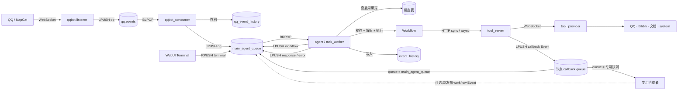

# AAgent 功能全景

> 类型:审计报告（分节草稿）。
> 性质:现行文档。
> 归属:跨服务。
> 适用版本:平台 `4.0.0+`。

> 本文档由**代码级审计**产出：逐文件通读 `agent/`、`webui_py/`、`manager_webui/`、`workflow_editor/`、`tool_server/`、`tool_provider/`、`qqbot/`、`qqbot_consumer/` 与部署配置，把每一个功能、每一个 API、每一个按钮与交互、每一个配置项、每一处可插拔边界逐条登记。
>
> 原则：**以源码为准**。凡与 `docs/` 下的设计文档冲突，本文档记录代码事实，并在第七章登记漂移。引用一律给出 `文件路径:行号`。
>
> 生成方式：分七个领域并行审计后合并；每个领域独立成章，可单独阅读。

---

## 阅读指南

| 你想知道 | 直接看 |
| --- | --- |
| 这个系统到底有哪些进程、怎么连起来 | 第 0.2 节 服务拓扑 · 第 06 章 事件源适配器与基础设施 |
| 一条消息从进入到出结果走了什么路 | 第 0.3 节 端到端数据流 |
| Workflow 能编排哪些节点、端口怎么连 | 第 0.4 节 节点与端口能力矩阵 · 第 04 章 Workflow 编辑器 |
| 每个页面有哪些按钮、点了会发生什么 | 第 02 章（:8081）· 第 03 章（:8084）· 第 04 章（:8082）· 第 05 章 控制台控件表 |
| 怎么接一个新的聊天平台 / 新事件源 | 第 06 章 扩展槽 · 第 0.4 节事件信封 · 第 08 章 §8.4 |
| 怎么加一个新工具 | 第 05 章 扩展槽（E2）· `tool_provider/README.md` |
| 怎么加一种新节点类型 | 第 01 章 扩展槽 · 第 04 章 扩展槽（**前后端各要注册一次**） |
| 跨子系统的坑（"前端能造、后端必崩"那一类） | **第 08 章 跨章交叉发现** |
| 项目还有哪些没做完、有哪些已知坑 | 第 07 章 未实现与路线图全表（82 项） |
| 哪些文档已经过期、不能信 | 第 07 章 文档与实现漂移 · 第 08 章 §8.8 |

### 文档结构

| 章 | 覆盖范围 | 源码根 |
| --- | --- | --- |
| 0 | 概述、服务拓扑、端到端数据流、节点与端口能力矩阵、术语表 | 全局 |
| 1 | Agent 运行时：Workflow 校验/解析/执行、节点实现、契约、仓库、LLM | `agent/` |
| 2 | Agent WebUI：事件流、终端、事件绑定 | `webui_py/` |
| 3 | 管理 WebUI：Workflow、文档、模型、Session、事件目录 | `manager_webui/` |
| 4 | Workflow 可视化编辑器：画布、连线、Inspector、序列化 | `workflow_editor/` |
| 5 | 工具平台：Tool Server 注册/调用/任务/回调 + Provider 与内置工具 | `tool_server/`、`tool_provider/` |
| 6 | 事件源适配器（QQ / OneBot）与部署配置、环境变量、存储键 | `qqbot/`、`qqbot_consumer/`、compose |
| 7 | 设计目标态、未实现项（82）、显式扩展槽清单（67）、文档漂移 | `docs/` |
| 8 | **跨章交叉发现**：经父代理逐行复核的跨子系统缺陷 | 全局 |

---

## 0.1 系统定位

以 **事件驱动 + Workflow 画布** 为中心的个人 Agent 平台。三类横向扩展轴：

| 轴 | 扩展对象 | 对接契约 | 是否需要改执行器 |
| --- | --- | --- | --- |
| 输入 | 事件源适配器 | 产出标准 Event 写入主队列 | 否 |
| 编排 | Workflow 节点 | `agent/workflow_contract.py` 的节点/端口/类型表 | 是（新增节点类型） |
| 能力 | Tool Provider / 工具 | Tool Server 注册协议 | 否 |

QQ 与 WebUI Terminal 只是当前已实现的两个事件源；`README.md:10` 明确它们不是系统入口的固定边界。

## 0.2 服务拓扑

| 服务 | 端口 | 入口文件 | 角色 | 有状态 |
| --- | --- | --- | --- | --- |
| `webui_py` | 8081 | `webui_py/main.py` | Agent WebUI：事件流 / 终端 / 事件绑定 | 否（读写 Redis+Mongo） |
| `workflow_editor` | 8082 | `workflow_editor/main.py` | Workflow 可视化编辑器，只导出 JSON | 否（无持久化） |
| `tool_server` | 8083 | `tool_server/main.py` | 工具注册、调用、任务状态、回调投递 | 是（Redis + Mongo） |
| `manager_webui` | 8084 | `manager_webui/main.py` | 管理面：Workflow / 文档 / 模型 / Session / 事件目录 | 否（读写 Mongo） |
| `agent` | — | `agent/task_worker.py` | 主队列消费者，Workflow 执行器 | 是（Mongo 历史） |
| `qqbot` | — | `qqbot/listener.py` | OneBot WebSocket 接入 → QQ 队列 | 否 |
| `qqbot_consumer` | — | `qqbot_consumer/queue_consumer.py` | QQ 事件存档 → 筛选转发主队列 | 是（Mongo） |
| `tool_provider` | — | `tool_provider/main.py` | 工具实际执行方，WebSocket 注册到 Tool Server | 否 |
| `redis` / `mongodb` | dev 下暴露 | — | 队列与存储 | 是 |

## 0.3 端到端数据流



### 队列方向与顺序（`docs/20-Event协议与流转.md:29-53`）

| 队列 | 默认键名 | 入队 | 出队 | 实际顺序 |
| --- | --- | --- | --- | --- |
| QQ 输入队列 | `qq:events` | `LPUSH` | `BLPOP` | **LIFO**，后到先处理 |
| 主队列 · 普通 | `main_agent_queue` | `LPUSH` | `BRPOP` | **FIFO** |
| 主队列 · 终端入队 | `main_agent_queue` | `RPUSH` | `BRPOP` | **插队**，当前任务结束后优先取出 |
| 回调队列 | 由节点 `callback.queue` 指定，**可以就是 `main_agent_queue`** | `LPUSH` | 主 worker `BRPOP`（配绑定）或专用消费者 `BLPOP` | 视队列而定 |

四个容易踩的点：

1. `qq:events` 是 LIFO 不是 FIFO（`README.md:94`、`docs/20-Event协议与流转.md:39`）。
2. Terminal 的 `terminal` Event 有插队优先级，但它派生出的 `workflow` Event 走普通 `LPUSH`，**不继承**该优先级（`docs/20-Event协议与流转.md:284`）。
3. 异步工具回调**可以**写 `main_agent_queue`：给 `async_result` 建一条启用绑定，主 worker 的通用绑定路由就会把它变成 `workflow` 事件（`agent/task_worker.py:46-53`），**不需要新容器**；节点侧把 `callback.queue` 设为 `main_agent_queue` 即可（`tool_server/main.py:57,141`）。
   > `README.md:98`、`docs/20-Event协议与流转.md:247` 的"不能写主队列"是旧架构残留，详见成稿 §8.15。
4. 只有当你**确实要另起一个消费者**时，才必须换队列（`agent` 用 `BRPOP` 占着主队列，`agent/queue_client.py:65`）。

### Event 类型表（`docs/20-Event协议与流转.md:68-80`）

| `event_type` | 生产者 | 消费者 | 作用 | 参与绑定路由 |
| --- | --- | --- | --- | --- |
| `qq` | QQ listener（经 consumer 筛选） | 主 worker | 命中绑定时透传 payload 并发布 `workflow` | 是 |
| `terminal` | WebUI `POST /api/terminal` | 主 worker | 同上 | 是 |
| `workflow` | 主 worker 绑定路由 | 主 worker | 按 `payload.workflow_id` 执行 Workflow | 否（内部） |
| `response` | `workflow` handler | 主 worker | 最终输出写历史 + 终端历史接口 | **是**（见成稿 §8.7） |
| `error` | `workflow` handler | 主 worker | 目标 Workflow 不存在时记错误 | **是**（同上，见成稿 §8.7） |
| `async_result` | Tool Server callback | 主 worker（需一条启用绑定）或专用消费者 | 异步工具终态通知 | **是** |
| `raw` | WebUI 展示层 | — | **仅展示用**，无法解析为 JSON 对象时的包装类型，不是 worker 协议 | 否 |

Event 信封（`docs/20-Event协议与流转.md:13-27`）：

```json
{"event_type": "workflow", "payload": {"workflow_id": "..."}}
```

- `event_type` 决定主 worker 调用哪个 handler；`payload` 承载数据。
- 出队后主 worker **复制** Event、追加 UTC `created_at`，再写 MongoDB（Mongo 自动生成 `_id`）。
- `terminal` 生产者额外写顶层 `time`，主 worker 不读它。
- **未绑定的 Event 只写历史，不发布后续 Event**；绑定查询出错算处理错误，不算未绑定。

## 0.4 节点与端口能力矩阵

> 唯一权威来源：`agent/workflow_contract.py`。前端 `workflow_editor/static/workflow/domain/node-contract.js:9-26` 维护同一份清单。

### 数据类型（`agent/workflow_contract.py:8-16`）

`content` · `message` · `event` · `list-content` · `list-message` · `list-event` · `map-content`

`list-*` 由 `list_type_for_item()`（`workflow_contract.py:88-89`）按 `item_type` 动态拼出；列表节点的 `item_type` 决定它实际能连哪条 `list-*` 边。

### 24 种节点

| # | 节点 type | 控制入 | 控制出 | 数据入 | 数据出 | 私有参数 |
| --- | --- | --- | --- | --- | --- | --- |
| 1 | `input` | — | `control-out` | — | `workflow:<边界端口>` | — |
| 2 | `output` | `control-in` | — | `workflow:<边界端口>` | — | — |
| 3 | `router` | `control-in` | 每个 `branches[].id` | `content-in` | — | `branches` |
| 4 | `llm` | `control-in` | `control-out` | `messages-in` | `output` (+`reasoning`、`tool_calls`) | `model` `think` `tool_calls` `tools` |
| 5 | `construct_message` | `control-in` | `control-out` | `content-in` (+`role-in`) | `message-out` | `role` `role_source` |
| 6 | `construct_content` | `control-in` | `control-out` | 声明的 `dataInputPorts` | `content-out` | `append_items` |
| 7 | `construct_map_content` | `control-in` | `control-out` | 声明的 `dataInputPorts` | `map-out` | `mappings` |
| 8 | `map_content_get` | `control-in` | `control-out` | `map-in` `key-in` | `content-out` | — |
| 9 | `split_event` | `control-in` | `control-out` | `event-in` | `type-out` `payload-out` | — |
| 10 | `deserialize_json` | `control-in` | `control-out` | `content-in` | 每个 `outputs[].key` | `outputs` |
| 11 | `construct_list` | `control-in` | `control-out` | 声明的 `dataInputPorts` | `list-out` | `item_type` `initial_value_count` |
| 12 | `list_append` | `control-in` | `control-out` | `list-in` `item-in` | `list-out` | `item_type` `position` |
| 13 | `foreach` | `control-in` `loop-in` | `control-out` `loop-out` | `list-in` | `item-out` | `item_type` |
| 14 | `history` | `control-in` | `control-out` | 声明的 `dataInputPorts` | `events` | `event_types` `limit` |
| 15 | `local_tool` | `control-in` | `control-out` | 参数名同名端口 | `output` | `tool` `parameters` |
| 16 | `remote_sync_tool` | `control-in` | `control-out` | 参数名同名端口 | 每个 `outputs[].name` | `tool` `parameters` `outputs` `timeout_ms` |
| 17 | `remote_async_tool` | `control-in` | `control-out` | 参数名同名端口 | `task_id` | `tool` `parameters` `timeout_ms` `callback` |
| 18 | `context_create` | `control-in` | `control-out` | `initial-value` | `context-id` | `value_type` |
| 19 | `context_read` | `control-in` | `control-out` | `context-id` | `value-out` | `value_type` |
| 20 | `context_write` | `control-in` | `control-out` | `context-id` `value-in` | `context-id` `value-out` | `value_type` |
| 21 | `session_create` | `control-in` | `control-out` | `initial-value` | `session-id` | `value_type` |
| 22 | `session_read` | `control-in` | `control-out` | `session-id` | `value-out` | `value_type` |
| 23 | `session_write` | `control-in` | `control-out` | `session-id` `value-in` | `session-id` `value-out` | `value_type` |
| 24 | `workflow` | `control-in` | `control-out` | `workflow:<input_ports>` | `workflow:<output_ports>` | `workflow_name` |

`foreach` 是唯一有**两个控制入 / 两个控制出**的节点：`control-*` 走顺序，`loop-*` 走迭代回边（`workflow_contract.py:226-227`），这是画布上唯一合法的成环写法。

### 节点通用字段（`workflow_contract.py:44-50`）

- 基础字段：`id` `type` `name` `x` `y` `arguments`
- 共享字段：`workflowPorts` `dataInputPorts` `input_ports` `output_ports`

### 连接合法性

后端在 `is_valid_connection()`（`workflow_contract.py:231-354`）逐条判定，前端在 `connection-rules.js` 维护等价规则。语义要点：

1. 控制边与数据边是两套端口集合，`connection_type == "control"` 时只查控制端口（`:251-254`）。
2. 数据边类型必须落在 7 种 `DATA_CONNECTION_TYPES`（`:255-256`）。
3. **边界端口强类型**：`input` 节点出、`output` 节点入、`workflow` 子节点两端的边类型必须等于该边界端口声明的 `type`（`:261-276`）。
4. **工具节点参数化类型**：工具入参端口名 = 参数名，边类型必须等于 `parameters[].type`；出参同理查 `outputs[].type`（`:277-280`）。
5. **Context/Session 值类型**：`value_type` 决定 `value-in` / `initial-value` / `value-out` 的边类型；`context-id` 与 `session-id` 恒为 `content`（`:281-293`）。
6. **列表族**：`construct_list` / `list_append` / `foreach` 的边类型由 `item_type` 动态推导（`:334-351`）。
7. **LLM 特例**：`tool_calls` 出边必须是 `list-content`（`:352`）。

> 任一步抛 `KeyError` / `StopIteration` / `TypeError` 都直接判非法连接（`:353-354`）——即"模型里缺字段"表现为"连不上线"，而不是崩溃。

---

## 0.5 术语表

| 术语 | 含义 |
| --- | --- |
| Event | 队列里的标准消息单元，含 `event_type` 与 `payload` |
| 主队列 | `main_agent_queue`，agent 的唯一输入 |
| Handler | agent 内按 `event_type` 分发的处理函数 |
| Workflow | 画布导出的 JSON 图，绑定到事件后执行 |
| 绑定 | 事件类型 → Workflow 的映射，由 WebUI 维护 |
| Context | Workflow 内可变状态，Redis 承载，随执行生命周期 |
| Session | 跨 Workflow 持久状态，可被多个 Workflow 读写 |
| Tool Server | 工具注册与调用中心，负责等待、状态与回调 |
| Provider | 工具的实际执行方，WebSocket 注册到 Tool Server |
| 回调 / callback | 异步工具终态后由 Tool Server 投递的事件 |
| 扩展槽 | 代码中预留或天然存在的可插拔接缝（本文档第 8 章） |
