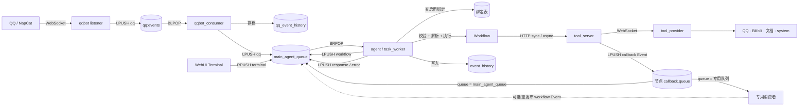

# 平台架构总览

> 类型:设计文档。
> 性质:历史快照（旧设计，已不代表当前行为，只用于追溯）。
> 归属:—。
> 适用版本:平台 `4.0.0-4.0.4`。

本文是 AAgent 平台**当前架构**的权威说明：有哪些进程、怎么连起来、数据怎么流、能编排什么、可以从哪扩展。版本号规则见 [版本控制](../版本控制.md) 与 [版本与归属规范](../版本与归属规范.md)；逐文件、逐 API、逐按钮的代码级清点见 [功能全景](../功能全景/AAgent-功能全景.md)。

## 1. 系统定位

以 **事件驱动 + Workflow 画布** 为中心的个人 Agent 平台。

- **事件驱动**：所有输入都是一条 Event，投进 Redis 队列；执行器是队列消费者，不是 HTTP 服务。
- **Workflow 画布**：编排逻辑是一张有向图（JSON），在独立编辑器里画、在管理页上传、由执行器解释执行。
- **三根横向扩展轴**：

| 轴 | 扩展对象 | 对接契约 | 要改执行器吗 |
|---|---|---|---|
| 输入 | 事件源适配器（QQ / Terminal / …） | 产出标准 Event 写入主队列 | 否 |
| 编排 | Workflow 节点 | `agent/workflow_contract.py` 的节点 / 端口 / 类型表 | 是（新增节点类型） |
| 能力 | Tool Provider / 工具 | Tool Server 注册协议 | 否 |

QQ 与 WebUI Terminal 只是当前已实现的两个事件源，不是系统入口的固定边界。

## 2. 服务拓扑

九个服务进程 + 两个基础组件（`docker-compose.yml`）：

| 服务 | 端口 | 入口 | 角色 | 有状态 |
|---|---|---|---|---|
| `webui_py` | 8081 | `webui_py/main.py` | Agent WebUI：事件流 / 终端 / 事件绑定 | 否（读写 Redis + Mongo） |
| `workflow_editor` | 8082 | `workflow_editor/main.py` | Workflow 可视化编辑器，只导出 JSON | 否（无持久化） |
| `tool_server` | 8083 | `tool_server/main.py` | 工具注册、调用、任务状态、回调投递 | 是（Redis + Mongo） |
| `manager_webui` | 8084 | `manager_webui/main.py` | 管理面：Workflow / 文档 / 模型 / Session / 事件目录 | 否（读写 Mongo） |
| `agent` | — | `agent/task_worker.py` | 主队列消费者，Workflow 执行器 | 是（Mongo 历史） |
| `qqbot` | — | `qqbot/listener.py` | OneBot WebSocket 接入 → QQ 队列 | 否 |
| `qqbot_consumer` | — | `qqbot_consumer/queue_consumer.py` | QQ 事件存档 → 筛选转发主队列 | 是（Mongo） |
| `tool_provider` | — | `tool_provider/main.py` | 工具实际执行方，WebSocket 注册到 Tool Server | 否 |
| `redis` | dev 暴露 | `redis:7-alpine` | 队列、状态键、Context、工具注册表 | 是 |
| `mongodb` | dev 暴露 | `mongo:8` | 历史、定义、绑定、文档、模型、Session、工具任务日志 | 是 |

`agent` / `qqbot` / `qqbot_consumer` / `tool_provider` 不监听 HTTP 端口；四个 Web 服务（8081–8084）都在 `GET /api/health` 上有健康检查。

## 3. 端到端数据流

### 队列方向与顺序

| 队列 | 默认键名 | 入队 | 出队 | 实际顺序 |
|---|---|---|---|---|
| QQ 输入队列 | `qq:events` | `LPUSH` | `BLPOP` | **LIFO**，后到先处理 |
| 主队列 · 普通 | `main_agent_queue` | `LPUSH` | `BRPOP` | **FIFO** |
| 主队列 · 终端入队 | `main_agent_queue` | `RPUSH` | `BRPOP` | **插队**，当前任务结束后优先取出 |
| 回调队列 | 由节点 `callback.queue` 指定，可以就是 `main_agent_queue` | `LPUSH` | 主 worker `BRPOP`（配绑定）或专用消费者 `BLPOP` | 视队列而定 |

**Event 信封**：`{"event_type": "...", "payload": {...}}`。`event_type` 决定主 worker 调用哪个 handler，`payload` 承载数据。已有类型：`qq` / `terminal` / `workflow` / `response` / `error` / `async_result`（另有纯展示用的 `raw`）。协议正文见 [20-Event协议与流转](20-Event协议与流转.md)。

## 4. 存储

| 载体 | 用途 |
|---|---|
| **Redis** | 主队列与 QQ 队列、worker 状态键（`aagent:worker:status`）、Workflow Context（运行期可变状态）、本地工具注册表（`aagent:tools`） |
| **MongoDB** | 事件历史（`event_history` / `qq_event_history`）、Workflow 定义（`workflows`）、事件绑定（`event_bindings`）、文档（`documents`）、模型（`models`）、Session（`sessions`）、Tool Server 任务与日志（`tool_task_logs`） |

## 5. 可编排能力（节点与端口）

唯一权威来源是 `agent/workflow_contract.py`（编辑器侧 `workflow_editor/static/workflow/domain/node-contract.js` 维护同一份清单）。共 **24 种节点**、**7 种数据类型**。

| 类别 | 节点 |
|---|---|
| 边界 | `input` · `output` |
| 控制 | `router` · `foreach` |
| 模型 | `llm` |
| 数据构造 | `construct_message` · `construct_content` · `construct_map_content` · `map_content_get` · `construct_list` · `list_append` · `deserialize_json` · `split_event` · `history` |
| 工具 | `local_tool` · `remote_sync_tool` · `remote_async_tool` |
| 状态 | `context_create` · `context_read` · `context_write` · `session_create` · `session_read` · `session_write` |
| 调用 | `workflow`（调用另一个 Workflow） |

数据类型：`content` · `message` · `event` · `list-content` · `list-message` · `list-event` · `map-content`。

工作流**允许控制流成环**：唯一合法的成环写法是 `foreach` 的 `control-*`（顺序）与 `loop-*`（迭代回边）两组端口。完整端口矩阵与连接合法性规则见 [功能全景 §0.4](../功能全景/AAgent-功能全景.md)。

## 6. 版本号（三层）

| 层 | 当前值 | 载体 | 规则 |
|---|---|---|---|
| **平台版本** | `4.0.0` | `version.json` 的 `platform` + git tag（标签正文即发布记录） | [规范 §2](../版本与归属规范.md) |
| **协议版本** | `event` 1.0 / `workflow` 1.0 | `version.json` 的 `protocol` + 对应设计文档元信息头 | `MAJOR.MINOR`（[规范 §3](../版本与归属规范.md)） |
| **服务版本** | 8 个服务全部跟随平台 `4.0.0` | `version.json` 的 `services` + 各服务目录的 `version.json` | 默认跟随平台（[规范 §4](../版本与归属规范.md)） |

## 7. 与其它文档的关系

| 想知道 | 看 |
|---|---|
| 这一代引擎长什么样（本文） | 本文件 |
| 某个文件、API、按钮具体做什么 | [AAgent-功能全景](../功能全景/AAgent-功能全景.md) |
| 版本号怎么定、改了代码该更新哪些文档 | [版本与归属规范](../版本与归属规范.md) |
| 现在还有哪些问题没修 | [问题清单 4.0.5a](../review/4_0_5a.md) |
| Event 协议正文 | [20-Event协议与流转](20-Event协议与流转.md) |
